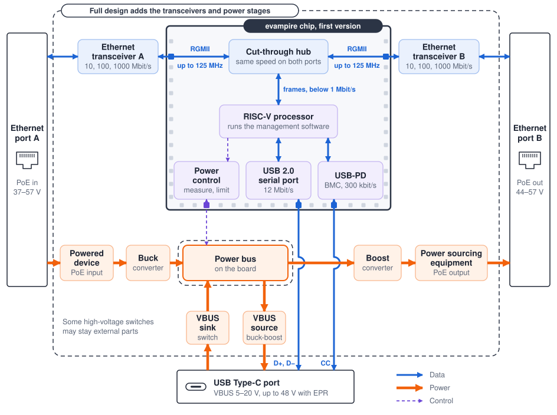

evampire
========

evampire is an integrated circuit for the `GlobalFoundries 180 nm MCU
(gf180mcu) <https://gf180mcu-pdk.readthedocs.io/>`_ process, manufactured
through `wafer.space <https://wafer.space/>`_. It is a three-port gigabit
:wikipedia:`Ethernet` hub with a small :wikipedia:`RISC-V` processor that
also moves power between
:wikipedia:`Power over Ethernet <Power_over_Ethernet>` and
:wikipedia:`USB Type-C <USB-C>`.

The chip passes traffic straight through between two Ethernet ports,
except for a few kinds of frame listed in
:ref:`the forwarding requirements <req-forwarding>`. The
processor receives selected frames from either port and sends frames of its
own. A
board built around evampire can be powered over Ethernet and supply power
over USB Type-C, or the other way around.

:numref:`fig-overview` shows the main blocks of evampire and how data and
power flow between them.

         Ethernet port A, Ethernet transceiver A, the cut-through hub,
         Ethernet transceiver B and Ethernet port B. Each transceiver is
         labelled 10, 100, 1000 Mbit/s, the hub same speed on both ports,
         and each link between a transceiver and the hub RGMII, up to
         125 MHz. The hub
         passes frames, below 1 Mbit/s, to and from the RISC-V processor
         below it. The processor connects to three blocks: power control
         (measure, limit), the USB 2.0 serial port (12 Mbit/s) and USB-PD
         (BMC, 300 kbit/s). The serial port connects straight down to the USB
         Type-C port over the D+ and D− wires, and USB-PD over the CC wire;
         both hop over the power row. Power control connects to the power
         bus. Power runs in a straight line along the bottom, from
         Ethernet port A (PoE in, 37–57 V) through the powered device and
         buck converter to the power bus on the board. From the bus it runs
         through the boost converter and power sourcing equipment to
         Ethernet port B (PoE out, 44–57 V). Below the bus, power comes up from the USB Type-C port
         through the VBUS sink switch, and goes down to it through the VBUS
         source buck-boost converter. The USB Type-C port is labelled VBUS
         5–20 V, up to 48 V with EPR. The first-version chip is drawn as a
         die with a ring of bond pads around the hub, processor, power
         control, serial port and USB-PD; coloured pads mark the RGMII links,
         the USB wires and the power control signals that leave it. A dashed
         outline that also includes both Ethernet transceivers and all the
         power stages marks the chip in the full design, with a note that
         some high-voltage switches may stay external parts. The outline has
         a hole around the power bus, which stays on the board.
   :align: center

   The main blocks of evampire. Data flows along the top row and power along
   the bottom row, each from Ethernet port A to port B. The first-version
   chip is drawn as a die, where a coloured pad marks each signal that leaves
   it, and the dashed outline is the chip in the full design. The power bus
   stays on the board.

The two chip outlines are the two board configurations of
:numref:`tab-power-board-configs`. The first version connects to separate
Ethernet transceiver chips over RGMII and uses external power stages. The
full design builds the transceivers and the power stages into evampire,
except possibly some high-voltage switches
(:ref:`requirements-open-questions`). Both ports run at the same speed, 10,
100 or 1000 Mbit/s, because forwarding is cut-through (see
:ref:`the forwarding requirements <req-forwarding>`).
The figure shows the power roles and the single USB Type-C port of the
first version: port A receives power and port B supplies it.

The labels use two abbreviations. USB Power Delivery messages on the :term:`CC` wire use
:term:`biphase mark coding <Biphase mark coding>` (BMC). :term:`EPR` is the
extended power range of USB Power Delivery.

This documentation describes what the chip does and explains the Ethernet
and power-delivery standards that evampire implements. It is written for
readers who are familiar with digital and analogue integrated circuit design
but not with the Ethernet or USB Power Delivery standards.

:doc:`overview`
   What evampire does, in outline.
:doc:`requirements`
   Every requirement the design meets, and the questions still open.
:doc:`architecture/index`
   The blocks inside evampire and how frames move between them.
:doc:`ethernet/index`
   The Ethernet interfaces, from the chip's pins to the cable.
:doc:`power/index`
   How power moves between Power over Ethernet and USB Type-C, and the
   board configurations.
:doc:`usb-serial/index`
   The USB serial port carried on the USB Type-C data wires.
:doc:`esd/index`
   How the gf180mcu I/O cells protect the pins against electrostatic
   discharge, with simulations of the foundry's cells.
:doc:`standards`
   The standards that the pages cite, with links to each.
:doc:`glossary`
   The terms used in this documentation, in alphabetical order.

.. toctree::
   :maxdepth: 2
   :caption: Contents
   :hidden:

   overview
   requirements
   architecture/index
   ethernet/index
   power/index
   usb-serial/index
   esd/index
   standards
   glossary
