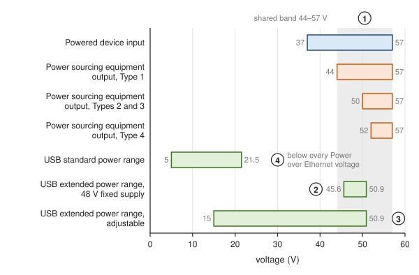

Converter arrangement
=====================

This page sets out the voltages and currents that evampire's three converter
functions must handle in each operating mode (:ref:`power-modes`), where
the Power over Ethernet and USB Power Delivery ranges overlap, and the ways
of arranging converters to cover them. The arrangement is an open decision;
this page compares the options and lists what would decide between them.

The three conversions
---------------------

The board's maximum power is not fixed (:ref:`requirements`), so the
tables cover every Power over Ethernet type and every USB Power Delivery
range. All values come from the standards as summarised on :doc:`../poe/index`
and :doc:`../usb-pd/index`, and the currents are the power divided by the lowest
voltage at which that power is allowed.

Input converter: Power over Ethernet in
   Takes the powered device input, after the powered device front end, to
   the board's power bus (:ref:`power-flow`). Its input current is largest
   at the lowest input voltage (:numref:`tab-conv-input-ranges`).

.. list-table:: Input converter: powered device input by type
   :name: tab-conv-input-ranges
   :header-rows: 1
   :widths: 14 22 22 22 20

   * - Type
     - Most power at the powered device (W)
     - Lowest input voltage (V)
     - Highest input voltage (V)
     - Largest input current (A)
   * - 1
     - 13.0
     - 37.0
     - 57
     - 0.351
   * - 2
     - 25.5
     - 42.5
     - 57
     - 0.600
   * - 3
     - 51.0
     - 42.5
     - 57
     - 1.200
   * - 4
     - 71.3
     - 41.2
     - 57
     - 1.731

Power and voltages: :clause:`33` and :clause:`145`, as tabulated on
:doc:`../poe/index`. The current is the power divided by the lowest voltage.

High-voltage converter: Power over Ethernet out
   Produces the power sourcing equipment voltage from the bus. The
   standard fixes a voltage window for each type; its output current is
   largest at the bottom of the window (:numref:`tab-conv-hv-ranges`).

.. list-table:: High-voltage converter: power sourcing equipment output by type
   :name: tab-conv-hv-ranges
   :header-rows: 1
   :widths: 14 22 22 22 20

   * - Type
     - Most power at the output (W)
     - Lowest output voltage (V)
     - Highest output voltage (V)
     - Largest output current (A)
   * - 1
     - 15.4
     - 44
     - 57
     - 0.350
   * - 2
     - 30
     - 50
     - 57
     - 0.600
   * - 3
     - 60
     - 50
     - 57
     - 1.200
   * - 4
     - 90
     - 52
     - 57
     - 1.731

Voltages: [CONV-EA-BT]_ (Table 15); power: :clause:`145` as tabulated on
:doc:`../poe/index`.

USB converter: USB Power Delivery out, and in
   As a source it produces the negotiated VBUS voltage (VBUS is the USB
   power wire). As a sink the same port delivers the negotiated voltage to
   the board. Both directions span the same range
   (:numref:`tab-conv-usb-ranges`).

.. list-table:: USB Type-C port voltage and current in each USB Power Delivery range
   :name: tab-conv-usb-ranges
   :header-rows: 1
   :widths: 34 26 20 20

   * - Supply
     - Voltage (V)
     - Current (A)
     - Power (W)
   * - Standard, fixed
     - 5, 9, 15 or 20
     - 3 or 5
     - 100
   * - Standard, programmable
     - 5 to 21
     - 3 or 5
     - 100
   * - Standard, adjustable
     - 9 to 20
     - 3 or 5
     - 100
   * - Extended, fixed
     - 28, 36 or 48
     - 5
     - 240
   * - Extended, adjustable
     - 15 to 48
     - 5
     - 240

"Standard" and "extended" are the standard and extended power ranges.
The programmable
supply moves in 20 mV steps and the adjustable supplies in 100 mV steps;
5 A needs a cable rated for it, and the standard range offers it only at 20 V.

Source: :pd:`Table 3.1`, :pd:`Table 4.2`, :pd:`Table 4.7` and
:pd:`Section 3.2.5.3`, as described on :doc:`../usb-pd/index`. A fixed supply may
be 5 % above its nominal voltage and VBUS may rise another 0.5 V during
changes, giving 21.5 V and 50.9 V.

Overlapping voltage ranges
--------------------------

:numref:`tab-conv-overlap` lists the ranges and :numref:`fig-conv-ranges`
draws them on one voltage axis.

.. list-table:: Voltage ranges at each kind of port
   :name: tab-conv-overlap
   :header-rows: 1
   :widths: 46 27 27

   * - Port and role
     - Lowest (V)
     - Highest (V)
   * - Powered device input (Power over Ethernet in)
     - 37
     - 57
   * - Power sourcing equipment output, Type 1
     - 44
     - 57
   * - Power sourcing equipment output, Types 2 and 3
     - 50
     - 57
   * - Power sourcing equipment output, Type 4
     - 52
     - 57
   * - USB, standard power range
     - 5
     - 21.5
   * - USB, extended power range, 48 V fixed supply
     - 45.6
     - 50.9
   * - USB, extended power range, adjustable
     - 15
     - 50.9

         to 57 V; power sourcing equipment output 44 V to 57 V for Type 1,
         50 V to 57 V for Types 2 and 3, and 52 V to 57 V for Type 4; USB
         standard power range 5 V to 21.5 V; USB extended power range 48 V
         fixed supply 45.6 V to 50.9 V; USB extended power range adjustable
         15 V to 50.9 V. A grey band from 44 V to 57 V marks the shared
         band. Circled numbers 1 to 4 mark the four overlaps listed in the
         text.
   :align: center

   Voltage ranges at each kind of port, with the four overlaps numbered as
   in the list below.

Four overlaps follow from them:

#. The powered device input and every power sourcing equipment output share
   the band from 44 V (Type 1) or 52 V (Type 4) up to 57 V. An input above
   the output's minimum could be passed straight through; an input below
   it must be raised.
#. A 48 V extended power range USB supply (45.6 V to 50.4 V, plus 0.5 V
   during changes) lies inside the powered device input range, and above
   the Type 1 power sourcing equipment minimum of 44 V. It is below the
   50 V minimum of Types 2 and 3.
#. The adjustable extended power range reaches 48 V, so a USB sink can ask
   for a voltage close to the Power over Ethernet band.
#. The standard power range, 5 V to 21.5 V, is entirely below every Power
   over Ethernet voltage. Conversions between it and Power over Ethernet
   only ever step down (Ethernet in, USB out) or up (USB in, Ethernet out).

A converter that goes from the Power over Ethernet input to a 48 V USB
output has to step up at some inputs and down at others
(:numref:`tab-conv-four-switch-modes`).

Arrangements
------------

Three separate converters
~~~~~~~~~~~~~~~~~~~~~~~~~

The arrangement in :ref:`power-flow`: an input converter (a buck or an
isolated flyback) from the Power over Ethernet input to the bus; a
four-switch buck-boost from the bus to the USB port; a boost from the bus to
the power sourcing equipment port. When the USB port is a sink, a switch
connects VBUS to the bus, so the bus then follows the negotiated USB
voltage (:numref:`fig-conv-separate`).

.. graphviz:: separate.dot
   :name: fig-conv-separate
   :caption: Three separate converters around a power bus.
   :alt: Block diagram: Ethernet port A feeds an input converter, a buck or
         flyback, which feeds the power bus, whose voltage is open. The bus
         feeds the board supplies, a boost converter to Ethernet port B's
         power sourcing equipment switch, and a four-switch buck-boost to
         the USB Type-C port of 5 V to 48 V. A dashed path from the USB port
         through a VBUS switch, on when the USB port is a sink, feeds the
         bus.
   :align: center

* Each converter is designed for one job and one direction.
* "Ethernet in, USB out" passes through two converters (input, then USB),
  and "Ethernet in, Ethernet out" through two (input, then high-voltage).
* The bus voltage is a free choice in Power over Ethernet modes. A bus at
  12 V or 20 V keeps the board supplies simple; a bus nearer the USB
  output lowers the USB converter's ratio.
* The boost converter must reach 54 V from whatever USB voltage the sink
  negotiated, a gain of up to 10.8 from 5 V (:numref:`tab-conv-boost-duty`).

One bidirectional four-switch converter
~~~~~~~~~~~~~~~~~~~~~~~~~~~~~~~~~~~~~~~

.. graphviz:: shared.dot
   :name: fig-conv-shared
   :caption: One bidirectional four-switch buck-boost converter between the
             Ethernet side and the USB Type-C port.
   :alt: Block diagram: Ethernet port A feeds an Ethernet-side node of 37 V
         to 57 V, which feeds Ethernet port B and the board supplies. A
         bidirectional four-switch buck-boost converter connects the
         Ethernet-side node to the USB Type-C port, carrying power in either
         direction.
   :align: center

The four-switch converter of :doc:`buck-boost` is symmetric and can carry
power either way. Placed between an Ethernet-side node and the USB port
(:numref:`fig-conv-shared`), one converter covers both cross-standard
modes:

* "Ethernet in, USB out": power flows from the powered device input to
  VBUS, stepping down for the standard power range and up or down for
  48 V.
* "USB in, Ethernet out": power flows from VBUS to the Ethernet-side node,
  which the converter regulates to the power sourcing equipment voltage.
* "Ethernet in, Ethernet out": the converter is idle and the two Ethernet
  ports are joined through switches. The output then follows the input
  (:ref:`conv-pass-through`). Adding selection switches that connect the
  converter between port A and port B instead would regulate this mode
  too, at the cost of more series switches.

Each mode passes through one converter. The converter handles one
conversion at a time, so the full design, with two USB Type-C ports
(:ref:`power-board-configs`), needs one converter per port or a converter
with more than one output (:ref:`conv-alternatives`). For reference, the
LM5177 is a bidirectional four-switch controller from 3.5 V to 60 V that
lists Power over Ethernet routers among its applications
[CONV-LM5177]_ (Features, Applications).

High-voltage power bus
~~~~~~~~~~~~~~~~~~~~~~

.. graphviz:: high-bus.dot
   :name: fig-conv-high-bus
   :caption: A power bus near the Power over Ethernet voltage, with
             pass-through connections to both Ethernet ports.
   :alt: Block diagram: Ethernet port A feeds a power bus of about 37 V to
         57 V directly. The bus feeds Ethernet port B directly or through an
         optional regulator, feeds the board supplies, and connects through
         a bidirectional buck or buck-boost converter to the USB Type-C
         port.
   :align: center

The bus can be chosen so that some conversions disappear
(:numref:`fig-conv-high-bus`):

* With Power over Ethernet in, the powered device input is the bus, 37 V to
  57 V, with no input converter.
* With USB in, the USB converter regulates the bus, for example to 54 V,
  and the power sourcing equipment switch connects it to port B: one
  conversion.
* With Ethernet in and Ethernet out, the bus passes to port B directly
  where its voltage allows (:ref:`conv-pass-through`), or through an
  optional regulator.
* The USB converter always works between the bus (37 V to 57 V) and VBUS.
  If the board only supports the standard power range (VBUS at most
  21.5 V, below the lowest bus voltage of 37 V), it only ever steps down
  towards USB and up towards the bus. A synchronous buck converter run in
  either direction does both, with two switches. Supporting 48 V USB needs
  the four-switch converter, because 48 V can be above or below the bus.
* The board supplies, including evampire's own, come from a bus of up to
  57 V.

.. _conv-pass-through:

Power over Ethernet pass-through
~~~~~~~~~~~~~~~~~~~~~~~~~~~~~~~~

A switch from the powered device input to the power sourcing equipment
output loses only its resistance: an illustrative 0.1 Ω switch at the Type 4
current of 1.731 A loses :math:`1.731^2 \times 0.1 = 0.30` W, 0.3 % of 90 W.
The output voltage is then the input voltage less the switch drops.
:numref:`tab-conv-pass-through` compares the input needed with the lowest
input of the same type, for an illustrative 0.2 V drop.

.. list-table:: Lowest input voltage that a pass-through can pass on
   :name: tab-conv-pass-through
   :header-rows: 1
   :widths: 25 25 25 25

   * - Output type
     - Lowest output voltage (V)
     - Input needed (V)
     - Lowest input of that type (V)
   * - 1
     - 44
     - 44.2
     - 37.0
   * - 2
     - 50
     - 50.2
     - 42.5
   * - 3
     - 50
     - 50.2
     - 42.5
   * - 4
     - 52
     - 52.2
     - 41.2

The input can be anywhere in its range, so a pass-through meets the output
window only when the measured input is high enough. evampire measures the
input voltage (:doc:`first-version`), so software can choose pass-through
when the input allows it and a regulated path otherwise. A linear regulator
is a third choice where the input is slightly above the output:

.. math::

   \eta_\text{lin} = \frac{V_\text{out}}{V_\text{in}} = \frac{52}{54} = 0.963

   P_\text{loss} = (54 - 52) \times 1.731 = 3.46 \ \text{W}

(:doc:`why-switching`), while from 57 V to 44 V the same current would lose
22.5 W.

.. _conv-comparison:

Comparison
~~~~~~~~~~

:numref:`tab-conv-arrangements` counts the parts of each arrangement for the
first-version board (one powered device port, one power sourcing equipment
port, one USB port; :ref:`power-board-configs`). Switches in the powered
device front end and the power sourcing equipment switch are present in
every arrangement and are not counted.

.. list-table:: Converter parts of each arrangement
   :name: tab-conv-arrangements
   :header-rows: 1
   :widths: 50 25 25

   * - Arrangement
     - Converter switches
     - Inductors
   * - Three separate converters
     - 8
     - 3
   * - One bidirectional four-switch converter
     - 4
     - 1
   * - High bus, standard power range USB only
     - 2
     - 1
   * - High bus, extended power range USB
     - 4
     - 1

"High bus" is the arrangement with a power bus near the Power over Ethernet
voltage. :numref:`tab-conv-conversions` counts the conversions that power
passes through in each operating mode.

.. list-table:: Conversions in series in each operating mode
   :name: tab-conv-conversions
   :header-rows: 1
   :widths: 40 20 20 20

   * - Arrangement
     - Ethernet to USB
     - USB to Ethernet
     - Ethernet to Ethernet
   * - Three separate converters
     - 2
     - 1
     - 2
   * - One bidirectional four-switch converter
     - 1
     - 1
     - 0
   * - High bus
     - 1
     - 1
     - 0 or 1

The three-converter count is 2 (input buck) + 4 (USB four-switch) + 2
(boost). A 0 is a pass-through; the "0 or 1" depends on whether the
optional regulator is fitted.
Every switch on the Power over Ethernet side must block 57 V plus
transients; the switches on the USB side block up to 21.5 V or 50.9 V.

.. _conv-efficiency:

Efficiency of each arrangement
~~~~~~~~~~~~~~~~~~~~~~~~~~~~~~

The efficiency :math:`\eta` sets the output power available,
:math:`P_\text{out} = P_\text{in} \times \eta - P_\text{board}`
(:ref:`power-translation`). Converters in series multiply their
efficiencies:

.. math::

   \eta_\text{total} = \prod_{k=1}^{n} \eta_k

where :math:`\eta_k` is the efficiency of the :math:`k`-th conversion and
:math:`n` the number of conversions (:numref:`tab-conv-sym-eff`).

.. list-table:: Symbols for chained efficiency
   :name: tab-conv-sym-eff
   :header-rows: 1
   :widths: 20 60 20

   * - Symbol
     - Meaning
     - Unit
   * - :math:`\eta_k`
     - Efficiency of one conversion
     - fraction
   * - :math:`n`
     - Number of conversions in series
     - none
   * - :math:`\eta_\text{total}`
     - Efficiency of the whole path
     - fraction

evampire's converter efficiencies depend on parts, frequencies and layout
that are open. :numref:`tab-conv-eff-ranges` uses 90 % to 97 % per
conversion as an illustration, taken from the commercial examples on
:doc:`why-switching`, and treats a pass-through as lossless.

.. list-table:: Illustrative path efficiency, 90 % to 97 % per conversion
   :name: tab-conv-eff-ranges
   :header-rows: 1
   :widths: 34 22 22 22

   * - Arrangement
     - Ethernet to USB (%)
     - USB to Ethernet (%)
     - Ethernet to Ethernet (%)
   * - Three separate converters
     - 81.0 to 94.1
     - 90.0 to 97.0
     - 81.0 to 94.1
   * - One bidirectional four-switch converter
     - 90.0 to 97.0
     - 90.0 to 97.0
     - 100 (pass-through)
   * - Bus near the Power over Ethernet voltage
     - 90.0 to 97.0
     - 90.0 to 97.0
     - 100 or 90.0 to 97.0

For a Type 4 input of 71.3 W, one conversion leaves
:math:`P_\text{out} = 64.2` W to 69.2 W minus :math:`P_\text{board}`, and
two conversions 57.8 W to 67.1 W minus :math:`P_\text{board}`. The board's
own consumption :math:`P_\text{board}` is open (:ref:`requirements`), so it
stays a parameter here.

.. _conv-alternatives:

Less common alternatives
------------------------

Some approaches are rare in commercial products at these voltages and
powers. :numref:`tab-conv-alternatives` lists them with the usual reason and
whether that reason applies to evampire.

.. list-table:: Alternatives and whether the usual objection applies
   :name: tab-conv-alternatives
   :header-rows: 1
   :widths: 22 39 39

   * - Approach
     - Usual reason it is avoided
     - For evampire
   * - Switched-capacitor converter or charge pump
     - Efficient only near a fixed ratio; many capacitors at high power
     - Capacitors integrate on chip more readily than inductors; a fixed
       4:1 stage followed by a small regulator fits a narrow input range
   * - Hybrid switched-capacitor and inductor converter
     - More switches and a more complex controller
     - The controller is custom logic in any case
   * - Resonant or soft-switched converter
     - Narrow regulation range; more parts; harder control
     - Lowers switching loss, which matters most if the power transistors
       move on chip with slower switching
   * - Software or fully digital control loop
     - Needs a fast processor and fine timing resolution
     - Software is the preferred place for control (:doc:`first-version`)
   * - Hysteretic or pulse-frequency control
     - Varying frequency spreads noise
     - Fast response with no compensation; usable at light load
   * - Linear regulator
     - Heat when the voltage difference is large
     - Efficient where Power over Ethernet in and out are close
       (:ref:`conv-pass-through`)
   * - Pass-through of the Power over Ethernet voltage
     - The output follows the input
     - evampire measures the input and can choose it per connection
   * - Single inductor, several outputs
     - Outputs interact; complex control
     - Could serve two USB ports from one inductor in the full design

A switched-capacitor ladder divides by a fixed ratio. A 4:1 ladder gives
9.25 V, 12 V and 14.25 V from 37 V, 48 V and 57 V. Followed by a linear
regulator to 9 V its efficiency would be at most 97.3 %, 75.0 % and 63.2 %
at those inputs. A following switching regulator, as in a hybrid converter,
removes that loss. For reference, a merged two-stage converter with a
switched-capacitor stage and a 10 MHz buck stage in 180 nm CMOS reaches 81 %
peak efficiency from 5 V to 1 V [CONV-PILAWA2012]_ (Abstract), and a charge
pump in nanometre-scale bulk CMOS reaches 36 V [CONV-ISMAIL2017]_ (Title).

A single-inductor multiple-output converter shares one inductor between
outputs by switching it to each in turn. Whether the outputs' interaction
is acceptable for two USB Power Delivery ports, each with its own voltage
tolerance, is an open question.

Open questions
--------------

* Which arrangement is used: three separate converters, one bidirectional
  four-switch converter, a bus near the Power over Ethernet voltage, or one
  of the alternatives in :numref:`tab-conv-alternatives`.
* The bus voltage, and whether it is regulated or follows the input.
* Whether the USB port supports the extended power range, which decides
  between a two-switch and a four-switch USB converter in the high-bus
  arrangement.
* Whether "Ethernet in, Ethernet out" passes through, uses a linear
  regulator, or uses a switching converter, and the input voltages at
  which each is chosen.
* The efficiency of each conversion in evampire's design, which sets
  :math:`\eta` in :ref:`power-translation`. It is established by a design
  and simulation with the chosen parts, then by measurement on a board.
* The board's own power consumption :math:`P_\text{board}`.
* How the full design's second USB Type-C port is served: its own
  converter, or a converter with several outputs.
* Fixed-frequency PWM or variable-frequency control at light load, and the
  effect of each on the Ethernet signals, measured on a board.
* Whether the powered device input converter is isolated
  (:doc:`buck-boost`, :doc:`../poe/index`).
