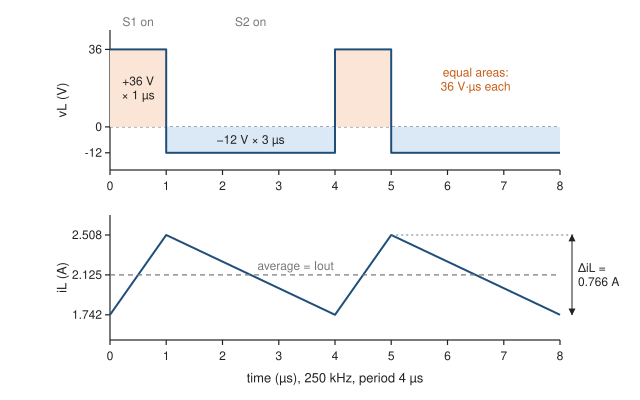
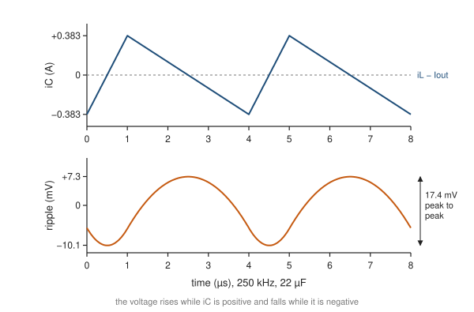
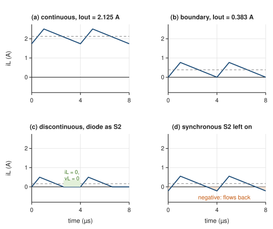

Buck converter
==============

The step-down converter, called a
:wikipedia:`buck converter <Buck_converter>`, makes an output voltage lower
than its input. Its ratio of output to input voltage follows from the
timing of its switches. The current in its inductor ripples, and conducts
continuously or discontinuously depending on the load. The input converter
of an evampire board is a step-down converter (:ref:`power-flow`), and the
four-switch buck-boost converter on :doc:`buck-boost` contains one.

Parts and operation
-------------------

.. graphviz:: buck.dot
   :name: fig-conv-buck
   :caption: Power stage of a synchronous buck converter.
   :alt: Schematic: the input source connects through switch S1 to the
         switch node; switch S2 connects the switch node to ground; the
         inductor L connects the switch node to the output, where the
         output capacitor C and the load connect to ground.
   :align: center

:numref:`fig-conv-buck` shows the four parts:

S1, the high-side switch
   A transistor between the input and the *switch node*. "High side" means
   it connects to the positive supply rather than to ground.
S2, the low-side switch
   A transistor from the switch node to ground. In the simplest buck
   converter S2 is a diode, called the *freewheel diode* (see
   :wikipedia:`flyback diode <Flyback_diode>`), which conducts by itself
   when S1 turns off. Replacing the diode with a transistor that is turned
   on at the same moment is called *synchronous rectification* (see
   :wikipedia:`active rectification <Active_rectification>`), and the
   converter is then a *synchronous* buck converter.
L, the inductor
   Resists changes in its current: the voltage across it sets how fast the
   current changes, :math:`\mathrm{d}i/\mathrm{d}t = v_L / L`.
C, the output capacitor
   Holds the output voltage nearly steady while the inductor current rises
   and falls around the load current.

The switches turn on and off in turn at a fixed *switching frequency*
:math:`f_\text{sw}`, so each *period* :math:`T = 1/f_\text{sw}` has two
parts:

#. S1 on, S2 off, for a time :math:`D \, T`. The switch node is at
   :math:`V_\text{in}`, the inductor has :math:`V_\text{in} - V_\text{out}`
   across it, and its current rises.
#. S1 off, S2 on, for the rest of the period, :math:`(1 - D) \, T`. The
   switch node is at ground, the inductor has :math:`-V_\text{out}` across
   it, and its current falls while it keeps flowing into the output.

:math:`D` is the :wikipedia:`duty cycle <Duty_cycle>`: the fraction of each
period during which S1 is on. :numref:`fig-conv-buck-waves` shows the
resulting waveforms.

.. graphviz:: buck-waveforms.dot
   :name: fig-conv-buck-waves
   :caption: Idealised gate signals, switch node voltage and inductor current
             of a buck converter with a duty cycle of 0.25.
   :alt: Waveforms over two switching periods. The S1 gate is high for the
         first quarter of each period and the S2 gate is high for the rest,
         with short gaps at each change. The switch node voltage follows
         the S1 gate between zero and Vin. The inductor current rises while
         S1 is on, falls while S2 is on, and averages the output current.
   :align: center

Between the two switches turning on there is a short gap, the *dead time*,
when both are off. It prevents both switches being on at once, which would
short the input to ground (:ref:`conv-dead-time`).

Duty cycle and output voltage
-----------------------------

In steady state the inductor current must end each period where it began,
otherwise it would grow or shrink without limit. The current changes at a
rate of :math:`v_L / L`, so the voltage across the inductor multiplied by the
time it is applied, its *volt-seconds* (see
:wikipedia:`volt-second <Volt-second>`), must add up to zero over a period.
This is called *volt-second balance*. For the buck converter it gives

.. math::

   (V_\text{in} - V_\text{out}) \, D \, T = V_\text{out} \, (1 - D) \, T

.. math::

   D = \frac{V_\text{out}}{V_\text{in}}

with the symbols in :numref:`tab-conv-sym-buck`. This holds when the
switches and the inductor have no resistance and the inductor current never
falls to zero (continuous conduction, below). Losses make the real duty
cycle slightly larger. :numref:`fig-conv-buck-balance` shows the balance
for the worked example below: the two shaded areas are equal.

.. list-table:: Symbols for the buck converter
   :name: tab-conv-sym-buck
   :header-rows: 1
   :widths: 20 60 20

   * - Symbol
     - Meaning
     - Unit
   * - :math:`V_\text{in}`
     - Input voltage
     - V
   * - :math:`V_\text{out}`
     - Output voltage
     - V
   * - :math:`D`
     - Duty cycle, the fraction of the period with S1 on
     - fraction
   * - :math:`f_\text{sw}`
     - Switching frequency
     - Hz
   * - :math:`T`
     - Switching period, :math:`1 / f_\text{sw}`
     - s
   * - :math:`L`
     - Inductance
     - H
   * - :math:`I_\text{out}`
     - Output (load) current, equal to the average inductor current
     - A
   * - :math:`\Delta I_L`
     - Peak-to-peak inductor current ripple
     - A
   * - :math:`C`
     - Output capacitance
     - F
   * - :math:`\Delta V_\text{out}`
     - Peak-to-peak output voltage ripple
     - V

As a worked example, take an input converter that brings a 48 V Power over
Ethernet input down to a 12 V bus. The 12 V bus is an illustration; the bus
voltage is an open choice (:doc:`arrangement`). Then
:math:`D = 12 / 48 = 0.25`: S1 is on for a quarter of each period. Over
the whole powered device input range of 37 V to 57 V (:doc:`../poe/index`), the
duty cycle runs from :math:`12 / 37 = 0.32` down to :math:`12 / 57 = 0.21`.
The controller changes the duty cycle to hold the output at 12 V as the
input changes.

Inductor current ripple
-----------------------

While S1 is on, the inductor current rises by

.. math::

   \Delta I_L = \frac{(V_\text{in} - V_\text{out}) \, D \, T}{L}
              = \frac{(V_\text{in} - V_\text{out}) \, D}{L \, f_\text{sw}}

and falls by the same amount while S2 is on. The symbols are in
:numref:`tab-conv-sym-buck` [CONV-SLVA477]_ (Equation 2).

The worked example uses a 250 kHz switching frequency, a 47 µH inductor and a
25.5 W load, which is the most a Type 2 powered device may draw
(:clause:`33`, see :doc:`../poe/index`). These are illustrative values. The load
current is :math:`I_\text{out} = 25.5 / 12 = 2.125` A and

.. math::

   \Delta I_L &= \frac{(48 - 12) \times 0.25}
                      {47 \times 10^{-6} \times 250 \times 10^{3}} \\
              &= \frac{9}{11.75} = 0.766 \ \text{A}

The ripple is 36 % of the load current; designers commonly choose 20 % to
40 % [CONV-SLVA477]_ (Equation 6). The inductor current swings between
:math:`2.125 - 0.383 = 1.742` A and :math:`2.125 + 0.383 = 2.508` A
(:numref:`fig-conv-buck-balance`). The
peak, 2.508 A, is the current the switches, the inductor and the current
limit must handle.

         the first 1 µs of each period and −12 V for the remaining 3 µs; the
         shaded areas above and below zero are each 36 V·µs. The inductor
         current rises from 1.742 A to 2.508 A while the voltage is positive
         and falls back while it is negative, averaging 2.125 A, a ripple of
         0.766 A.
   :align: center

   Inductor voltage and current of the buck worked example: 48 V to 12 V,
   250 kHz, 47 µH and 2.125 A.

The ripple is inversely proportional to :math:`L \, f_\text{sw}`, so a higher
switching frequency allows a smaller inductor for the same ripple: 117.5 µH
at 100 kHz, 47 µH at 250 kHz, 19.6 µH at 600 kHz and 5.3 µH at 2.2 MHz in
this example (:numref:`fig-conv-fsw-tradeoff`). The cost is higher
switching loss (:ref:`conv-losses`).

The output capacitor absorbs the ripple current. With an ideal capacitor
the output voltage ripple is

.. math::

   \Delta V_\text{out} &= \frac{\Delta I_L}{8 \, f_\text{sw} \, C} \\
     &= \frac{0.766}{8 \times 250 \times 10^{3} \times 22 \times 10^{-6}} \\
     &= 17.4 \ \text{mV}

for an illustrative 22 µF capacitor; this is [CONV-SLVA477]_ (Equation 12)
solved for the ripple. A real capacitor adds the ripple current times its
:wikipedia:`equivalent series resistance <Equivalent_series_resistance>`.
:numref:`fig-conv-cap-ripple` shows the capacitor current and the output
ripple of the example.

         inductor current less the load current, is a triangle between
         −0.383 A and +0.383 A. The output voltage ripple rises while the
         current is positive and falls while it is negative, 17.4 mV peak
         to peak with 22 µF.
   :align: center

   Output capacitor current and voltage ripple of the buck example
   with an ideal 22 µF capacitor.

Continuous and discontinuous conduction
---------------------------------------

The inductor current in :numref:`fig-conv-buck-waves` never reaches zero:
the converter is in *continuous conduction mode*. When the load current
falls below half the ripple, :math:`I_\text{out} < \Delta I_L / 2`
(0.383 A in the example), the current would fall below zero at the end of
each period. With a diode as S2, the diode stops it at zero and the current
stays at zero for part of the period: *discontinuous conduction mode*.
:numref:`fig-conv-conduction-modes` compares the cases.

         scale. (a) Continuous conduction at 2.125 A: a triangle wave
         between 1.742 A and 2.508 A. (b) The boundary at 0.383 A: the
         triangle just touches zero at the end of each period. (c)
         Discontinuous conduction with a diode: the current rises, falls to
         zero and stays at zero, with zero inductor voltage, until the next
         period. (d) A synchronous S2 left on at light load: the triangle
         dips below zero, and the negative part is shaded.
   :align: center

   Inductor current of the buck example at four loads and switch choices,
   with the average dashed; panels (c) and (d) are schematic.

The
volt-second balance then has a third interval with no voltage across the
inductor, and the duty cycle is no longer :math:`V_\text{out} / V_\text{in}`
but depends on the load.

A synchronous converter whose S2 stays on lets the current reverse and flow
back from the output to the input, which keeps the converter in continuous
conduction at any load but wastes power at light load. Controllers choose
between the two behaviours: the LM5122 has an optional *diode emulation*
mode that turns its synchronous switch off when the current reaches zero
[CONV-LM5122]_ (Features). The same reverse current is what lets a
synchronous converter carry power in both directions, which
:doc:`arrangement` uses.

Diode or synchronous switch
---------------------------

During the off time the load current flows through S2, a diode or a
transistor (:numref:`fig-conv-buck`). A diode drops a
roughly fixed forward voltage, a transistor drops its current times its
on-resistance. For the example, with an illustrative 0.5 V diode drop and
an illustrative 20 mΩ transistor:

.. math::

   P_\text{diode} &= V_f \, I_\text{out} \, (1 - D) \\
                  &= 0.5 \times 2.125 \times 0.75 = 0.797 \ \text{W}

.. math::

   P_\text{S2} &= R_\text{on} \, I_\text{out}^2 \, (1 - D) \\
               &= 0.020 \times 2.125^2 \times 0.75 = 0.068 \ \text{W}

where :math:`V_f` is the diode forward voltage in V and :math:`R_\text{on}`
the on-resistance of S2 in Ω (:numref:`tab-conv-sym-buck-loss`); ripple is
neglected. The synchronous switch saves most of the loss but needs its own
gate driver and the dead-time control on :doc:`control`.

.. list-table:: Symbols for the freewheel path loss
   :name: tab-conv-sym-buck-loss
   :header-rows: 1
   :widths: 20 60 20

   * - Symbol
     - Meaning
     - Unit
   * - :math:`V_f`
     - Forward voltage of the diode
     - V
   * - :math:`R_\text{on}`
     - On-resistance of the transistor used as S2
     - Ω
   * - :math:`P_\text{diode}`, :math:`P_\text{S2}`
     - Power lost in the diode or in the transistor
     - W
