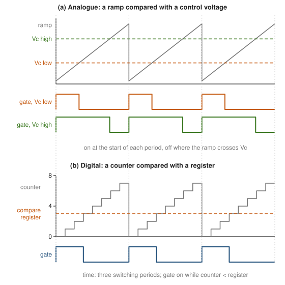

Converter control
=================

This page explains how a converter's switches are timed so that its output
stays at the set voltage or current, and the circuits around the power
stage that keep it safe: soft start, current limits, dead time and
high-side gate drive. It ends with the trade-offs of the switching frequency
and where the losses come from. What evampire itself provides for this is on
:doc:`first-version`.

Pulse-width modulation
----------------------

The controller turns each switch on and off once per period and sets the
duty cycle :math:`D` (:doc:`buck`). This is
:wikipedia:`pulse-width modulation <Pulse-width_modulation>` (PWM) at a
fixed frequency. In an analogue controller a comparator starts each period
by turning the switch on and ends the on time when a ramp crosses a control
voltage; a higher control voltage gives a longer on time. A digital
controller does the same with a counter that restarts every period and a
compare register that ends the on time (:doc:`first-version` works out the
timing resolution this needs). :numref:`fig-conv-pwm` shows both.

         ramp rises through each period and restarts; two dashed control
         voltages, low and high, cross it early and late. The gate for the
         low control voltage is on for a short time from the start of each
         period, the gate for the high control voltage for a long time.
         (b) A counter steps from 0 to 7 in each period and restarts; the
         gate is on while the counter is below a compare register value
         of 3.
   :align: center

   Pulse-width modulation with an analogue ramp and comparator, and with a
   digital counter and compare register (schematic).

Voltage-mode and current-mode control
-------------------------------------

Two ways of choosing the duty cycle are in common use
(:numref:`fig-conv-control-modes`).

.. graphviz:: control-modes.dot
   :name: fig-conv-control-modes
   :caption: Voltage-mode and peak current-mode control loops.
   :alt: Two block diagrams. (a) Voltage mode: a reference and the output
         voltage, scaled by a divider, feed an error amplifier; its output,
         the control voltage, goes to a PWM comparator with a sawtooth
         ramp; the PWM drives a gate driver and the power stage, whose
         output returns through the divider: one loop. (b) Peak current
         mode: the error amplifier sets a current level for a current
         comparator, which also takes slope compensation and the inductor
         current from a sense resistor; the comparator resets a latch that
         a clock sets, and the latch drives the power stage. The sense path
         forms an inner current loop every period, and the divider path an
         outer voltage loop.
   :align: center

Voltage-mode control
   An *error amplifier* compares the output voltage, scaled down by a
   resistor divider, with a reference voltage and amplifies the
   difference. Its output is the control voltage, compared against a fixed
   sawtooth ramp to set the duty cycle. It has one feedback loop.

Peak current-mode control
   The switch turns on at the start of each period and turns off when the
   inductor current, measured through a small sense resistor, reaches a
   level set by the error amplifier. An inner loop regulates the inductor
   current every period and an outer loop sets that current to hold the
   output voltage. The inner loop limits the switch current in every
   period by construction, and corrects input voltage changes within one
   period. The LM5176, LM5122, LM5155 and the TPS23753A controller all use
   it [CONV-LM5176]_ (Description) [CONV-LM5122]_ (Description)
   [CONV-LM5155]_ (Description) [CONV-TPS23753A]_ (Section 8.4.6).

Above a duty cycle of 0.5, peak current-mode control becomes unstable: a
small disturbance of the inductor current grows from one period to the next
and the duty cycle alternates between long and short pulses, called
*subharmonic oscillation*. Adding a ramp to the sensed current, *slope
compensation*, prevents it; the added slope must be at least half the
inductor current's down-slope [CONV-SLUA101]_ (Sections 2.1 to 2.3,
Equations 3 and 4) [CONV-LM5122]_ (Section 7.3.4). The boost duty cycles in
:numref:`tab-conv-boost-duty` are mostly above 0.5, so a peak current-mode
high-voltage converter needs it.

Other schemes exist. *Average current-mode control* regulates the average
rather than the peak inductor current, as in the TPS55289
[CONV-TPS55289]_ (Description). *Valley current-mode control* turns the
switch on when the current falls to a set level, as the LTC3780 does in its
buck region [CONV-LTC3780]_ (Operation). Two schemes drop the fixed
frequency altogether:

Hysteretic control
   Turns the switch on when the output falls below a lower threshold and off
   when it rises above an upper one (a
   :wikipedia:`hysteresis <Hysteresis>` comparator). It needs no
   compensation and responds within one switching event, but its frequency
   changes with the load and the input.
Pulse-frequency modulation
   Sends fixed pulses only as often as the load needs
   (:wikipedia:`pulse-frequency modulation <Pulse-frequency_modulation>`).
   Controllers use it at light load to save switching loss: the LM5177 has
   a selectable power save mode, and the TPS55289 a selectable
   pulse-frequency mode at light load [CONV-LM5177]_ (Features)
   [CONV-TPS55289]_ (Features).

A changing frequency spreads switching noise across a band that is harder
to filter. That is
why fixed-frequency PWM is the usual choice at medium and high load. For
evampire this is a trade-off to measure, not a fixed rule; the open
questions on :doc:`arrangement` list it.

Feedback loop compensation
--------------------------

The output voltage is held by :wikipedia:`negative feedback
<Negative_feedback>`: the controller measures the output, compares it with
the reference, and changes the duty cycle to reduce the difference. The
power stage responds with delay. The inductor and output capacitor form a
filter whose response lags the duty cycle, and in a boost converter the
output first moves the wrong way (below). If the loop corrects too
strongly and too late, it overshoots and oscillates.

*Compensation* is the filter in the error amplifier that shapes the loop's
response so that it is stable. Two numbers describe the result:

Crossover frequency
   The frequency at which the loop's gain falls to 1. Disturbances slower
   than this are corrected; faster ones are not. It sets how quickly the
   output recovers after a load step.
Phase margin
   How far the loop is from oscillating at the crossover frequency
   (see :wikipedia:`phase margin <Phase_margin>`), read from a
   :wikipedia:`Bode plot <Bode_plot>`.

The crossover frequency must be well below the switching frequency, because
the duty cycle changes only once per period. The LM5122 data sheet places
it between one twentieth and one fifth of the switching frequency
[CONV-LM5122]_ (Section 8.1.1).

Right-half-plane zero of the boost converter
--------------------------------------------

When a boost converter's duty cycle increases, S2 conducts for less of each
period, so less current reaches the output and the output first falls. In
control terms this is a *right-half-plane zero*, at

.. math::

   f_\text{RHP} = \frac{(1 - D)^2 \, R_\text{load}}{2 \pi L}

   R_\text{load} = \frac{V_\text{out}^2}{P_\text{out}}

[CONV-LM5177]_ (Section 7.3.8, Equation 6), with the symbols in
:numref:`tab-conv-sym-rhp`. The crossover frequency must stay well below it:
below one third of it for the LM5177 [CONV-LM5177]_ (Section 7.3.8,
Equation 7), one quarter in the LM5122 design example [CONV-LM5122]_
(Section 8.2.2).

.. list-table:: Symbols for the right-half-plane zero
   :name: tab-conv-sym-rhp
   :header-rows: 1
   :widths: 20 60 20

   * - Symbol
     - Meaning
     - Unit
   * - :math:`f_\text{RHP}`
     - Frequency of the right-half-plane zero
     - Hz
   * - :math:`D`
     - Boost duty cycle
     - fraction
   * - :math:`R_\text{load}`
     - Load resistance equivalent to the output power
     - Ω
   * - :math:`L`
     - Inductance
     - H
   * - :math:`V_\text{out}`, :math:`P_\text{out}`
     - Output voltage and power
     - V, W

For the 20 V to 54 V, 30 W worked example on :doc:`boost`
(:math:`D = 0.630`, :math:`L = 100` µH),
:math:`R_\text{load} = 54^2 / 30 = 97.2` Ω and

.. math::

   f_\text{RHP} = \frac{0.370^2 \times 97.2}{2 \pi \times 100 \times 10^{-6}}
                = 21.2 \ \text{kHz}

so the crossover frequency would be about 4 kHz to 5 kHz, a fiftieth of
the 250 kHz switching frequency. The high-voltage converter therefore
corrects its output more slowly than a buck converter switching at the same
frequency.

.. _conv-soft-start:

Soft start
----------

At turn-on the output capacitor is empty. If the controller aimed straight
at the final voltage, the inductor current would rise to the current limit
and the output could overshoot. A *soft start* raises the reference
gradually over a set time so that the output follows it. The TPS23753A,
for example, has a soft-start period of 400 µs to 800 µs
[CONV-TPS23753A]_ (Section 7.5), and the LM5177 sets it with a capacitor
[CONV-LM5177]_ (Section 8.2.2.9). Soft start also limits the current
drawn from the input during start-up, which matters on a Power over
Ethernet input with its inrush limit (:doc:`../poe/index`).

.. _conv-protection:

Current limit and short-circuit protection
------------------------------------------

The inductor current rises at :math:`V_L / L` and nothing but the
controller stops it. Controllers therefore compare the sensed current with
a limit in every period and end the on time early when it is reached: a
*cycle-by-cycle current limit*. Peak current-mode control does this as part
of its normal operation. For a sustained overload some controllers stop
switching for a while and then retry, called *hiccup* mode: the LM5176,
LM5177 and TPS55289 all offer it [CONV-LM5176]_ (Features)
[CONV-LM5177]_ (Features) [CONV-TPS55289]_ (Features). The response times
these protections need for evampire are worked out on :doc:`first-version`.

.. _conv-dead-time:

Dead time
---------

In a synchronous converter the two switches of a half bridge must never be
on together, or they short the input to ground (*shoot-through*). A
transistor takes a few nanoseconds to turn off, so the controller leaves a
gap, the :wikipedia:`dead time <Dead_time>`, between one switch turning off
and the other turning on. During the gap the inductor current flows through
the off switch's body diode, which has a larger voltage drop, so the gap
should be as short as is safe.

For reference, the LM5176 has a fixed 45 ns
dead time [CONV-LM5176]_ (Section 6.5, tDT1 and tDT2), and the LM5177
measures about 20 ns to 23 ns with a 3.3 nF load [CONV-LM5177]_ (Section
5.5). The LM5122 adapts the dead time to the measured switching
[CONV-LM5122]_ (Features).

.. _conv-gate-drive:

High-side gate drive and level shifting
---------------------------------------

To turn on an n-channel transistor its gate must be several volts above its
source. A low-side switch has its source at ground, so its driver works from
a fixed supply such as 5 V. A high-side switch (S1 in :numref:`fig-conv-buck`)
has its source on the switch node, which swings between ground and the
input voltage every period. Its gate must therefore swing between the
switch node and a few volts above the input, 57 V plus the gate voltage on a
Power over Ethernet input.

The usual solution is a :wikipedia:`bootstrap <Bootstrapping_(electronics)>`
supply. A capacitor sits between the switch node and the high-side driver's
supply pin, and a diode charges it from the low-side supply whenever the
switch node is at ground. When the switch node rises, the capacitor rises
with it and powers the driver, so the driver only ever sees the gate drive
voltage across itself [CONV-SLUA618]_ (Section 5.2.2). The capacitor must
supply the gate charge without drooping too far
[CONV-SLUA618]_ (Section 5.2.2.4, Equation 30):

.. math::

   C_\text{boot} \ge \frac{Q_g + Q_\text{other}}{\Delta V_\text{boot}}

with the symbols in :numref:`tab-conv-sym-boot`. An illustrative 10 nC
gate plus 1 nC for leakage and the driver's own charge, with a 0.5 V droop,
needs at least 22 nF.

.. list-table:: Symbols for the bootstrap capacitor
   :name: tab-conv-sym-boot
   :header-rows: 1
   :widths: 20 60 20

   * - Symbol
     - Meaning
     - Unit
   * - :math:`C_\text{boot}`
     - Bootstrap capacitance
     - F
   * - :math:`Q_g`
     - Charge needed to turn on the high-side transistor's gate
     - C
   * - :math:`Q_\text{other}`
     - Other charge taken from the capacitor in one on time (leakage,
       driver supply current, diode recovery)
     - C
   * - :math:`\Delta V_\text{boot}`
     - Allowed droop of the bootstrap voltage
     - V

The control signal for the high-side switch comes from ground-referenced
logic and must be moved up to the floating driver: a
:wikipedia:`level shifter <Level_shifter>`. It must hold off the full input
voltage and tolerate the switch node slewing at tens of volts per
nanosecond. For reference, the LM5109B half-bridge driver works with its
switch node up to 90 V and its bootstrap supply up to 108 V
[CONV-LM5109B]_ (Section 6.3, Features), and the UCC27211 with a bootstrap
voltage up to 120 V [CONV-UCC27211]_ (Features). Drivers up to about 100 V
commonly use level shifters that carry a DC current; higher-voltage drivers
use short pulses [CONV-SLUA618]_ (Section 5.2.2.2). :doc:`integration`
discusses building these on evampire.

Switching frequency
-------------------

The switching frequency trades size against loss:

* the inductance needed for a given ripple falls in proportion to the
  frequency (:doc:`buck` works an example: 117.5 µH at 100 kHz, 5.3 µH at
  2.2 MHz), and the output capacitance falls too;
* the switching loss and gate-drive loss rise in proportion to the frequency
  (:ref:`conv-losses`);
* the loop can be faster, because the crossover frequency is a fraction of
  the switching frequency;
* the timing resolution needed for a given duty-cycle step gets finer
  (:doc:`first-version`).

For reference, the controllers in :numref:`tab-conv-four-switch-parts` run
between 100 kHz and 2.2 MHz. Several allow the frequency to be spread over
a band (spread spectrum) to lower the peak of the
:wikipedia:`electromagnetic interference <Electromagnetic_interference>`:
the LT8390 by about ±15 % [CONV-LT8390]_ (Description).

.. _conv-losses:

Losses and efficiency
---------------------

The loss in a converter has four main parts, each with a simple estimate
[CONV-ERICKSON]_ (Chapters 3 and 4):

.. math::

   P_\text{cond} = I_\text{rms}^2 \, R

   P_\text{sw} = \tfrac{1}{2} \, V_\text{in} \, I \, (t_r + t_f) \, f_\text{sw}

.. math::

   P_\text{gate} = Q_g \, V_g \, f_\text{sw}

   P_\text{dead} = V_\text{diode} \, I \, 2 \, t_\text{dead} \, f_\text{sw}

with the symbols in :numref:`tab-conv-sym-loss`.

.. list-table:: Symbols for converter losses
   :name: tab-conv-sym-loss
   :header-rows: 1
   :widths: 22 58 20

   * - Symbol
     - Meaning
     - Unit
   * - :math:`P_\text{cond}`
     - Conduction loss in the resistance of a switch or the inductor
     - W
   * - :math:`I_\text{rms}`, :math:`R`
     - Root-mean-square current through that part, and its resistance
     - A, Ω
   * - :math:`P_\text{sw}`
     - Switching loss while a switch passes between on and off
     - W
   * - :math:`I`
     - Current switched
     - A
   * - :math:`t_r`, :math:`t_f`
     - Rise and fall times of the switch node
     - s
   * - :math:`P_\text{gate}`
     - Power to charge and discharge a gate every period
     - W
   * - :math:`Q_g`, :math:`V_g`
     - Gate charge and gate drive voltage
     - C, V
   * - :math:`P_\text{dead}`
     - Loss in the body diode during the two dead times
     - W
   * - :math:`V_\text{diode}`, :math:`t_\text{dead}`
     - Body diode voltage and one dead time
     - V, s

For the buck worked example (48 V to 12 V, 2.125 A, 250 kHz) with
illustrative part values, the switching loss with 40 ns of rise plus fall
time is

.. math::

   P_\text{sw} &= 0.5 \times 48 \times 2.125 \\
               &\quad \times 40 \times 10^{-9} \times 250 \times 10^{3} \\
               &= 0.51 \ \text{W}

and the gate loss for a 10 nC gate at 5 V is
12.5 mW. The conduction loss of a 20 mΩ low-side switch is 0.068 W
(:doc:`buck`). These are illustrations of the method; the losses of
evampire's converters depend on parts and frequencies that are open
choices.

Two techniques remove most of the switching loss. A *resonant* or
*soft-switched* converter shapes the current or voltage with an added
inductor and capacitor so that each switch turns on or off when its
voltage or current is near zero (see
:wikipedia:`resonant converter <Resonant_converter>`). :doc:`arrangement`
discusses why they are less common at these power levels and whether that
applies to evampire.
