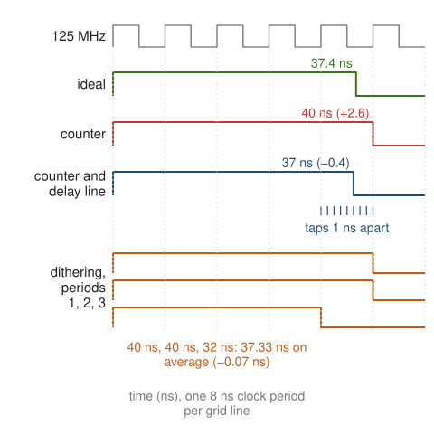
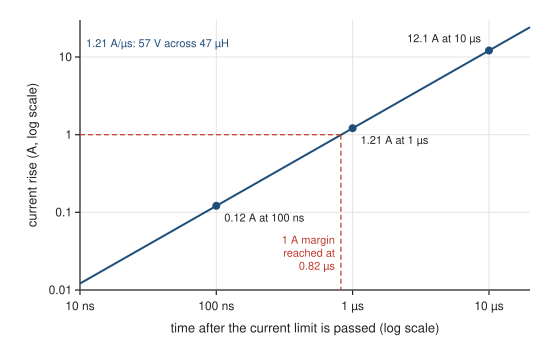
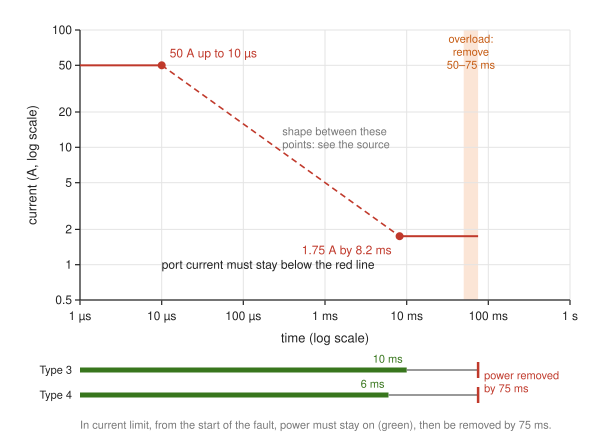
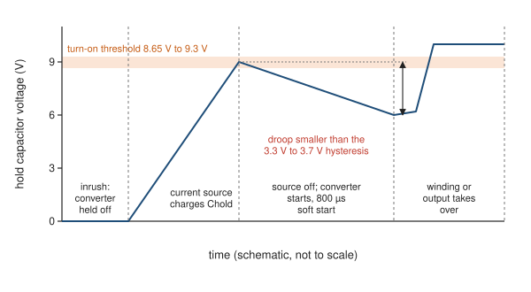

External power stage control
============================

This page sets out what evampire provides to control converters whose gate
drivers and power transistors are external parts, as in the first version
(:ref:`power-board-configs`, :ref:`requirements`). It covers the split
between software and built-in hardware, the timing resolution and loop
rates the control needs, how the converter sensing also serves power
monitoring and limiting, the fault response times, and how the board starts
before any software runs.

Functions on evampire
---------------------

.. graphviz:: control-split.dot
   :name: fig-conv-control-split
   :caption: Converter control with external gate drivers and power stages.
   :alt: Block diagram: inside evampire, RISC-V software sends settings to a
         PWM generator with dead time, exchanges limits and faults with
         comparators, and receives readings from an ADC and DAC block. The
         PWM generator drives an external gate driver, which drives external
         switches and an inductor. An external sense resistor and divider
         feed current to the comparators and current and voltage to the ADC.
         The comparators can end a pulse or stop the PWM generator.
   :align: center

For each converter, evampire provides (:numref:`fig-conv-control-split`):

* a logic-level PWM output for each switch, with the dead time between the
  two switches of each half bridge, to an external gate driver;
* a fast comparator on the sensed inductor current, which ends the on time
  at the peak current level or at the current limit;
* a fast short-circuit comparator that stops switching;
* a digital-to-analogue converter (DAC) for each reference (output voltage,
  current limit), or a digital equivalent;
* analogue-to-digital converter (ADC) channels for the input and output
  voltages and currents.

:numref:`tab-conv-signal-count` counts the PWM outputs for each arrangement
on :doc:`arrangement`.

.. list-table:: PWM outputs needed for each arrangement on the first-version board
   :name: tab-conv-signal-count
   :header-rows: 1
   :widths: 60 40

   * - Arrangement
     - PWM outputs
   * - Three separate converters
     - 8
   * - One bidirectional four-switch converter
     - 4
   * - Bus near the Power over Ethernet voltage, standard power range USB
     - 2 (plus 2 for the optional regulator)
   * - Bus near the Power over Ethernet voltage, extended power range USB
     - 4 (plus 2 for the optional regulator)

The voltages to be sensed reach 57 V. In the first version the external
parts bring them within evampire's input range: resistor dividers for
voltages, and a sense resistor in the ground return (low-side sensing) or
an external amplifier for currents.

Software and hardware division
------------------------------

Software on the processor makes every power decision once it is running
(:ref:`requirements`). For the converters this means software:

* turns each converter on and off and chooses the arrangement for the
  operating mode, including pass-through (:ref:`conv-pass-through`);
* sets each output voltage and each current and power limit;
* reads the voltage and current measurements and keeps the power budget
  (:ref:`power budget <power-budget>`);
* handles faults that the hardware reports, and decides on retries.

Built-in hardware does only what is too fast for software:

* generating the PWM signals and dead times;
* the cycle-by-cycle current limit and short-circuit shutdown
  (:ref:`conv-fault-times`);
* starting the input converter before software runs
  (:ref:`conv-start-up`);
* possibly the inner part of the control loop, if the rates in
  :ref:`conv-loop-rates` are beyond what the software can sustain.

PWM timing resolution
---------------------

A digital PWM generator can only place an edge on its time grid, so the
duty cycle moves in steps of

.. math::

   \Delta D = t_\text{step} \, f_\text{sw}

and in a buck converter the output moves in steps of
:math:`\Delta V_\text{out} = V_\text{in} \, \Delta D` (symbols in
:numref:`tab-conv-sym-pwm`). The finest voltage step a USB Power Delivery
source must make is the 20 mV step of the programmable supply (*vPpsStep*,
:pd:`Table 4.7`; see :doc:`../usb-pd/index`). At the highest input of 57 V that
needs :math:`\Delta D = 0.020 / 57 = 3.51 \times 10^{-4}`, which is
11.5 bits, and therefore

.. math::

   t_\text{step} = \frac{\Delta D}{f_\text{sw}}
                 = \frac{3.51 \times 10^{-4}}{250 \times 10^{3}}
                 = 1.40 \ \text{ns}

at an illustrative 250 kHz.

.. list-table:: Symbols for PWM resolution
   :name: tab-conv-sym-pwm
   :header-rows: 1
   :widths: 20 60 20

   * - Symbol
     - Meaning
     - Unit
   * - :math:`t_\text{step}`
     - Smallest step in which an edge can be placed
     - s
   * - :math:`\Delta D`
     - Smallest duty-cycle step
     - fraction
   * - :math:`f_\text{sw}`
     - Switching frequency
     - Hz
   * - :math:`\Delta V_\text{out}`
     - Smallest output voltage step
     - V

.. list-table:: Time step needed for a 20 mV step at 57 V in
   :name: tab-conv-pwm-steps
   :header-rows: 1
   :widths: 34 33 33

   * - Switching frequency (kHz)
     - Time step needed (ps)
     - Step of a counter at 125 MHz (mV at 57 V)
   * - 100
     - 3509
     - 45.6
   * - 250
     - 1404
     - 114.0
   * - 600
     - 585
     - 273.6
   * - 2200
     - 160
     - 1003.2

The third column uses evampire's 125 MHz reference clock (:ref:`arch-clock`)
as an example counter clock. Three techniques give finer steps, and are
often combined:

* a counter clocked faster;
* a *delay line*: a chain of gates whose taps divide one counter clock into
  smaller steps (a 125 MHz counter with an 8-tap delay line has 1 ns steps);
* *dithering*: mixing two neighbouring duty cycles from one period to the
  next, in a pattern whose average falls between them, at the cost of a
  small ripple at a lower frequency.

:numref:`fig-conv-pwm-resolution` shows the three on a 125 MHz counter.

         PWM edge at 37.4 ns; a counter alone can only end the pulse at
         40 ns, 2.6 ns late; a counter with an 8-tap delay line, taps 1 ns
         apart, ends it at 37 ns, 0.4 ns early; with dithering, two periods
         ending at 40 ns and one at 32 ns repeat, giving 37.33 ns on
         average, 0.07 ns early.
   :align: center

   Placing a PWM edge with a 125 MHz counter, a delay line and dithering
   (illustrative edge position).

In peak current-mode control the duty cycle comes from a comparator, not
from a counter, so the voltage step is set by the reference DAC instead:
10 bits for 20 mV steps over 21 V, and 9 bits for 100 mV steps over 48 V
(the adjustable supply step, :pd:`Table 4.7`).

A digital loop also needs the PWM step to be finer than the step of the ADC
that measures the output, and an integral term in its control law;
otherwise the output hunts between two levels, a *limit cycle*
[CONV-PETERCHEV2003]_ ([CONV-PETERCHEV2006]_, Section 2.2).

For reference:

* the TMS320F28004x microcontrollers place PWM edges in steps of 150 ps
  typical, 310 ps maximum [CONV-C2000]_ (Features, Section 6.11.4.1.1);
* the dsPIC33CK256MP508 family reaches 250 ps PWM resolution from a
  500 MHz input clock [CONV-DSPIC33CK]_ (Features, Section 12.0);
* the UCD3138 digital power controller has 250 ps PWM resolution, made
  from 16 phase-shifted 250 MHz clocks [CONV-UCD3138]_ (Sections 8.8.1.2
  and 8.8.1.4);
* a 1 MHz digital PWM controller in 0.5 µm CMOS makes an 8-bit PWM from a
  3-bit counter and a 32-cell ring of delay cells [CONV-PATELLA2003]_
  (Section III).

.. _conv-loop-rates:

Control loop rates
------------------

:numref:`tab-conv-loop-needs` states what each part of the control needs in
rate and latency; :numref:`fig-conv-control-modes` shows the inner and
outer loops. The figures follow from the switching frequency and the
crossover frequencies on :doc:`control`, with an illustrative 250 kHz
switching frequency.

.. list-table:: Rates and latencies needed by the control, at 250 kHz switching
   :name: tab-conv-loop-needs
   :header-rows: 1
   :widths: 30 22 24 24

   * - Function
     - Update rate (kHz)
     - Latency needed
     - Basis
   * - Peak current comparison, cycle-by-cycle limit
     - 250 (every period)
     - tens of ns
     - Ends the on time when the current crosses the level
   * - Duty-cycle update, voltage-mode inner loop
     - 250
     - under 1 µs
     - One update per period, before the next on time
   * - Outer voltage loop, buck (crossover up to 25 kHz)
     - 250
     - under 4 µs
     - Ten updates per crossover period
   * - Outer voltage loop, boost (crossover about 4 kHz)
     - 40
     - under 25 µs
     - Ten updates per crossover period
   * - Power monitoring and budget
     - 1 or less
     - ms
     - Power negotiation times on :doc:`../poe/index` and :doc:`../usb-pd/index`

"Ten updates per crossover period" is a common starting point for sampled
control, not a fixed rule. The work per update depends on the control
algorithm. A proportional-integral update with a few multiply-accumulates
is the minimum; with :math:`N_\text{ops}` operations per update the
processing rate needed is

.. math::

   R_\text{ops} = N_\text{ops} \, f_\text{update} \, n_\text{conv}

(symbols in :numref:`tab-conv-sym-ops`). For example 50 operations at
250 kHz for three converters is 37.5 million operations per second; at
40 kHz for one boost loop it is 2 million.

.. list-table:: Symbols for the processing rate
   :name: tab-conv-sym-ops
   :header-rows: 1
   :widths: 20 60 20

   * - Symbol
     - Meaning
     - Unit
   * - :math:`R_\text{ops}`
     - Processing rate needed for the loops
     - operations/s
   * - :math:`N_\text{ops}`
     - Operations per loop update
     - none
   * - :math:`f_\text{update}`
     - Loop update rate
     - Hz
   * - :math:`n_\text{conv}`
     - Number of converters controlled this way
     - none

The peak current comparison must be hardware: it acts within the on time of
a single period. The outer loops can be software, built-in hardware such
as a digital filter or an analogue error amplifier, or a mix; which one is
an open choice set by the processor design and the switching frequency.
For reference, both splits are in commercial use:

* the UCD3138 runs up to three loops in dedicated hardware filters
  (proportional-integral-derivative, two poles and two zeros) fed by a
  16 MHz error ADC, and uses its processor core for supervision
  [CONV-UCD3138]_ (Features);
* the TMS320F28004x runs control loops in software on a control-law
  accelerator beside its main processor, with hardware comparators that
  respond within 60 ns for cycle-by-cycle limits
  [CONV-C2000]_ (Features, Section 6.10.5.1.1).

Open-source examples at evampire's scale are few and unmeasured. The
gf180-buck project designs a 5 V to 1.8 V synchronous buck converter with
on-die switches, gate drive and PWM control in gf180mcu, so far in
simulation only [CONV-GF180-BUCK]_, and a three-level flying-capacitor
buck converter has been designed in SkyWater 130 nm with open-source tools
[CONV-MARIN2024]_ (Title).

Sensing
-------

evampire measures the voltage and current of every power port and of the
power bus, and enforces software-set current and power limits in hardware
(:ref:`requirements`). The converters already sense the same quantities,
so one set of sense points can serve all three uses, with different
circuits after them (:numref:`tab-conv-sense-uses`).

.. list-table:: What each use of the sensed signals needs
   :name: tab-conv-sense-uses
   :header-rows: 1
   :widths: 28 36 36

   * - Use
     - Response
     - Accuracy
   * - Control
     - Tens of ns (peak current)
     - Sets the output and limit accuracy
   * - Protection
     - One period (converter); µs (port short)
     - Coarse; no trip within the negotiated limits
   * - Monitoring and power limits
     - Averaged over ms; 1 kHz or less
     - Fine; sets the budget margin

Control and protection use comparators, each with its own threshold from a
DAC; monitoring uses an ADC with averaging. :numref:`fig-conv-sensing`
shows the sense points of a power sourcing equipment output and what each
one feeds.

.. graphviz:: sensing.dot
   :name: fig-conv-sensing
   :caption: Sense points of a boost converter feeding a power sourcing
             equipment port, and the circuits on evampire that use them.
   :alt: Block diagram: the power path runs from the power bus through the
         boost power stage, the output capacitor and the port switch to
         Ethernet port B. Below it are four sense points: bus voltage and
         current, an inductor current sense resistor, an output divider,
         and a port current sense resistor after the output capacitor.
         Inside evampire, the inductor current and output divider feed
         comparators with DAC thresholds for peak current, current
         limit and output voltage; the bus, output and port sense points feed an ADC with
         averaging for monitoring at 1 kHz or less; the port sense resistor
         also feeds a port short comparator that acts within microseconds.
   :align: center

Two differences limit the sharing:

* A converter senses its inductor current, and a port's current is the
  inductor current averaged and, for a boost converter, multiplied by
  :math:`1 - D` (:doc:`boost`). The port current for monitoring can be
  computed from the inductor current or sensed at the port.
* A power sourcing equipment port must limit the current in its own switch
  (:ref:`conv-fault-times`), so it needs its own sense point after the
  output capacitor in every arrangement.

The ADC resolution needed for monitoring follows from the range and the
smallest current that matters:

.. math::

   N_\text{bits} \ge \log_2 \frac{I_\text{full}}{I_\text{step}}

where :math:`I_\text{full}` is the full-scale current and
:math:`I_\text{step}` the smallest step in A. For the Type 4 power
sourcing equipment current of 1.731 A, 1 mA steps need 10.76 bits, so 11
bits; 5 mA steps need 8.44 bits. 10 mA steps at 5 A (USB) need 8.97 bits.
The accuracy needed for the power budget is an open question.

.. _conv-fault-times:

Fault response times
--------------------

:numref:`tab-conv-fault-times` gives the response time each fault needs and
where it comes from, and :numref:`fig-conv-pse-template` draws the times
of a power sourcing equipment port in current limit.

.. list-table:: Fault response times
   :name: tab-conv-fault-times
   :header-rows: 1
   :widths: 25 30 25 20

   * - Fault
     - Time needed
     - Source
     - Hardware or software
   * - Inductor current above the limit
     - Within the same on time: tens to hundreds of ns
     - Current rise rate, below
     - Hardware
   * - Short on a power sourcing equipment output, current limiting
     - Current must be inside the upper-bound template: up to 50 A for 10 µs,
       falling to 1.75 A by 8.2 ms
     - [CONV-EA-BT]_ (Figures 22 and 23)
     - Hardware
   * - Power sourcing equipment in current limit, power removed
     - Hold at least 10 ms (Type 3) or 6 ms (Type 4); remove by 75 ms
     - [CONV-EA-BT]_ (Sections 8.2 and 8.5)
     - Software, with hardware backstop
   * - Power sourcing equipment overload
     - Remove power after 50 ms to 75 ms
     - [CONV-EA-BT]_ (Figures 22 and 23)
     - Software, with hardware backstop
   * - USB source over-current
     - Bring VBUS to vSafe5V within 275 ms and to vSafe0V within 650 ms
     - :pd:`Section 4.1.5.1`
     - Software
   * - Board power above the budget
     - Reduce the offers first (:ref:`power budget <power-budget>`)
     - :ref:`power-translation`
     - Software

The first row follows from the inductor: its current rises at
:math:`V_L / L` until something stops it. With 57 V across 47 µH (the buck
example on :doc:`buck`) the rate is 1.21 A/µs, so the current grows by
0.12 A in 100 ns, 1.21 A in 1 µs and 12.1 A in 10 µs. The response time
needed is

.. math::

   t_\text{response} \le \frac{L \, \Delta I_\text{margin}}{V_L}

where :math:`\Delta I_\text{margin}` is the margin between the current limit
and the current at which the inductor saturates or a switch is damaged, in
A, and :math:`V_L` the voltage across the inductor in V. A 1 A margin in the
example allows 0.82 µs. :numref:`fig-conv-runaway` plots the rise.

         1.21 A/µs, for 57 V across 47 µH, through 0.12 A at 100 ns,
         1.21 A at 1 µs and 12.1 A at 10 µs. Dashed lines mark a 1 A margin
         reached at 0.82 µs.
   :align: center

   Inductor current rise of the buck example once nothing stops it.

The USB Power Delivery specification gives no response time for the source's
over-current protection; it requires that the protection does not trip
within the negotiated contract (:pd:`Section 4.1.5.1`, see
:doc:`../usb-pd/index`). The converter's own cycle-by-cycle limit protects the
converter, and software carries out the shutdown sequence. A boost
converter needs a series switch to stop a short on its output
(:doc:`boost`).

For reference, the TPS23881 power sourcing equipment controller turns its
switch off within 0.9 µs of its short-circuit threshold, 205 mV to 245 mV
across a 0.2 Ω sense resistor, about 1.0 A to 1.2 A [CONV-TPS23881]_
(Section 7.5, tD_off_SEN and Vshort).

         1 s and 0.5 A to 100 A. The upper bound for the port current is
         50 A up to 10 µs and 1.75 A from 8.2 ms; a dashed line joins the
         two points, whose exact shape is in the cited source. A shaded
         band from 50 ms to 75 ms marks overload removal. Below, bars show
         that in current limit a Type 3 port holds power for at least
         10 ms and a Type 4 port for at least 6 ms, and both remove it by
         75 ms.
   :align: center

   Current and time limits of a power sourcing equipment port in a fault,
   from :numref:`tab-conv-fault-times`; the shape between 10 µs and 8.2 ms
   is drawn as a straight line.

.. _conv-start-up:

Start-up before software runs
-----------------------------

A board powered only from one port starts from nothing
(:ref:`requirements`). Until software runs, the hardware alone must bring
up the input converter and the supply that powers evampire.

Power over Ethernet start-up
~~~~~~~~~~~~~~~~~~~~~~~~~~~~

The steps before power is applied (detection, classification and the
inrush period) are described on :doc:`../poe/index`; a built-in sequencer
answers them. After them the powered device has the power of its class.
:numref:`tab-conv-class-power` lists the power at the powered device per
class.

.. list-table:: Power available at the powered device after classification
   :name: tab-conv-class-power
   :header-rows: 1
   :widths: 25 25 50

   * - Class
     - Power (W)
     - Types that can grant it
   * - 1
     - 3.84
     - 1 to 4
   * - 2
     - 6.49
     - 1 to 4
   * - 3
     - 13.0
     - 1 to 4
   * - 4
     - 25.5
     - 2 to 4
   * - 5
     - 40.0
     - 3 and 4
   * - 6
     - 51.0
     - 3 and 4
   * - 7
     - 62.0
     - 4
   * - 8
     - 71.3
     - 4

Source: :clause:`145` as tabulated on :doc:`../poe/index`. The class
assigned also depends on the power sourcing equipment
(:ref:`poe-class-outcome`).

The power left for the board while it starts is

.. math::

   P_\text{start,avail} = P_\text{class} \times \eta_\text{start}

where :math:`P_\text{class}` is the class power in W and
:math:`\eta_\text{start}` the efficiency of the conversions between the
cable and evampire's supply. Whether a class is enough depends on the power
the board needs to start, :math:`P_\text{start}`, which is open: the
sequencer must request a class with
:math:`P_\text{class} \times \eta_\text{start} \ge P_\text{start}`.

Commercial powered-device converters bootstrap their own controller supply.
For reference, in the TPS23753A [CONV-TPS23753A]_ (Section 8.4.6.1):

#. the converter is held off until the inrush period ends;
#. a current source from the high-voltage input, 2.5 mA to 6 mA at 48 V,
   charges the controller's supply capacitor;
#. at 8.65 V to 9.3 V the current source turns off and the converter starts
   with a soft start;
#. the capacitor supplies the controller and gate drive until a transformer
   winding takes over, and must not fall by more than the 3.3 V to 3.7 V
   hysteresis before then (Section 7.5, UVLO_1 and UVLO_H).

:numref:`fig-conv-start-path` shows this start-up path and
:numref:`fig-conv-start-timeline` the capacitor voltage through it.

.. graphviz:: start-path.dot
   :name: fig-conv-start-path
   :caption: Start-up path of a powered-device input converter.
   :alt: Block diagram: the 37 V to 57 V input feeds a current source of
         2.5 mA to 6 mA, or a 28 kΩ resistor, which charges a hold
         capacitor of at least 0.70 µF. The capacitor supplies a controller
         with under-voltage lockout, which drives the gate of the input
         converter power stage and turns the current source off at 8.65 V
         to 9.3 V. An auxiliary winding or the converter output feeds back
         to the hold capacitor and takes over after start-up.
   :align: center

The capacitor must hold the controller's load through the start-up:

.. math::

   C_\text{hold} \ge \frac{(I_\text{ctrl} + Q_g \, f_\text{sw}) \, t_\text{start}}
                         {\Delta V_\text{hyst}}

with the symbols in :numref:`tab-conv-sym-start`. With the TPS23753A's
0.58 mA operating current and 248 kHz, an illustrative 10 nC gate, its
800 µs soft start and 3.5 V hysteresis, :math:`I = 0.58 + 2.48 = 3.06` mA
and :math:`C_\text{hold} \ge 3.06 \times 10^{-3} \times 800 \times 10^{-6} / 3.5
= 0.70` µF.

.. list-table:: Symbols for the start-up supply
   :name: tab-conv-sym-start
   :header-rows: 1
   :widths: 22 58 20

   * - Symbol
     - Meaning
     - Unit
   * - :math:`C_\text{hold}`
     - Capacitance that powers the controller during start-up
     - F
   * - :math:`I_\text{ctrl}`
     - Controller supply current
     - A
   * - :math:`Q_g`, :math:`f_\text{sw}`
     - Gate charge and switching frequency
     - C, Hz
   * - :math:`t_\text{start}`
     - Time from the converter starting to its output taking over
     - s
   * - :math:`\Delta V_\text{hyst}`
     - Allowed fall of the capacitor voltage
     - V
   * - :math:`R_\text{start}`
     - Start-up resistor, when a resistor replaces the current source
     - Ω

         period the converter is held off and the voltage is zero. The
         current source then charges the capacitor up to the turn-on
         threshold band of 8.65 V to 9.3 V. The source turns off and the
         converter starts with an 800 µs soft start, while the voltage
         droops by less than the 3.3 V to 3.7 V hysteresis. A winding or
         the output then takes over and the voltage rises again.
   :align: center

   Hold capacitor voltage through a powered-device start-up, with the
   TPS23753A thresholds (schematic, not to scale).

A plain resistor in place of the current source keeps dissipating after
start-up. Sized for 1 mA at 37 V into a 9 V capacitor,
:math:`R_\text{start} = (37 - 9) / 1 \times 10^{-3} = 28` kΩ, and at 57 V it
dissipates :math:`(57 - 9)^2 / 28 \times 10^{3} = 82` mW continuously. A
current source that switches off after start-up, as in the TPS23753A,
avoids this.

For evampire the same structure needs, without software:

* a start-up path from the 37 V to 57 V input to evampire's supply, built
  from external parts in the first version;
* an under-voltage lockout that holds the input converter off until its
  supply and the input are high enough;
* a default operating point for the input converter: a bus voltage set by
  hardware, for example by a resistor divider or a fixed reference;
* a soft start (:ref:`conv-soft-start`) and the cycle-by-cycle current limit
  (:ref:`conv-protection`) active from the first pulse;
* a hand-over from the start-up path to the converter's own output.

Software then reads the measurements, may change the bus voltage, and
negotiates more power where needed.

USB start-up
~~~~~~~~~~~~

A USB charger supplies vSafe5V, 4.75 V to 5.5 V, before any USB Power
Delivery negotiation, at the current its pull-up resistor advertises
(:typec:`Table 4-27`, see :doc:`../usb-pd/index`).
:numref:`tab-conv-usb-start-power` gives the power at the lowest voltage.

.. list-table:: Power available from a USB source before negotiation, at 4.75 V
   :name: tab-conv-usb-start-power
   :header-rows: 1
   :widths: 50 25 25

   * - Advertised current
     - Current (A)
     - Power (W)
   * - Default USB power, USB 2.0 port
     - 0.5
     - 2.375
   * - Default USB power, USB 3.2 single-lane port
     - 0.9
     - 4.275
   * - 1.5 A
     - 1.5
     - 7.125
   * - 3.0 A
     - 3.0
     - 14.25

How the board starts from 5 V depends on the arrangement. With three
separate converters, the bus follows VBUS, so the board supplies run from
5 V directly. With a bus near the Power over Ethernet voltage, the USB
converter must first raise the bus from 5 V, so it too needs a default
operating point and protection that work without software, or the board
supplies take their start-up power from VBUS directly.
:numref:`fig-conv-usb-start` shows both cases.

.. graphviz:: usb-start.dot
   :name: fig-conv-usb-start
   :caption: Start-up power paths from vSafe5V for two arrangements.
   :alt: Two diagrams. (a) Three separate converters: VBUS at vSafe5V,
         4.75 V to 5.5 V, passes a VBUS switch onto the power bus at about
         5 V, which feeds the board supplies and evampire. (b) High bus: the
         USB converter, with a hardware default, raises the bus to 37 V to
         57 V, which feeds the board supplies; a dashed path shows VBUS
         feeding the supplies directly instead. Before negotiation the
         source offers 2.375 W to 14.25 W.
   :align: center

Open questions
--------------

* Which parts of the control loops run in software and which in built-in
  hardware; this depends on the processor design and the switching
  frequency (:numref:`tab-conv-loop-needs`).
* The switching frequency of each converter, which sets the PWM time step
  (:numref:`tab-conv-pwm-steps`), the loop rates and the inductor sizes.
* How the PWM time step is made: counter clock, delay line, dithering, or a
  combination.
* The accuracy of voltage and current monitoring needed for the power
  budget, and the ADC resolution and sample rate that follow.
* Whether each port's current is sensed at the port or computed from the
  converter's inductor current.
* The power the board needs to start, :math:`P_\text{start}`, and so the
  class the start-up sequencer requests and the start-up path's rating.
* The default bus voltage and the start-up path (resistor, current source,
  or external regulator) in the first version.
