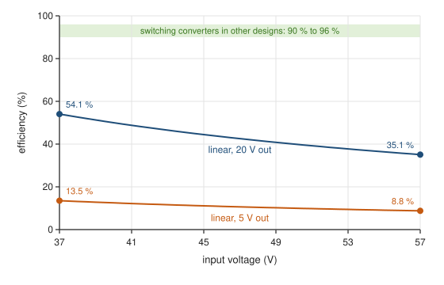

Linear and switching converters
===============================

This page compares the two ways of changing a DC voltage, the linear
regulator and the switching converter, at the voltages and powers of
evampire's power path. The converters themselves are described on
:doc:`buck`, :doc:`boost` and :doc:`buck-boost`.

Linear regulator losses
-----------------------

A :wikipedia:`linear regulator <Linear_regulator>` puts a transistor in
series between the input and the output and adjusts how hard it conducts so
that the output stays at the set voltage. The transistor carries the full
load current and drops the whole difference between the input and output
voltages, so it turns that difference times the current into heat. A linear
regulator can only make a voltage lower than its input.
:numref:`fig-conv-linear` shows its parts.

.. graphviz:: linear.dot
   :name: fig-conv-linear
   :caption: A linear regulator: a series pass transistor set by an
             error amplifier.
   :alt: Schematic: the input connects through a pass transistor to the
         output and the load. A divider on the output feeds an error
         amplifier with a reference, which drives the pass transistor's
         gate. The pass transistor drops Vin − Vout and carries the load
         current, so it turns (Vin − Vout) × Iout into heat.
   :align: center

The power lost in the transistor and the resulting efficiency, the fraction
of the input power that reaches the load, are

.. math::

   P_\text{loss} = (V_\text{in} - V_\text{out}) \, I_\text{out}

   \eta_\text{lin} &= \frac{V_\text{out} \, I_\text{out}}{V_\text{in} \, I_\text{out}} \\
                   &= \frac{V_\text{out}}{V_\text{in}}

with the symbols in :numref:`tab-conv-sym-linear`. The regulator's own
supply current is neglected, so the result is the best case.

.. list-table:: Symbols for the linear regulator
   :name: tab-conv-sym-linear
   :header-rows: 1
   :widths: 20 60 20

   * - Symbol
     - Meaning
     - Unit
   * - :math:`V_\text{in}`
     - Input voltage
     - V
   * - :math:`V_\text{out}`
     - Output voltage
     - V
   * - :math:`I_\text{out}`
     - Load current, equal to the input current
     - A
   * - :math:`P_\text{loss}`
     - Power turned into heat in the series transistor
     - W
   * - :math:`\eta_\text{lin}`
     - Efficiency, output power divided by input power
     - fraction

:numref:`tab-conv-linear` works this out for the "Ethernet in, USB out"
mode (:ref:`power-modes`). The input is the powered device input range,
37 V to 57 V (:doc:`../poe/index`), and the outputs are the 5 V and 20 V fixed
:doc:`USB Power Delivery <../usb-pd/index>` voltages at 3 A. For example, at
57 V in and 20 V out, :math:`P_\text{loss} = (57 - 20) \times 3 = 111` W and
:math:`\eta_\text{lin} = 20 / 57 = 35.1` %.

.. list-table:: A linear regulator from the Power over Ethernet input to USB outputs at 3 A
   :name: tab-conv-linear
   :header-rows: 1
   :widths: 18 18 16 16 16 16

   * - In (V)
     - Out (V)
     - Out (W)
     - In (W)
     - Loss (W)
     - Efficiency (%)
   * - 37
     - 5
     - 15
     - 111
     - 96
     - 13.5
   * - 37
     - 20
     - 60
     - 111
     - 51
     - 54.1
   * - 57
     - 5
     - 15
     - 171
     - 156
     - 8.8
   * - 57
     - 20
     - 60
     - 171
     - 111
     - 35.1

Every input power in :numref:`tab-conv-linear` is above 71.3 W, the most a
Type 4 powered device may draw (:clause:`145`, see :doc:`../poe/index`). A linear
regulator therefore cannot deliver 3 A on these USB outputs from any
Power over Ethernet type. In the other direction, "USB in, Ethernet out",
the output (44 V to 57 V) is above most USB input voltages, which a linear
regulator cannot produce at all.

Switching converter operation
-----------------------------

A :wikipedia:`switching converter <Switched-mode_power_supply>` uses
transistors only as switches, fully on or fully off, and stores energy for
a moment in an :wikipedia:`inductor <Inductor>` (sometimes a capacitor or a
transformer). A fully-on switch has a small voltage across it and a fully-off
switch carries almost no current, so in both states it dissipates little
power. Changing the fraction of time each switch is on changes the ratio
between the input and output voltages, which can be above or below 1
depending on how the switches and the inductor are connected.

The losses that remain come from the resistance of the switches and the
inductor, from the short time each switch spends between on and off, and
from charging the switches' gates (:ref:`conv-losses`). For reference,
commercial converters at similar voltages reach the following efficiencies:

* the TPS55289 four-switch buck-boost converter is specified at 96 %
  efficiency converting 12 V to 20 V at 3 A [CONV-TPS55289]_ (Features);
* the LM5177 datasheet's design example assumes 95 % efficiency for a
  four-switch buck-boost converter [CONV-LM5177]_ (Section 8.2.2.4);
* the LM5176 datasheet's design example assumes 90 % efficiency
  [CONV-LM5176]_ (Section 8.2.2.4).

These are illustrations from other designs, not evampire values.
:numref:`tab-conv-switching-loss` shows what such efficiencies mean for the
60 W output of :numref:`tab-conv-linear`, using

.. math::

   P_\text{in} = \frac{P_\text{out}}{\eta}

   P_\text{loss} &= P_\text{in} - P_\text{out} \\
                 &= P_\text{out} \left( \frac{1}{\eta} - 1 \right)

with the symbols in :numref:`tab-conv-sym-switching`.

.. list-table:: Symbols for a converter's input power and loss
   :name: tab-conv-sym-switching
   :header-rows: 1
   :widths: 20 60 20

   * - Symbol
     - Meaning
     - Unit
   * - :math:`P_\text{out}`
     - Output power
     - W
   * - :math:`P_\text{in}`
     - Input power
     - W
   * - :math:`\eta`
     - Efficiency
     - fraction
   * - :math:`P_\text{loss}`
     - Power lost in the converter
     - W

.. list-table:: Loss of a switching converter delivering 60 W, at illustrative efficiencies
   :name: tab-conv-switching-loss
   :header-rows: 1
   :widths: 34 33 33

   * - Efficiency (%)
     - Input power (W)
     - Loss (W)
   * - 90
     - 66.7
     - 6.67
   * - 96
     - 62.5
     - 2.5

At the same 60 W output a linear regulator loses 51 W to 111 W
(:numref:`tab-conv-linear`); a switching converter loses a few watts. The
efficiency of evampire's own
converters sets how much of the input power is left for the output ports;
:ref:`power-translation` uses it as :math:`\eta`, and
:doc:`arrangement` gives ranges for each way of arranging the converters.
:numref:`fig-conv-linear-efficiency` compares the two.

         linear regulator to 20 V falls from 54.1 % at 37 V to 35.1 % at
         57 V; to 5 V it falls from 13.5 % to 8.8 %. A shaded band from 90 %
         to 96 % marks the switching converters of other designs.
   :align: center

   Efficiency of a linear regulator from the powered device input
   to 5 V and 20 V, against the switching converters cited above.

Uses for linear regulators
--------------------------

The efficiency of a linear regulator, :math:`V_\text{out} / V_\text{in}`, is
high when the two voltages are close. Two places in evampire's power path
can have that property: small supplies after a switching converter, such as
the low-voltage supplies of evampire itself, and the "Ethernet in, Ethernet
out" mode, where the input and output voltage ranges overlap. :doc:`arrangement`
works out the second case.

A :wikipedia:`low-dropout regulator <Low-dropout_regulator>` (a linear
regulator that works with a small difference between input and output) is
also used after a switching converter to remove the switching ripple from a
sensitive supply.
