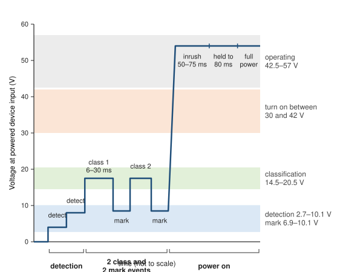

Power over Ethernet
===================

This page describes the analog circuits a powered device needs to take part
in the Power over Ethernet detection and classification process, and how
those circuits are normally built.

It is written from the point of view of the board being powered: a board
built around evampire that takes its power from the cable plugged into one of
its Ethernet ports. The power source side is described only as far as needed
to understand the exchange. The last part of the page explains which pieces
must be separate chips on the board and which low-voltage pieces evampire
itself can provide.

The rules come from the IEEE 802.3 Ethernet standard [PoE-IEEE802.3]_.
The numbers on this page are taken from published summaries of the
standard and from controller data sheets, each cited where it is used.

Terms used on this page
-----------------------

Power source
   The equipment that puts power onto the cable. It is either an Ethernet
   switch with power outputs, or an *injector*: a box placed in the cable
   between an ordinary switch and the powered device. The IEEE 802.3 standard
   calls it *power sourcing equipment* (PSE).

Powered device
   The equipment at the other end of the cable that takes power from it.
   The standard calls it a *powered device* (PD).

Pair and pair set
   An Ethernet cable has 8 wires twisted into 4 pairs. Both wires of a pair
   always carry the same DC voltage. Two pairs, one positive and one
   negative, form a *pair set* that carries current out and back.

Type
   A set of rules that a power source or powered device follows. Type 1
   comes from IEEE 802.3af, Type 2 from IEEE 802.3at, and Types 3 and 4 from
   IEEE 802.3bt.

Class
   A number from 0 to 8 that stands for a maximum power level. The powered
   device *requests* a class, and the power source *assigns* a class, which
   may be lower.

Signature
   A defined electrical behaviour (a resistance, a current) that the powered
   device shows when the power source applies a test voltage. The power
   source measures the signature to decide what is connected.

Maintain power signature
   The minimum current the powered device must keep drawing after power is
   on. If it stops, the power source assumes the cable has been unplugged and
   turns the power off.

Overview
--------

.. _fig-poe-system:

.. graphviz:: poe/system.dot
   :caption: How power from the cable reaches a board built around evampire.
             Bold arrows carry power, thin arrows carry data, dashed arrows
             carry status signals.
   :align: center

The power source applies a DC voltage between two pair sets of the cable.
Because both wires of each pair are at the same voltage, the DC voltage
appears as a *common-mode* voltage on the pairs and does not disturb the
data signals, which are differential. At the powered device the DC voltage
is taken from the centre taps of the cable-side windings of the Ethernet
transformers (the "magnetics"). The transformers pass the data signals and
block the DC from reaching the Ethernet transceiver. See
:doc:`../ethernet/magnetics` for how the transformers and their centre taps
are connected.

Which pairs carry power
~~~~~~~~~~~~~~~~~~~~~~~

The standard names the two pair sets *Alternative A* and *Alternative B* at
the power source, and *Mode A* and *Mode B* at the powered device
[EA-bt]_.

.. list-table:: Pair sets used for power
   :header-rows: 1
   :widths: 20 25 25 30

   * - Pair set
     - RJ45 pins
     - Cable colours (T568B wiring)
     - Used by
   * - Mode A
     - 1 and 2, 3 and 6
     - green and orange
     - all types
   * - Mode B
     - 4 and 5, 7 and 8
     - blue and brown
     - all types

Type 1 and Type 2 power sources use only one pair set at a time, chosen by
the power source. Type 3 and Type 4 power sources may use one pair set or
both for classes 1 to 4, and may switch between the two while powering.
When a power source assigns class 5 or higher it must use both pair sets
("4-pair power"). In gigabit Ethernet all four
pairs carry data, so both pair sets pass through transformers and the power
is taken from the centre taps in both cases [EA-bt]_.

Voltage range
~~~~~~~~~~~~~

The power source output is between 44 V and 57 V for Type 1, between 50 V
and 57 V for Types 2 and 3, and between 52 V and 57 V for Type 4
[EA-bt]_. The cable resistance lowers the voltage at the powered device. A
powered device must work down to 37 V (Type 1 rules) or about 42 V (higher
power types); see the type tables below.

Polarity bridges
~~~~~~~~~~~~~~~~

The powered device cannot know in advance which pair set will carry power,
or which pair of a set will be positive. The standard allows power sources
several pin and polarity arrangements; a Type 3 power source, for example,
may use any of the four polarity combinations of the two pair sets. It
therefore requires every powered device to accept any polarity on either
pair set [EA-bt]_.
The usual solution is two full-wave bridge rectifiers, one per pair set,
whose outputs are connected together.

The bridges are either ordinary diodes or MOSFETs used as switches. A
diode bridge loses two diode drops, which matters at high power. Schottky
diodes reduce the loss by about 30 % but leak more current, which makes it
harder to meet the limit on the voltage a powered device may feed back onto
the unused pair set (at most 2.8 V across a 100 kΩ test resistor)
[TPS2372]_ [EA-bt]_. The bridge also adds series resistance during
detection; the Analog Devices LT4275 data sheet allows up to 1.1 kΩ for it
[LT4275]_. MOSFET bridges such as the Microchip PD70224 replace the diodes
with low-resistance transistors [PD70224]_; they must stay off during
detection and classification, because a conducting transistor lets current
flow in both directions and spoils the signature [EA-bt]_.

Types and classes
-----------------

.. list-table:: Device types
   :header-rows: 1
   :widths: 10 18 12 15 15 15 15

   * - Type
     - Standard
     - Pairs powered
     - Power source voltage
     - Lowest voltage at powered device
     - Power source output, maximum
     - Power at powered device, maximum
   * - 1
     - IEEE 802.3af (2003), Clause 33
     - 2
     - 44–57 V
     - 37 V
     - 15.4 W
     - 13 W
   * - 2
     - IEEE 802.3at (2009), Clause 33
     - 2
     - 50–57 V
     - 42.5 V
     - 30 W
     - 25.5 W
   * - 3
     - IEEE 802.3bt (2018), Clause 145
     - 2 or 4 (4 for classes 5 and 6)
     - 50–57 V
     - 42.5 V
     - 60 W
     - 51 W
   * - 4
     - IEEE 802.3bt (2018), Clause 145
     - 2 or 4 (4 for classes 5 to 8)
     - 52–57 V
     - 41.2 V
     - 90 W
     - 71.3 W

Sources: power source voltages and powers from [EA-bt]_; lowest
powered-device voltages from [TPS2372]_, Table 6. The lowest voltage at the
powered device follows from the power source minimum voltage, the worst-case
cable resistance and the maximum power (see the calculation below).

.. list-table:: Classes
   :header-rows: 1
   :widths: 8 14 14 14 18 16 16

   * - Class
     - Power at powered device (average)
     - Peak power at powered device
     - Power source must supply
     - Class signature, events 1 and 2 / events 3 to 5
     - Class events needed to grant it
     - Powered device type
   * - 0
     - 13 W
     - —
     - 15.4 W
     - 0 / —
     - 1
     - 1 only
   * - 1
     - 3.84 W
     - 5.00 W
     - 4.00 W
     - 1 / 1
     - 1
     - 1 or 3
   * - 2
     - 6.49 W
     - 8.36 W
     - 6.70 W
     - 2 / 2
     - 1
     - 1 or 3
   * - 3
     - 13.0 W
     - 14.4 W
     - 14.0 W
     - 3 / 3
     - 1
     - 1 or 3
   * - 4
     - 25.5 W
     - 28.3 W
     - 30.0 W
     - 4 / 4
     - 2 or 3
     - 2 or 3
   * - 5
     - 40.0 W
     - 42.0 W
     - 45.0 W
     - 4 / 0
     - 4
     - 3
   * - 6
     - 51.0 W
     - 53.5 W
     - 60.0 W
     - 4 / 1
     - 4
     - 3
   * - 7
     - 62.0 W
     - 65.1 W
     - 75.0 W
     - 4 / 2
     - 5
     - 4
   * - 8
     - 71.3 W
     - 74.9 W
     - 90.0 W
     - 4 / 3
     - 5
     - 4

Classes 1 to 8, peak powers and power source powers are from the Clause 145
tables summarised in [EA-bt]_ (Tables 6, 7 and 14). Class 0 exists only in
Clause 33 and is treated as class 3 by Type 3 and Type 4 power sources.
Under the older Clause 33 rules (Types 1 and 2, with a 20 Ω cable allowance
for Type 1) the power source supplies 4.0 W, 7.0 W and 15.4 W for classes 1,
2 and 3 [EA-bt]_. A powered device may draw more than its average limit,
up to the peak power, for at most 50 ms in any 1 s window [EA-bt]_.

Power lost in the cable
~~~~~~~~~~~~~~~~~~~~~~~

The difference between the power source output and the power at the powered
device is the loss in the cable. The standard assumes a worst-case loop
resistance :math:`R` of 20 Ω for Type 1, 12.5 Ω for one pair set of the
higher types, and 6.25 Ω when both pair sets share the current [TPS2372]_
[EA-bt]_. With source voltage :math:`V_S` and current :math:`I`:

.. math::

   P_{PD} = V_S I - I^2 R

For Type 1 at the minimum source voltage and the full 15.4 W:

.. math::

   I = \frac{15.4\ \text{W}}{44\ \text{V}} = 0.35\ \text{A}, \qquad
   P_{PD} = 15.4\ \text{W} - (0.35\ \text{A})^2 \times 20\ \Omega
          = 12.95\ \text{W}

For Type 2: :math:`I = 30\ \text{W} / 50\ \text{V} = 0.6\ \text{A}` and
:math:`P_{PD} = 30 - 0.6^2 \times 12.5 = 25.5\ \text{W}`. For Type 4:
:math:`I = 90 / 52 = 1.73\ \text{A}` and
:math:`P_{PD} = 90 - 1.73^2 \times 6.25 = 71.3\ \text{W}`.

The lowest voltage at the powered device for a given power comes from
solving :math:`V_{PD} (V_S - V_{PD}) / R = P_{PD}`:

.. math::

   V_{PD} = \frac{V_S + \sqrt{V_S^2 - 4 R P_{PD}}}{2}

which gives 37.0 V for Type 1 (44 V, 20 Ω, 13 W), 42.5 V for Type 2
(50 V, 12.5 Ω, 25.5 W) and 41.2 V for Type 4 (52 V, 6.25 Ω, 71.3 W).
The Ethernet Alliance summary of Clause 145 lists 43.0 V as the lowest
voltage for class 8 on a Type 4 power source [EA-bt]_; the difference from
the simple calculation has not been resolved here, and a design should take
the value from the standard itself.

Power-up sequence
-----------------

When a powered device is plugged in, the power source runs through a fixed
sequence before it applies full voltage. Each step uses a different voltage
range, so the powered device can tell the steps apart only by measuring its
own input voltage.

.. _fig-poe-voltage-timeline:

         detection steps, four class events separated by mark events, and
         the rise to full voltage.
   :align: center
   :width: 100%

   Voltage at the powered device input while a Type 3 power source detects
   a powered device, runs four class events (granting class 6) and turns
   the power on. Shaded bands are the voltage windows the powered device
   must recognise. Time is not to scale.

.. _fig-poe-states:

.. wavedrom::
   :caption: What a powered-device controller does in each step of a
             two-event classification.

   { "signal": [
       { "name": "Power source output", "wave": "23.4.54.56..7...",
         "data": ["0 V", "detect", "class 1", "mark", "class 2", "mark",
                  "inrush", "44–57 V"] },
       {},
       { "name": "Signature resistor", "wave": "1..0.10.10......" },
       { "name": "Class current", "wave": "0..1.01.0......." },
       { "name": "Mark-event load", "wave": "0....10.10......" },
       { "name": "Class events counted", "wave": "2....3..4.......",
         "data": ["0", "1", "2"] },
       { "name": "Isolation switch", "wave": "0........3..1...",
         "data": ["current limited"] },
       { "name": "Power good", "wave": "0...........1..." }
     ],
     "head": { "text": "Two-event classification (Type 2 power source)" }
   }

The diagram above shows what a powered-device controller does in each step
for the shorter two-event sequence of a Type 2 power source. "Signature
resistor" high means the 25 kΩ resistor is connected; "isolation switch" is
the transistor that connects the rest of the board to the cable.

.. list-table:: Start-up timeline
   :header-rows: 1
   :widths: 16 22 22 40

   * - Step
     - Power source applies
     - Powered device sees
     - Powered device must
   * - Detection
     - At least two test points between 2.8 V and 10 V, at least 1 V
       apart. Never more than 30 V or 5 mA.
     - 2.7–10.1 V
     - Present a 23.7–26.3 kΩ incremental resistance, 50–120 nF.
   * - Class event 1
     - 15.5–20.5 V. Lasts 6–75 ms (Type 1), 6–30 ms (Type 2) or
       88–105 ms (Types 3 and 4).
     - 14.5–20.5 V
     - Draw its class signature current within 5 ms.
   * - Mark event
     - 7–10 V
     - 6.9–10.1 V
     - Draw 0.25–4 mA and present an invalid (below 12 kΩ) signature.
   * - Class events 2 to 5
     - 15.5–20.5 V, at most 20 ms each (Types 3 and 4).
     - 14.5–20.5 V
     - Draw the signature for that event; count the events.
   * - Power on
     - Rises to 44–57 V. Limits its current for 50–75 ms.
     - Turns on between 30 and 42 V
     - Charge its input capacitor slowly; stay below 13 W until 80 ms
       after turn-on.
   * - Operation
     - Watches the current.
     - Above 30 V
     - Keep drawing the maintain power signature current.

Values from [EA-bt]_, [Sifos-PD]_ and [TPS2372]_. Each step is described
below.

Detection
~~~~~~~~~

The power source must not put 50 V onto a cable that leads to equipment that
was not designed for it. So while nothing is powered, it repeatedly applies
small test voltages and measures the current. It applies at least two
voltages between 2.8 V and 10 V, at least 1 V apart, and computes the
*incremental* resistance

.. math::

   R_{det} = \frac{V_1 - V_2}{I_1 - I_2}

Using the difference of two points cancels the voltage offset of the
powered device's input bridge [EA-bt]_. A powered device shows a valid
signature when, over the whole 2.7–10.1 V range at its input:

* the incremental resistance is between 23.7 kΩ and 26.3 kΩ,
* the voltage offset is at most 1.9 V,
* the input capacitance is between 50 nF and 120 nF, and
* the series inductance is below 100 µH [EA-bt]_.

To make sure it is *not* detected (for example during a mark event, or when
it wants to refuse power), a powered device shows below 12 kΩ or above
45 kΩ. The power source must accept 19–26.5 kΩ and must reject below 15 kΩ
or above 33 kΩ; the gaps between these ranges give margin for measurement
error [EA-bt]_.

The signature is normally a 25 kΩ resistor across the bridge output. The
nominal 25 kΩ with ±5 % tolerance gives:

.. math::

   25\ \text{k}\Omega \times (1 \pm 0.05) = 23.75\ \text{k}\Omega \ \text{to}\
   26.25\ \text{k}\Omega

The bridge adds series resistance and the controller adds its own leakage,
so controller makers choose a slightly lower value. Texas Instruments
recommends an external 24.9 kΩ ±1 % resistor [TPS2378]_. Analog Devices
builds a temperature-compensated 24.4 kΩ resistor into the LT4275 (23.7 kΩ
to 25.2 kΩ over temperature) to leave room for up to 1.1 kΩ in the bridge
[LT4275]_:

.. math::

   R_{det,max} = 25.2\ \text{k}\Omega + 1.1\ \text{k}\Omega
               = 26.3\ \text{k}\Omega

The resistor sees very little power, so a small part is enough:

.. math::

   P = \frac{(10.1\ \text{V})^2}{24.9\ \text{k}\Omega} \approx 4.1\ \text{mW}

The capacitance requirement is usually met with a 0.1 µF, 100 V ceramic
capacitor across the controller input [TPS2372]_. The large capacitor that
feeds the DC-DC converter must not be visible during detection, which is
one reason for the isolation switch described below.

Classification
~~~~~~~~~~~~~~

After a valid detection the power source raises the voltage into the
classification range and measures the current. This is a *class event*.
The powered device answers with one of five *class signature* currents:

.. list-table:: Class signature currents (powered device)
   :header-rows: 1
   :widths: 20 25 25 30

   * - Class signature
     - Current drawn
     - Example resistor (TPS2372, 2.5 V)
     - Typical current with that resistor
   * - 0
     - 1–4 mA
     - 1210 Ω
     - 2.5 mA
   * - 1
     - 9–12 mA
     - 249 Ω
     - 10.6 mA
   * - 2
     - 17–20 mA
     - 140 Ω
     - 18.6 mA
   * - 3
     - 26–30 mA
     - 90.9 Ω
     - 27.9 mA
   * - 4
     - 36–44 mA
     - 63.4 Ω
     - 39.9 mA

Current ranges from [Sifos-PD]_ and [EA-bt]_ (IEEE 802.3bt Table 145-24);
resistor values and typical currents from [TPS2372]_.

The power source applies 15.5–20.5 V; the powered device must recognise
14.5–20.5 V at its input, which allows for the bridge drop and cable
resistance. The current must reach its final value within 5 ms of the input
passing 15.5 V [Sifos-PD]_ [EA-bt]_.

Single-event classification
   A Type 1 power source applies one class event (or none, since
   classification is optional for Type 1) and then turns the power on. The
   powered device learns nothing from this except that it may draw up to
   the power of the class it showed, and at most 13 W.

Multi-event classification
   Type 2, 3 and 4 power sources apply several class events, each followed
   by a *mark event*. The number of class events tells the powered device
   how much power it has been granted: two events for class 4, four for
   class 5 or 6, five for class 7 or 8 (see the table below). A Type 2
   power source applies at most 2 events, Type 3 at most 4 and Type 4 at
   most 5 [EA-bt]_.

Mark events
   Between class events the power source drops the voltage to 7–10 V. The
   powered device sees 6.9–10.1 V. This range overlaps the detection range,
   so the powered device must *not* look like a valid 25 kΩ signature here;
   it draws 0.25–4 mA and presents less than 12 kΩ [EA-bt]_. The TI
   TPS2378 presents 6–12 kΩ [TPS2378]_ and the LT4275 less than 11 kΩ
   [LT4275]_. Without the mark event, the powered device could not tell
   where one class event ends and the next begins. The powered device
   counts a class event when the voltage falls from the class range into
   the mark range [EA-bt]_. Between the two ranges (10.1 V to 14.5 V) the
   powered device may draw either current.

Long first class event
   Type 3 and Type 4 power sources make the first class event 88–105 ms
   long; Type 1 and Type 2 make it 6–75 ms and 6–30 ms. A powered device
   that measures the length of the first event can tell the newer types
   from the older ones, which decides which maintain power signature
   timing it may use. Later class events last at most 20 ms. Type 3 and 4
   power sources always end with a mark event before turning the power on
   [EA-bt]_.

Changing the signature from event 3
   Powered devices that request class 5 to 8 show class signature 4 in the
   first two events (so that older power sources see a class 4 device) and
   switch to signature 0, 1, 2 or 3 from the third event on [EA-bt]_.
   Controllers implement this with two class resistors, one for events 1
   and 2 and one for later events (pins CLSA and CLSB on the TPS2372)
   [TPS2372]_.

Reset
   If the power source wants to start again, it drops the voltage below
   2.8 V for at least 15 ms. The powered device then forgets the events it
   has counted [EA-bt]_. Controllers do this with a *mark reset*
   comparator: 3–5 V on the TPS2372 [TPS2372]_, 2.6–5.6 V on the LT4275
   [LT4275]_.

Autoclass
   An optional Type 3 and Type 4 feature: the powered device drops to class
   signature 0 about 81 ms into the first class event, and then draws its
   highest power during the first seconds after power-up so that the power
   source can measure it and reserve only what is really needed
   [EA-bt]_ [TPS2372]_.

The classification current flows through the controller at up to 20.5 V,
so the controller dissipates noticeable power during each event:

.. math::

   P \approx 20.5\ \text{V} \times 44\ \text{mA} \approx 0.9\ \text{W}

The LT4275 data sheet quotes up to 1.5 W during classification and relies
on thermal protection if the condition lasts abnormally long [LT4275]_.
This is one reason the later class events were limited to 20 ms.

Power on and inrush
~~~~~~~~~~~~~~~~~~~

After the last mark event the power source raises its output to the
operating voltage. The powered device must stay off (draw no load current)
until its input passes a *turn-on* voltage, which may be anywhere from 30 V
to 42 V, and must turn off again when its input falls below 30 V
[Sifos-PD]_ [EA-bt]_. A gap between turn-on and turn-off (hysteresis) is
needed so that the voltage drop caused by switching on the load does not
switch it off again.

.. list-table:: Turn-on and turn-off thresholds of example controllers
   :header-rows: 1
   :widths: 30 35 35

   * - Controller
     - Turn on (rising)
     - Turn off (falling)
   * - Standard limit
     - between 30 V and 42 V
     - not below 30 V
   * - TI TPS2372 and TPS2378
     - 36.3 V to 40 V (38.1 V typical)
     - 30.5 V to 33.6 V (32 V typical)
   * - Analog Devices LT4275
     - 35 V typical, 37 V maximum
     - 30 V minimum, 31 V typical

Sources: [TPS2372]_, [TPS2378]_, [LT4275]_.

The powered device's DC-DC converter has a large input capacitor (tens to
hundreds of µF). Connecting it directly to 50 V would draw a very large
current. Instead the power source limits its own current for 50–75 ms
after turning on: to 400–450 mA when it has assigned class 1 to 4, and up
to 900 mA for higher classes [EA-bt]_ [TPS2372]_. The powered device
should limit its own current too, so that its capacitor is fully charged
before the power source leaves its current-limited phase. Between 50 ms
and 80 ms after its turn-on the powered device must draw less than the
inrush current limit and no more than 13 W [EA-bt]_. Controllers limit
the current with their isolation switch (see below): 140 mA on the TPS2378,
200 mA or 335 mA on the TPS2372-3 and -4 [TPS2378]_ [TPS2372]_, and about
100 mA set by an external capacitor on the LT4275 [LT4275]_. The time to
charge the capacitor is

.. math::

   t = \frac{C V}{I} = \frac{100\ \mu\text{F} \times 57\ \text{V}}{140\ \text{mA}}
     \approx 41\ \text{ms}

Only when the capacitor is charged does the controller signal *power good*
and let the DC-DC converter start. The TPS2372 also waits at least
78–87 ms after the start of inrush before doing so, so that the converter
does not start inside the power source's inrush period [TPS2372]_.

Maintain power signature
~~~~~~~~~~~~~~~~~~~~~~~~

Once powered, the powered device must keep drawing a minimum current. If
the current stays below that level for long enough, the power source
assumes the cable has been unplugged and removes the voltage, then returns
to detection. This prevents a disconnected cable end from staying live.
The current may be continuous or pulsed:

.. list-table:: Maintain power signature (powered device side)
   :header-rows: 1
   :widths: 18 16 16 16 16 18

   * - Powered device type
     - Assigned class
     - Power source type
     - Minimum current
     - Minimum on time
     - Maximum off time
   * - 1, 2
     - all
     - all
     - 10 mA
     - 75 ms
     - 250 ms
   * - 3, 4
     - 1 to 4
     - 1, 2
     - 10 mA
     - 75 ms
     - 250 ms
   * - 3, 4
     - 1 to 4
     - 3, 4
     - 10 mA
     - 7 ms
     - 310 ms
   * - 3, 4
     - 5 to 8
     - 3, 4
     - 16 mA
     - 7 ms
     - 310 ms

Source: [EA-bt]_, Table 19. Type 1 and Type 2 power sources may also check
an AC impedance; for those the powered device must also present less than
26.3 kΩ in parallel with 0.05 µF, which the bulk capacitor normally does
[TPS2378]_. A Type 3 or Type 4 power source must remove power when the
current has been below 2 mA for more than 400 ms [EA-bt]_.

A board that always draws more than about 0.6 W (classes 1–4) or 1 W
(classes 5–8) meets the requirement without any special circuit [EA-bt]_.
A board with a deep sleep mode must draw pulses. With the short Type 3/4
timing the average cost is small:

.. math::

   P_{MPS} \approx 54\ \text{V} \times 10\ \text{mA} \times
   \frac{7\ \text{ms}}{7\ \text{ms} + 310\ \text{ms}} \approx 12\ \text{mW}

The power source only sees the pulse after the bulk capacitor stops
supplying it, so in practice the pulses are made longer than 7 ms. The
TPS2372 generates them automatically when its output current falls below
about 28 mA, with a choice of 5.4 %, 8.1 % or 12.5 % duty cycle for Type 3
and 4 power sources and 26 % for Type 1 and 2 [TPS2372]_.

How the powered device learns its power allocation
--------------------------------------------------

The powered device must not draw more than the power it has been assigned.
It learns the assigned power in three ways.

From the number of class events
   The assigned class is the lower of the requested class and the class
   implied by the number of class events [EA-bt]_:

   .. list-table::
      :header-rows: 1
      :widths: 40 60

      * - Class events applied
        - Highest class assigned
      * - 1
        - 3 (13 W)
      * - 2 or 3
        - 4 (25.5 W)
      * - 4
        - 6 (51 W), or 5 if 5 was requested
      * - 5
        - 8 (71.3 W), or 7 if 7 was requested

   A power source that cannot supply the requested power simply applies
   fewer events. The powered device is then *demoted* to a lower class and
   must either stay off or start in a reduced-power mode [EA-bt]_.

From the controller's indicator outputs
   The controller counts the events in hardware and reports the result to
   the rest of the board on open-drain output pins. These pins are
   referenced to the controller's return node, and are passed through
   optocouplers when the DC-DC converter is isolated [TPS2378]_
   [TPS2372]_.

   * TI TPS2378: one pin, T2P, pulled low after a two-event classification
     (Type 2 power source) [TPS2378]_.
   * TI TPS2372: three pins, TPH, TPL and BT, which together encode the
     power source type and the allocated power (12.95 W, 25.5 W, 40 W,
     51 W, 62 W or 71 W). They become valid about 24 ms after power good
     [TPS2372]_.
   * Analog Devices LT4275: one pin, T2P, which floats for 13 W, is low
     for 25.5 W, and toggles at about 840 Hz when it has identified a
     power source using Analog Devices' own higher-power extension
     [LT4275]_.

From software, over the network
   After power is on and the Ethernet link is up, the powered device and
   the power source can exchange short Ethernet messages to change the
   allocation. The messages belong to the *Link Layer Discovery Protocol*
   (LLDP, IEEE 802.1AB): small frames sent to the next device on the cable
   only, with destination MAC address 01-80-C2-00-00-0E and type field
   0x88CC [PoE-LLDP]_. IEEE 802.3 Clause 79 defines a "Power via MDI" field
   for them. Among others it carries a *requested power* value from the
   powered device and an *allocated power* value from the power source,
   both in units of 0.1 W (so 255 means 25.5 W). The powered device sends
   its request, the power source answers with its allocation, and the new
   limit applies once both agree [EA-bt]_. Powered devices of class 4 and
   above must support this exchange; it lets a demoted device ask again
   for its full power later, or a device give back power it does not need.
   A powered device may not request more by software than it requested
   in hardware [EA-bt]_. On evampire this exchange runs on the RISC-V
   processor in software: it builds and parses these frames using the
   internal Ethernet port.

Analog blocks in a powered-device controller
--------------------------------------------

Every function described above is analog and works at the cable voltage,
up to 57 V plus surges. Commercial powered-device controller chips combine
them on a 100 V process. All voltages inside the controller are measured
from its negative input (VSS), which is the negative output of the bridges.

.. _fig-poe-pd-controller:

.. graphviz:: poe/pd-controller.dot
   :caption: Blocks inside a typical powered-device controller. In the TI
             parts the isolation switch sits in the negative path, between
             the load return (RTN) and VSS.
   :align: center

Signature resistor and its switch
   A 24.9 kΩ resistor connected while the input is in the detection range.
   On the TPS2378 the resistor is external, between VDD and the DEN pin,
   and the controller connects it between about 1.4 V and 10.9 V and
   disconnects it above that range to save power. Pulling DEN low also
   turns the isolation switch off, so the same pin lets the board refuse or
   drop the power [TPS2378]_. The LT4275 integrates the resistor
   [LT4275]_. During mark events a second, lower resistance is connected
   to spoil the signature.

Classification current regulator
   A regulator that holds a fixed voltage across an external resistor
   while the input is in the class range, so that the current is set by
   the resistor: about 2.5 V on the TI parts [TPS2378]_ and 1.40 V on the
   LT4275 [LT4275]_.

   .. math::

      I_{class} \approx \frac{V_{CLS}}{R_{CLS}} + I_{bias}, \qquad
      \frac{2.5\ \text{V}}{63.4\ \Omega} = 39.4\ \text{mA}, \qquad
      \frac{1.40\ \text{V}}{34.8\ \Omega} = 40.2\ \text{mA}

   Both land in the 36–44 mA window for class signature 4. The regulator
   is turned off above the class range and during thermal shutdown to
   limit dissipation [TPS2378]_.

Window comparators with hysteresis
   A set of comparators on the input voltage decides which step is in
   progress. Hysteresis gives each comparator memory, so that the state
   does not chatter on noise and so that falling and rising thresholds can
   be placed in the gaps between the standard's ranges:

   .. list-table:: TPS2372 input-voltage comparators
      :header-rows: 1
      :widths: 40 30 30

      * - Comparator
        - Threshold (typical)
        - Hysteresis (typical)
      * - Class lower (rising)
        - 12.5 V
        - 1.6 V
      * - Class upper (rising)
        - 22 V
        - 0.78 V
      * - Mark reset (falling)
        - 3.9 V
        - —
      * - Turn on (rising)
        - 38.1 V
        - 6.1 V

   Source: [TPS2372]_. A small state machine combines the comparator
   outputs, counts class events and latches the result for the indicator
   pins.

Reference
   The thresholds and the classification voltage need a reference that is
   accurate over −40 °C to 125 °C. The TPS2372 block diagram shows a 1.5 V
   reference on a REF pin with an external 49.9 kΩ resistor [TPS2372]_;
   the LT4275 block diagram shows internal voltage and current references
   [LT4275]_. A bandgap reference is the usual way to build this.

Isolation switch with current limit
   An N-channel MOSFET rated for 100 V that keeps the DC-DC converter and
   its large capacitor disconnected until the turn-on threshold is
   reached, then charges the capacitor with a limited current, and then
   stays fully on with a higher current limit as overload protection.
   Examples: TPS2378, 0.42 Ω, 140 mA inrush limit, 1 A limit; TPS2372-4,
   0.1 Ω, 335 mA inrush limit, 2.2 A limit [TPS2378]_ [TPS2372]_. If the
   load pulls the switch out of saturation for longer than a filter time
   (800 µs on the TPS2378, 1.65 ms on the TPS2372), the controller falls
   back to the inrush limit. The LT4275 drives an external MOSFET instead,
   from an internal charge pump, and sets the inrush current with a
   capacitor on the gate [LT4275]_. This lets the designer choose a
   lower-resistance transistor for high power.

Power-good output
   An open-drain output that tells the DC-DC converter it may start. It is
   held low while the bulk capacitor charges (TPS2372 PG, TPS2378 CDB,
   LT4275 PWRGD) [TPS2372]_ [TPS2378]_ [LT4275]_.

Thermal protection
   The isolation switch and the class regulator can overheat during a
   short circuit or a long class event. A temperature sensor turns them
   off and lets them restart after cooling: at 158 °C typical (140 °C
   minimum) with 20 °C hysteresis on the TPS2372, 145 °C typical on the
   TPS2378 [TPS2372]_ [TPS2378]_.

Input protection
   A transient-voltage suppressor (TI recommends an SMAJ58A) across the
   bridge output limits surges from the cable to below the controller's
   100 V rating [TPS2372]_ [LT4275]_.

Example controller chips
~~~~~~~~~~~~~~~~~~~~~~~~

.. list-table::
   :header-rows: 1
   :widths: 18 14 22 22 24

   * - Part
     - Maker
     - Standard
     - Isolation switch
     - Notes
   * - TPS2378
     - Texas Instruments
     - 802.3at, Type 2 (up to 25.5 W)
     - Internal, 0.42 Ω
     - T2P indicator, converter enable output
   * - TPS2372-3 / -4
     - Texas Instruments
     - 802.3bt, Types 3 and 4 (51 W / 71.3 W)
     - Internal, 0.3 Ω / 0.1 Ω
     - TPH/TPL/BT indicators, automatic maintain power signature,
       autoclass
   * - TPS23753A
     - Texas Instruments
     - 802.3at, Type 1 (13 W)
     - Internal, 0.7 Ω
     - Includes a current-mode controller for an isolated DC-DC converter
   * - LT4275A / B / C
     - Analog Devices
     - 802.3bt-compatible (A, up to 90 W with a proprietary extension),
       802.3at (B), 802.3af (C)
     - External N-channel MOSFET
     - T2P indicator, power good, integrated signature resistor
   * - LTC4269-1
     - Analog Devices
     - 802.3at, Type 2
     - Internal, 0.7 Ω
     - Includes a synchronous flyback controller
   * - NCP1096
     - onsemi
     - 802.3bt (up to 90 W at the power source)
     - Internal
     - Power good output, auxiliary supply input
   * - PD70224
     - Microchip
     - 802.3af/at/bt
     - —
     - MOSFET bridge rectifier that replaces the diode bridges

Sources: [TPS2378]_, [TPS2372]_, [TPS23753A]_, [LT4275]_, [LTC4269-1]_,
[NCP1096]_, [PD70224]_.

The DC-DC converter and its start-up
~~~~~~~~~~~~~~~~~~~~~~~~~~~~~~~~~~~~

After the isolation switch the board has a 37–57 V supply. A DC-DC
converter turns it into the low voltages the board uses (3.3 V for
evampire's input/output pins and the Ethernet transceivers).

Isolated flyback converter
   The usual choice. A transformer separates the cable side from the rest
   of the board, which keeps the cable electrically isolated from any
   other connector or metal part the user can touch. Parts such as the
   TPS23753A and the LTC4269-1 combine the powered-device controller with
   the flyback controller [TPS23753A]_ [LTC4269-1]_.

Non-isolated buck converter
   Simpler and smaller. Analog Devices notes that isolation is not needed
   when the powered device is a single unit with no other external
   connector, fully enclosed in plastic [ADI-PoE]_. The isolation
   requirement and its exceptions are set by the standard and by safety
   rules; they have not been checked here against the text of IEEE 802.3.

Start-up of the converter follows the power-good signal. On the TPS23753A,
the converter stays off during inrush; an internal current source then
charges the converter's bias capacitor until it reaches about 9 V, the
converter starts switching with a soft start, and an auxiliary winding on
the transformer must take over the bias supply before the capacitor falls
to about 5.5 V. If the input falls below the lower turn-off threshold
(about 30.5 V) the isolation switch opens but the converter keeps running
from the bulk capacitor until its own under-voltage lock-out stops it
[TPS23753A]_.

What evampire can and cannot do
-------------------------------

Device voltage ratings in gf180mcu
~~~~~~~~~~~~~~~~~~~~~~~~~~~~~~~~~~

.. list-table:: Device voltage ratings from the gf180mcu PDK documentation
   :header-rows: 1
   :widths: 35 30 35

   * - Device
     - Rating
     - Notes
   * - 3.3 V MOSFETs (thin gate oxide)
     - 3.3 V nominal, +10 %
     - Gate-to-any-node DC limit 3.63 V
   * - 5 V and 6 V MOSFETs (thick gate oxide)
     - 5 V or 6 V nominal, +10 %
     - Gate-to-any-node DC limit given as "6.5V/6V for 5V/6V process thick
       gate"; 6 V NMOS drain breakdown 8.5 V minimum
   * - 10 V LDNMOS and LDPMOS (optional)
     - 10 V
     - Drain breakdown 13.2 V minimum, 14.5 V typical
   * - N-well to substrate junction
     - —
     - Breakdown 10 V minimum, 14 V typical

Sources: [PoE-GF180-DRM-2]_ (process options: LV 3.3 V, HV 5 V or 6 V),
[PoE-GF180-DRM-14]_ (supply and gate-oxide limits), [PoE-GF180-EP-2]_,
[PoE-GF180-EP-5]_ and [PoE-GF180-EP-8]_ (breakdown voltages and the 10 V LDMOS
devices).

No device in the PDK documentation is rated anywhere near the 57 V
operating voltage of the cable, let alone the 100 V that commercial
controllers are built for to survive surges. Even the optional 10 V
LDMOS transistors break down at about 13–15 V. Everything that is
connected to the cable-side supply must therefore be outside evampire:

* the bridges and the surge clamp,
* the signature resistor, the classification current regulator, the
  window comparators and the mark-event load, all of which see up to 57 V
  between their terminals,
* the isolation switch and its current limit,
* the DC-DC converter.

The detection and classification signals are short and slow (tens of
milliseconds), so logic on evampire could in principle sequence them; but
the comparators and current sources themselves must stand off the full
input voltage, and a commercial controller provides them, with their
thermal protection, in one small package. Building them from discrete
high-voltage parts controlled by evampire would add parts and risk without
a clear benefit.

What evampire can provide
~~~~~~~~~~~~~~~~~~~~~~~~~

.. _fig-poe-split:

.. graphviz:: poe/split.dot
   :caption: Recommended split between external parts and evampire.
   :align: center

The low-voltage side of the power negotiation interface can be on
evampire:

Status inputs
   Ordinary 3.3 V digital inputs for the controller's power-good and
   allocated-power outputs. These are open-drain and need a pull-up.
   With an isolated converter they reach evampire through optocouplers
   (the TPS2372 data sheet shows the circuit [TPS2372]_). With a
   non-isolated converter the controller's return node is the board
   ground, so a pull-up to 3.3 V is enough, provided the controller's
   output is only ever pulled low and never driven above 3.3 V.

Supply monitor (optional)
   A comparator or analog-to-digital converter that measures the cable
   supply through an external resistor divider, so that software can see
   the input voltage drop under load. This works only with a non-isolated
   converter, where the divider and evampire share a ground. The divider
   should sit after the isolation switch, so that it is not in parallel
   with the 25 kΩ signature during detection. For example:

   .. math::

      V_{out} = 57\ \text{V} \times
                \frac{56\ \text{k}\Omega}{1\ \text{M}\Omega + 56\ \text{k}\Omega}
              = 3.02\ \text{V}, \qquad
      I = \frac{57\ \text{V}}{1.056\ \text{M}\Omega} \approx 54\ \mu\text{A}

   This keeps the evampire input below the 3.63 V gate limit at the
   highest operating voltage, but surges on the cable can go higher;
   a clamp at the divider output would be needed.

Load control and keep-alive
   Software reads the allocated power and keeps the board's consumption
   below it, for example by holding one Ethernet transceiver in reset
   until enough power has been granted. If the board has a sleep mode
   below the maintain power signature current, either the controller
   generates the pulses itself (TPS2372) or an evampire output switches
   an external load resistor on the cable-side supply through a
   high-voltage transistor.

Software negotiation
   The RISC-V processor runs the LLDP power exchange described above.

Open design decisions
~~~~~~~~~~~~~~~~~~~~~

The following choices are not yet made:

* **Isolated or non-isolated converter.** This decides whether evampire
  can see the controller's signals and the input voltage directly or only
  through optocouplers. The second Ethernet port is itself isolated by its
  transformers, but any other connector or exposed metal on the board
  would need the isolated design.
* **Which class to request.** This depends on the power budget of the
  whole board (evampire and two gigabit Ethernet transceivers), which has
  not been estimated yet. It decides the controller (Type 2 or Type 3)
  and the class resistors.
* **Whether the power negotiation interface includes a comparator or
  analog-to-digital converter**, or only digital status inputs.
* **Which ports accept power.** Port A only, or either port, each with its
  own bridges and controller. Passing power on from one port to the other
  is not covered on this page.
* **Handling of LLDP frames on the forwarding path.** evampire forwards
  every frame between ports A and B unchanged. LLDP frames are addressed
  to 01-80-C2-00-00-0E, which normal bridges do not forward [PoE-LLDP]_. A
  power request sent by equipment on port B would therefore reach the
  power source on port A, and both evampire's and that equipment's
  requests would arrive at the same power source port. Whether the
  forwarding path should drop these frames is open.
* **Availability of optional PDK layers.** The 10 V LDMOS devices are an
  optional part of the process. They are not needed for the recommended
  split, and whether they are offered on wafer.space runs has not been
  checked.

Related pages: :doc:`usb-pd` describes the other way of powering the
board.

References
----------

.. [PoE-IEEE802.3] IEEE Std 802.3-2022, *IEEE Standard for Ethernet*,
   Clause 33 "Power over Ethernet over 2 pairs" (Types 1 and 2),
   Clause 145 "Power over Ethernet" (Types 3 and 4) and Clause 79
   (link-layer discovery power fields).
   https://standards.ieee.org/ieee/802.3/10422/ . The standard text was not
   accessible while writing this page; values are taken from the summaries
   and data sheets below, which cite the standard's tables.

.. [EA-bt] L. Yseboodt and D. Abramson, *Overview of 802.3bt — Power over
   Ethernet standard*, Ethernet Alliance white paper, 2019-12.
   https://ethernetalliance.org/wp-content/uploads/2019/12/WP_EA_Overview8023bt_V2p1_FINAL.pdf

.. [Sifos-PD] Sifos Technologies, *802.3bt PD Conformance Test Suite
   Parameters*, report version 3.7, 2022-11-11.
   https://sifos.com/wp-content/uploads/PDA-604-802.3bt-Conformance-Test-PICS-Coverage.pdf

.. [TPS2372] Texas Instruments, *TPS2372 High-Power PoE PD Interface with
   Automatic MPS and Autoclass*, SLUSCM4B, revised 2018-11.
   https://www.ti.com/lit/ds/symlink/tps2372.pdf

.. [TPS2378] Texas Instruments, *TPS2378 IEEE 802.3at PoE Powered Device
   Controller*, SLVSB99C, revised 2015-07.
   https://www.ti.com/lit/ds/symlink/tps2378.pdf

.. [TPS23753A] Texas Instruments, *TPS23753A IEEE 802.3 PoE Interface and
   Converter Controller with Enhanced ESD Immunity*, SLVS933D, revised
   2020-12. https://www.ti.com/lit/ds/symlink/tps23753a.pdf

.. [LT4275] Analog Devices (Linear Technology), *LT4275 LTPoE++/PoE+/PoE PD
   Controller*, data sheet 4275f.
   https://www.analog.com/media/en/technical-documentation/data-sheets/lt4275.pdf

.. [LTC4269-1] Analog Devices (Linear Technology), *LTC4269-1 IEEE 802.3at
   High Power PD and Synchronous No-Opto Flyback Controller*, product page.
   https://www.analog.com/en/products/ltc4269-1.html

.. [NCP1096] onsemi, *NCP1096 PoE-PD Interface Controller*, data sheet
   NCP1096/D. https://www.onsemi.com/products/interfaces/power-over-ethernet-poe/ncp1096

.. [PD70224] Microchip, *PD70224 IdealBridge Dual MOSFET-Bridge Rectifier*,
   data sheet DS00003575D. https://www.microchip.com/en-us/product/PD70224

.. [ADI-PoE] Analog Devices, *Creating the Power Subsystem for Power over
   Ethernet Designs*, technical article.
   https://www.analog.com/en/resources/technical-articles/creating-the-power-subsystem-for-power-over-ethernet-designs.html

.. [PoE-LLDP] IEEE Std 802.1AB, *Station and Media Access Control Connectivity
   Discovery* (Link Layer Discovery Protocol).
   https://standards.ieee.org/ieee/802.1AB/6047/

.. [PoE-GF180-DRM-2] GlobalFoundries, gf180mcu PDK design manual, section 2.0
   "Scope".
   https://gf180mcu-pdk.readthedocs.io/en/latest/physical_verification/design_manual/drm_02.html

.. [PoE-GF180-DRM-14] GlobalFoundries, gf180mcu PDK design manual, section 14.1
   "Chip Operating Conditions".
   https://gf180mcu-pdk.readthedocs.io/en/latest/physical_verification/design_manual/drm_14_1.html

.. [PoE-GF180-EP-2] GlobalFoundries, gf180mcu electrical parameters, section 2.0
   "Medium Voltage Devices (6V)".
   https://gf180mcu-pdk.readthedocs.io/en/latest/analog/spice/elec_specs/elec_specs_2.html

.. [PoE-GF180-EP-5] GlobalFoundries, gf180mcu electrical parameters, section 5.5
   "Junction Breakdown Voltage".
   https://gf180mcu-pdk.readthedocs.io/en/latest/analog/spice/elec_specs/elec_specs_5_5.html

.. [PoE-GF180-EP-8] GlobalFoundries, gf180mcu electrical parameters, section 8
   "High Voltage LDMOS Transistor (10.0V)".
   https://gf180mcu-pdk.readthedocs.io/en/latest/analog/spice/elec_specs/elec_specs_8_1.html
