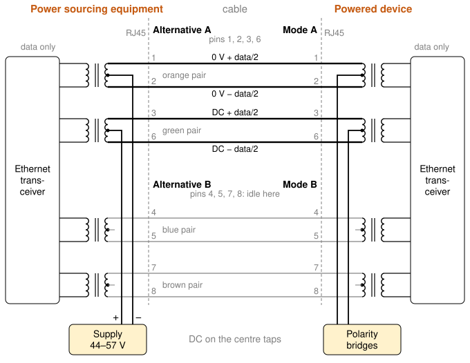
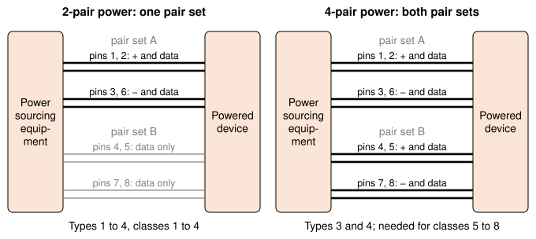

.. _poe-basics:

Ends, pairs and voltages
========================

This page names the two ends of a powered Ethernet cable, shows which pairs
of the cable carry the power, and gives the voltage range at each end.

The two ends
------------

The end that puts power onto the cable is the
:term:`power sourcing equipment`, abbreviated PSE in the standard. It is
usually an Ethernet :wikipedia:`switch <Network_switch>` with power outputs,
or an *injector*: a box placed in the cable between an ordinary switch and
the device. The end that takes power from the cable is the
:term:`powered device`, abbreviated PD. :ref:`power-roles` lists the names
both power standards use.

:numref:`fig-poe-system` shows both ends on a first-version board
(:ref:`board configurations <tab-power-board-configs>`). Port A receives
power from upstream power sourcing equipment and port B supplies power to
a downstream powered device. All the power passes through the board's
internal power bus (:ref:`power-flow`).

.. graphviz:: system.dot
   :name: fig-poe-system
   :caption: The Power over Ethernet blocks on a first-version board, with
             power arriving on port A and leaving on port B.
   :alt: Block diagram. On the left, power sourcing equipment feeds a cable
         into the RJ45 socket and magnetics of port A, then two polarity
         bridges, the signature, class and isolation switch block, and the
         input converter, which feeds the internal power bus. On the right,
         the bus feeds the high-voltage converter, then the detection,
         class, switch and current-limit block, then the RJ45 socket and
         magnetics of port B and the cable to a powered device. Data passes
         from each socket through an Ethernet transceiver to evampire over
         RGMII. evampire reads status from port A and controls port B.
   :align: center

Power as a common-mode voltage
------------------------------

An Ethernet cable has 8 wires twisted into 4
:wikipedia:`twisted pairs <Twisted_pair>`. The power sourcing equipment
puts the same DC voltage on both wires of one pair, and the return on both
wires of another pair. Two such pairs, one positive and one negative, form
a :term:`pair set`, which carries the current out and back.

Both wires of a pair sit at the same DC voltage, so the power is a
:term:`common-mode voltage` on the pair. The data
is the difference between the two wires, so the DC voltage does not
disturb it. On the first-version board the DC voltage is connected to the
:term:`centre taps <centre tap>` of the cable-side windings of the :term:`magnetics`, which pass
the data and keep the DC away from the :term:`Ethernet transceiver`. The
full design has no coupling transformers. :doc:`../../ethernet/magnetics/index`
describes both arrangements. :numref:`fig-poe-pairs` shows the
first-version arrangement with power on one pair set.

         equipment on the left and a powered device on the right. Each pair
         runs from a transformer at one end to a transformer at the other,
         and each transformer's data winding connects to an Ethernet
         transceiver, which sees data only. Pairs 1-2 (orange) and 3-6
         (green) form Alternative A at the power sourcing end and Mode A
         at the powered device. The centre tap of pair 1-2 connects to the
         negative side of the 44 to 57 V supply and that of pair 3-6 to the
         positive side, so the wires of pair 1-2 sit at 0 V plus and minus
         half the data and those of pair 3-6 at DC plus and minus half the
         data. At the powered device both centre taps go to the polarity
         bridges. Pairs 4-5 (blue) and 7-8 (brown), Alternative B and
         Mode B, are idle in this example.
   :align: center

   Power on Alternative A: the DC is fed in at the centre taps of the
   cable-side windings, so both wires of a pair carry the same DC and the
   data is their difference (pins 1, 2 negative, which every type allows;
   T568B colours).

Pair set names
--------------

The power sourcing equipment calls the two pair sets Alternative A and
Alternative B. The powered device calls the same pair sets Mode A and
Mode B. :numref:`tab-poe-pairs` lists the pins of each pair set on the
:term:`RJ45` socket (:clause:`Table 145-3 <145>`).

.. list-table:: The two pair sets
   :name: tab-poe-pairs
   :header-rows: 1
   :widths: 40 25 35

   * - Pair set
     - RJ45 pins
     - Wire colours
   * - Alternative A, Mode A
     - 1, 2, 3, 6
     - orange, green
   * - Alternative B, Mode B
     - 4, 5, 7, 8
     - blue, brown

The wire colours follow the T568A and T568B wiring of
:std:`TIA-568 <tia-568>`, in which pins 1 and 2 are one pair, pins 3 and 6
another, pins 4 and 5 the third and pins 7 and 8 the fourth.

Each name belongs to one end, so :numref:`fig-poe-pairs` labels the same
pins Alternative A at one end and Mode A at the other. The polarity of
each pair set is chosen by the power sourcing equipment:

* On Alternative A, either pair of the set may be positive
  (:clause:`Table 33-2 <33>`, :clause:`Table 145-3 <145>`).
* On Alternative B, pins 4 and 5 are positive under :clause:`33`. Under
  :clause:`145` either pair may be positive.
* Type 4 power sourcing equipment uses one fixed polarity on each pair set
  (:clause:`Table 145-4 <145>`). The types are described on
  :doc:`types-classes`.

The powered device cannot know in advance which pair set carries power, or
which pair is positive, so it must accept any polarity on either pair set
(:doc:`powered-device`).

2-pair and 4-pair power
-----------------------

Power sourcing equipment of Types 1 and 2 powers one pair set. Types 3 and
4 may power one pair set or both for classes 1 to 4, and must power both
for classes 5 to 8 (:clause:`145.1.3`, :clause:`145.2.10.1`). Powering both
pair sets is called 4-pair power. :numref:`fig-poe-pair-sets` shows the
two cases.

Gigabit Ethernet (:term:`1000BASE-T`) carries data on all four pairs, so
on a gigabit port both pair sets carry data and power together.

         powered device on the right and four pairs between them. In the
         2-pair panel, pins 1-2 carry negative and data and pins 3-6
         positive and data, while pins 4-5 and 7-8 carry data only; this
         serves Types 1 to 4 at classes 1 to 4. In the 4-pair panel, pins
         4-5 also carry positive and data and pins 7-8 negative and data;
         this is Types 3 and 4 and is needed for classes 5 to 8.
   :align: center

   2-pair power on one pair set, here pair set A, and 4-pair power on
   both, with data on all four pairs of a gigabit link; the polarities
   drawn are those a Type 4 source uses.

Output voltage
--------------

:numref:`tab-poe-pse-voltage` gives the output voltage that power sourcing
equipment of each type must hold while the power is on. The voltage at the
powered device is lower by the drop in the cable; :doc:`types-classes`
works it out.

.. list-table:: Output voltage of power sourcing equipment while powered
   :name: tab-poe-pse-voltage
   :header-rows: 1
   :widths: 20 25 25 30

   * - Type
     - Lowest (V)
     - Highest (V)
     - Source
   * - 1
     - 44
     - 57
     - :clause:`Table 33-11 <33>`
   * - 2
     - 50
     - 57
     - :clause:`Table 33-11 <33>`
   * - 3
     - 50
     - 57
     - :clause:`Table 145-16 <145>`
   * - 4
     - 52
     - 57
     - :clause:`Table 145-16 <145>`

Before the power is on, the cable carries only test voltages, below 30 V
during detection (:clause:`Table 145-7 <145>`) and below 20.5 V during
classification (:clause:`Table 145-14 <145>`). :doc:`sequence` describes
these steps.

Open questions
--------------

* Whether port B powers one pair set or both, which decides whether it can
  offer classes 5 to 8 (:doc:`types-classes`).
