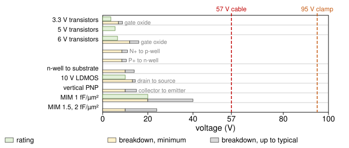
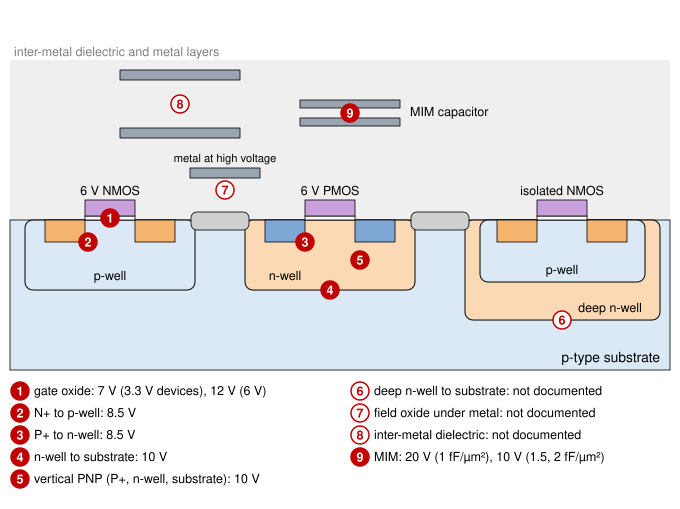
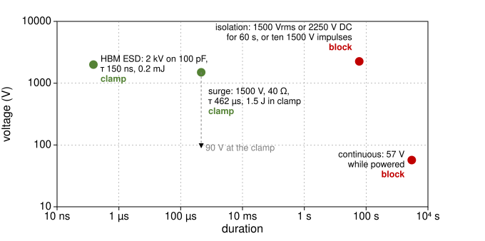
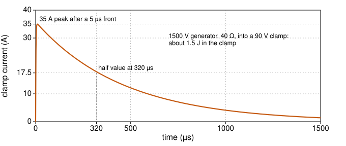

.. _poe-limits:

Process voltage limits
======================

This page separates three kinds of voltage limit in the gf180mcu process,
and describes the four kinds of electrical stress that a circuit connected
to the cable must survive.

Cable voltage and device ratings
--------------------------------

Every circuit of a :doc:`powered device <powered-device>` and of
:doc:`power sourcing equipment <power-sourcing>` handles up
to 57 V, plus surges. The standard transistors of
`gf180mcu <https://gf180mcu-pdk.readthedocs.io/>`_ are rated for 3.3 V,
5 V or 6 V. A rating is not the only limit: evampire uses custom devices
wherever a function needs them (:ref:`req-process`), so a function with no
ready-made high-voltage device is a design task, not an impossibility. Three
kinds of limit are separated below. :numref:`fig-poe-ratings` sets the
ratings and breakdown voltages of the next two sections against the cable
voltage.

         gf180mcu device, a bar shows its rating and further bars its
         breakdown voltages, minimum and up to typical: 3.3 V transistors
         rated 3.63 V with gate oxide breakdown 7 to 8.8 V; 5 V transistors
         rated 5.5 V; 6 V transistors rated 6.6 V with gate oxide 12 to
         16 V, N+ to p-well 8.5 to 11 V and P+ to n-well 8.5 to 10.5 V;
         n-well to substrate 10 to 14 V; 10 V LDMOS rated 10 V with drain
         to source 13.2 to 14.5 V; vertical PNP 10 to 15 V; MIM 1 fF/µm²
         rated 20 V with breakdown 20 to 40 V; MIM 1.5 and 2 fF/µm² 10 to
         24 V. Dashed lines mark the 57 V cable voltage and the 95 V
         suppressor limit, far above every bar.
   :align: center

   Ratings and breakdown voltages of standard gf180mcu devices against the
   cable voltage.

Ratings
-------

The ratings are the continuous limits the foundry guarantees for long life
(:numref:`tab-poe-gf180-ratings`).

.. list-table:: Continuous ratings of standard gf180mcu devices
   :name: tab-poe-gf180-ratings
   :header-rows: 1
   :widths: 60 40

   * - Device
     - Rating (V)
   * - 3.3 V transistors, nominal plus 10 % [POE-GF180-DRM-14]_
     - 3.63
   * - 5 V transistors, nominal plus 10 % [POE-GF180-DRM-14]_
     - 5.5
   * - 6 V transistors, nominal plus 10 % [POE-GF180-DRM-14]_
     - 6.6
   * - 10 V LDMOS transistors, optional [POE-GF180-EP-8]_
     - 10
   * - MIM capacitor, 1 fF/µm² option [POE-GF180-MIM]_
     - 20

The 10 V LDMOS transistors are drain-extended, and their well shares the
substrate potential [POE-GF180-LDMOS]_. The 1.5 fF/µm² and 2 fF/µm² MIM
options are for 6 V use [POE-GF180-MIM]_.

Breakdown voltages
------------------

The physical limits are the voltages at which a layer or junction breaks
down. They are higher than the ratings, and a design must stay below them
with margin and its own reliability analysis
(:numref:`tab-poe-gf180-limits`).

.. list-table:: Breakdown voltages documented for gf180mcu
   :name: tab-poe-gf180-limits
   :header-rows: 1
   :widths: 50 25 25

   * - Layer or junction
     - Minimum (V)
     - Typical (V)
   * - Gate oxide, 3.3 V transistors [POE-GF180-EP-OX]_
     - 7
     - 8.8
   * - Gate oxide, 6 V transistors [POE-GF180-EP-OX]_
     - 12
     - 16
   * - N+ to p-well, 6 V NMOS [POE-GF180-EP-5]_
     - 8.5
     - 11
   * - P+ to n-well, 6 V PMOS [POE-GF180-EP-5]_
     - 8.5
     - 10.5
   * - N-well to substrate [POE-GF180-EP-5]_
     - 10
     - 14
   * - 10 V LDMOS drain to source [POE-GF180-EP-8]_
     - 13.2
     - 14.5
   * - Vertical PNP, collector to emitter [POE-GF180-EP-BJT]_
     - 10
     - 15
   * - MIM, 1 fF/µm² option [POE-GF180-MIM]_
     - 20
     - 40
   * - MIM, 1.5 and 2 fF/µm² options [POE-GF180-MIM]_
     - 10
     - 24

The minimum is the lowest value the foundry guarantees, not the voltage at
which every device fails. The typical MIM values are 24 V to 30 V across the
1.5 fF/µm² and 2 fF/µm² options. The breakdown of the deep n-well to the
substrate, and of the field oxide and inter-metal dielectric under a node at
high voltage, needs gf180mcu simulation, a test structure or foundry data
(:ref:`poe-limits-open`). :numref:`fig-poe-limits-section` shows where each
of these limits sits.

         p-well, a 6 V PMOS in an n-well and an isolated NMOS in a p-well
         inside a deep n-well, separated by field oxide, with metal layers,
         a MIM capacitor and inter-metal dielectric above. Numbered markers
         place each limit: 1 gate oxide, 7 V for 3.3 V devices and 12 V for
         6 V devices; 2 N+ to p-well, 8.5 V; 3 P+ to n-well, 8.5 V; 4
         n-well to substrate, 10 V; 5 the vertical PNP of P+, n-well and
         substrate, 10 V; 9 MIM, 20 V or 10 V by option. Open markers show
         the undocumented limits: 6 deep n-well to substrate, 7 field oxide
         under a metal line at high voltage and 8 inter-metal dielectric.
   :align: center

   Where each breakdown sits, with minimum values and open markers for the
   undocumented ones, in a schematic not to scale without the LDMOS.

Metal carries the current, within electromigration limits of 2.09 mA per µm
of width for Metal 1 to the second-top layer and 16.52 mA per µm for the
30 kÅ top metal at 85 °C, and 0.58 mA per contact or via
[POE-GF180-DRM-EM]_.

For ESD, the PDK gives transmission-line pulse data for a 5 V or 6 V
grounded-gate NMOS: it starts to conduct at about 10.7 V, holds about
6.2 V, and fails at about 7 mA per µm of width [POE-GF180-ESD]_.
:numref:`fig-esd-tlp-limits` plots the measured curves.

Custom structures
-----------------

Published work shows low-voltage CMOS switching or generating several times
its device rating (:numref:`tab-poe-hv-cmos`). These are reference examples
from other processes, not evidence for gf180mcu.

.. list-table:: Published high-voltage results in low-voltage CMOS
   :name: tab-poe-hv-cmos
   :header-rows: 1
   :widths: 40 25 35

   * - Technique
     - Process
     - Result
   * - Drain-extended NMOS, no added masks [POE-DosSantos2003]_
     - 0.5 µm bulk
     - Breakdown about 30 V
   * - Drain-extended NMOS and PMOS [POE-Mitros2000]_
     - 0.18 µm bulk
     - 5 V drain with core gate oxide
   * - Three stacked transistors [POE-Pashmineh2016]_
     - 65 nm bulk
     - Driver at 5.5 V from 2.5 V devices
   * - Stack with capacitive sharing [POE-Mentze2006]_
     - 0.35 µm SOI
     - Twice the rating, scalable
   * - 20 stacked transistors [POE-Syroiezhin2023]_
     - 65 nm SOI
     - 20 V off-state
   * - Charge pump with double-diode isolation [POE-Ismail2017]_
     - 65 nm bulk
     - 36 V output
   * - Charge pump of polysilicon diodes [POE-Ker2007]_
     - 0.25 µm bulk
     - 28.08 V output
   * - Charge pump of triple-well NMOS [POE-Li2019]_
     - 0.18 µm bulk
     - 13 V to 16.95 V output

Two points limit how directly these carry over. The SOI results rely on a
buried oxide that isolates every transistor from the substrate, and
gf180mcu is bulk silicon. In bulk silicon the top of a stack sits at the
full voltage relative to the substrate (:numref:`fig-hv-stack-section`), so
some junction or dielectric must hold that voltage continuously.
:numref:`fig-hv-oxide-isolation` compares bulk silicon with a buried
oxide.

The bulk results above did this by stacking two junctions between the
circuit and the substrate (:numref:`fig-hv-dnw-stack`), or by building
devices in polysilicon on the field oxide (:numref:`fig-hv-poly-on-fox`),
and reached 28 V to 36 V [POE-Ker2007]_ [POE-Ismail2017]_. In
gf180mcu, whether a structure can hold 57 V plus a surge margin to the
substrate depends on the breakdowns that need test structures. No
documented limit rules it out.

.. _poe-stresses:

Stresses on the cable side
--------------------------

Four kinds of stress reach a circuit on the cable side. They differ by
orders of magnitude in duration and energy
(:numref:`fig-poe-stresses`). That decides whether a clamp can absorb a
stress or a structure must block it.

         to 10 thousand seconds. Human body model ESD, 2 kV on 100 pF with
         a 150 ns time constant and 0.2 mJ, is marked clamp. A 1500 V surge
         through 40 Ω with a 462 µs time constant, 1.5 J in a clamp held at
         90 V, is marked clamp. The isolation test, 1500 V rms or 2250 V DC
         for 60 s or ten 1500 V impulses, is marked block. Continuous operation at 57 V while
         powered is marked block.
   :align: center

   The four stresses on the cable side by duration and voltage: the same
   10/700 µs impulse is clamped as a surge but blocked in the isolation
   test, and continuous operation is drawn at an arbitrary long duration.

ESD during handling
~~~~~~~~~~~~~~~~~~~

The human body model used for chip ESD ratings is a 100 pF capacitor
discharged through 1500 Ω, with a rise time of 2 ns to 10 ns
[POE-ESDA-HBM]_ (:std:`JS-001 <js-001>`). :numref:`fig-esd-testers` draws
the tester circuit and :numref:`fig-esd-sources` its current. For a 2 kV
rating:

.. math::

   I_\text{HBM} &= \frac{V_\text{HBM}}{R_\text{HBM}}
     = \frac{2000\ \text{V}}{1500\ \Omega} = 1.33\ \text{A} \\
   \tau_\text{HBM} &= R_\text{HBM} \times C_\text{HBM} = 150\ \text{ns} \\
   E_\text{HBM} &= 0.5 \times C_\text{HBM} \times V_\text{HBM}^2 \\
   &= 0.5 \times 100\ \text{pF} \times (2000\ \text{V})^2 = 0.2\ \text{mJ}

.. list-table::
   :header-rows: 1
   :widths: 22 58 20

   * - Symbol
     - Meaning
     - Unit
   * - :math:`V_\text{HBM}`
     - Charging voltage of the model
     - V
   * - :math:`R_\text{HBM}`, :math:`C_\text{HBM}`
     - Resistor and capacitor of the model
     - Ω, pF
   * - :math:`I_\text{HBM}`
     - Peak current
     - A
   * - :math:`\tau_\text{HBM}`
     - Decay time constant
     - ns
   * - :math:`E_\text{HBM}`
     - Stored energy
     - mJ

The 2 kV is on the tester's capacitor, not on the pin: a clamp conducts a
few volts above the supply and carries 1.33 A for a few hundred
nanoseconds. At 7 mA per µm before failure, a 6 V grounded-gate NMOS about
:math:`1.33\ \text{A} / (7\ \text{mA/µm}) = 190\ \text{µm}` wide carries
it, an estimate; real designs follow
the PDK's ESD guidelines [POE-GF180-ESD]_.

Surge from the cable
~~~~~~~~~~~~~~~~~~~~

Lightning-induced surges on Ethernet ports are tested with a 10/700 µs
generator, 10 µs rise and 700 µs to half value in open circuit, with an
effective output resistance of 40 Ω. The test levels of
:std:`IEC 61000-4-5` for these lines run from 500 V to 4000 V
[POE-SLUA736]_. For a 1500 V surge into a clamp that holds 90 V:

.. math::

   I_\text{surge} &= \frac{V_\text{surge} - V_\text{clamp}}{R_\text{gen}}
     = \frac{1410\ \text{V}}{40\ \Omega} = 35\ \text{A} \\
   \tau_\text{surge} &= \frac{t_\text{half}}{\ln 2}
     = \frac{320\ \text{µs}}{0.693} = 462\ \text{µs} \\
   E_\text{surge} &\approx V_\text{clamp} \times I_\text{surge}
     \times \tau_\text{surge} \\
   &= 90\ \text{V} \times 35\ \text{A} \times 462\ \text{µs}
     = 1.5\ \text{J}

.. list-table::
   :header-rows: 1
   :widths: 22 58 20

   * - Symbol
     - Meaning
     - Unit
   * - :math:`V_\text{surge}`, :math:`R_\text{gen}`
     - Generator voltage and output resistance
     - V, Ω
   * - :math:`V_\text{clamp}`
     - Clamp voltage, an assumed value
     - V
   * - :math:`t_\text{half}`
     - Time to half value of the short-circuit current
     - µs
   * - :math:`I_\text{surge}`, :math:`\tau_\text{surge}`
     - Peak current and decay time constant in the clamp
     - A, µs
   * - :math:`E_\text{surge}`
     - Energy in the clamp
     - J

The generator's short-circuit current has a 5 µs front and a 320 µs time to
half value [POE-SLUA736]_. The estimate treats it as a single exponential
decay and ignores the front; :numref:`fig-poe-surge` draws the current with
its front.

         current rises to a 35 A peak after a 5 µs front and decays to half
         its peak, 17.5 A, at 320 µs. A note gives the 1500 V generator with
         40 Ω output resistance into a 90 V clamp, about 1.5 J in the clamp.
   :align: center

   The current of a 1500 V, 10/700 µs surge into a 90 V clamp, with a front
   and decay that match the stated times.

The energy is about 7000 times the HBM energy,
for a pulse thousands of times longer. The 90 V clamp is below the 95 V
limit that Texas Instruments gives for a port suppressor [POE-TPS23881]_
(Application and Implementation).

Isolation test
~~~~~~~~~~~~~~

The isolation required by :clause:`145.4.1` is tested with high voltages
between the cable conductors and other accessible conductors.
:doc:`isolation` describes it and :numref:`fig-poe-isolation-test` shows
where the voltage is applied. This stress must be blocked, not clamped: a
clamp across the isolation barrier would fail the test.

Continuous operation
~~~~~~~~~~~~~~~~~~~~

The cable voltage is up to 57 V for as long as the port is powered, and the
power path carries up to 0.6 A for class 4 (25.5 W at 42.5 V) or 1.73 A for
class 8 (71.3 W at 41.2 V). A clamp cannot help: every structure across the
cable voltage must block it indefinitely, with margin. On chip the current
needs wide metal (:numref:`tab-poe-metal`).

.. list-table:: Metal width for the power path at 85 °C
   :name: tab-poe-metal
   :header-rows: 1
   :widths: 40 30 30

   * - Layer
     - Width for 0.6 A (µm)
     - Width for 1.73 A (µm)
   * - Metal 1
     - 287
     - 828
   * - 30 kÅ top metal
     - 36
     - 105

The widths are the current divided by the limits above [POE-GF180-DRM-EM]_.
0.6 A also needs about 1035 contacts at 0.58 mA each.

.. _poe-limits-open:

Open questions
--------------

* The breakdown of the deep n-well to the substrate, and of the field oxide
  and inter-metal dielectric, in gf180mcu; each needs simulation, a test
  structure or foundry data.
* Which optional layers (10 V LDMOS, MIM option, high-resistance
  polysilicon) the wafer.space runs offer.
