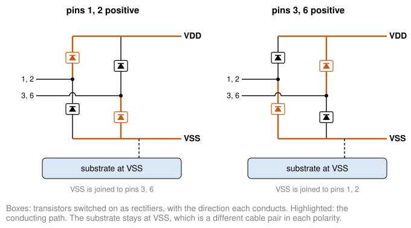

.. _poe-options:

On-chip and external options
============================

This page sets out, for each function that handles the cable voltage, the
external option and the on-chip option, and what would decide between
them.

Choice per function
-------------------

The full design builds most of these functions on chip, on evampire or on
a second cable-side die (:numref:`tab-power-board-configs`). The choice is made per function. An
on-chip option is a custom design
using the structures in :ref:`req-process`: custom transistor layouts,
drain-extended or stacked transistors, parasitic bipolar transistors and
custom I/O cells. An on-chip option for a cable-side function also needs
evampire to sit on the cable side of the isolation barrier, or a second
cable-side die (:doc:`isolation`). The limits that decide each option are on
:doc:`hv-limits`. The low-voltage parts, the sequencing, the measurement
logic and the software, are on evampire in every option.
:numref:`fig-poe-hv-functions` shows the functions of one port.

.. graphviz:: hv-functions.dot
   :name: fig-poe-hv-functions
   :caption: The cable-side functions of one port, with red outlines on
             those that see the cable voltage.
   :alt: Diagram. The RJ45 socket connects to surge and ESD protection. On
         the powered-device side, power passes through polarity correction,
         signature and classification, the isolation switch and voltage
         sensing. On the power sourcing side, the detection and class
         source and the power sourcing switch connect to the protection;
         the gate drive and current sensing connect to the switch. The
         functions that see the cable voltage have red outlines; gate drive
         and current sensing do not. Below, the sequencing, measurement
         logic and software are on evampire in every option.
   :align: center

Polarity correction
-------------------

External
   Two diode bridges, or a MOSFET bridge such as the PD70224
   [POE-PD70224]_. For reference, Texas Instruments suggests diodes rated
   for 100 V and 3 A to 5 A [POE-TPS2372]_ (Application and
   Implementation).

On chip
   An active bridge of stacked or drain-extended transistors. It blocks
   57 V plus surge in reverse, carries the port current with the metal
   widths of :numref:`tab-poe-metal`, and does not conduct backwards during
   detection (:doc:`powered-device`). The substrate must sit at the most
   negative rectified node, which moves with the polarity
   (:numref:`fig-poe-active-bridge`).

What decides
   The breakdown to the substrate, and the die area for a low enough
   on-resistance.

         as a box with the direction it conducts. With pins 1, 2 positive,
         the upper transistor of the first leg and the lower transistor of
         the second leg conduct, and VSS is joined to pins 3, 6. With pins
         3, 6 positive, the other two conduct and VSS is joined to pins
         1, 2. In both, the substrate is tied to VSS.
   :align: center

   An active bridge on chip in both polarities: the substrate follows VSS,
   which is a different cable pair in each.

Signature and classification
----------------------------

External
   A powered-device controller (:numref:`tab-poe-pd-chips`).

On chip
   The signature, mark load and class current work only below about 22 V
   (:numref:`fig-poe-sig-blocking`),
   and the class current is at most 44 mA. They stay connected while the
   input rises to 57 V, so a switch or structure that blocks 57 V sits ahead
   of them. The class regulator dissipates about 0.8 W in each event
   (:ref:`poe-class-signature`). The thresholds come from an on-chip divider
   and reference.

What decides
   The blocking structure ahead of the low-voltage circuits, and the heat of
   the class current.

.. graphviz:: sig-blocking.dot
   :name: fig-poe-sig-blocking
   :caption: A structure that blocks 57 V ahead of the low-voltage
             signature and class circuits of an on-chip powered device.
   :alt: Diagram. The bridge output, 0 to 57 V, passes through a switch or
         structure that blocks 57 V to the signature, mark load and class
         current circuits, which draw up to 44 mA and work below about
         22 V. A divider and comparator sense the bridge output and open
         the switch above the class range.
   :align: center

Isolation switch of the powered device
--------------------------------------

External
   Inside the controller, or an external 100 V MOSFET that the controller
   drives (:doc:`pd-controller`).

On chip
   Stacked or drain-extended transistors carrying 0.6 A to 1.73 A
   continuously, and the inrush current while most of 57 V is across them.
   For reference, the TPS2378's 140 mA limit at 57 V is 8 W for tens of
   milliseconds [POE-TPS2378]_.

What decides
   The blocking voltage, the safe operating area of the custom structure,
   and the die area for a low on-resistance.

Gate drive for an external switch
---------------------------------

A mixed option keeps the switch external and drives its gate from
evampire. If the chosen MOSFET is specified at a gate drive of 6 V or less,
the 6 V devices drive it directly. Otherwise a stacked or bootstrapped
driver, or an external driver, is needed. For reference, the TPS23881
drives its gates at 10 V to 12.5 V and the LT4275 at 10 V to 18 V
[POE-TPS23881]_ [POE-LT4275]_ (Electrical Characteristics).
:ref:`conv-gate-drive` describes gate drive in the converters, and
:numref:`fig-poe-gate-drive` compares the three options.

.. graphviz:: gate-drive.dot
   :name: fig-poe-gate-drive
   :caption: Three ways to drive an external switch from evampire.
   :alt: Three rows. Row 1: evampire's 6 V devices drive a MOSFET specified
         at a gate drive of 6 V or less directly. Row 2: evampire drives a
         stacked or bootstrapped driver, which drives a MOSFET that needs a
         higher gate voltage. Row 3: evampire drives an external driver,
         which drives such a MOSFET. A note gives reference gate voltages:
         TPS23881 10 to 12.5 V and LT4275 10 to 18 V.
   :align: center

Voltage sensing
---------------

External divider
   A resistor divider scales the port voltage to evampire's input range.
   For an input that must stay below the 3.63 V limit of the 3.3 V devices
   (:numref:`tab-poe-gf180-ratings`):

   .. math::

      V_\text{out} &= V_\text{in} \times \frac{R_2}{R_1 + R_2} \\
      &= 57\ \text{V} \times
        \frac{56\ \text{k}\Omega}{1056\ \text{k}\Omega} \\
      &= 3.0\ \text{V} \\
      I_\text{div} &= \frac{V_\text{in}}{R_1 + R_2} \\
      &= \frac{57\ \text{V}}{1.056\ \text{M}\Omega} \\
      &= 54\ \text{µA}

   .. list-table::
      :header-rows: 1
      :widths: 22 58 20

      * - Symbol
        - Meaning
        - Unit
      * - :math:`V_\text{in}`
        - Highest operating voltage
        - V
      * - :math:`R_1`, :math:`R_2`
        - Upper and lower resistors, example values
        - kΩ
      * - :math:`V_\text{out}`
        - Voltage at evampire's input
        - V
      * - :math:`I_\text{div}`
        - Current the divider draws
        - µA

   The divider costs about 3 mW. The model ignores the input's leakage and
   the resistor tolerance. A surge goes above 57 V, so the divider output
   needs a clamp. On the powered-device side the divider sits after the
   isolation switch, so that it is not in parallel with the signature
   (:numref:`fig-poe-divider`).

On-chip divider
   A high-resistance polysilicon divider. With the 2000 Ω per square
   option, 1 MΩ is 500 squares and dissipates
   :math:`(57\ \text{V})^2 / 1\ \text{M}\Omega = 3.2\ \text{mW}`. Its
   voltage coefficient, −150 ppm/V typical, adds error
   [POE-GF180-EP-6]_. The top of the divider sits at 57 V over the field
   oxide, as the polysilicon of :numref:`fig-hv-poly-on-fox` does. A capacitive divider of stacked MIM capacitors, at least three of
   the 20 V type for 57 V, suits sampled measurement.

What decides
   The field-oxide breakdown under the divider.

.. graphviz:: divider.dot
   :name: fig-poe-divider
   :caption: An external divider after the isolation switch, with a clamp
             on its output.
   :alt: Diagram. The bridges and signature feed the isolation switch,
         whose output is the port voltage of up to 57 V. A 1 MΩ resistor
         R1 and a 56 kΩ resistor R2 divide it to VSS, drawing 54 µA. The
         tap feeds evampire's input, 3.0 V at 57 V, and a clamp to VSS. A
         note says the divider is not across the signature, so detection
         sees only 25 kΩ.
   :align: center

Power sourcing switch and current sensing
-----------------------------------------

External
   A 100 V MOSFET and a sense resistor per channel
   (:doc:`pse-sequencing`).

On chip
   With the switch in the negative pair, the sense resistor, the current
   measurement, the fast fault comparator and the control logic sit near
   the supply return (:numref:`fig-poe-pse-channel`), and the sense voltages are millivolts. They can be on
   evampire at low voltage. The switch's drain reaches the full port
   voltage, so an on-chip switch needs a structure that blocks 57 V. The
   switch must stay inside its safe operating area through a short, up to
   57 W for 75 ms for class 8 (:doc:`monitoring`).

What decides
   The blocking structure for the switch, and the energy it absorbs in
   current limit.

Detection and class source
--------------------------

External
   A current source or a linear-mode MOSFET.

On chip
   The detection currents flow into a port node that sits near the supply
   during detection, and classification holds the port at 15.5 V to
   20.5 V with up to 100 mA. This needs a high-voltage current source, or
   linear control of the switch as the TPS23881 does [POE-TPS23881]_, with
   the measurement and sequencing in evampire.

What decides
   The blocking voltage of the current-source structure.

Surge protection
----------------

External
   An external transient-voltage suppressor at each port is the
   conventional option [POE-TPS23881]_ (Application and Implementation).

On chip
   Absorbing the 1.5 J surge of :doc:`hv-limits` on chip has not been
   shown for gf180mcu, whose PDK characterises ESD-scale events only. An
   on-chip clamp, for example a
   :wikipedia:`silicon-controlled rectifier <Silicon_controlled_rectifier>`
   or parasitic-bipolar clamp of several mm², is open, as is a split with an
   external pre-clamp and an on-chip fine clamp
   (:numref:`fig-poe-surge-split`).

What decides
   A thermal estimate and a transmission-line pulse or surge test
   structure.

.. graphviz:: surge-split.dot
   :name: fig-poe-surge-split
   :caption: Surge protection by an external suppressor alone, or split
             between an external pre-clamp and an on-chip fine clamp; the
             split is open.
   :alt: Two rows. In the first, a 1.5 J cable surge goes into an external
         suppressor, which takes the energy, before the port circuits. In
         the second, an external pre-clamp takes most of the energy and an
         on-chip fine clamp the rest, before the port circuits.
   :align: center

A rough estimate of the area treats the surge energy as heating a layer of
silicon as thick as the heat spreads during the pulse:

.. math::

   L &= \sqrt{\alpha \times \tau_\text{surge}} \\
   &= \sqrt{88\ \text{mm}^2/\text{s} \times 462\ \text{µs}} \\
   &= 0.20\ \text{mm} \\
   A &= \frac{E_\text{surge}}{\rho \times c \times L \times \Delta T} \\
   \rho \times c &= 2330\ \text{kg/m}^3 \times 705\ \text{J/(kg K)} \\
   &= 1.64\ \text{J/(cm}^3\,\text{K)} \\
   A &= \frac{1.5\ \text{J}}
     {1.64\ \text{J/(cm}^3\,\text{K)} \times 0.020\ \text{cm}
      \times 100\ \text{K}} \\
   &= 0.46\ \text{cm}^2 = 46\ \text{mm}^2

.. list-table::
   :header-rows: 1
   :widths: 22 58 20

   * - Symbol
     - Meaning
     - Unit
   * - :math:`\alpha`
     - :wikipedia:`Thermal diffusivity <Thermal_diffusivity>` of silicon
     - mm²/s
   * - :math:`\tau_\text{surge}`
     - Decay time constant of the surge (:doc:`hv-limits`)
     - µs
   * - :math:`L`
     - Depth the heat reaches during the pulse
     - mm
   * - :math:`\rho`, :math:`c`
     - Density and specific heat of silicon
     - kg/m³, J/(kg K)
   * - :math:`\Delta T`
     - Allowed temperature rise, an assumed value
     - K
   * - :math:`E_\text{surge}`
     - Surge energy in the clamp
     - J
   * - :math:`A`
     - Clamp area needed
     - mm²

The estimate, about 40 mm² to 50 mm² for the range of inputs, considers heat
diffusion only. It ignores the uneven current in a real clamp and the heat
carried away by the package.

ESD protection
--------------

Every pin has an ESD clamp following the PDK guidelines [POE-GF180-ESD]_, in
every option. :doc:`hv-limits` sizes a clamp for a 2 kV human body model
discharge.

Converter power stages
----------------------

The gate drivers and power transistors of the converters are discussed on
:doc:`../converters/index`, with the steps to move them onto evampire
(:ref:`conv-custom`).

Devices in a stack
------------------

A stack of transistors that shares a voltage equally needs enough devices
for each to stay within its rating (:numref:`fig-hv-stack-section` shows
such a stack in cross-section). As a first estimate, ignoring the
imbalance any real stack has:

.. math::

   N \ge \frac{V_\text{block}}{V_\text{dev,max}}

.. list-table::
   :header-rows: 1
   :widths: 22 58 20

   * - Symbol
     - Meaning
     - Unit
   * - :math:`V_\text{block}`
     - Voltage to block
     - V
   * - :math:`V_\text{dev,max}`
     - Rating of each device (:numref:`tab-poe-gf180-ratings`)
     - V
   * - :math:`N`
     - Number of devices, rounded up
     - none

:numref:`tab-poe-stack` gives the counts for the operating voltage and for
the 95 V clamp limit of a port suppressor [POE-TPS23881]_.

.. list-table:: Devices needed in a stack
   :name: tab-poe-stack
   :header-rows: 1
   :widths: 40 30 30

   * - Device
     - For 57 V
     - For 95 V
   * - 6 V transistors, 6.6 V each
     - 9
     - 15
   * - 3.3 V transistors, 3.63 V each
     - 16
     - 27

The count covers only the drain-to-source sharing. The well-to-substrate voltage
of the top devices is the open question of :doc:`hv-limits`.

Open questions
--------------

* Which of the high-voltage switches above, if any, stay external parts,
  and whether the cable-side functions sit on evampire or on a second
  cable-side die.
* Whether an on-chip surge clamp, alone or with an external pre-clamp, is
  pursued, which needs a thermal estimate and a test structure.
