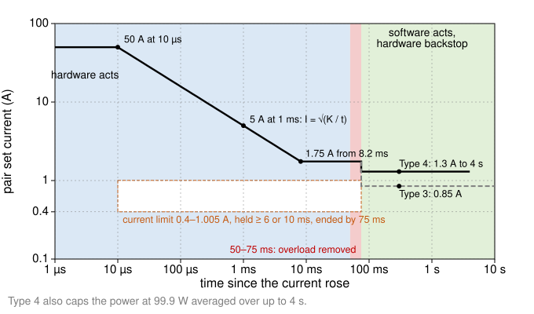
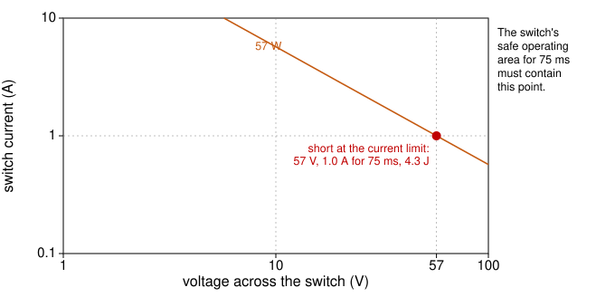
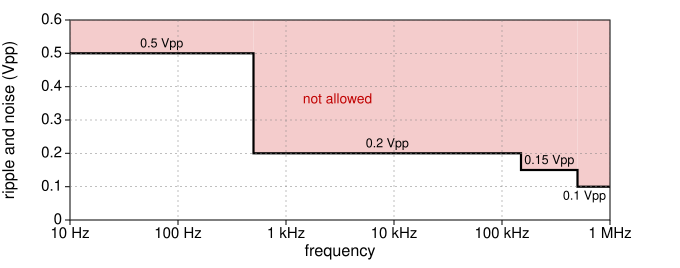

.. _poe-monitoring:

Power monitoring and limits
===========================

This page lists what evampire's built-in power monitoring and limiting must
measure and enforce on a Power over Ethernet port, and how fast each limit
must act.

Limits and enforcement
----------------------

evampire measures the voltage and current of every power port and of the
board's power bus, so the software can read the power through each of them
at any time (:ref:`req-power-control`). The software sets a current and
power limit for each port. Built-in hardware enforces the limits, switches
a port off by itself when a fault is too fast for the software, and then
reports the fault. The same measurements serve the converters
(:doc:`../converters/index`).

Measurement accuracy
--------------------

:numref:`tab-poe-accuracy` collects the measurement accuracy derived on
:doc:`power-sourcing` from the bands in which the standard allows either
decision.

.. list-table:: Measurement accuracy for power sourcing equipment
   :name: tab-poe-accuracy
   :header-rows: 1
   :widths: 40 30 30

   * - Measurement
     - Range
     - Accuracy
   * - Detection resistance
     - 15 kΩ to 33 kΩ
     - ± 10 %
   * - Class current
     - 0 mA to 51 mA
     - ± 1.5 mA
   * - Maintain power signature current
     - 4 mA to 9 mA
     - ± 2.5 mA

The power policing below needs the port current up to the class limit, for
class 8 about 1 A per pair set (:clause:`Table 145-16 <145>`, item 11). The
resolution needed for the power budget is open
(:ref:`conv-fault-times` gives the bits for a given step).

On a powered-device port the software checks that the board stays within
its assigned class. The standard measures the powered device's average
power over a sliding 1 s window (:clause:`145.3.8.2`).

Limits on a powered port
------------------------

:numref:`tab-poe-limits` lists the limits that apply while a power sourcing
equipment port is powered, on time scales from 10 µs to 4 s, from the
fastest to the slowest
(:clause:`145.2.10.8` to :clause:`145.2.10.13`).

.. list-table:: Limits on a powered port, fastest first
   :name: tab-poe-limits
   :header-rows: 1
   :widths: 35 35 30

   * - Limit
     - Time scale
     - Enforced by
   * - Upper current template
     - 10 µs to 4 s
     - Hardware
   * - Current limit held
     - At least 6 ms or 10 ms
     - Hardware
   * - Current limit ended
     - By 75 ms
     - Hardware, set by software
   * - Overload removed
     - After 50 ms to 75 ms
     - Software, with a hardware backstop
   * - Type 4 power cap
     - 4 s window
     - Software, with a hardware backstop

Upper current template
   The current of each pair set must stay below a template that allows up
   to 50 A for the first 10 µs, then falls with time, then stays at 1.75 A
   until the end of the overload time, 75 ms at most. After that it is
   0.85 A for Type 3, and 1.3 A up to 4 s for Type 4
   (:clause:`145.2.10.9`, :clause:`Equation 145-17 <145>` and
   :clause:`Equation 145-18 <145>`).

Current limit held
   In a short circuit, power sourcing equipment holds the current at its
   limit, at least 0.4 A to 1.005 A per pair set depending on the class,
   for at least 10 ms (Type 3) or 6 ms (Type 4)
   (:clause:`Table 145-16 <145>`, items 11 and 12). This lets a powered
   device ride through a supply step.

Current limit ended
   Power is removed before a current-limit event has lasted 75 ms
   (:clause:`145.2.10.9`).

Overload removed
   If the current stays above the overload level for longer than 50 ms to
   75 ms, counted in a sliding window of at least 1 s, the power sourcing
   equipment may remove power (:clause:`145.2.10.8`).

Type 4 power cap
   Type 4 power sourcing equipment sources no more than 99.9 W, averaged
   over a sliding window of up to 4 s (:clause:`145.2.10.13`).

Between 10 µs and 8.2 ms the template follows a fixed energy limit:

.. math::

   I_\text{max}(t) = \sqrt{\frac{K}{t}}

.. list-table::
   :header-rows: 1
   :widths: 22 58 20

   * - Symbol
     - Meaning
     - Unit
   * - :math:`K`
     - Energy limitation constant, 0.025 A²s (:clause:`145.2.10.9`)
     - A²s
   * - :math:`t`
     - Time the port has sourced the current
     - s
   * - :math:`I_\text{max}`
     - Highest allowed current of a pair set
     - A

At 10 µs this gives 50 A, at 1 ms 5 A, and at 8.2 ms 1.75 A, where the
template joins the flat 1.75 A section. :numref:`fig-poe-template` draws
the template with the limits of :numref:`tab-poe-limits`.

         since the current rose, 1 µs to 10 s. The template is flat at 50 A
         to 10 µs, falls as the square root of K over t through 5 A at
         1 ms to 1.75 A at 8.2 ms, stays at 1.75 A to 75 ms, then is 1.3 A
         to 4 s for Type 4 or 0.85 A for Type 3. A dashed box marks the
         current limit of 0.4 to 1.005 A, held for at least 6 or 10 ms and
         ended by 75 ms. A band from 50 to 75 ms marks the overload
         removal window. Shading shows hardware acting before 50 ms and
         software, with a hardware backstop, after it.
   :align: center

   The upper current template of one pair set, with the current limit and
   the overload removal window.

Switch safe operating area
--------------------------

The fast fault comparator must keep the current inside the template and the
switch inside its :wikipedia:`safe operating area <Safe_operating_area>`.
While the loop holds a shorted port at its current limit, the switch has
almost the whole supply voltage across it:

.. math::

   P_\text{sw} &= V_\text{supply} \times I_\text{lim}
     = 57\ \text{V} \times 1.0\ \text{A} = 57\ \text{W} \\
   E_\text{sw} &= P_\text{sw} \times t_\text{lim}
     = 57\ \text{W} \times 75\ \text{ms} = 4.3\ \text{J}

.. list-table::
   :header-rows: 1
   :widths: 22 58 20

   * - Symbol
     - Meaning
     - Unit
   * - :math:`V_\text{supply}`
     - Highest supply voltage
     - V
   * - :math:`I_\text{lim}`
     - Current limit, the class 8 minimum per pair set, rounded
     - A
   * - :math:`t_\text{lim}`
     - Longest time in current limit
     - ms
   * - :math:`P_\text{sw}`, :math:`E_\text{sw}`
     - Power and energy in the switch
     - W, J

A switch rated for 57 W for 75 ms needs no faster software
(:numref:`fig-poe-soa`).

         across the switch, 1 to 100 V, with a line of constant 57 W. A
         point marks a short at the current limit: 57 V and 1.0 A for
         75 ms, 4.3 J. A note says that the switch's safe operating area
         for 75 ms must contain this point.
   :align: center

   The operating point of the switch in a short at the current limit.

The response time of the comparator then follows from how fast the current rises in a
short, which the cable and port inductance set, and from the switch's peak
current rating. For reference, the TPS23881 turns its switch off within
0.9 µs of a short-circuit threshold of about 1.0 A to 1.2 A
[POE-TPS23881]_ (Electrical Characteristics). Faults in the converters have
their own response times (:ref:`conv-fault-times`).

Supply voltage, ripple and noise
--------------------------------

The port voltage must stay above 45.3 V (Type 3) or 48.4 V (Type 4) through
transients of 30 µs to 250 µs, and inside the output range for longer
ones (:clause:`145.2.10.3`). Its ripple and noise must stay below the
limits of :numref:`tab-poe-ripple` (:clause:`Table 145-16 <145>`, item 4),
drawn in :numref:`fig-poe-ripple`.

.. list-table:: Ripple and noise limits at the power sourcing equipment
   :name: tab-poe-ripple
   :header-rows: 1
   :widths: 35 35 30

   * - From
     - To
     - Limit (Vpp)
   * - 0 Hz
     - 500 Hz
     - 0.5
   * - 500 Hz
     - 150 kHz
     - 0.2
   * - 150 kHz
     - 500 kHz
     - 0.15
   * - 500 kHz
     - 1 MHz
     - 0.1

         frequency, 10 Hz to 1 MHz on a log scale. The limit steps down
         from 0.5 Vpp below 500 Hz to 0.2 Vpp up to 150 kHz, 0.15 Vpp up to
         500 kHz and 0.1 Vpp up to 1 MHz. The region above the limit is
         shaded as not allowed.
   :align: center

   The ripple and noise limit at the power sourcing equipment output.

Open questions
--------------

* The current measurement resolution needed for the power budget.
* The response time of the fast fault comparator, which depends on the
  switch's rating and the inductance in the short-circuit path.
