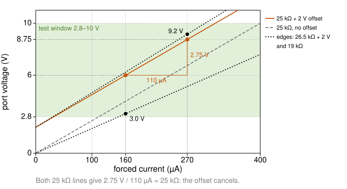
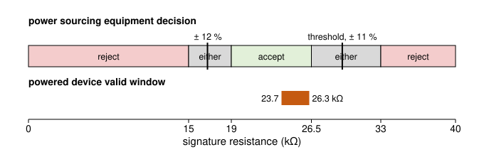
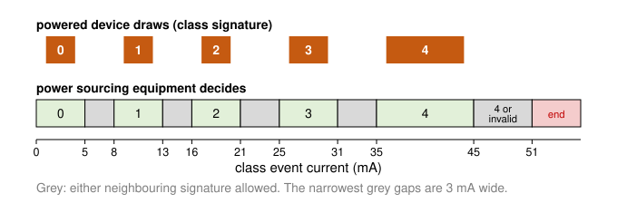
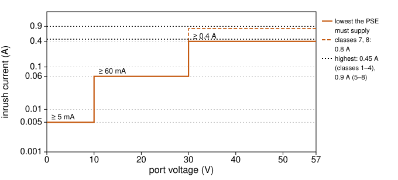

.. _poe-pse-side:

Power sourcing equipment requirements
=====================================

The end that supplies power, port B on a first-version board, has a task
at each step of the sequence on :doc:`sequence`, and the standard's limits
set how accurately it must measure.

Detection before power
----------------------

Power sourcing equipment must not apply the operating voltage to a pair set
that has not shown a valid detection signature (:clause:`145.2.6`). This
rule protects equipment that was not designed for Power over Ethernet. Such
equipment connects its centre taps only through capacitors, so it looks
like an open circuit at DC, fails detection and receives no power
(:numref:`fig-poe-non-poe`).

.. graphviz:: non-poe.dot
   :name: fig-poe-non-poe
   :caption: What detection finds at equipment without Power over Ethernet
             and at a powered device.
   :alt: Two rows. In the first, detection at 2.8 to 10 V measures
         equipment without Power over Ethernet, whose centre taps connect
         only through capacitors; it is open at DC, fails detection and
         receives no power. In the second, detection measures a powered
         device with a 25 kΩ signature, which is valid, so power may be
         applied.
   :align: center

Two-point detection
-------------------

The power sourcing equipment applies at least two test voltages, or forces
two test currents, and measures the response. During detection it may
never produce more than 30 V or source more than 5 mA, and its port
capacitance is at most 520 nF (:clause:`Table 145-7 <145>`). The test
points lie between 2.8 V and 10 V and at least 1 V apart, and each is
measured after the voltage has settled to within 1 %
(:clause:`145.2.6.2`).

The powered device behaves like an offset voltage, from its bridge, in
series with the signature resistance. The difference between two points
removes the offset:

.. math::

   R_\text{meas} = \frac{V_2 - V_1}{I_2 - I_1}

.. list-table::
   :header-rows: 1
   :widths: 22 58 20

   * - Symbol
     - Meaning
     - Unit
   * - :math:`V_1`, :math:`V_2`
     - Port voltages at the two test points
     - V
   * - :math:`I_1`, :math:`I_2`
     - Port currents at the two test points
     - µA
   * - :math:`R_\text{meas}`
     - Measured signature resistance
     - kΩ

The equation is that of :clause:`145.2.6.2`. It assumes the powered device
is linear between the two points. A capacitive or non-linear load breaks
it, which is why designs wait for the voltage to settle and some take more
than two points.

For reference, the TPS23881 forces 160 µA and then 270 µA and repeats the
pair to get four points [POE-TPS23881]_ (Detailed Description). For a
25 kΩ signature with a 2 V offset, the largest offset the power sourcing
equipment must accept (:clause:`Table 145-8 <145>`):

.. math::

   V_1 &= 2\ \text{V} + 160\ \text{µA} \times 25\ \text{k}\Omega
     = 6.0\ \text{V} \\
   V_2 &= 2\ \text{V} + 270\ \text{µA} \times 25\ \text{k}\Omega
     = 8.75\ \text{V} \\
   R_\text{meas} &= \frac{8.75\ \text{V} - 6.0\ \text{V}}{110\ \text{µA}}
     = 25\ \text{k}\Omega

The offset cancels. At the edges the points stay in the 2.8 V to 10 V
window: 26.5 kΩ with a 2 V offset gives 9.2 V at 270 µA, and 19 kΩ with no
offset gives 3.0 V at 160 µA. :numref:`fig-poe-detect-iv` draws these
lines.

         400 µA, with the test window from 2.8 V to 10 V shaded. A 25 kΩ
         line with a 2 V offset passes through 6.0 V at 160 µA and 8.75 V
         at 270 µA; the steps of 110 µA and 2.75 V give 25 kΩ, the same as
         the parallel 25 kΩ line with no offset. Dotted edge cases give
         9.2 V at 270 µA for 26.5 kΩ with a 2 V offset and 3.0 V at 160 µA
         for 19 kΩ with no offset.
   :align: center

   Two-point detection: the offset shifts the line but not its slope.

The decision follows :numref:`tab-poe-detect`
(:clause:`Table 145-8 <145>`, :clause:`Table 145-9 <145>`). The power
sourcing equipment must also accept a parallel capacitance up to 0.15 µF and
reject one of 10 µF or more.

.. list-table:: Detection decision
   :name: tab-poe-detect
   :header-rows: 1
   :widths: 30 30 40

   * - From (kΩ)
     - To (kΩ)
     - Decision
   * - 0
     - 15
     - reject
   * - 15
     - 19
     - accept or reject
   * - 19
     - 26.5
     - accept
   * - 26.5
     - 33
     - accept or reject
   * - 33
     - none
     - reject

The bands where either decision is allowed set the measurement accuracy.
One threshold must lie between 26.5 kΩ and 33 kΩ, with any error keeping a
true 26.5 kΩ below it and a true 33 kΩ above it. The largest relative error
that allows this is:

.. math::

   e_\text{max} = \frac{R_\text{reject} - R_\text{accept}}
     {R_\text{reject} + R_\text{accept}}
     = \frac{33 - 26.5}{33 + 26.5} = 0.11

.. list-table::
   :header-rows: 1
   :widths: 22 58 20

   * - Symbol
     - Meaning
     - Unit
   * - :math:`R_\text{accept}`
     - Edge of the accept band
     - kΩ
   * - :math:`R_\text{reject}`
     - Edge of the reject band
     - kΩ
   * - :math:`e_\text{max}`
     - Largest relative measurement error, with the threshold placed where
       the errors at both edges are equal
     - none

The lower band, 15 kΩ to 19 kΩ, gives 0.12. A resistance measurement within
about ± 10 % therefore meets both (:numref:`fig-poe-detect-bands`). If detection fails on Alternative B, the
power sourcing equipment waits at least 2 s before trying again, unless it
measured an open circuit above 0.5 MΩ (:clause:`Table 145-16 <145>`,
item 23, and :clause:`145.2.6.5`).

         sourcing equipment rejects 0 to 15 kΩ, may decide either way from
         15 to 19 kΩ, accepts 19 to 26.5 kΩ, may decide either way from
         26.5 to 33 kΩ and rejects above 33 kΩ. A threshold in each either
         band allows an error of 12 % in the lower band and 11 % in the
         upper. Below, the powered device's valid window is 23.7 to
         26.3 kΩ, inside the accept band.
   :align: center

   Detection decision bands, with a threshold placed in each band where
   either decision is allowed.

Connection check
----------------

Power sourcing equipment that will power both pair sets first runs a
*connection check*. It finds out whether the two pair sets lead to one
powered-device circuit, a single-signature powered device, or to two, a
dual-signature powered device (:clause:`145.2.7`). A single-signature
powered device shows an invalid signature on one pair set while 3.7 V to
57 V is applied to the other; a dual-signature powered device shows a
valid signature on each regardless (:clause:`145.3.5`). Detection must
start within 0.4 s of the end of the connection check
(:clause:`Table 145-10 <145>`). :numref:`fig-poe-connection-check`
compares the two kinds of powered device.

.. graphviz:: connection-check.dot
   :name: fig-poe-connection-check
   :caption: The connection check: one circuit behind both pair sets, or
             one circuit behind each.
   :alt: Two panels. On the left, power sourcing equipment applies 3.7 to
         57 V to pair set A of a single-signature powered device and runs
         detection on pair set B. Bridges A and B join one signature, so B
         shows an invalid signature. On the right, a dual-signature powered
         device has circuit 1, a bridge and signature, on pair set A and
         circuit 2 on pair set B, and each shows a valid signature.
   :align: center

.. _poe-pse-classification:

Classification
--------------

After a valid detection the power sourcing equipment raises the port to
15.5 V to 20.5 V and limits the current to between 51 mA and 100 mA
(:clause:`Table 145-14 <145>`). It measures the current at least 6 ms after
the start of the event and decides the class signature from
:numref:`tab-poe-class-decision` (:clause:`Table 145-13 <145>`). A current
of 51 mA or more ends classification and returns to the start.

.. list-table:: Class signature decision
   :name: tab-poe-class-decision
   :header-rows: 1
   :widths: 30 30 40

   * - From (mA)
     - To (mA)
     - Class signature
   * - 0
     - 5
     - 0
   * - 8
     - 13
     - 1
   * - 16
     - 21
     - 2
   * - 25
     - 31
     - 3
   * - 35
     - 45
     - 4

In the gaps between the bands either neighbouring signature is allowed, and
from 45 mA to 51 mA the signature may also be judged invalid. The bands are
wider than the powered device's (:numref:`tab-poe-class-sig`) to allow for
measurement error. The narrowest gaps, 5 mA to 8 mA and 13 mA to 16 mA, are
3 mA wide, so a current measurement within about ± 1.5 mA places every
threshold correctly. :numref:`fig-poe-class-bands` shows both sets of bands.

         one shows the powered device's class signatures: 0 at 1 to 4 mA, 1
         at 9 to 12 mA, 2 at 17 to 20 mA, 3 at 26 to 30 mA and 4 at 36 to
         44 mA. The lower one shows the power sourcing equipment's
         decisions: 0 from 0 to 5 mA, 1 from 8 to 13, 2 from 16 to 21, 3
         from 25 to 31, 4 from 35 to 45, either neighbour in the gaps
         between, 4 or invalid from 45 to 51 mA, and the end of
         classification above 51 mA.
   :align: center

   Class signature currents of the powered device against the decision
   bands of the power sourcing equipment.

Between class events the port drops to the mark range, 7 V to 10 V, with
the current limited to between 5 mA and 100 mA. The power sourcing
equipment must not let the port fall below the mark range until power-up,
except to reset the powered device (:clause:`145.2.8.1`). It issues no more
class events than the class it can support, and no more than the requested
class needs. It may issue extra events to learn the requested class, then
reset the powered device by holding the port below 2.8 V for at least
15 ms and start again (:clause:`145.2.8.1`).

evampire's port issues these class events in every type, and also
answers LLDP requests (:ref:`req-poe-classification`).

Power sourcing equipment that has less than class 3 power available does
not power a powered device that requests more than it has
(:clause:`145.2.11`).

Power-up and inrush
-------------------

The power sourcing equipment reaches full power within 400 ms of the end of
detection, otherwise it starts again with detection
(:clause:`145.2.10.14`). The port voltage rises with a 10 % to 90 % time of
at least 15 µs (:clause:`Table 145-16 <145>`, item 15). For 50 ms to 75 ms
it limits the current, so that the powered device's capacitor charges
gently (:numref:`tab-poe-inrush`).

.. list-table:: Inrush current limits for a single-signature powered device
   :name: tab-poe-inrush
   :header-rows: 1
   :widths: 25 25 25 25

   * - Assigned class
     - Total, lowest (A)
     - Total, highest (A)
     - Per pair set, highest (A)
   * - 1 to 4
     - 0.4
     - 0.45
     - 0.45
   * - 5 and 6
     - 0.4
     - 0.9
     - 0.6
   * - 7 and 8
     - 0.8
     - 0.9
     - 0.6

The limits are from :clause:`Table 145-16 <145>`, items 6 to 8. The lowest
current applies only above 30 V. Below that the power sourcing equipment
must supply at least 5 mA from 0 V to 10 V and 60 mA from 10 V to 30 V
(:clause:`145.2.10.7`). The lower current at low voltage reduces the
power in the switch while most of the supply voltage is across it.
:numref:`fig-poe-inrush-pse` draws the limits against the port voltage.

         voltage, 0 to 57 V. The lowest current the power sourcing
         equipment must supply steps from 5 mA below 10 V to 60 mA from 10
         to 30 V and 0.4 A above 30 V, or 0.8 A for classes 7 and 8.
         Dotted lines mark the highest currents, 0.45 A for classes 1 to 4
         and 0.9 A for classes 5 to 8.
   :align: center

   The inrush current of power sourcing equipment against port voltage.

Supervision while powered
-------------------------

While the port is powered, the power sourcing equipment holds its output
voltage (:numref:`tab-poe-pse-voltage`), keeps its ripple and noise within
limits, polices the current, and watches for the maintain power signature.
:doc:`monitoring` gives these limits and the response time each one needs.

It removes the power when the current has stayed below its threshold for
320 ms to 400 ms (:numref:`fig-poe-mps`) (:clause:`Table 145-16 <145>`, item 21). The threshold
lies between 4 mA and 9 mA for classes 1 to 4 on one pair set
(item 19), so a current measurement within about ± 2.5 mA meets it. After
removing power because of a fault, it waits at least 750 ms before trying
again (item 25). When it turns a port off, the port falls below 2.8 V
within 500 ms (items 16 and 17).

Two channels for 4-pair power
-----------------------------

A port that powers both pair sets has two *channels*, each with its own
switch, current measurement and current limit, because the standard limits
the current of each pair set separately (:clause:`Table 145-16 <145>`).
Power sourcing equipment switches at least the more negative conductor of
each pair set (:clause:`145.4.1.1.1`, :clause:`145.4.1.1.2`). A common
arrangement ties the positive pairs of both pair sets to the supply and
switches only the negative pairs, as :numref:`fig-poe-pse-channels`
shows.

.. graphviz:: pse-channels.dot
   :name: fig-poe-pse-channels
   :caption: A port that powers both pair sets, with one channel for each
             negative pair.
   :alt: Block diagram. The 44 to 57 V supply connects to the positive
         pairs of pair sets A and B at the port. The negative pair of A
         passes through switch A and sense A, and the negative pair of B
         through switch B and sense B, to the supply return. A current
         limit block set by software reads both sense resistors and drives
         the gates of both switches.
   :align: center

A dual-signature powered device is detected and classified on each pair set
separately (:clause:`145.2.8`). Power sourcing equipment that has assigned
class 5 to 8 to a single-signature powered device powers both pair sets
(:clause:`145.2.10.1`).

Open questions
--------------

* The measurement method for detection, forced currents or applied
  voltages, and the number of points.
* Whether port B supports dual-signature powered devices.
* Whether port B supports :ref:`Autoclass <poe-autoclass>`, which lets
  it allocate a single-signature powered device less than the power of
  its class.
