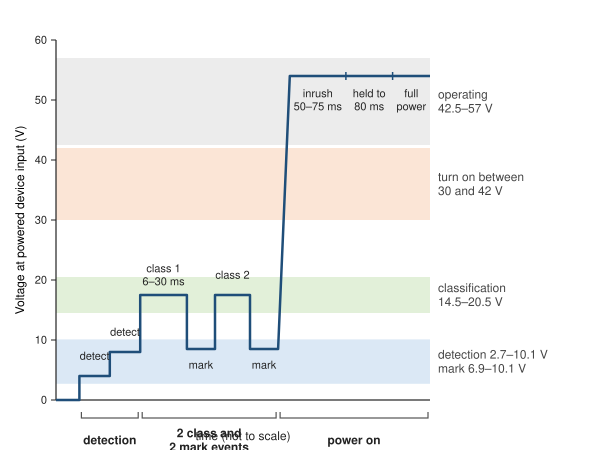

.. _poe-sequence:

The power-up sequence
=====================

This page describes the steps that power sourcing equipment runs, from the
moment a cable is plugged in until full power flows, and what keeps the
power on afterwards.

Each step uses its own voltage range
------------------------------------

Before it applies full voltage, the power sourcing equipment finds out
whether a powered device is connected and how much power it wants. Each
step uses a different voltage range on the cable, so the powered device
tells the steps apart by measuring its own input voltage.
:numref:`fig-poe-voltage-timeline` shows the voltage at the powered device
for a simple case: Type 2 power sourcing equipment and a class 4 powered
device.

         steps at about 4 V and 8 V, a class event at about 17.5 V, a mark
         event at about 8.5 V, a second class event and a second mark
         event, then a rise to about 54 V with an inrush period of 50 to
         75 ms, a period held to 80 ms, and full power. Shaded bands mark
         the detection and mark range of 2.7 to 10.1 V, the class range of
         14.5 to 20.5 V, the turn-on range of 30 to 42 V and the operating
         range of 42.5 to 57 V.
   :align: center
   :width: 100%

   Voltage at a class 4 powered device while Type 2 power sourcing
   equipment detects it, classifies it and turns the power on, not to
   scale.

The steps are:

Detection
   The power sourcing equipment applies small test voltages and measures
   the current, to check for a 25 kΩ resistance called the
   :term:`detection signature`. A device that does not show it never
   receives power.
Classification
   The power sourcing equipment raises the voltage into the class range
   for a :term:`class event`, and the powered device answers by drawing a
   fixed current, its *class signature*. Between class events the voltage
   drops into a lower range for a :term:`mark event`. The number of class
   events and the currents drawn decide the assigned class.
Power-up
   The power sourcing equipment switches on the operating voltage with a
   limited current while the powered device charges its input capacitor.
   This is the :term:`inrush current` period.
Operation
   The powered device keeps drawing at least a small current, its
   :term:`maintain power signature`. When the current disappears, the power
   sourcing equipment assumes the cable is unplugged and removes the power.

:numref:`tab-poe-steps` gives the voltage range of each step at both ends
of the cable. The range at the powered device is wider, to allow for the
drop in the cable and in the powered device's polarity bridges.

.. list-table:: Voltage ranges of each step
   :name: tab-poe-steps
   :header-rows: 1
   :widths: 34 33 33

   * - Step
     - At power sourcing equipment (V)
     - At powered device (V)
   * - Detection
     - 2.8–10
     - 2.7–10.1
   * - Class event
     - 15.5–20.5
     - 14.5–20.5
   * - Mark event
     - 7–10
     - 6.9–10.1
   * - Reset
     - 0–2.8
     - 0–2.81
   * - Operation
     - 50–57
     - 42.5–57

The ranges come from :clause:`Table 145-7 <145>`,
:clause:`Table 145-14 <145>`, :clause:`Table 145-21 <145>` and
:clause:`Table 145-25 <145>`. The operation row is for Type 2 and Type 3
(:numref:`tab-poe-pse-voltage`, :numref:`tab-poe-lowest-voltage`).

Each step has time limits
-------------------------

:numref:`tab-poe-step-times` gives the duration of each step for Types 3
and 4 (:clause:`Table 145-14 <145>`, :clause:`Table 145-16 <145>`).

.. list-table:: Duration of each step, Types 3 and 4
   :name: tab-poe-step-times
   :header-rows: 1
   :widths: 50 25 25

   * - Step
     - Shortest (ms)
     - Longest (ms)
   * - Detection of one pair set
     - none
     - 500
   * - First class event
     - 88
     - 105
   * - Later class event
     - 6
     - 20
   * - Mark event, except the last
     - 6
     - 12
   * - Reset
     - 15
     - none
   * - Inrush
     - 50
     - 75
   * - Detection to full power
     - none
     - 400

Type 2 power sourcing equipment makes its first class event 6 ms to 30 ms
long, and Type 1 makes its single class event 6 ms to 75 ms long
(:clause:`Table 33-10 <33>`). The long first class event of Types 3 and 4
lets a powered device tell which type it is connected to
(:clause:`145.3.7`).

More class events give more power
---------------------------------

Type 1 power sourcing equipment issues one class event. Type 2 issues up to
two, Type 3 up to four and Type 4 up to five (:clause:`145.2.8.1`). A
powered device that asks for class 5 to 8 shows class signature 4 in the
first two events, so that older power sourcing equipment sees a class 4
device. It shows a different signature from the third event on
(:clause:`Table 145-26 <145>`). :doc:`powered-device` and
:doc:`power-sourcing` give the details.

The power sourcing equipment issues no more class events than it needs for
the class it can afford. :numref:`tab-poe-events` gives the highest class
each number of events can assign (:clause:`Table 145-11 <145>`).

.. list-table:: Number of class events and the highest class assigned
   :name: tab-poe-events
   :header-rows: 1
   :widths: 50 50

   * - Class events
     - Highest class assigned
   * - 1
     - 3
   * - 2 or 3
     - 4
   * - 4
     - 6
   * - 5
     - 8

With 4 events a powered device that asked for class 5 gets class 5, and
with 5 events one that asked for class 7 gets class 7. A powered device
gets the lower of the class it asked for and the class in
:numref:`tab-poe-events`.

Both ends act at each step
--------------------------

:numref:`fig-poe-states` shows what each end does during the sequence of
:numref:`fig-poe-voltage-timeline`. The top rows are the power sourcing
equipment and the lower rows the powered device. The isolation switch and
power good are parts of the powered device described on
:doc:`powered-device`.

.. wavedrom::
   :name: fig-poe-states
   :caption: What each end does during a two-event classification by Type 2
             power sourcing equipment.
   :alt: Timing diagram. The power sourcing equipment port goes from 0 V
         to detection, class event 1, a mark event, class event 2, a mark
         event, inrush and full voltage, measuring resistance during
         detection, class current during class events and current while
         powered, and limits the current first to the inrush limit and then
         to the operating limit. The powered device connects its signature
         resistor during detection, disconnects it during class events, adds
         a mark load during mark events, draws class current during class
         events, counts two class events, turns on its isolation switch with
         a current limit and then fully, and finally asserts power good.

   { "signal": [
         { "name": "Port", "wave": "2.3.4.54.56.7.",
           "data": ["0 V", "detect", "class 1", "mark", "class 2", "mark",
                    "inrush", "50–57 V"] },
         { "name": "Measures", "wave": "x.3.4.x4.xx.5.",
           "data": ["resistance", "current", "current", "current"] },
         { "name": "Limit", "wave": "0.........3.4.",
           "data": ["inrush", "operating"] },
         {},
         { "name": "Signature", "wave": "1...0.10.10..." },
         { "name": "Class load", "wave": "0...1.01.0...." },
         { "name": "Mark load", "wave": "0.....10.10..." },
         { "name": "Count", "wave": "2.....3..4....",
           "data": ["0", "1", "2"] },
         { "name": "Switch", "wave": "0.........3.1.",
           "data": ["limited"] },
         { "name": "Power good", "wave": "0...........1." }
     ]
   }

During a mark event the signature resistor stays connected, and the mark
load in parallel with it brings the resistance below 12 kΩ, which is not a
valid detection signature (:clause:`145.3.6.1.1`).

The maintain power signature keeps the power on
-----------------------------------------------

Once powered, the powered device must keep drawing at least a minimum
current, steadily or in pulses (:clause:`Table 145-32 <145>`):

* at least 10 mA for classes 1 to 4, or 16 mA for classes 5 to 8;
* each pulse at least 75 ms long, or 7 ms when it saw a long first class
  event;
* gaps between pulses of at most 250 ms, or 310 ms after a long first class
  event.

Type 3 and Type 4 power sourcing equipment removes the power when the
current has been below the threshold for 320 ms to 400 ms
(:clause:`Table 145-16 <145>`, item 21). It turns the port off within
500 ms, to below 2.8 V (items 16 and 17). A new cable then starts the
sequence again with detection.

Open questions
--------------

* The highest number of class events port B issues, which is set by its
  type (:doc:`power-sourcing`).
