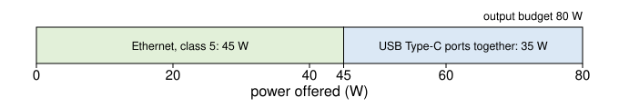

.. _poe-sharing:

Sharing the budget between ports
================================

This page describes how the software shares the power budget when a power
sourcing equipment port supplies power at the same time as other output
ports, and how it moves power between them safely.

Offers within the budget
------------------------

Several ports can supply power at once (:ref:`power-sharing`): on a full
design board, two USB Type-C ports and an Ethernet port, or both Ethernet
ports when the board is powered from USB
(:ref:`board configurations <tab-power-board-configs>`). The software keeps
the sum of the offers within the power left for the outputs:

.. math::

   \sum_i P_{\text{offer},i} \le P_\text{out}

.. list-table::
   :header-rows: 1
   :widths: 22 58 20

   * - Symbol
     - Meaning
     - Unit
   * - :math:`P_{\text{offer},i}`
     - Highest power offered on output port :math:`i`
     - W
   * - :math:`P_\text{out}`
     - Power left for the outputs (:doc:`translation`)
     - W

For a power sourcing equipment port, the offer is the power of its assigned
class at the power sourcing equipment (:numref:`tab-poe-classes`), or the
allocated value set over LLDP plus the cable loss (:doc:`lldp`).

For example, with :math:`P_\text{out} = 80\ \text{W}`, a class 5 Ethernet
output takes 45 W and leaves 35 W for the USB Type-C ports together
(:numref:`fig-poe-budget-split`). The USB
offers that fit in 35 W are described on :doc:`../usb-pd/index`.

         takes 45 W and the USB Type-C ports together take the remaining
         35 W of the 80 W output budget.
   :align: center

   An 80 W output budget shared between a class 5 Ethernet output and the
   USB Type-C ports.

Allocation changes
------------------

A USB Power Delivery source can change its offer while a device is
connected, by sending a new list of offers. A power sourcing equipment port
changes its allocation in one of two ways:

Over LLDP
   In steps of 0.1 W, with a powered device that supports the exchange.
   Every powered device that requests class 4 or higher does
   (:numref:`tab-poe-class-methods`), and evampire's port always answers
   (:ref:`req-poe-classification`).
By classifying again
   Removing the power and running classification again with fewer class
   events. This interrupts the powered device, so it is the last resort for
   a powered device of class 1 to 3 without LLDP.

Power sourcing equipment may base its allocation on more than the class,
but not only on how much power the powered device has drawn in the past
(:clause:`145.2.11`). If the powered device uses autoclass, the measured
draw plus its margin is a valid allocation (:clause:`145.2.8`).

Moving power between ports
--------------------------

When a device on one port is unplugged or uses less than its share, the
software raises the offer on another port (:numref:`fig-power-sharing`
shows the offers over time). When a new device is plugged in,
it first lowers the offers on the other ports to make room. On a power
sourcing equipment port, lowering over LLDP is complete only when the
powered device has answered with the new value, which may take up to 10 s
(:clause:`145.5.2`). Until then the software keeps the old allocation in
the budget. Its built-in current and power limit on the port is lowered at
the same time (:doc:`monitoring`). :numref:`fig-poe-sharing-move` shows the
order.

.. graphviz:: sharing-move.dot
   :name: fig-poe-sharing-move
   :caption: Moving power to a new device on a USB Type-C output by first
             lowering the allocation of an Ethernet output.
   :alt: Sequence diagram with three lifelines: the powered device on the
         Ethernet output, the software on evampire, and a new device on a
         USB Type-C output. The new device attaches and the budget needs
         room. The software sends an LLDP frame lowering the allocation;
         the old allocation is still counted, and the hardware limit is
         lowered at once. Up to 10 s later the powered device echoes the
         new value and the lower allocation is counted. The software then
         raises the offer on the USB Type-C output.
   :align: center

If the input power falls faster than the outputs can be lowered, for
example when the USB charger is unplugged, the software removes power from
output ports, starting with the ones it gives lowest priority.

Open questions
--------------

* The priority between output ports when the budget is short.
* The share each port starts with when several devices are connected at
  once.
