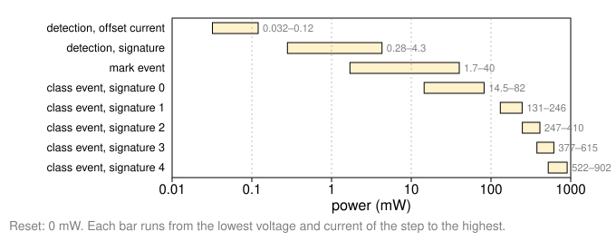

.. _poe-startup:

Start-up without the processor
==============================

This page gives the power that reaches a board at each step of the
sequence when the board is powered only from its powered-device port and
starts from nothing.

Built-in start-up sequencer
---------------------------

Until the power sourcing equipment switches on the operating voltage, the
cable carries only test voltages, for limited times (:doc:`sequence`).
evampire's processor is not running then. A small built-in start-up
sequencer, working without the processor, answers detection and
classification and requests a power level (:ref:`req-power-control`). Once
the processor runs, the software reads the assigned class and carries out
any further negotiation over LLDP (:doc:`lldp`).
:numref:`fig-poe-sequencer` shows which part answers each step.

.. graphviz:: sequencer.dot
   :name: fig-poe-sequencer
   :caption: The steps answered by the built-in start-up sequencer and
             those handled by software once the processor runs.
   :alt: Diagram of five steps in order: detection, where the signature is
         shown; class and mark events; turn-on and inrush; the processor
         starts; and the software reads the class and runs the LLDP
         exchange. The first three steps are marked as the built-in
         start-up sequencer, working without the processor, and the last
         two as software on the processor.
   :align: center

The sequencer's jobs are those of the blocks in
:numref:`fig-poe-pd-controller`. It shows the detection signature, draws the
class signature current in each class event, shows the mark-event load,
counts the events, keeps the isolation switch off until the turn-on voltage,
then charges the input capacitor at a limited current. The power it has for
this at each step is set by the standard, and is given below as ranges.
Whether it is enough depends on the design of the sequencer, which is an
open question.

Power at each step
------------------

:numref:`tab-poe-startup-power` gives the power the cable delivers to the
powered device at each step, from the lowest voltage and current of the
step to the highest, and :numref:`fig-poe-startup-power` sets the ranges
on a log scale.

.. list-table:: Power available to the powered device at each step
   :name: tab-poe-startup-power
   :header-rows: 1
   :widths: 40 30 30

   * - Step
     - Lowest (mW)
     - Highest (mW)
   * - Detection, as an offset current
     - 0.032
     - 0.12
   * - Detection, through the signature
     - 0.28
     - 4.3
   * - Class event, signature 0
     - 14.5
     - 82
   * - Class event, signature 1
     - 131
     - 246
   * - Class event, signature 2
     - 247
     - 410
   * - Class event, signature 3
     - 377
     - 615
   * - Class event, signature 4
     - 522
     - 902
   * - Mark event
     - 1.7
     - 40
   * - Reset
     - 0
     - 0

Each value is the voltage at the powered device multiplied by the current:

.. math::

   P_\text{step} = V_\text{PD} \times I_\text{step}

.. list-table::
   :header-rows: 1
   :widths: 22 58 20

   * - Symbol
     - Meaning
     - Unit
   * - :math:`V_\text{PD}`
     - Voltage at the powered device during the step
       (:numref:`tab-poe-steps`)
     - V
   * - :math:`I_\text{step}`
     - Current the powered device draws during the step
     - mA
   * - :math:`P_\text{step}`
     - Power available during the step
     - mW

The currents for each row are:

Detection, as an offset current
   A constant current adds an offset to the measured line but does not
   change its slope (:numref:`fig-poe-detect-iv` shows an offset line). Power sourcing equipment must tolerate an offset
   current of up to 12 µA (:clause:`Table 145-8 <145>`, item 4). Its
   behaviour with a larger offset is undefined (:clause:`145.2.6.4`). The
   range is 12 µA at 2.7 V and at 10.1 V.

Detection, through the signature
   The signature current itself, if the circuit that shows the 25 kΩ
   resistance uses its current: 2.7 V across 26.3 kΩ up to 10.1 V across
   23.7 kΩ (:clause:`Table 145-21 <145>`).

Class event
   The class signature current is the whole current the powered device
   draws (:clause:`145.2.8.1`), so the sequencer's own current is part of
   it. The range runs from 14.5 V at the lowest current of the signature to
   20.5 V at the highest (:numref:`tab-poe-class-sig`).

Mark event
   0.25 mA to 4 mA at 6.9 V to 10.1 V (:clause:`Table 145-25 <145>`).

         step: detection as an offset current 0.032 to 0.12 mW; detection
         through the signature 0.28 to 4.3 mW; mark event 1.7 to 40 mW;
         class event with signature 0, 14.5 to 82 mW; signature 1, 131 to
         246 mW; signature 2, 247 to 410 mW; signature 3, 377 to 615 mW;
         signature 4, 522 to 902 mW. A note gives 0 mW during reset.
   :align: center

   The power available to the powered device at each step, spanning more
   than four orders of magnitude.

Energy in each step
-------------------

The energy available in a step is its power multiplied by its duration
(:numref:`tab-poe-step-times`). For example, the first class event of
Type 3 or Type 4 power sourcing equipment lasts 88 ms to 105 ms, so with
class signature 4:

.. math::

   E_\text{low} &= 522\ \text{mW} \times 88\ \text{ms} = 46\ \text{mJ} \\
   E_\text{high} &= 902\ \text{mW} \times 105\ \text{ms} = 95\ \text{mJ}

With class signature 0 the same event gives 1.3 mJ to 8.6 mJ. A later class
event, 6 ms to 20 ms, gives 3.1 mJ to 18 mJ with signature 4. A mark event,
6 ms to 12 ms, gives 0.010 mJ to 0.48 mJ.

Energy cannot be carried across the steps in a large capacitor, because
the input capacitance during detection is limited to 0.12 µF
(:clause:`Table 145-21 <145>`). Whether a capacitor behind a diode or a
switch can hold the sequencer's supply between steps, without appearing in
the detection signature, is part of the sequencer design
(:numref:`fig-poe-holdup`).

.. graphviz:: holdup.dot
   :name: fig-poe-holdup
   :caption: An open idea: a hold-up capacitor for the sequencer behind a
             diode or switch, outside the detection signature.
   :alt: Diagram. The bridge outputs feed the 25 kΩ signature, with a port
         capacitance of 0.05 to 0.12 µF, and, through a diode or switch, a
         hold-up capacitor that supplies the sequencer. The diode or switch
         and the capacitor are drawn dashed, and a note says it is open
         whether the capacitor can stay hidden from detection.
   :align: center

Power after turn-on
-------------------

Once the voltage passes the turn-on voltage, the powered device may draw up
to 0.4 A (0.8 A for classes 7 and 8) until 80 ms after turn-on, mostly to
charge its input capacitor (:doc:`powered-device`). At 30 V to 57 V,
0.4 A is 12 W to 23 W. From 50 ms after turn-on it also stays within
13 W, or within the power of class 1 or 2 if it requested one of them
(:ref:`poe-pd-inrush`). From 80 ms after turn-on it may draw the power of
its assigned class, from 3.84 W for class 1 to 71.3 W for class 8
(:numref:`tab-poe-classes`).

The assigned class depends on the power sourcing equipment as well as on
the class requested (:numref:`tab-poe-class-outcome`). A board that
requests class 6 gets class 4, 25.5 W, from Type 2 power sourcing equipment
that issues two class events, and less from one that issues only one. The
software reads the assigned class from the sequencer when it starts, and
keeps the board within it (:doc:`monitoring`). The power left for the board
after its converters is worked out on :doc:`../converters/index`.

A board powered from USB starts in the same way: the USB Type-C connection
offers a basic current before any USB Power Delivery negotiation
(:doc:`../usb-pd/index`).

Open questions
--------------

* The power the start-up sequencer and its supply draw at each step, which
  depends on its design.
* Which class the sequencer requests, before the software can negotiate.
* How the sequencer holds its supply between class events and mark events.
