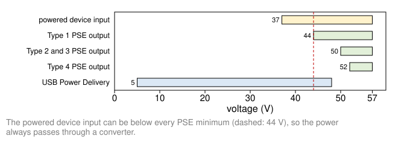
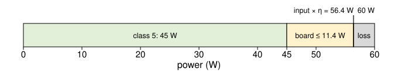
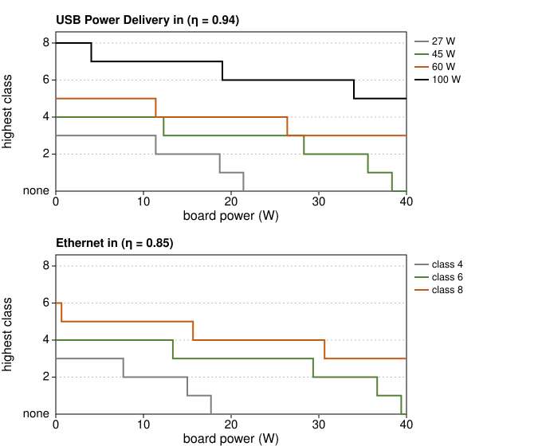

.. _poe-translation:

Choosing the class to offer
===========================

The software chooses the class that a power sourcing equipment port
offers from the power on the input port. Worked examples cover USB Power
Delivery inputs and Power over Ethernet inputs.

No direct pass-through
----------------------

Power arriving on an Ethernet port cannot be switched straight through to
the other. At a powered device the voltage can be as low as 37 V
(:numref:`tab-poe-lowest-voltage`), while power sourcing equipment must
supply at least 44 V, 50 V or 52 V (:numref:`tab-poe-pse-voltage`). A USB
Power Delivery input is at most 48 V. The power therefore passes onto the
internal power bus and through the high-voltage converter
(:ref:`power-flow`, :doc:`../converters/index`).
:numref:`fig-poe-voltages` compares the ranges.

         from 37 to 57 V. Power sourcing equipment outputs run from 44 to
         57 V for Type 1, 50 to 57 V for Types 2 and 3 and 52 to 57 V for
         Type 4. A USB Power Delivery supply runs from 5 to 48 V. A dashed
         line at 44 V shows that the powered device input can be below
         every power sourcing equipment minimum.
   :align: center

   The voltage ranges at the two ends of a cable and of a USB Power
   Delivery supply.

Highest class that fits
-----------------------

The software first works out the power left for the outputs, as on
:ref:`power-translation`:

.. math::

   P_\text{out} = P_\text{in} \times \eta - P_\text{board}

.. list-table::
   :header-rows: 1
   :widths: 22 58 20

   * - Symbol
     - Meaning
     - Unit
   * - :math:`P_\text{in}`
     - Power granted on the input port
     - W
   * - :math:`\eta`
     - Efficiency of the conversions from the input to the output port
     - none
   * - :math:`P_\text{board}`
     - Power the board itself uses
     - W
   * - :math:`P_\text{out}`
     - Power left for the output port
     - W

It then offers the highest class whose power at the power sourcing
equipment, :math:`P_\text{class}` in :numref:`tab-poe-classes`, is no more
than :math:`P_\text{out}`. That column already includes the worst-case loss
in the outgoing cable, so no cable term is needed.

For a single-signature powered device, the number of class events limits
the class only to 3, 4, 6 or 8 (:ref:`poe-demotion`). When the highest
class that fits is one of these, the port issues the events for it. When
it is 5 or 7, the port gives that class to a device that requests it, and
class 4 or 6 to one that requests more. Such a device requests class 6 or
higher, so it supports LLDP (:numref:`tab-poe-class-methods`). The port
then raises its allocation over LLDP to the power of class 5 or 7, 40.0 W
or 62.0 W at the powered device (:clause:`Table 145-12 <145>`,
:doc:`lldp`). The device takes it by requesting up to its own maximum,
which for class 6 to 8 is above both values (:clause:`145.5.3.3.1`,
:clause:`Figure 145-44 <145>`). The examples below give class 5 in this
way.

When the highest class that fits is 1 or 2, the port powers a device that
requests no more than that class, and refuses a single-signature device
that requests more
(:ref:`power sourcing equipment classification <poe-pse-classification>`).
It can power a dual-signature device on one pair set when that pair set's
class fits, under the conditions given with
:ref:`the allocation changes <poe-allocation-changes>`.

The board's own power is not known, so the examples below give, for each
input, the highest class and the largest board power at which it still
fits:

.. math::

   P_\text{board,max} = P_\text{in} \times \eta - P_\text{class}

The model assumes a constant efficiency over load. The values of
:math:`\eta` used below are illustrations, not properties of evampire's
converters; :ref:`conv-efficiency` discusses converter efficiency. The
highest class is also limited by the type and pair sets port B supports:
classes 5 to 8 need 4-pair power, and classes 7 and 8 Type 4
(:numref:`tab-poe-types`).

USB Power Delivery in, Ethernet out
-----------------------------------

The USB input power is the voltage and current of the USB Power Delivery
contract. :numref:`tab-poe-usb-in` uses the fixed supplies that a source of
each power must offer: 5 V, 9 V, 15 V and 20 V at up to 3 A, 20 V at 5 A
for 100 W (:pd:`Table 3.1`), and 28 V or 48 V at 5 A in the extended power
range (:pd:`Table 3.6`). The sink path is assumed lossless and the
high-voltage converter 94 % efficient, so :math:`\eta = 0.94`.

.. list-table:: Highest class from a USB Power Delivery contract
   :name: tab-poe-usb-in
   :header-rows: 1
   :widths: 25 25 25 25

   * - Contract (W)
     - After conversion (W)
     - Highest class
     - Board power up to (W)
   * - 15
     - 14.1
     - 3
     - 0.1
   * - 27
     - 25.4
     - 3
     - 11.4
   * - 45
     - 42.3
     - 4
     - 12.3
   * - 60
     - 56.4
     - 5
     - 11.4
   * - 100
     - 94
     - 8
     - 4
   * - 140
     - 132
     - 8
     - 42
   * - 240
     - 226
     - 8
     - 136

For example, a 20 V, 3 A contract gives:

.. math::

   P_\text{in} \times \eta &= 60\ \text{W} \times 0.94 = 56.4\ \text{W} \\
   P_\text{board,max} &= 56.4\ \text{W} - 45\ \text{W} = 11.4\ \text{W}

:numref:`fig-poe-power-split` shows this split. Class 5 fits while the
board uses no more than 11.4 W. Above that, class 4
fits up to :math:`56.4\ \text{W} - 30\ \text{W} = 26.4\ \text{W}` of
board power. With a 5 V, 3 A contract,
class 3 leaves only 0.1 W for the board, so in practice class 2 applies
(up to 7.4 W). The USB contract itself is negotiated as described on
:doc:`../usb-pd/index`. :numref:`fig-poe-class-board` gives the highest
class against the board's power for several inputs.

         leaves 56.4 W; of that, class 5 takes 45 W and the board can use
         up to 11.4 W.
   :align: center

   A 60 W USB Power Delivery contract split into the class 5 output, the
   board's power and the conversion loss.

         board's own power, 0 to 40 W. The upper graph is for USB Power
         Delivery contracts of 27, 45, 60 and 100 W with an efficiency of
         0.94; with 60 W, class 5 is offered up to 11.4 W of board power
         and class 4 up to 26.4 W. The lower graph is for Power over
         Ethernet inputs of class 4, 6 and 8 with an efficiency of 0.85;
         with class 8 in, class 6 is offered up to 0.6 W and class 5 up to
         15.6 W. Every curve steps down as the board takes more power, to
         none when no class fits.
   :align: center

   The highest class offered against the board's own power, for USB Power
   Delivery and Power over Ethernet inputs.

Ethernet in, Ethernet out
-------------------------

When power arrives on port A, the input power is the power of the assigned
class at the powered device (:numref:`tab-poe-classes`), or the allocation
set over LLDP. Before LLDP it can be lower than the requested class
(:numref:`tab-poe-class-outcome`). The conversion now has two
stages, the input converter and the high-voltage converter, assumed 90 %
and 94 % efficient, so :math:`\eta = 0.90 \times 0.94 = 0.85`.
:numref:`tab-poe-pass-through` gives the results.

.. list-table:: Highest class on port B from a class on port A
   :name: tab-poe-pass-through
   :header-rows: 1
   :widths: 25 25 25 25

   * - Class on port A
     - After conversion (W)
     - Highest class on port B
     - Board power up to (W)
   * - 3
     - 11.0
     - 2
     - 4.3
   * - 4
     - 21.7
     - 3
     - 7.7
   * - 6
     - 43.4
     - 4
     - 13.4
   * - 8
     - 60.6
     - 6
     - 0.6

:numref:`fig-poe-class-board` shows the same steps for Ethernet inputs.
Port B always offers a lower class than port A. Each class needs more
power at the power sourcing equipment than it gives at the powered device
(:numref:`tab-poe-classes`), and the converters take a share on top. For class 8 in, class 6 out leaves only
0.6 W for the board, so class 5 applies in practice, up to
:math:`60.6\ \text{W} - 45\ \text{W} = 15.6\ \text{W}` of board power.

Two measures recover some of the margin. If port B supports Autoclass,
an open question (:doc:`power-sourcing`), and the powered device on port B
uses it, the software can measure its real draw and allocate that plus a
margin, as given with :ref:`Autoclass <poe-autoclass>`. The margin is at least 0.5 W for an
assigned class of 1 to 4, 0.75 W for 5 or 6, and 1.5 W for 7 or 8
(:clause:`Table 145-15 <145>`). And the
powered device on port B may ask for less over LLDP (:doc:`lldp`).

Open questions
--------------

* The board's own power, which decides the class offered for each input.
* The efficiencies of the converters over load (:doc:`../converters/index`).
