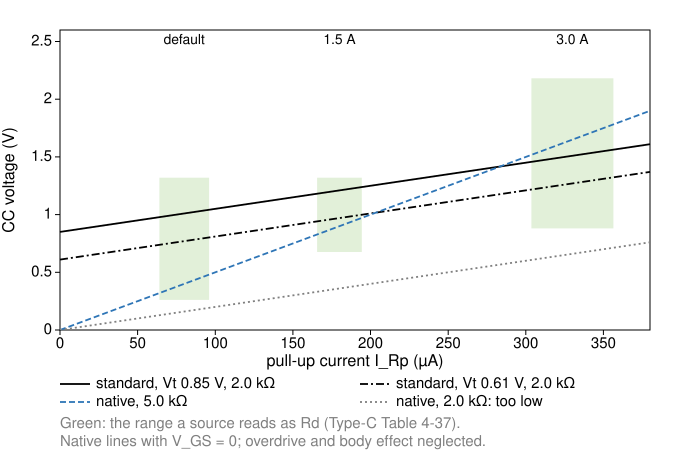
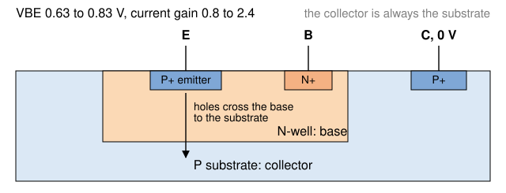

.. _usbpd-analogue:

Analogue circuits for one port
==============================

The analogue circuits that connect one evampire USB Type-C port to its
:term:`CC` pins and to :term:`VBUS`: the requirement for each, the on-chip
and external options, and reference examples from commercial controllers.

:numref:`fig-usbpd-port-blocks` shows the blocks, from the connector pins to
the processor. Each port has its own set; the number of ports in each board
configuration is in :ref:`board configurations <tab-power-board-configs>`.
The processor's part, and the optional timer, are described on
:ref:`usbpd-software`. The protection between the connector and these
blocks has its own page, :ref:`usbpd-cc-protection`, and the voltage limits
of the process that decide each on-chip option are on
:ref:`usbpd-process-limits`. The values commercial controllers reach for each
block are collected at the end of the page, in
:ref:`usbpd-analogue-examples`.

.. _fig-usbpd-port-blocks:

.. graphviz:: port-blocks.dot
   :caption: The analogue and digital blocks of one dual-role USB Type-C
             port, from the CC1, CC2 and VBUS pins to the processor.
   :alt: Block diagram. On the connector side, the CC1 and CC2 pins pass
         through a CC protection block to five blocks used on each CC pin:
         Rp current sources, Rd and dead-battery Rd, VCONN switch,
         comparators and BMC driver. The VBUS pin connects to a VBUS
         divider and discharge, a sink switch and a source converter. The
         CC blocks connect to the processor through input and output bits,
         and the comparators and BMC driver also connect through an optional
         timer with input capture and output compare.
   :align: center

.. _usbpd-rp-sources:

Rp current sources
------------------

As a source, each CC pin needs a pull-up that advertises one of three current
levels, and that can be switched off when the port presents Rd. The values
and tolerances are on :ref:`usbpd-cc-voltages`. The Type-C specification
allows either a :wikipedia:`current source <Current_source>` working from
1.7 V to 5.5 V or a resistor to 3.3 V or 5 V (:typec:`Table 4-27`).

On chip
   Switched :wikipedia:`current mirrors <Current_mirror>` copy a current set
   by the voltage reference (:ref:`usbpd-reference`). With no sink attached,
   the pin must rise above the 2.432 V disconnect threshold of the 3.0 A level
   (:typec:`Table 4-37`). From a 3.3 V supply, this leaves 0.87 V of headroom
   for the mirror's output transistor. The CC pin stays below 5.5 V, within
   the rating of the standard 5 V and 6 V transistors
   (:ref:`usbpd-process-limits`).
External
   Resistors to 3.3 V or 5 V, each switched by a transistor that evampire
   controls.

:numref:`fig-usbpd-rp-sources` shows the two options side by side.

.. graphviz:: rp-sources.dot
   :name: fig-usbpd-rp-sources
   :caption: The switched Rp of one CC pin, built on chip from current
             mirrors or on the board from switched resistors.
   :alt: Two panels. On chip: a 3.3 V supply and a voltage reference feed
         switched current-mirror outputs of 80, 180 or 330 µA, which drive
         the CC pin; with the pin open, 3.3 V minus the 2.432 V threshold
         leaves 0.87 V of headroom. External, on the board: a 3.3 V or 5 V
         supply feeds resistors of 36, 12 or 4.7 kΩ, or 56, 22 or 10 kΩ,
         through switch transistors set by evampire to the CC pin.

.. _usbpd-rd-circuit:

Rd circuit
----------

As a sink, each CC pin needs :term:`Rd`, 5.1 kΩ to ground. A ± 10 % Rd lets
the sink read the source's current level, and a ± 20 % Rd only lets the source
detect it (:typec:`Table 4-28`). Switched off, the pin must present at least
126 kΩ to ground (:typec:`Table 4-30`). The Rd must also be present when the
board has no supply, so that a source switches VBUS on
(:ref:`usbpd-dead-battery`).

The Type-C specification gives an example for the unpowered case: a ± 20 %
resistor in series with a transistor whose gate is weakly pulled up to the CC
pin, with a threshold below the 1.32 V maximum of the voltage-clamp Rd
(:typec:`Section 4.8.5`). Once powered, the chip switches this path off and
uses the trimmed Rd (:numref:`fig-usbpd-rd-paths`). The voltage on the CC
pin is then:

.. math::

   V_\text{CC} = I_\text{Rp} \times R_\text{s} + V_\text{GS}

.. list-table::
   :header-rows: 1
   :widths: 20 60 20

   * - Symbol
     - Meaning
     - Unit
   * - :math:`V_\text{CC}`
     - Voltage on the CC pin
     - V
   * - :math:`I_\text{Rp}`
     - Pull-up current from the source
     - A
   * - :math:`R_\text{s}`
     - Series resistor of the dead-battery path
     - Ω
   * - :math:`V_\text{GS}`
     - Gate-source voltage of the transistor, its threshold plus the
       overdrive needed for :math:`I_\text{Rp}`
     - V

The equation holds while the transistor conducts, with its gate at the CC
voltage through a pull-up that carries no current. The gate and the drain
then sit at the same voltage, so :math:`V_\text{GS}` equals the drain-source
voltage, which is positive while current flows: :math:`V_\text{GS}` is never
below zero, even for a transistor whose threshold is.

:math:`V_\text{CC}` must lie between the source's two thresholds at every
pull-up current of its level, or the source reads Ra or an open pin and does
not turn VBUS on. With a current-source Rp the window is above 0.260 V and
below 1.321 V at the default level, above 0.675 V and below 1.441 V at
1.5 A, and above 0.879 V and below 2.432 V at 3.0 A
(:numref:`tab-usbpd-src-thresholds`, :typec:`Table 4-37`). This page
keeps a margin below the upper thresholds: at most 1.32 V, the top of the
voltage-clamp Rd (:typec:`Section 4.8.5`), at the default and 1.5 A levels,
and at most 2.181 V, the top of the range for an Rd within ± 20 %
(:typec:`Table 4-35`), at 3.0 A.

For example, take a standard 6 V NMOS at its highest documented threshold,
0.85 V ([USBPD-GF180-ELEC]_, Section 2.0), and :math:`R_\text{s}` =
2.0 kΩ. At the highest 1.5 A pull-up current, 194.4 µA, the path gives
:math:`194.4\ \mu\text{A} \times 2.0\ \text{k}\Omega + 0.85\ \text{V} = 1.2\ \text{V}`,
with the overdrive neglected. At the 3.0 A level, 356.4 µA, it gives 1.6 V,
inside the 2.181 V limit. At the lowest threshold, 0.61 V, and the lowest
current of each level, 64 µA, 165.6 µA and 303.6 µA, it gives 0.74 V,
0.94 V and 1.2 V, above the lower thresholds. :numref:`fig-usbpd-dead-battery` plots the
equation over the range of pull-up currents.

.. graphviz:: rd-paths.dot
   :name: fig-usbpd-rd-paths
   :caption: The two Rd paths on one CC pin: the trimmed Rd for a powered
             chip, and the dead-battery path that needs no supply.
   :alt: Schematic. The source's Rp drives a current I_Rp of 80, 180 or
         330 µA into the CC pin. One path is the trimmed Rd of 5.1 kΩ
         within 10 % in series with a switch to ground that is on once the
         chip is powered. The other is an NMOS, standard or native, above a
         series resistor R_s, to ground: 2.0 kΩ for a standard NMOS or 4.1 to
         5.9 kΩ for a native one; the
         NMOS gate is weakly pulled up from CC. Once powered, the path is
         turned off, by a gate at 0 V for a standard NMOS, and by a gate
         below its source or a series switch for a native one; the pin then
         presents at least 126 kΩ.

         0 to 380 µA. Green boxes mark, for each level's current range, the
         window between the source's thresholds: 0.260 to 1.321 V at 64 to
         96 µA, 0.675 to 1.441 V at 165.6 to 194.4 µA, and 0.879 to
         2.432 V at 303.6 to 356.4 µA, with dashed margin targets at 1.32 V,
         1.32 V and 2.181 V. Lines for a standard NMOS with R_s of 2.0 kΩ
         and threshold 0.61 V or 0.85 V pass through every window. A native
         NMOS with 2.0 kΩ falls below every window; with 5.0 kΩ it passes
         through all three.

   CC voltage of the dead-battery path against the source's pull-up current,
   against the source's thresholds, with the overdrive neglected.

On chip, native transistor
   The PDK's 6 V :term:`native transistor` *nfet_06v0_nvt* has a
   :wikipedia:`threshold <Threshold_voltage>` of −0.32 V to 0.08 V
   ([USBPD-GF180-ELEC]_, Section 4.0). With :math:`V_\text{GS}` between
   0 V and 0.08 V, the resistor alone must lift the CC voltage above the
   lower thresholds: :math:`R_\text{s}` above
   :math:`0.675\ \text{V} / 165.6\ \mu\text{A} = 4.1\ \text{k}\Omega`.
   The upper limits need :math:`R_\text{s}` below
   :math:`(2.181\ \text{V} - 0.08\ \text{V}) / 356.4\ \mu\text{A}
   = 5.9\ \text{k}\Omega`. A native transistor therefore needs about
   4.1 kΩ to 5.9 kΩ; the 2.0 kΩ of the example is too small. Its threshold
   can be below zero, so turning it off needs its gate about 0.5 V below its
   source, or a switch in series: with its gate at 0 V, its source rises to
   the threshold magnitude and the path still conducts. Off in this way, it :wikipedia:`leaks <Leakage_(electronics)>`
   up to 50 µA/µm at 6.6 V ([USBPD-GF180-ELEC]_, Section 4.0). Any leakage
   adds to the Rp current when the port presents Rp (:typec:`Table 4-27`,
   Note 2).
On chip, standard transistor
   A 6 V NMOS, with a threshold of 0.61 V to 0.85 V and an off-state leakage
   of at most 10 pA/µm ([USBPD-GF180-ELEC]_, Section 2.0), turns off with its
   gate at 0 V. Its larger threshold calls for a smaller series resistor, as
   in the example above.
External
   A protector with built-in dead-battery resistors, such as the TPD8S300A.
   If the CC protection is external (:ref:`usbpd-cc-protection`), the
   dead-battery Rd must be visible through it while the board is unpowered.

.. _usbpd-vconn-switch:

VCONN switch
------------

A port that powers a marked cable connects :term:`VCONN`, a 3.0 V to 5.5 V
supply, to the CC pin that does not carry messages, and discharges that
pin after detach (:numref:`fig-usbpd-vconn-cable`). The voltage, timing and
discharge requirements are on :ref:`usbpd-vconn`. The power a
source must supply depends on what the port carries (:typec:`Table 4-4` and
:typec:`Table 4-5`). A port without SuperSpeed signals need not supply VCONN
unless it offers more than 3 A, and then it must supply 100 mW. The current
that takes at the lowest VCONN voltage is:

.. math::

   I_\text{VCONN} = \frac{P_\text{VCONN}}{V_\text{VCONN}}

.. list-table::
   :header-rows: 1
   :widths: 20 60 20

   * - Symbol
     - Meaning
     - Unit
   * - :math:`I_\text{VCONN}`
     - Current through the VCONN switch
     - A
   * - :math:`P_\text{VCONN}`
     - Power the port must supply on VCONN
     - W
   * - :math:`V_\text{VCONN}`
     - VCONN voltage at the cable, 3.0 V to 5.5 V
     - V

At 100 mW and 3.0 V this gives
:math:`0.1\ \text{W} / 3.0\ \text{V} = 33\ \text{mA}`. A port with
one lane of SuperSpeed signals must supply 1 W, or 333 mA at 3.0 V
(:typec:`Table 4-5`).

On chip
   A 6 V PMOS switch on each CC pin, from a 5 V supply, with a current limit
   set for the required current. 5.5 V is within the rating of the standard
   6 V transistors (:ref:`usbpd-process-limits`). The pin that carries VCONN
   does not carry messages, so the switch and the BMC circuits are never
   active on the same pin at once.
External
   A load switch with a current limit, or a protector whose CC switches pass
   VCONN: the TPD8S300A passes up to 600 mA ([USBPD-TPD8S300A]_,
   Section 7.4).

.. _usbpd-comparators:

CC comparators
--------------

Each CC pin needs :term:`comparators <comparator>` at several thresholds:

* as a sink, the thresholds that detect attach and the source's current
  level (:ref:`usbpd-sink-thresholds`);
* as a source, the thresholds that tell Ra, Rd and an open pin apart at each
  current level (:ref:`usbpd-source-thresholds`);
* for receiving messages, the thresholds with
  :wikipedia:`hysteresis <Hysteresis>` and the filtering of the
  :ref:`receiver <usbpd-receiver>`;
* for fast role swap, if supported, the detection threshold of
  :ref:`fast role swap <usbpd-fast-role-swap>`.

On chip
   One fast comparator on each CC pin, behind a
   :wikipedia:`low-pass filter <Low-pass_filter>`, for messages and fast
   role swap. A small :term:`DAC` or a
   :wikipedia:`resistor ladder <Resistor_ladder>` selects its threshold.
   The attach and current-level checks change over milliseconds, so the same
   comparator can make them between messages, or a shared :term:`ADC` can.
   All CC voltages are within the rating of the standard 5 V and 6 V
   transistors.
External
   A CC interface such as the FUSB302B, which brings its own comparators.

:numref:`fig-usbpd-cc-frontend` shows the on-chip receive path, and the
transmit path described below.

.. graphviz:: cc-frontend.dot
   :name: fig-usbpd-cc-frontend
   :caption: The on-chip receive and transmit paths of one CC pin; dashed
             blocks are optional.
   :alt: Block diagram. The CC pin feeds a low-pass filter with a time
         constant of at least 100 ns and then a fast comparator, whose
         threshold comes from a DAC or resistor ladder; its output goes to
         the processor's input and output bits. Optionally, a multiplexer
         takes the CC pin to a shared ADC. For transmitting, a regulator
         makes the 1.125 V rail for a slew-limited three-state output of
         33 to 75 Ω, which drives the CC pin from the processor's data and
         enable bits.

.. _usbpd-bmc-driver:

BMC driver
----------

The transmitter drives 0 V and a level near 1.125 V through a limited output
impedance, with rise and fall times inside a window, and is high-impedance
when not sending. These values are in the
:ref:`transmitter limits <usbpd-transmitter>`. The
transmitter must also tolerate its output being shorted to ground for
tFRSwapTx, at most 120 µs (:pd:`Section 5.3.4.10`).

On chip
   A small :wikipedia:`linear regulator <Linear_regulator>` for the
   1.125 V rail, and a :wikipedia:`three-state <Three-state_logic>` output
   stage with a controlled :wikipedia:`slew rate <Slew_rate>`. Either CC
   pin can carry VCONN, up to 5.5 V, depending on the plug orientation, so
   the output transistors are 5 V or 6 V devices
   (:numref:`fig-usbpd-cc-frontend`).
External
   A CC interface or controller with its own driver, such as the FUSB302B,
   or the STUSB1602, which drives the line from bits sent by an external
   microcontroller ([USBPD-STUSB1602]_, Description).

.. _usbpd-reference:

Voltage reference
-----------------

The driver level must stay within ± 6.7 % of 1.125 V (1.05 V to 1.2 V,
:ref:`usbpd-transmitter`), the 1.5 A and 3.0 A pull-up currents within ± 8 %
(:typec:`Table 4-27`), and the thresholds inside their windows. All three
come from a voltage reference that is stable over supply and temperature.

On chip
   The open gf180mcu PDK has no :term:`bandgap reference` among its IP
   blocks, which are I/O cells and SRAM ([USBPD-GF180-IP]_). One has to be
   designed. A :wikipedia:`bandgap reference <Bandgap_voltage_reference>`
   is usually built from :wikipedia:`bipolar transistors
   <Bipolar_junction_transistor>`, and the PDK documents a vertical PNP: a
   P+ emitter inside an N-well base, with the P substrate as collector. Its
   base-emitter voltage is 0.63 V to 0.83 V and its current gain 0.8 to 2.4
   ([USBPD-GF180-ELEC]_, Section 5.8). Vertical NPN transistors in a
   :term:`deep N-well` are also listed ([USBPD-GF180-DRM]_, Appendix A).
On chip, shared
   The Ethernet (:doc:`../../ethernet/index`), Power over Ethernet
   (:doc:`../poe/index`) and converter (:doc:`../converters/index`)
   circuits also need a reference, so one design can serve all of them.
External
   A reference IC on the board.

:numref:`fig-usbpd-reference` shows what the reference sets, and
:numref:`fig-usbpd-vertical-pnp` the vertical PNP it can be built from.

.. graphviz:: reference.dot
   :name: fig-usbpd-reference
   :caption: One voltage reference sets the three CC quantities whose
             accuracy the specifications fix.
   :alt: Block diagram. A voltage reference, a bandgap built from the
         vertical PNP, feeds the BMC driver level of 1.125 V within 6.7 %,
         the Rp currents of the 1.5 A and 3.0 A levels within 8 %, and the
         comparator thresholds, which must lie inside their windows.

         a P+ contact at 0 V. An N-well in it is the base, contacted
         through N+. A P+ region in the N-well is the emitter. An arrow
         shows holes crossing the base from the emitter to the substrate.
         The base-emitter voltage is 0.63 to 0.83 V and the current gain
         0.8 to 2.4.

   The vertical PNP transistor of the process, schematic and not to scale:
   its collector is always the substrate.

.. _usbpd-vbus-sensing:

VBUS sensing and discharge
--------------------------

The port measures VBUS to detect attach and detach, to check that VBUS is
near 0 V before it switches VBUS on, and to check the voltage after each
change. It discharges VBUS after detach, during a power role swap and during
a Hard Reset (:ref:`usbpd-discharge`, :ref:`usbpd-monitoring`). VBUS
reaches 21.5 V with fixed :term:`SPR` supplies, 22.15 V with PPS, and 50.9 V with :term:`EPR`
(:ref:`usbpd-spr`, :ref:`usbpd-epr`). Commercial controllers take one of two
approaches: a VBUS pin that holds the full voltage, as on the TPS65987D, or
a pin that sees VBUS only through an external resistor, as on the TUSB320.

On chip, divider
   A :wikipedia:`voltage divider <Voltage_divider>` of high-resistance
   :wikipedia:`polysilicon <Polycrystalline_silicon>`. A resistor's value is
   its :wikipedia:`sheet resistance <Sheet_resistance>` times its length in
   squares, its length divided by its width. The divider draws:

   .. math::

      I_\text{div} = \frac{V_\text{BUS}}{N_\square \times R_\square}

   .. list-table::
      :header-rows: 1
      :widths: 20 60 20

      * - Symbol
        - Meaning
        - Unit
      * - :math:`I_\text{div}`
        - Current drawn from VBUS by the divider
        - A
      * - :math:`V_\text{BUS}`
        - VBUS voltage
        - V
      * - :math:`N_\square`
        - Length of the divider in squares
        - none
      * - :math:`R_\square`
        - Sheet resistance of the polysilicon
        - Ω

   With the 3 kΩ-per-square option, 2.25 kΩ to 3.75 kΩ per square
   ([USBPD-GF180-ELEC]_, Section 6.1C), 333 squares make 1 MΩ nominal, and
   at 21.5 V the divider draws
   :math:`21.5\ \text{V} / (333 \times 3\ \text{k}\Omega) = 21.5\ \mu\text{A}`.
   The resistor lies on :term:`field oxide`, and the top of the divider sits
   at the full VBUS voltage above the substrate. The limits that apply are on
   :ref:`usbpd-process-limits`. The VBUS pad also needs an ESD structure that
   does not conduct below the VBUS voltage.
On chip, discharge
   A switched load from VBUS to ground. The switch must block the full VBUS
   voltage when off. 21.5 V, or 22.15 V with PPS, is above the documented minimum breakdown of
   every standard transistor, 13.2 V for the LDMOS
   (:ref:`usbpd-process-limits`), so an on-chip switch is a custom
   drain-extended or stacked device.
External
   A top resistor on the board, as with the TUSB320, so the chip sees only
   the divided voltage, and a discharge transistor on the board.

:numref:`fig-usbpd-vbus-sense` shows the two options. The cross-section of
the polysilicon divider is in :numref:`fig-usbpd-custom-structures`.

.. graphviz:: vbus-sense.dot
   :name: fig-usbpd-vbus-sense
   :caption: VBUS sensing and discharge on chip, and with the high-voltage
             parts on the board.
   :alt: Two panels. On chip: VBUS, up to 21.5 V or 22.15 V with PPS,
         feeds a polysilicon divider of 333 squares, 1 MΩ, drawing 21.5 µA
         at 21.5 V, whose output goes to an ADC or comparator; and a custom
         discharge switch that holds VBUS, to ground. External: VBUS feeds
         a board top resistor of 855 to 920 kΩ, as with the TUSB320, to a
         sense pin rated at most 4 V; and a discharge transistor on the
         board, to ground.

.. _usbpd-power-path:

Power path
----------

As a sink, a switch connects VBUS to the board's power bus. As a source, a
converter makes the negotiated voltage from the bus, with a current limit. In
both roles, power must not flow backwards, and a dual-role port presents at
most 10 µF on VBUS when it is not sourcing (:typec:`Table 4-2`).
:numref:`fig-usbpd-power-path` shows the two paths.

.. graphviz:: power-path.dot
   :name: fig-usbpd-power-path
   :caption: The power path of one dual-role port; bold arrows carry power.
   :alt: Block diagram. VBUS, with at most 10 µF on it when the port is not
         sourcing, feeds the board power bus through a sink switch that
         blocks reverse current. The bus feeds VBUS through a source
         converter with a current limit, which also blocks reverse current.
         evampire controls both paths and sets the limit.

The converters are described on :doc:`../converters/index`, their gate drive
on :ref:`conv-gate-drive`, their protection on :ref:`conv-protection`, and
the custom devices for on-chip power switches on :ref:`conv-custom`. The
current limit that software sets is on :ref:`usbpd-limiting`, and the power
flow on the board on :ref:`power-flow`. For reference, the TPS65987D puts
two 5 A switches on the controller die, and the CCG5C drives external
P-channel MOSFETs on separate sink and source paths
(:numref:`tab-usbpd-ref-values`).

.. _usbpd-analogue-examples:

Commercial controllers
----------------------

:numref:`tab-usbpd-ref-parts` lists the commercial parts, and
:numref:`tab-usbpd-ref-values` the values they reach for each block. They
show how other designs meet each requirement; they are not requirements for
evampire.

.. list-table:: Commercial parts used as reference examples
   :name: tab-usbpd-ref-parts
   :header-rows: 1
   :widths: 26 74

   * - Part
     - Kind
   * - TI TPS65987D
     - Dual-role controller with integrated power paths
       [USBPD-TPS65987D]_
   * - onsemi FUSB302B
     - CC interface for an external processor, able to toggle as a
       dual-role port [USBPD-FUSB302B]_
   * - ST STUSB1602
     - Controller with a BMC line driver for an external microcontroller
       [USBPD-STUSB1602]_
   * - Infineon CCG5C
     - Dual-role controller with an Arm Cortex-M0 processor [USBPD-CCG5C]_
   * - TI TUSB320
     - CC logic without USB Power Delivery [USBPD-TUSB320]_
   * - TI TPD8S300A
     - Protector for the CC and SBU pins [USBPD-TPD8S300A]_

.. list-table:: Values of commercial parts for each block
   :name: tab-usbpd-ref-values
   :header-rows: 1
   :widths: 44 22 34

   * - Parameter
     - Value
     - Source
   * - Rp current, 3.0 A level (µA)
     - 303.6 to 356.4
     - [USBPD-TPS65987D]_, 6.8
   * - Rp current, 3.0 A level (µA)
     - 304 to 356
     - [USBPD-FUSB302B]_, Table 10
   * - Rd, powered (kΩ)
     - 4.59 to 5.61
     - [USBPD-TPS65987D]_, 6.8
   * - Rd, unpowered (kΩ)
     - 4.08 to 6.12
     - [USBPD-TPS65987D]_, 6.8
   * - Dead-battery transistor threshold (V)
     - 0.5 to 1.2
     - [USBPD-TPD8S300A]_, 7.6
   * - VCONN switch resistance (mΩ)
     - 222 to 325
     - [USBPD-TPS65987D]_, 6.7
   * - VCONN current limit (A)
     - 0.6 to 0.9
     - [USBPD-TPS65987D]_, 6.7
   * - VCONN over-current detection, minimum (mA)
     - 550
     - [USBPD-CCG5C]_, Table 39
   * - Fixed CC comparators
     - 3
     - [USBPD-FUSB302B]_, Type-C Detection
   * - Threshold DAC step (mV)
     - 42
     - [USBPD-FUSB302B]_, Table 10
   * - BMC transmit level (V)
     - 1.05 to 1.2
     - [USBPD-TPS65987D]_, 6.9
   * - BMC output impedance (Ω)
     - 33 to 75
     - [USBPD-TPS65987D]_, 6.9
   * - VBUS pin absolute maximum (V)
     - 24
     - [USBPD-TPS65987D]_, 6.1
   * - External VBUS sense resistor (kΩ)
     - 855 to 920
     - [USBPD-TUSB320]_, 6.5
   * - VBUS sense pin absolute maximum (V)
     - 4
     - [USBPD-TUSB320]_, 6.1
   * - Current of each integrated power path (A)
     - 5
     - [USBPD-TPS65987D]_, Features
   * - Tolerance of the external switch gate drivers (V)
     - 24
     - [USBPD-CCG5C]_, Features

The Source column names each part's datasheet; a bare number there is a
section of that datasheet.

Open questions
--------------

* Which transistor carries the dead-battery Rd path. For the native NMOS,
  a simulation with the PDK models gives the off-state leakage at the CC
  voltages. For a standard 6 V NMOS, it gives the CC voltage over the range
  of pull-up currents.
* How much VCONN power a board supplies, which follows from whether its
  ports carry SuperSpeed signals and offer more than 3 A
  (:typec:`Table 4-4`).
* Whether the attach and current-level checks use the message comparator,
  a separate comparator or a shared ADC, which sets the number of
  comparators per CC pin.
* Whether the voltage reference is on chip, and whether one reference
  serves the USB, Ethernet, Power over Ethernet and converter circuits.
* Whether the VBUS divider and discharge switch are on chip or on the board.
* Which parts of the power-path control are on chip: the
  :wikipedia:`pulse-width modulation <Pulse-width_modulation>`, the
  feedback, the reverse-current detection and the gate drive.
