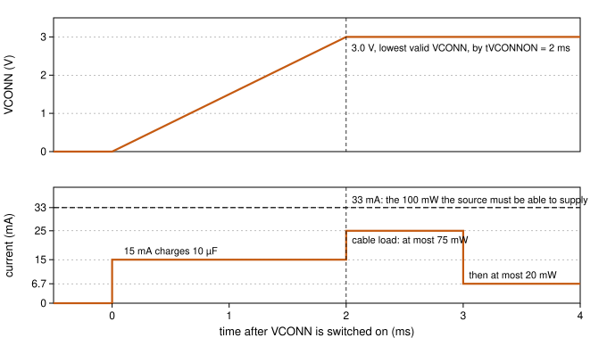

.. _usbpd-cables:

Cables and VCONN
================

A USB Type-C port powers the chip inside a marked cable, and asks that chip
for the cable's rating before offering more than 3 A.

Cable current rating
--------------------

Every standard USB Type-C cable carries at least 3 A at voltages above 5 V
(:pd:`Section 8.6.1.2.2`). A cable rated for more than 3 A, and every cable
rated for the :term:`extended power range <EPR>`, contains an
:term:`e-marker <E-marker>`: a small chip in the plug that reports the
cable's ratings. So does every cable with SuperSpeed wires
(:typec:`Type‑C Sections 3.4.1.1 <x>`, :typec:`3.4.2.1 <x>` and
:typec:`3.11.2 <x>`).

A :term:`source` that can offer more than 3 A must ask the e-marker for the
cable's current rating and limit its offers to it. An EPR source must also
check that the cable supports EPR (:pd:`PD Sections 8.6.1.2.2 <x>` and
:pd:`8.6.1.2.3 <x>`). The question is the :term:`Discover Identity` message,
described below. A port that offers 3 A or less needs neither the e-marker
nor its supply.

.. _usbpd-vconn:

VCONN and the e-marker
----------------------

The e-marker takes its power from :term:`VCONN`, a 3.0 V to 5.5 V supply that
the source puts on the :term:`CC` pin not connected to the cable's CC wire
(:typec:`Section 4.4.3`). A marked cable shows itself by a resistor,
:term:`Ra`, on that pin. The source supplies VCONN on the pin that shows Ra,
or on the unused pin whatever it shows, within *tVCONNON* (2 ms) of VBUS
reaching 5 V (:typec:`Section 4.5.2.2.9.1`; :typec:`Table 4-32 <x>`).
:numref:`fig-usbpd-vconn-cable` shows the two paths.

.. graphviz:: vconn-cable.dot
   :name: fig-usbpd-vconn-cable
   :caption: A source supplying VCONN to the e-marker in the near cable plug,
             through the CC pin that does not meet the CC wire.
   :alt: Schematic. In the source port, Rp connects to the CC1 pin, which
         meets the plug's CC contact and the CC wire to the far plug and the
         sink's Rd. A VCONN supply of 3.0 to 5.5 V connects through a switch
         to the CC2 pin, with a discharge resistor Rdch of 30 to 6120 Ω to
         ground used after detach. CC2 meets the plug's VCONN contact, which
         holds Ra, 0.8 to 1.2 kΩ to ground, and the e-marker. VCONN turns on
         within tVCONNON, 2 ms, of VBUS reaching 5 V.

The port that supplies VCONN is the *VCONN Source*. After attach it is the
source; the two ports can exchange the job with a
:ref:`VCONN_Swap <usbpd-vconn-swap>`.

evampire's USB Type-C ports carry USB 2.0 data on D+ and D− (see
:ref:`req-usb-serial`) and no SuperSpeed pairs. :numref:`tab-usbpd-vconn-when`
lists when such a port must supply VCONN, and how much power.

.. list-table:: When a source with USB 2.0 data or none must supply VCONN
   (:typec:`Table 4-4`)
   :name: tab-usbpd-vconn-when
   :header-rows: 1
   :widths: 35 65

   * - Offer on VBUS
     - VCONN requirement
   * - 3 A or less
     - Not required
   * - More than 3 A
     - At least 100 mW; may be removed once the source has read the cable's
       current rating

:numref:`tab-usbpd-vconn` gives the limits a VCONN supply and a passive
marked cable must meet.

.. list-table:: VCONN limits (:typec:`Type‑C Tables 4-5 <x>`, :typec:`4-6 <x>`,
   :typec:`4-24 <x>` and :typec:`4-32 <x>`)
   :name: tab-usbpd-vconn
   :header-rows: 1
   :widths: 52 16 16 16

   * - Parameter
     - Min
     - Max
     - Unit
   * - Valid VCONN voltage, *vVCONNValid*
     - 3.0
     - 5.5
     - V
   * - Power the source must supply
     - 100
     - none
     - mW
   * - Turn-on time from VBUS at 5 V, *tVCONNON*
     - none
     - 2
     - ms
   * - Cable inrush capacitance
     - none
     - 10
     - µF
   * - Power drawn by a passive marked cable
     - none
     - 20
     - mW
   * - The same, in the first *tRaWeaken* (21 ms to 1.2 s)
     - none
     - 75
     - mW
   * - Current drawn while VCONN is below 3.0 V, *iRaDetect*
     - none
     - 10
     - mA
   * - E-marker ready after VCONN, *teMarkerReady*
     - none
     - 50
     - ms
   * - Discharge resistance after detach, *Rdch*
     - 30
     - 6120
     - Ω

After detach the source discharges the VCONN pin through Rdch until it is
below *vVCONNDischarge*, 0.8 V (:typec:`Section 4.5.2.2.6`;
:typec:`Table 4-6 <x>`).

VCONN switch current
^^^^^^^^^^^^^^^^^^^^

When VCONN turns on, the switch must charge the cable's capacitance to the
lowest valid VCONN voltage within tVCONNON. A switch with a
:wikipedia:`current limit <Current_limiting>` charges it at a constant
current, the :wikipedia:`inrush current <Inrush_current>`, which must be at
least:

.. math::

   I_\text{inrush} = \frac{C_\text{cable} \times V_\text{min}}{t_\text{on}}

.. list-table::
   :header-rows: 1
   :widths: 22 60 18

   * - Symbol
     - Meaning
     - Unit
   * - :math:`I_\text{inrush}`
     - Constant current that charges the cable in time
     - A
   * - :math:`C_\text{cable}`
     - Inrush capacitance of the cable, at most 10 µF (:typec:`Table 4-6`)
     - F
   * - :math:`V_\text{min}`
     - Lowest valid VCONN voltage, 3.0 V (:typec:`Table 4-5`)
     - V
   * - :math:`t_\text{on}`
     - Turn-on time, tVCONNON, 2 ms (:typec:`Table 4-32`)
     - s

The equation counts only the current that charges the capacitance. With
the limits above:

.. math::

   I_\text{inrush} = \frac{10\ \mu\text{F} \times 3.0\ \text{V}}{2\ \text{ms}}
                   = 15\ \text{mA}

While VCONN is below 3.0 V the cable may also draw up to *iRaDetect*,
10 mA, so the switch supplies up to 15 mA plus 10 mA, 25 mA, during the
ramp. Once VCONN is valid, a passive marked cable draws at most 75 mW in
the first tRaWeaken, 25 mA at 3.0 V, and 20 mW after it
(:numref:`tab-usbpd-vconn`). The source must also be able to supply
100 mW, which is
:math:`0.1\ \text{W} / 3.0\ \text{V} = 33\ \text{mA}` at the lowest valid
VCONN voltage. A VCONN switch for evampire therefore needs a current limit of
at least 33 mA, which also covers the 25 mA of the ramp
(:numref:`fig-usbpd-vconn-inrush`). Sources with SuperSpeed data must supply 1 W to
1.5 W (:typec:`Table 4-4`), and the controllers in
:numref:`tab-usbpd-vconn-parts`, built for those, have much higher limits.
They are reference examples, not requirements for evampire.

         VCONN rises linearly from 0 to 3.0 V, the lowest valid VCONN, by
         tVCONNON at 2 ms. While it rises, the switch supplies up to 25 mA:
         15 mA to charge 10 µF, drawn dashed, plus up to 10 mA, iRaDetect,
         drawn by the cable. The cable then draws at most 75 mW, 25 mA, in
         the first tRaWeaken, and at most 20 mW, 6.7 mA, after it. A dashed line at 33 mA marks the
         100 mW the source must be able to supply.

   The VCONN switch charging a marked cable at a constant current, then
   carrying its load, against the 100 mW a source must be able to supply;
   the length of the 75 mW period, tRaWeaken, is 21 ms to 1.2 s and is
   drawn shorter.

.. list-table:: VCONN current limits of commercial USB PD controllers
   :name: tab-usbpd-vconn-parts
   :header-rows: 1
   :widths: 26 26 48

   * - Part
     - Limit (mA)
     - Source
   * - TPS65987D
     - 600 to 900
     - [USBPD-TPS65987D]_, Section 6.7
   * - STUSB1602
     - 100 to 600
     - [USBPD-STUSB1602]_, Section 3.4.6
   * - CCG5C
     - 550 or more
     - [USBPD-CCG5C]_, Table 39

The STUSB1602 limit is set in 50 mA steps; the other two are fixed.

The circuit of the VCONN switch is described with the
:ref:`analogue circuits <usbpd-vconn-switch>`.

.. _usbpd-discover-identity:

Discover Identity
-----------------

Discover Identity is a structured Vendor_Defined message
(:pd:`Section 6.4.12.3`). Sent with the SOP′ :ref:`start of packet <usbpd-sop>`,
it goes to the cable plug nearest the sender instead of to the port at the
far end. The e-marker answers with an ACK that
carries a *Cable VDO*, a 32-bit :term:`VDO` describing the cable
(:pd:`Table 6.45`). :numref:`fig-usbpd-discover-identity` shows the
exchange.

.. graphviz:: discover-identity.dot
   :name: fig-usbpd-discover-identity
   :caption: A source asks the cable plug for its identity after turning
             VCONN on.
   :alt: Sequence diagram between the source and the cable plug. The source
         turns VCONN on within 2 ms of VBUS reaching 5 V. The e-marker is
         ready within 50 ms. The source sends Discover Identity, repeated up
         to 20 times if no GoodCRC comes back. The cable plug answers GoodCRC
         within 195 microseconds, then Discover Identity ACK with the Cable
         VDO within 15 ms, and the source answers GoodCRC within
         195 microseconds.
   :align: center

The steps and their limits are:

#. The source turns VCONN on within tVCONNON (2 ms) of VBUS reaching 5 V
   (:typec:`Table 4-32`). The e-marker is ready to answer within
   *teMarkerReady* (50 ms) of VCONN or VBUS, whichever comes later
   (:typec:`Table 4-24`).
#. The source sends Discover Identity, and the cable plug answers with a
   :term:`GoodCRC` within *tTransmit* (195 µs, :pd:`Table 7.10`).
#. Without a GoodCRC the source tries again. It sends at most
   *nDiscoverIdentityCount* (20) messages without a GoodCRC, every
   *tDiscoverIdentity* (40 ms to 50 ms) once a contract is in place, and
   then treats the cable as unmarked (:pd:`PD Sections 7.31.12.4 <x>` and
   :pd:`8.6.1.2.1 <x>`; :pd:`Tables 7.10 <x>` and :pd:`7.12 <x>`).
#. The cable plug sends the ACK within *tVDMReceiverResponse* (15 ms). The
   source gives up waiting after *tVDMSenderResponse* (24 ms to 50 ms)
   (:pd:`Section 7.31.11.1`; :pd:`Table 7.10 <x>`).

Before the first contract, the source keeps sending Source_Capabilities on
its own schedule while it asks the cable (:pd:`Section 8.6.1.2.1`). Before a
contract any source may talk to the cable. Once a contract is in place, only
the VCONN Source may (:typec:`Section 4.9`; :pd:`Section 7.13`).

The Cable VDO fields the source needs are (:pd:`Table 6.45`):

* maximum VBUS voltage: 20 V or 50 V;
* VBUS current: 3 A or 5 A;
* whether the cable supports EPR;
* whether the cable needs VCONN all the time, or only to answer Discover
  Identity. A cable that needs it only to answer lets the source turn VCONN
  off afterwards (:pd:`Section 4.1.6`).

The source then builds its offer within the cable's current
(:ref:`usbpd-building-offer`).

Open questions
--------------

* Whether a source port that offers more than 3 A keeps VCONN on after
  Discover Identity, or turns it off when the cable allows it.
