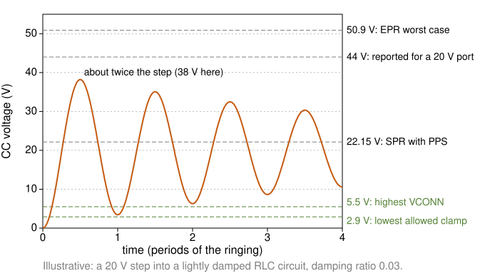
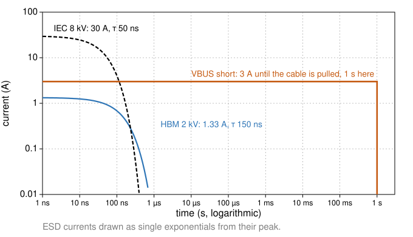

.. _usbpd-cc-protection:

CC protection against VBUS shorts
=================================

What a short from :term:`VBUS` to a :term:`CC` pin does, why the
:term:`ESD` protection of a pin does not cover it, and the ways to protect
evampire's CC pins: blocking the short, or pulling the pin to ground with a
crowbar.

Over-voltage protection on the CC pins
--------------------------------------

In normal operation the CC pins see at most 5.5 V, when one of them carries
:term:`VCONN` (:ref:`usbpd-vconn`). The CC contact sits next to VBUS in the
connector, and a damaged cable, debris or moisture can short them. Twisting
or sliding the plug can also short a 20 V VBUS onto CC ([USBPD-TPD8S300A]_,
Section 3). VBUS reaches 21.5 V with fixed :term:`SPR` supplies, 22.15 V with PPS, and 50.9 V with
:term:`EPR` (:ref:`usbpd-spr`, :ref:`usbpd-epr`).

The short also rings. The cable's inductance and the capacitance on the pin
form a resonant circuit, and an :wikipedia:`RLC circuit <RLC_circuit>` with
little damping, driven by a step, overshoots to about twice the step (:numref:`fig-usbpd-cc-ringing`). TI
gives ringing up to twice the settled voltage, and more than 44 V on a 20 V
port when capacitors lose capacitance under the voltage
([USBPD-TPD8S300A]_, Section 8.3.1). Infineon gives the same factor of two,
44 V, when nothing clamps the pin ([USBPD-CYPD3177]_, Section 1.1.3).

A port may clamp its CC pins at 2.9 V or above, but the clamp must not
affect the pin when it carries VCONN (:typec:`Section 4.11.3.3`,
:typec:`Table 4-40`). Any clamp on evampire's CC pins therefore starts to
conduct above 5.5 V.

         the ringing, from 0 to 4. A 20 V step rings up to about 38 V,
         about twice the step, and decays slowly around 20 V. Dashed lines
         mark 50.9 V for EPR, 44 V reported for a 20 V port, 22.15 V for
         SPR with PPS, 5.5 V for the highest VCONN and 2.9 V for the lowest
         allowed clamp.

   An illustrative 20 V short ringing on a CC pin, against the voltages
   that matter for protection.

.. _usbpd-esd:

ESD protection and VBUS shorts
------------------------------

Every I/O pad has protection against electrostatic discharge. The gf180mcu
I/O library targets 2000 V in the :wikipedia:`human-body model
<Human-body_model>` ([USBPD-GF180-IO]_, ESD protection page). An ESD test
discharges a small capacitor through a resistor into the pin, so it delivers
a small, fixed charge for a short time:

.. math::

   Q_\text{ESD} = C_\text{ESD} \times V_\text{ESD}

   \tau_\text{ESD} = R_\text{ESD} \times C_\text{ESD}

   I_\text{peak} = \frac{V_\text{ESD}}{R_\text{ESD}}

.. list-table::
   :header-rows: 1
   :widths: 20 60 20

   * - Symbol
     - Meaning
     - Unit
   * - :math:`Q_\text{ESD}`
     - Charge delivered by the test network
     - C
   * - :math:`C_\text{ESD}`
     - Capacitance of the test network
     - F
   * - :math:`V_\text{ESD}`
     - Test voltage
     - V
   * - :math:`\tau_\text{ESD}`
     - Time constant of the discharge
     - s
   * - :math:`R_\text{ESD}`
     - Series resistance of the test network
     - Ω
   * - :math:`I_\text{peak}`
     - Peak current into a pin held near 0 V
     - A

The equations treat the network as an ideal capacitor and resistor. The
:term:`HBM` network is 100 pF and 1.5 kΩ (:std:`JS-001`; [USBPD-TB505]_,
Figure 1). At 2000 V it delivers
:math:`100\ \text{pF} \times 2000\ \text{V} = 200\ \text{nC}`, with a time
constant of
:math:`1.5\ \text{k}\Omega \times 100\ \text{pF} = 150\ \text{ns}` and a
peak of :math:`2000\ \text{V} / 1.5\ \text{k}\Omega = 1.33\ \text{A}`
([USBPD-TB505]_, Figure 2). A clamp carries this charge for a few hundred
nanoseconds. After three time constants, 450 ns, the current has fallen to
:math:`e^{-3}`, 5 % of its peak.

A connector pin of a finished product also faces the system-level test of
:std:`IEC 61000-4-2`, with 150 pF and 330 Ω ([USBPD-TB505]_, Figure 1). At
8 kV the charge is
:math:`150\ \text{pF} \times 8\ \text{kV} = 1.2\ \mu\text{C}` and the time
constant :math:`330\ \Omega \times 150\ \text{pF} = 50\ \text{ns}`. The
peak equation does not apply here: the IEC waveform has a faster and higher
first peak, 30 A at 8 kV, which rises in less than 1 ns ([USBPD-TB505]_,
page 1 and Figure 2). :numref:`fig-usbpd-esd-networks` shows the two
test networks.

.. graphviz:: esd-networks.dot
   :name: fig-usbpd-esd-networks
   :caption: The two ESD test networks: a charged capacitor discharged
             through a series resistor into the pin.
   :alt: Two rows. HBM at 2 kV: a 100 pF capacitor charged to 2000 V
         discharges through 1.5 kΩ into the pin under test. IEC at 8 kV: a
         150 pF capacitor charged to 8000 V discharges through 330 Ω into
         the pin under test.

A VBUS short is a power supply. A source must not trip its over-current
protection for any current its contract allows (:pd:`Section 4.1.5.1`), so
it can deliver 3 A or more until the cable is pulled out. As an estimate,
take a short that lasts 1 s at 3 A into an ESD-type clamp that holds the pin
at 6 V:

.. math::

   Q_\text{short} = I_\text{short} \times t_\text{short}

   E_\text{clamp} = V_\text{clamp} \times I_\text{short} \times t_\text{short}

.. list-table::
   :header-rows: 1
   :widths: 20 60 20

   * - Symbol
     - Meaning
     - Unit
   * - :math:`Q_\text{short}`
     - Charge delivered by the short
     - C
   * - :math:`I_\text{short}`
     - Current delivered by the source
     - A
   * - :math:`t_\text{short}`
     - Duration of the short
     - s
   * - :math:`E_\text{clamp}`
     - Energy dissipated in the clamp
     - J
   * - :math:`V_\text{clamp}`
     - Voltage the clamp holds the pin at
     - V

The equations assume a constant current for the whole short. The short
delivers :math:`3\ \text{A} \times 1\ \text{s} = 3\ \text{C}`, which is
:math:`3\ \text{C} / 200\ \text{nC} = 1.5 \times 10^{7}` times the HBM
charge. The clamp dissipates
:math:`6\ \text{V} \times 3\ \text{A} \times 1\ \text{s} = 18\ \text{J}`,
18 W for the whole second. :numref:`tab-usbpd-esd-short` compares the three
events.

.. list-table:: An HBM test, an :std:`IEC 61000-4-2` test and a VBUS short
   :name: tab-usbpd-esd-short
   :header-rows: 1
   :widths: 34 22 22 22

   * - Quantity
     - HBM, 2 kV
     - IEC, 8 kV
     - VBUS short
   * - Source of the charge
     - 100 pF capacitor
     - 150 pF capacitor
     - VBUS supply
   * - Series resistance (Ω)
     - 1500
     - 330
     - none
   * - Voltage (V)
     - 2000
     - 8000
     - 21.5
   * - Charge (µC)
     - 0.2
     - 1.2
     - 3 000 000
   * - Time constant (ns)
     - 150
     - 50
     - none
   * - Peak current (A)
     - 1.33
     - 30
     - 3
   * - Duration (ns)
     - 450
     - 150
     - 1 000 000 000

The durations are three time constants for the ESD tests, and the assumed
1 s for the short. No clamp sized for ESD absorbs the short, so the short is
either blocked or diverted at a low voltage. :numref:`fig-usbpd-esd-short`
shows the three currents on one time scale.

         1 ns to 3 s. The IEC 8 kV test starts at 30 A and decays with a
         50 ns time constant; the HBM 2 kV test starts at 1.33 A and decays
         with 150 ns; both are gone before 1 µs. The VBUS short holds 3 A
         until 1 s.

   Current into a pin for the two ESD tests and for a 3 A VBUS short of
   1 s; the ESD currents are drawn as single exponentials.

.. _usbpd-cc-blocking:

Blocking switch
---------------

The conventional protection is a series switch on each CC pin, which holds
off the full VBUS voltage, and the
ringing unless a clamp limits it. It opens within tens of nanoseconds, so
that the circuits behind it see only a short overshoot, which their own ESD
clamps absorb. TI designs the TPD8S300A so that the stress on the protected
pin is no more than an HBM event ([USBPD-TPD8S300A]_, Section 8.3.1).

The TPD8S300A opens its CC switches in 70 ns typical, once the pin passes
5.75 V to 6.2 V ([USBPD-TPD8S300A]_, Sections 7.6 and 7.7). Its diode clamps
limit the ringing to about 30 V, and its switches tolerate 30 V
([USBPD-TPD8S300A]_, Section 8.3.1). NXP's NX48P0407 is specified for a
short to a 48 V VBUS, with a response below 60 ns [USBPD-NX48P0407]_. VBUS
itself is protected at board level, for example with a :term:`TVS` diode
([USBPD-TPS25750]_, Section 10.2.3.2.2). :numref:`tab-usbpd-cc-ratings`
compares the CC ratings of commercial parts, and the left half of
:numref:`fig-usbpd-cc-protect-options` shows the arrangement.

.. graphviz:: cc-protect-options.dot
   :name: fig-usbpd-cc-protect-options
   :caption: The two ways to protect a CC pin from a VBUS short: block it
             with a series switch, or divert it with a crowbar.
   :alt: Two panels. Blocking switch: VBUS shorts to the CC contact; VBUS
         has a TVS diode to ground; on the CC line a diode clamp to ground
         limits the ringing to about 30 V, and a 30 V series switch that
         opens in 70 ns above 5.75 to 6.2 V protects the evampire CC pin and
         its ESD clamps. Crowbar: a far-end source with over-current
         protection and 10 to 120 µF on VBUS shorts onto the CC contact,
         rated 0.5 A or more; the current flows through the board trace
         into a crowbar to ground that triggers above 5.5 V and holds about
         0.5 V, in front of the evampire CC circuits.

.. list-table:: CC pin voltage ratings of commercial parts
   :name: tab-usbpd-cc-ratings
   :header-rows: 1
   :widths: 30 20 20 30

   * - Part
     - CC rating (V)
     - VBUS short (V)
     - Source
   * - TPS65987D
     - 6
     - none
     - [USBPD-TPS65987D]_, Section 6.1
   * - FUSB302B
     - 6.0
     - none
     - [USBPD-FUSB302B]_, Table 7
   * - CCG5C
     - 24
     - none
     - [USBPD-CCG5C]_, Table 8
   * - TPS25750
     - 26
     - none
     - [USBPD-TPS25750]_, Section 7.1
   * - STUSB1602
     - none
     - 22
     - [USBPD-STUSB1602]_, Features
   * - TPD8S300A
     - 24
     - 24
     - [USBPD-TPD8S300A]_, Sections 7.1 and 7.6
   * - NX48P0407
     - 60
     - 48
     - [USBPD-NX48P0407]_

The CC rating is the absolute maximum voltage of the pin, and the VBUS short
column the VBUS voltage the part is specified to withstand on its CC pins.
The TPS65987D and FUSB302B rate their CC pins to 6 V, and TI pairs the
TPS65982 with the TPD8S300A against a VBUS short ([USBPD-TPD8S300A]_,
Section 8.3.1). The STUSB1602 is made in a 20 V technology
([USBPD-STUSB1602]_, Description) and rates its CC pins for a 22 V short
without an external protector.

.. _usbpd-cc-crowbar:

Crowbar
-------

A :wikipedia:`crowbar <Crowbar_(circuit)>` on each CC pin turns on when the
pin passes a trigger voltage and pulls it close to 0 V (right half of
:numref:`fig-usbpd-cc-protect-options`). The short's current
then flows through the crowbar at a low voltage, and the source's
over-current protection switches VBUS off. The crowbar dissipates:

.. math::

   P_\text{crowbar} = V_\text{on} \times I_\text{short}

   E_\text{C} = \frac{1}{2} \times C_\text{BUS} \times V_\text{BUS}^{2}

.. list-table::
   :header-rows: 1
   :widths: 20 60 20

   * - Symbol
     - Meaning
     - Unit
   * - :math:`P_\text{crowbar}`
     - Power dissipated in the crowbar while it conducts
     - W
   * - :math:`V_\text{on}`
     - Voltage across the crowbar while it conducts
     - V
   * - :math:`E_\text{C}`
     - Energy stored in the VBUS capacitance, released when the crowbar
       turns on
     - J
   * - :math:`C_\text{BUS}`
     - Capacitance on VBUS
     - F
   * - :math:`V_\text{BUS}`
     - VBUS voltage at the moment of the short
     - V

The first equation assumes the source delivers a constant current until its
protection acts. As an estimate, with :math:`V_\text{on}` = 0.5 V and 3 A,
the crowbar dissipates
:math:`0.5\ \text{V} \times 3\ \text{A} = 1.5\ \text{W}`, against 18 W for a
clamp at 6 V. For reference, the highest over-current clamp setting of the
TPS65987D's high-voltage path reaches 6.963 A ([USBPD-TPS65987D]_,
Section 6.7), which gives 3.5 W.

The second equation gives the energy released at turn-on, which the crowbar
shares with the short's own resistance. A source has at least 10 µF on VBUS,
or 120 µF when it shares a supply between ports (:pd:`Table 4.7`). At
21.5 V that stores
:math:`0.5 \times 10\ \mu\text{F} \times (21.5\ \text{V})^{2} = 2.3\ \text{mJ}`
to 28 mJ, against 0.2 mJ for the 2 kV HBM pulse.

The crowbar has these costs:

* It shorts VBUS, so the port loses its power. If evampire is the sink and
  takes its power from this port, the crowbar must stay on without a supply.
* It relies on the source's over-current protection. The USB Power Delivery
  specification leaves its threshold and response time to the applicable
  safety standards (:pd:`Section 4.1.5.1`). A source that limits its current
  without switching off keeps the crowbar dissipating.
* It does not clear the fault (:numref:`fig-usbpd-crowbar-timing`). A source that has switched off tries to
  resume (:pd:`Section 4.1.5.1`), and the crowbar fires again for as long as
  CC stays shorted to VBUS.
* The short's current flows through the CC contact, whose rating is at
  least 0.5 A (:typec:`Section 3.7.8.4`), and through its board trace.
* Its trigger sits above 5.5 V, so that it never fires on VCONN, and below
  the voltage the CC circuits withstand.

.. wavedrom::
   :caption: A crowbar firing on a VBUS short and again on each retry of the
             source, schematic and not to scale.
   :name: fig-usbpd-crowbar-timing
   :alt: Timing diagram. A short appears and stays. The CC pin rises past
         the trigger and the crowbar turns on, holding the pin near 0 V;
         the VBUS capacitance discharges 2.3 to 28 mJ into it. The source's
         over-current protection switches VBUS off and the crowbar releases.
         The source retries, the crowbar fires again with another
         discharge, and the source switches off again.

   {"signal": [
     {"name": "short", "wave": "0...1..................."},
     {"name": "CC pin", "wave": "=...=.=.................",
      "data": ["≤ 5.5 V", "rises", "held near 0 V"]},
     {"name": "crowbar", "wave": "0.....1.....0.....1....."},
     {"name": "source VBUS", "wave": "=.........=.....=...=...",
      "data": ["on", "off: over-current", "retry", "off"]},
     {"name": "energy", "wave": "x.....=...x.......=...x.",
      "data": ["C_BUS 2.3–28 mJ", "again"]}
   ],
   "config": {"hscale": 1}}

The choice between blocking and a crowbar is decided by the behaviour of the
far-end source's protection, the on-voltage and area of a crowbar device in
gf180mcu, the current the CC path can carry, and whether losing VBUS on such
a fault is acceptable.

Options for evampire
--------------------

On-chip blocking switch
   A custom high-voltage switch on each CC pin: stacked transistors in
   isolated wells, each holding part of the voltage, or a drain-extended
   transistor (:ref:`conv-custom`). It also passes
   the BMC signal, the Rp and Rd currents and VCONN, and keeps the
   dead-battery Rd visible without power (:ref:`usbpd-rd-circuit`). Its
   connector side sits at the full VBUS voltage above the substrate. An
   N-well holds at least 10 V to the substrate, below 21.5 V. A deep N-well
   holds 30.48 V in the PDK's SPICE models, above the 22.15 V of SPR with PPS and
   below the 50.9 V of EPR (:ref:`usbpd-process-limits`).
On-chip crowbar
   A device from the CC pin to ground, such as a large NMOS or a
   :wikipedia:`thyristor <Thyristor>` built from the parasitic bipolar
   transistors of the process, with a trigger circuit. It holds only the
   trigger voltage and its on-voltage, so it needs no high-voltage
   isolation, but it carries the costs listed above.
External protector
   A protector such as the TPD8S300A for SPR or the NX48P0407 for EPR, in
   front of evampire's CC pins. evampire's CC circuits then use the standard
   5 V and 6 V transistors.

Open questions
--------------

* Which protection each board uses: an on-chip blocking switch, an on-chip
  crowbar or an external protector, and whether the choice differs between
  SPR and EPR boards.
* How the sources a board meets respond to a crowbar: their over-current
  threshold, response time and retry behaviour, measured on a set of
  chargers.
* The on-voltage, current capability and area of a crowbar device in
  gf180mcu, from a simulation with the PDK models and then a test
  structure.
