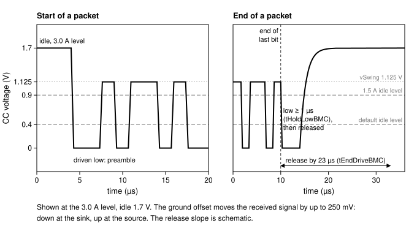
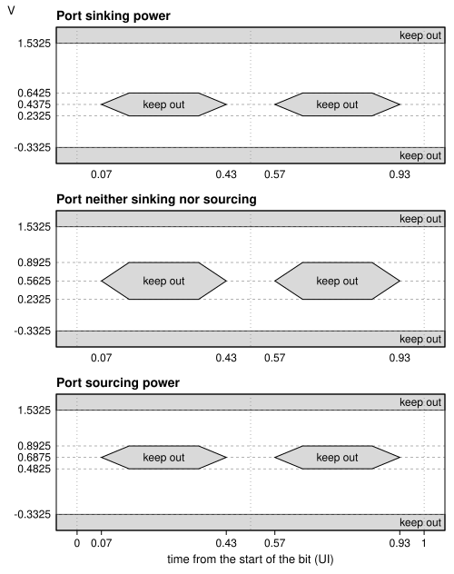

.. _usbpd-cc-signalling:

Electrical signal on the CC wire
================================

The electrical signal that carries :term:`USB Power Delivery` messages on the
:term:`CC` wire: how each bit is coded, the bit rate, the transmitter, the
DC level and the receiver. How the bits are grouped into packets is
described on :doc:`packets`.

Messages are sent on the CC wire that also carries the DC voltage set by the
:term:`Rp` and :term:`Rd` resistors (:ref:`usbpd-cc-voltages`).
Communication is :wikipedia:`half-duplex <Duplex_(telecommunications)>`:
only one end transmits at a time (:pd:`Section 5.1`). The :term:`source` and
the :term:`sink` use the same signalling.

.. _usbpd-bmc:

Biphase mark coding
-------------------

Bits are sent with :term:`biphase mark coding <Biphase mark coding>` (BMC),
a version of Manchester coding (:pd:`Section 5.3.3`; see
:wikipedia:`differential Manchester encoding
<Differential_Manchester_encoding>` and :wikipedia:`Manchester code
<Manchester_code>`). The rules are:

* the line changes level at the start of every bit;
* for a ``1``, the line also changes level in the middle of the bit;
* for a ``0``, there is no change in the middle.

Only the presence or absence of the middle change carries the data, so a
receiver does not need to know which way up the signal is. Every bit has at
least one edge, which lets the receiver follow the transmitter's clock.
:numref:`fig-usbpd-bmc` shows an example.

.. wavedrom::
   :caption: Biphase mark coding: an edge at every bit boundary, and a
             second edge in the middle of each ``1``.
   :name: fig-usbpd-bmc
   :alt: Timing diagram of the bits 0 1 1 0 1 0 0 and the BMC line level,
         which changes at every bit boundary and also in the middle of each
         1 bit.

   {"signal": [
     {"name": "data bit", "wave": "=.=.=.=.=.=.=.",
      "data": ["0", "1", "1", "0", "1", "0", "0"]},
     {"name": "CC (BMC)", "wave": "0.10101.010.1."}
   ],
   "config": {"hscale": 1}}

A receiver can decode BMC by measuring the time between successive edges. An
interval of about one bit time means a ``0``, and two intervals of about half
a bit time in a row mean a ``1``. BMC is also close to DC balanced: each
``1``, and each pair of ``0`` bits, spends equal time high and low
(:pd:`Section 5.3.3`).

.. _usbpd-bit-rate:

Bit rate
--------

The bit rate *fBitRate* is 300 kbit/s nominal and may be anywhere from
270 kbit/s to 330 kbit/s (:pd:`Table 5.9`). The time of one bit is the
:term:`unit interval <Unit interval>` (UI):

.. math::

   T_\text{UI} = \frac{1}{f_\text{bit}}

.. list-table::
   :header-rows: 1
   :widths: 22 58 20

   * - Symbol
     - Meaning
     - Unit
   * - :math:`T_\text{UI}`
     - Unit interval, the time of one bit
     - µs
   * - :math:`f_\text{bit}`
     - Bit rate, *fBitRate*
     - kbit/s

At the nominal bit rate, one UI is
:math:`1 / 300\ \text{kbit/s} = 3.333\ \mu\text{s}`.
:numref:`tab-usbpd-ui` gives the UI and the half UI at the limits. The
shortest time between two edges is half a UI at the fastest rate, 1.515 µs,
and any receiver, in hardware or software, must resolve intervals this
short.

.. list-table:: Unit interval at the bit-rate limits (:pd:`Table 5.9`)
   :name: tab-usbpd-ui
   :header-rows: 1
   :widths: 25 25 25 25

   * - Limit
     - Bit rate (kbit/s)
     - UI (µs)
     - Half UI (µs)
   * - Fastest
     - 330
     - 3.030
     - 1.515
   * - Nominal
     - 300
     - 3.333
     - 1.667
   * - Slowest
     - 270
     - 3.704
     - 1.852

Within one packet the bit rate stays close to its starting value. The rate
over the last 32 bits of the preamble is the reference, and the rate over
any 32 bits of the rest of the packet differs from it by no more than
*pBitRate*, 0.25 % (:pd:`Section 5.3.4.8`, :pd:`Table 5.10`). A receiver can
therefore measure the bit time on the preamble and use it for the whole
packet.

.. _usbpd-transmitter:

Transmitter
-----------

The transmitter is a slew-rate limited
:wikipedia:`three-state <Three-state_logic>` driver. While it sends, it
drives the CC wire between 0 V and *vSwing*; at all other times it is high
impedance (:pd:`Section 5.3.4`, item 1). :numref:`tab-usbpd-tx` lists its
limits. The nominal *vSwing* is 1.125 V, and the low level stays within
-0.075 V to 0.075 V (the transmit mask, :pd:`Table 5.7`).

.. list-table:: BMC transmitter limits (:pd:`Table 5.10`)
   :name: tab-usbpd-tx
   :header-rows: 1
   :widths: 40 20 20 20

   * - Parameter
     - Min
     - Max
     - Unit
   * - vSwing
     - 1.05
     - 1.20
     - V
   * - zDriver
     - 33
     - 75
     - Ω
   * - tRise
     - 300
     - none
     - ns
   * - tFall
     - 300
     - none
     - ns
   * - tStartDrive
     - -1
     - 1
     - µs
   * - tHoldLowBMC
     - 1
     - none
     - µs
   * - tEndDriveBMC
     - none
     - 23
     - µs
   * - tInterFrameGap
     - 25
     - none
     - µs
   * - pBitRate
     - none
     - 0.25
     - %

*vSwing*
   High level while driving.
*zDriver*
   Output impedance at 750 kHz.
*tRise*
   Rise time, 10 % to 90 %, unloaded.
*tFall*
   Fall time, 90 % to 10 %, unloaded.
*tStartDrive*
   Start of driving, from the first preamble bit.
*tHoldLowBMC*
   Low time after the last falling edge.
*tEndDriveBMC*
   Release, from the end of the last bit.
*tInterFrameGap*
   Gap from one packet to the next.
*pBitRate*
   Bit-rate change within a packet.

.. _usbpd-tx-mask:

Transmit mask
~~~~~~~~~~~~~

The transmitted waveform must stay out of a *transmit mask*, measured at the
output of a model of the worst cable and receiver load, for every Rp and Rd
value (:pd:`Section 5.3.4.1`, :pd:`Section 5.3.4.3`). The mask has outer
bands below -0.075 V and above 1.2 V, and an inner region, the open
:wikipedia:`eye <Eye_pattern>`, that the signal must not cross
(:numref:`fig-usbpd-tx-mask`; :pd:`Figures 5.12 <Figure 5.12>` and
:pd:`5.13 <Figure 5.13>`, :pd:`Tables 5.6 <Table 5.6>` and
:pd:`5.7 <Table 5.7>`).

.. figure:: tx-mask.svg
   :name: fig-usbpd-tx-mask
   :alt: Two plots of voltage against time over one bit. Grey keep-out
         regions lie below -0.075 V, above 1.2 V and in the middle of the
         bit; a 1 has two inner regions, split at half a bit, and a 0 has
         one. A solid waveform with fast edges and a dashed waveform with
         slow edges pass between the regions, the dashed one touching the
         inner region near 0.15 UI.
   :width: 100%

   The BMC transmit masks for a 1 and a 0, with two RC-shaped waveforms.

The keep-out region after each edge sets how far the signal must have moved
by each time. :numref:`tab-usbpd-tx-mask` lists the corners of the inner
mask after an edge at the start of a bit. The same shape, mirrored, lies
before the next edge.

.. list-table:: Inner transmit mask after an edge (:pd:`Tables 5.6
   <Table 5.6>` and :pd:`5.7 <Table 5.7>`)
   :name: tab-usbpd-tx-mask
   :header-rows: 1
   :widths: 34 33 33

   * - Time after the edge (UI)
     - A high level is above (V)
     - A low level is below (V)
   * - 0.015
     - 0.5625
     - 0.5625
   * - 0.07
     - 0.8
     - 0.325
   * - 0.15
     - 0.975
     - 0.15
   * - 0.25
     - 1.04
     - 0.075

.. _usbpd-edge-placement:

Edge placement
^^^^^^^^^^^^^^

The inner mask of each bit reaches the mid level, 0.5625 V, at 0.015 UI and
at 0.985 UI, and for a ``1`` also at 0.485 UI and 0.515 UI (*X1Tx*,
*X7Tx*, *X8Tx* and *X14Tx*, :pd:`Table 5.6`). If the masks sit on an ideal
bit grid, each edge must cross the mid level within a window derived from
the mask coordinates:

.. math::

   \Delta t_\text{edge} = \pm X_\text{1Tx} \times T_\text{UI}

.. list-table::
   :header-rows: 1
   :widths: 22 58 20

   * - Symbol
     - Meaning
     - Unit
   * - :math:`\Delta t_\text{edge}`
     - Allowed offset of a mid-level crossing from its ideal time
     - ns
   * - :math:`X_\text{1Tx}`
     - Mask tip position, 0.015
     - UI
   * - :math:`T_\text{UI}`
     - Unit interval (:numref:`tab-usbpd-ui`)
     - ns

At 300 kbit/s the window is
:math:`\pm 0.015 \times 3333\ \text{ns} = \pm 50\ \text{ns}`, and at
330 kbit/s it is ±45 ns. The specification states the mask, not this window. The ±50 ns
figure is a target for transmitter design, to be confirmed by measuring a
transmitter against the mask.

Rise and fall times
~~~~~~~~~~~~~~~~~~~

The 300 ns minimum rise and fall time limits
:wikipedia:`crosstalk <Crosstalk>` from the CC wire into the other wires of
the cable, such as the USB 2.0 data pair. The slope can be set by the
driver design or by an RC filter at the driver output (:pd:`Section 5.3.4`,
item 1). The mask sets the opposite limit: an edge must not be so slow that
it enters the inner mask. :numref:`fig-usbpd-tx-mask` draws both limits:
the fastest allowed edge and the slowest RC edge that stays out.

*Assumption:* the edge has the shape of the step response of a first-order
:wikipedia:`RC circuit <RC_circuit>` with :wikipedia:`time constant
<Time_constant>` τ. This is a model, not a property of every driver: a
driver with a controlled slope has a different shape. A rising edge then
follows:

.. math::

   V(t) = V_\text{swing} \times \left(1 - e^{-t / \tau}\right)

It passes 10 % of the swing at :math:`t = \tau \ln(10/9)` and 90 % at
:math:`t = \tau \ln 10`, so its 10 %-90 % time is:

.. math::

   t_{10\text{-}90} = \tau \ln 10 - \tau \ln\frac{10}{9} = \tau \ln 9

.. list-table::
   :header-rows: 1
   :widths: 22 58 20

   * - Symbol
     - Meaning
     - Unit
   * - :math:`V(t)`
     - Output voltage, starting from 0 V at the start of the edge
     - V
   * - :math:`V_\text{swing}`
     - Final high level, *vSwing*
     - V
   * - :math:`t`
     - Time from the start of the edge
     - ns
   * - :math:`\tau`
     - RC time constant
     - ns
   * - :math:`t_{10\text{-}90}`
     - :wikipedia:`Rise time <Rise_time>`, 10 % to 90 %
     - ns

The fastest allowed edge, 300 ns, has
:math:`\tau = 300\ \text{ns} / \ln 9 = 300\ \text{ns} / 2.197 = 137\ \text{ns}`.

For the slowest edge, align the edge so that it crosses the mid level
:math:`V_\text{mid}` = 0.5625 V on time. From that crossing, the time to
reach a mask level :math:`V_\text{m}` must not exceed that corner's time
:math:`X_\text{m}` (:numref:`tab-usbpd-tx-mask`):

.. math::

   t_\text{m} = \tau \ln\frac{V_\text{swing} - V_\text{mid}}
                             {V_\text{swing} - V_\text{m}}
              \le X_\text{m} \times T_\text{UI}

.. list-table::
   :header-rows: 1
   :widths: 22 58 20

   * - Symbol
     - Meaning
     - Unit
   * - :math:`t_\text{m}`
     - Time from the mid-level crossing to the mask level
     - ns
   * - :math:`V_\text{mid}`
     - Mid level of the mask, 0.5625 V (*Y5Tx*)
     - V
   * - :math:`V_\text{m}`
     - Mask level at the corner (:numref:`tab-usbpd-tx-mask`)
     - V
   * - :math:`X_\text{m}`
     - Time of the corner after the edge
     - UI

Worked example at the nominal swing of 1.125 V and the fastest bit rate,
for the corner at 0.15 UI and 0.975 V, gives the largest allowed
time constant :math:`\tau_\text{max}`:

.. math::

   \tau_\text{max} &= \frac{X_\text{m} \times T_\text{UI}}
       {\ln\left(\dfrac{V_\text{swing} - V_\text{mid}}
                       {V_\text{swing} - V_\text{m}}\right)} \\
     &= \frac{0.15 \times 3030\ \text{ns}}
       {\ln\left(\dfrac{1.125 - 0.5625}{1.125 - 0.975}\right)} \\
     &= \frac{454.5\ \text{ns}}{1.322} = 344\ \text{ns}

The matching 10 %-90 % time is
:math:`344\ \text{ns} \times 2.197 = 756\ \text{ns}`.
:numref:`tab-usbpd-edge-range` gives the corner that limits the edge at
each swing. At the lowest swing, 1.05 V, the corner at 1.04 V lies only
10 mV below the final level, and the slowest edge drops to about 430 ns.

.. list-table:: Slowest RC edge that stays out of the transmit mask at
   330 kbit/s (estimate)
   :name: tab-usbpd-edge-range
   :header-rows: 1
   :widths: 20 20 20 20 20

   * - vSwing (V)
     - Corner time (UI)
     - Corner level (V)
     - τ max (ns)
     - 10 %-90 % max (ns)
   * - 1.05
     - 0.25
     - 1.04
     - 195
     - 428
   * - 1.125
     - 0.15
     - 0.975
     - 344
     - 756
   * - 1.2
     - 0.15
     - 0.975
     - 437
     - 959

The model assumes that each edge starts from a settled level. The shortest
level lasts half a UI, 1.515 µs, which is at least 3.4 time constants
for every row, so less than 4 % of each step remains when the next starts. Under
this model, a 10 %-90 % edge time of 300 ns to about 430 ns stays out of the
mask at every allowed swing and bit rate. This is an estimate, to be
confirmed by simulating the driver with the load model of
:pd:`Section 5.3.4.3`.

Output impedance
~~~~~~~~~~~~~~~~

*zDriver* is the driver's :wikipedia:`output impedance <Output_impedance>`,
its output resistance in parallel with any shunt capacitance. Its limits
bound the noise from the cable that reaches the receiver
(:pd:`Section 5.3.4.7`). Extra capacitance used to shape the edges must be
disconnected within *tInterFrameGap* after the packet, leaving no more than
*cReceiver* on the line (:pd:`Section 5.3.4.6`).

A transmitter must also survive its output being shorted to ground for up
to 120 µs (*tFRSwapTx*, :pd:`Table 10.1`; :pd:`Section 5.3.4.10`). This
happens when the source pulls CC low to signal a
:term:`fast role swap <Fast role swap>`, in which the sink takes over as
source because the source is losing its own power (:ref:`usbpd-fast-role-swap`).

.. _usbpd-dc-level:

DC level
--------

When neither end transmits, the CC wire sits at the level set by Rp and Rd,
about 0.4 V, 0.9 V or 1.7 V for the three Rp values
(:numref:`tab-usbpd-cc-nominal`). The transmitter does not add its signal to
this level. Its output impedance of 33 Ω to 75 Ω overdrives the kilohm
resistors, so while it sends, the wire swings between 0 V and *vSwing*. When
it lets go, the wire returns to the level set by Rp and Rd
(:pd:`Section 5.3.4`, :pd:`Figures 5.7 <Figure 5.7>` to
:pd:`5.11 <Figure 5.11>`). The start and end of a packet follow from this:

* the transmitter starts the preamble, the 64 alternating bits that open
  every packet (:ref:`usbpd-packets`), by driving low
  (:pd:`Section 5.3.4`, item 2);
* the receiver must tolerate losing the first edge (:pd:`Section 5.3.4`,
  item 3);
* the last bit is followed by one more edge. If that edge goes low, the
  transmitter holds the line low for at least *tHoldLowBMC* and then lets
  go. If it goes high, the transmitter holds it high for 1 UI, then low for
  at least *tHoldLowBMC*, then lets go (:pd:`Section 5.3.4`, items 4 to 6);
* in both cases the transmitter lets go within *tEndDriveBMC*, 23 µs, of
  the end of the last bit (:pd:`Table 5.10`).

:numref:`fig-usbpd-preamble-start` shows the start of a packet and
:numref:`fig-usbpd-message-end` shows the end, after the EOP symbol that
closes every packet. Both draw the idle level at mid level.
:numref:`fig-usbpd-dc-level` draws the start and end on the real voltage
scale, at the 3.0 A level, where the idle level is above vSwing.

         packet: the line idles at 1.7 V, the 3.0 A level, then the
         transmitter drives it to 0 V and sends the preamble between 0 V and
         vSwing, 1.125 V. End of a packet: after the last bit the line is
         driven low, held low for at least 1 µs (tHoldLowBMC), then released
         and rises back to 1.7 V; the release comes within 23 µs
         (tEndDriveBMC) of the end of the last bit. Dashed lines mark the
         idle levels of 0.4 V and 0.9 V for the other Rp values.

   The BMC signal starting and ending at the Rp/Rd level of the 3.0 A
   advertisement, with the other idle levels dashed.

.. wavedrom::
   :caption: Start of a packet: the line idles at the Rp/Rd level, drawn at
             mid level, and the transmitter starts the preamble by driving
             low.
   :name: fig-usbpd-preamble-start
   :alt: Timing diagram: CC idle at mid level, then the first preamble bits
         0 1 0 1 sent in BMC starting from a low level.

   {"signal": [
     {"name": "field", "wave": "x.=.......", "data": ["preamble"]},
     {"name": "data bit", "wave": "x.=.=.=.=.", "data": ["0", "1", "0", "1"]},
     {"name": "CC", "wave": "z.0.101.01"}
   ],
   "config": {"hscale": 1}}

.. wavedrom::
   :caption: End of a packet: a final edge after the last EOP bit, the line
             held low for at least 1 µs, then released by 23 µs after the
             last bit.
   :name: fig-usbpd-message-end
   :alt: Timing diagram: the EOP bits 1 0 1 1 0 in BMC, a final falling
         edge, a short low period, then the line released to mid level.

   {"signal": [
     {"name": "field", "wave": "=.........x...", "data": ["EOP"]},
     {"name": "data bit", "wave": "=.=.=.=.=.x...", "data": ["1", "0", "1", "1", "0"]},
     {"name": "CC", "wave": "010.10101.0..z"},
     {"name": "driver", "wave": "x.........=..x", "data": ["hold low"]}
   ],
   "config": {"hscale": 1}}

The next packet starts no sooner than *tInterFrameGap*, 25 µs, after the end
of the previous one (:pd:`Section 5.3.4.9`).

Current in the cable shifts the received signal. Up to 250 mV can be lost
in the cable's ground wire at full current (*vIRDropGNDC*,
:pd:`Table 5.11`). The signal seen at the sink moves down and the signal
seen at the source moves up ([USBPD-BMCRX]_, Section 2). The receive masks
allow for this shift.

.. _usbpd-receiver:

Receiver
--------

The :ref:`PD specification <usb-pd-specification>` does not fix the
receiver's switching levels. It gives *receive masks*: regions that the
received signal, after filtering, noise and ground offset, stays out of
(:pd:`Section 5.3.4.2`, :pd:`Figures 5.14 <Figure 5.14>` to
:pd:`5.19 <Figure 5.19>`, :pd:`Table 5.8`). A receiver must decode any
signal that stays out of them (:numref:`fig-usbpd-rx-mask`).

         sinking power, a port neither sinking nor sourcing, and a port
         sourcing power. Each has grey keep-out bands below -0.3325 V and
         above 1.5325 V, and two inner keep-out regions from 0.07 UI to
         0.43 UI and from 0.57 UI to 0.93 UI, centred at 0.4375 V,
         0.5625 V and 0.6875 V.
   :width: 100%

   The BMC receive masks for a 1, which move with the port's power role.

The mask for a ``0`` is the same with the two inner regions joined into one,
from 0.07 UI to 0.93 UI. In time, the eye opens at 0.07 UI after each ideal
edge, so a receiver must accept edges up to 0.07 UI from their ideal time,
233 ns at 300 kbit/s. In level, the centre of the eye moves by 125 mV, half
of *vIRDropGNDC*, with the port's power role (:numref:`tab-usbpd-rx-eye`).

.. list-table:: Inner receive mask levels (:pd:`Table 5.8`)
   :name: tab-usbpd-rx-eye
   :header-rows: 1
   :widths: 34 22 22 22

   * - Port
     - Lower edge (V)
     - Centre (V)
     - Upper edge (V)
   * - Sinking power
     - 0.2325
     - 0.4375
     - 0.6425
   * - Neither
     - 0.2325
     - 0.5625
     - 0.8925
   * - Sourcing power
     - 0.4825
     - 0.6875
     - 0.8925

The sink and source eyes overlap only from 0.4825 V to 0.6425 V. A receiver
with fixed switching levels either places both levels in this 160 mV band
or changes its levels with the port's power role, as the example below
does. :numref:`tab-usbpd-rx` lists the other
receiver limits.

.. list-table:: BMC receiver limits (:pd:`Table 5.11`)
   :name: tab-usbpd-rx
   :header-rows: 1
   :widths: 40 20 20 20

   * - Parameter
     - Min
     - Max
     - Unit
   * - tRxFilter
     - 100
     - none
     - ns
   * - vNoiseActive
     - none
     - 165
     - mV
   * - vNoiseIdle
     - none
     - 300
     - mV
   * - vIRDropGNDC
     - none
     - 250
     - mV
   * - cReceiver
     - 200
     - 600
     - pF
   * - rBmcRx
     - 1
     - none
     - MΩ
   * - nTransitionCount
     - 3
     - none
     - edges
   * - tTransitionWindow
     - 12
     - 20
     - µs

*tRxFilter*
   Time constant of the input filter.
*vNoiseActive*
   Noise while a packet is sent, peak to peak.
*vNoiseIdle*
   Noise while the line is idle, peak to peak.
*vIRDropGNDC*
   Ground offset from cable current.
*cReceiver*
   CC capacitance while not sending.
*rBmcRx*
   Input resistance, Rp and Rd excluded.
*nTransitionCount*
   Edges that mark the line busy.
*tTransitionWindow*
   Time window in which *nTransitionCount* edges mark the line busy.

The noise limits apply after the input filter, and come from *VBUS*, the
USB 2.0 data pair and the :term:`SBU` wires. A receiver must treat any
signal smaller than *vNoiseIdle* on an idle line as noise
(:pd:`Section 5.3.4.2`, item 5).

Filter and comparator receivers
~~~~~~~~~~~~~~~~~~~~~~~~~~~~~~~

The specification requires a single-pole :wikipedia:`low-pass filter
<Low-pass_filter>` with a time constant of at least 100 ns in front of the
receiver's decision, analogue or digital (*tRxFilter*, :pd:`Table 5.11`).
One common design follows it with a :term:`comparator` with
:wikipedia:`hysteresis <Hysteresis>`, whose two switching levels sit inside
the receive eye for the port's present role.

For reference, the TI TPS65987D dual-role controller takes its switching
levels and hysteresis from the receive masks ([USBPD-TPS65987D]_,
Section 8.3.1.5). As a sink it switches at 525 mV rising and 250 mV falling,
and as a source at 875 mV rising and 600 mV falling (typical values,
[USBPD-TPS65987D]_, Section 6.9). Both pairs sit inside the eye for their
role, and the hysteresis of 275 mV is larger than the 165 mV of
*vNoiseActive*.

Edge-detecting receivers
~~~~~~~~~~~~~~~~~~~~~~~~

The USB Implementers Forum publishes two receiver designs that detect edges
instead of levels, and so need no change of levels with the power role
([USBPD-BMCRX]_, Section 2). They are informative examples, not
requirements ([USBPD-BMCRX]_, Section 1):

* the *finite difference* receiver samples the filtered signal every
  50 ns and subtracts the sample taken 300 ns to 500 ns earlier. An edge
  gives a large difference of one sign or the other ([USBPD-BMCRX]_,
  Sections 3.1 and 3.2);
* the *subtraction* receiver subtracts the outputs of two low-pass filters
  with time constants of 200 ns and 300 ns, which gives a similar result
  ([USBPD-BMCRX]_, Sections 4.1 and 4.2).

Both use thresholds of about ±0.2 V on the difference
([USBPD-BMCRX]_, Section 3.3). :numref:`fig-usbpd-edge-receivers` shows the
two signal chains.

.. graphviz:: edge-receivers.dot
   :name: fig-usbpd-edge-receivers
   :caption: The two edge-detecting receivers, which compare a difference
             rather than the signal level.
   :alt: Two block chains. Finite-difference receiver: CC, low-pass filter,
         sample every 50 ns, subtract the sample taken 300 to 500 ns
         earlier, compare with plus and minus 0.2 V, giving a rising or
         falling edge. Subtraction receiver: CC feeds two low-pass filters
         with time constants of 200 ns and 300 ns; their outputs are
         subtracted, and the difference is compared with plus and minus
         0.2 V, giving a rising or falling edge.

Idle-line detection
~~~~~~~~~~~~~~~~~~~

The receiver also tells the transmitter when the line is free. The line is
busy when *nTransitionCount* edges arrive within *tTransitionWindow*, and
idle after *tTransitionWindow* without them (:pd:`Section 5.2.2.1`). A
transmitter checks that the line is idle immediately before it starts
(:pd:`Section 5.2.2`, item 5), and then waits *tInterFrameGap* before the
preamble (:pd:`Section 5.3.4.9`, item 2).

Open questions
--------------

* How a compliance test places the transmit mask in time, and so whether
  the ±0.015 UI edge window derived from the mask coordinates
  (:ref:`usbpd-edge-placement`) applies to each edge against an ideal bit
  grid. Measuring a transmitter against the mask would settle the ±50 ns
  target.
* Whether the RC edge model holds for evampire's BMC driver, and which edge
  time it gives with the load model of :pd:`Section 5.3.4.3` at every
  *vSwing*. A :term:`gf180mcu` simulation of the driver would establish the range
  in :numref:`tab-usbpd-edge-range`.
