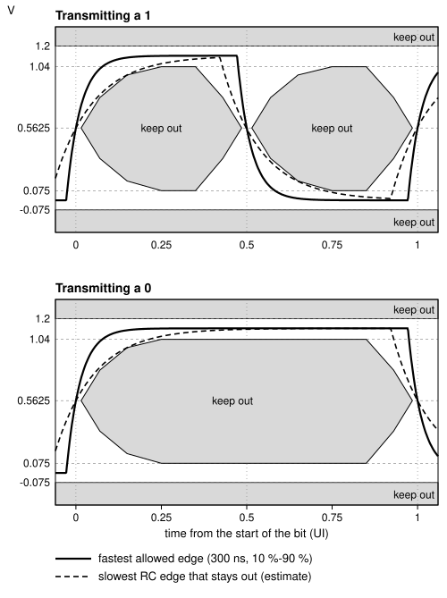

.. _usbpd-cc-signalling:

The signal on the configuration channel
=======================================

The electrical signal that carries :term:`USB Power Delivery` messages on the
:term:`CC` wire: how each bit is coded, the bit rate, the transmitter, the
DC level and the receiver. How the bits are grouped into packets is
described on :doc:`packets`.

Messages are sent on the CC wire that also carries the DC voltage set by the
:term:`Rp` and :term:`Rd` resistors (:ref:`usbpd-cc-voltages`).
Communication is :wikipedia:`half-duplex <Duplex_(telecommunications)>`:
only one end transmits at a time (:pd:`Section 5.1`). The :term:`source` and
the :term:`sink` use the same signalling.

.. _usbpd-bmc:

Each bit is sent with biphase mark coding
-----------------------------------------

Bits are sent with :term:`biphase mark coding <Biphase mark coding>` (BMC),
a version of Manchester coding (:pd:`Section 5.3.3`; see
:wikipedia:`differential Manchester encoding
<Differential_Manchester_encoding>` and :wikipedia:`Manchester code
<Manchester_code>`). The rules are:

* the line changes level at the start of every bit;
* for a ``1``, the line also changes level in the middle of the bit;
* for a ``0``, there is no change in the middle.

Only the presence or absence of the middle change carries the data, so a
receiver does not need to know which way up the signal is. Every bit has at
least one edge, which lets the receiver follow the transmitter's clock.
:numref:`fig-usbpd-bmc` shows an example.

.. wavedrom::
   :caption: Biphase mark coding: an edge at every bit boundary, and a
             second edge in the middle of each ``1``.
   :name: fig-usbpd-bmc
   :alt: Timing diagram of the bits 0 1 1 0 1 0 0 and the BMC line level,
         which changes at every bit boundary and also in the middle of each
         1 bit.

   {"signal": [
     {"name": "data bit", "wave": "=.=.=.=.=.=.=.",
      "data": ["0", "1", "1", "0", "1", "0", "0"]},
     {"name": "CC (BMC)", "wave": "0.10101.010.1."}
   ],
   "config": {"hscale": 1}}

A receiver can decode BMC by measuring the time between successive edges. An
interval of about one bit time means a ``0``, and two intervals of about half
a bit time in a row mean a ``1``. BMC is also close to DC balanced: each
``1``, and each pair of ``0`` bits, spends equal time high and low
(:pd:`Section 5.3.3`).

.. _usbpd-bit-rate:

The bit rate is 270 kbit/s to 330 kbit/s
----------------------------------------

The bit rate *fBitRate* is 300 kbit/s nominal and may be anywhere from
270 kbit/s to 330 kbit/s (:pd:`Table 5.9`). The time of one bit is the
:term:`unit interval <Unit interval>` (UI):

.. math::

   T_\text{UI} = \frac{1}{f_\text{bit}}

.. list-table::
   :header-rows: 1
   :widths: 22 58 20

   * - Symbol
     - Meaning
     - Unit
   * - :math:`T_\text{UI}`
     - Unit interval, the time of one bit
     - µs
   * - :math:`f_\text{bit}`
     - Bit rate, *fBitRate*
     - kbit/s

At the nominal bit rate, one UI is
:math:`1 / 300\ \text{kbit/s} = 3.333\ \mu\text{s}`.
:numref:`tab-usbpd-ui` gives the UI and the half UI at the limits. The
shortest time between two edges is half a UI at the fastest rate, 1.515 µs,
and any receiver, in hardware or software, must resolve intervals this
short.

.. list-table:: Unit interval at the bit-rate limits (:pd:`Table 5.9`)
   :name: tab-usbpd-ui
   :header-rows: 1
   :widths: 25 25 25 25

   * - Limit
     - Bit rate (kbit/s)
     - UI (µs)
     - Half UI (µs)
   * - Fastest
     - 330
     - 3.030
     - 1.515
   * - Nominal
     - 300
     - 3.333
     - 1.667
   * - Slowest
     - 270
     - 3.704
     - 1.852

Within one packet the bit rate stays close to its starting value. The rate
over the last 32 bits of the preamble is the reference, and the rate over
any 32 bits of the rest of the packet differs from it by no more than
*pBitRate*, 0.25 % (:pd:`Section 5.3.4.8`, :pd:`Table 5.10`). A receiver can
therefore measure the bit time on the preamble and use it for the whole
packet.

.. _usbpd-transmitter:

The transmitter drives 0 V to vSwing, then lets go
--------------------------------------------------

The transmitter is a slew-rate limited
:wikipedia:`three-state <Three-state_logic>` driver. While it sends, it
drives the CC wire between 0 V and *vSwing*; at all other times it is high
impedance (:pd:`Section 5.3.4`, item 1). :numref:`tab-usbpd-tx` lists its
limits. The nominal *vSwing* is 1.125 V, and the low level stays within
-0.075 V to 0.075 V (the transmit mask, :pd:`Table 5.7`).

.. list-table:: BMC transmitter limits (:pd:`Table 5.10`)
   :name: tab-usbpd-tx
   :header-rows: 1
   :widths: 40 20 20 20

   * - Parameter
     - Min
     - Max
     - Unit
   * - vSwing
     - 1.05
     - 1.20
     - V
   * - zDriver
     - 33
     - 75
     - Ω
   * - tRise
     - 300
     - none
     - ns
   * - tFall
     - 300
     - none
     - ns
   * - tStartDrive
     - -1
     - 1
     - µs
   * - tHoldLowBMC
     - 1
     - none
     - µs
   * - tEndDriveBMC
     - none
     - 23
     - µs
   * - tInterFrameGap
     - 25
     - none
     - µs
   * - pBitRate
     - none
     - 0.25
     - %

*vSwing*
   High level while driving.
*zDriver*
   Output impedance at 750 kHz.
*tRise*
   Rise time, 10 % to 90 %, unloaded.
*tFall*
   Fall time, 90 % to 10 %, unloaded.
*tStartDrive*
   Start of driving, from the first preamble bit.
*tHoldLowBMC*
   Low time after the last falling edge.
*tEndDriveBMC*
   Release, from the end of the last bit.
*tInterFrameGap*
   Gap from one packet to the next.
*pBitRate*
   Bit-rate change within a packet.

.. _usbpd-tx-mask:

The waveform must stay out of the transmit mask
~~~~~~~~~~~~~~~~~~~~~~~~~~~~~~~~~~~~~~~~~~~~~~~

The transmitted waveform must stay out of a *transmit mask*, measured at the
output of a model of the worst cable and receiver load, for every Rp and Rd
value (:pd:`Section 5.3.4.1`, :pd:`Section 5.3.4.3`). The mask has outer
bands below -0.075 V and above 1.2 V, and an inner region, the open
:wikipedia:`eye <Eye_pattern>`, that the signal must not cross
(:numref:`fig-usbpd-tx-mask`; :pd:`Figures 5.12 <Figure 5.12>` and
:pd:`5.13 <Figure 5.13>`, :pd:`Tables 5.6 <Table 5.6>` and
:pd:`5.7 <Table 5.7>`).

         regions lie below -0.075 V, above 1.2 V and in the middle of the
         bit; a 1 has two inner regions, split at half a bit, and a 0 has
         one. A solid waveform with fast edges and a dashed waveform with
         slow edges pass between the regions, the dashed one touching the
         inner region near 0.15 UI.
   :width: 100%

   The BMC transmit masks for a 1 and a 0, with two RC-shaped waveforms.

The keep-out region after each edge sets how far the signal must have moved
by each time. :numref:`tab-usbpd-tx-mask` lists the corners of the inner
mask after an edge at the start of a bit. The same shape, mirrored, lies
before the next edge.

.. list-table:: Inner transmit mask after an edge (:pd:`Tables 5.6
   <Table 5.6>` and :pd:`5.7 <Table 5.7>`)
   :name: tab-usbpd-tx-mask
   :header-rows: 1
   :widths: 34 33 33

   * - Time after the edge (UI)
     - A high level is above (V)
     - A low level is below (V)
   * - 0.015
     - 0.5625
     - 0.5625
   * - 0.07
     - 0.8
     - 0.325
   * - 0.15
     - 0.975
     - 0.15
   * - 0.25
     - 1.04
     - 0.075

