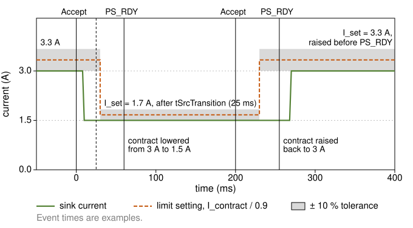
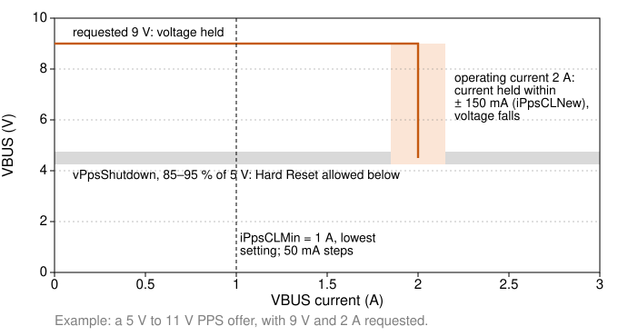
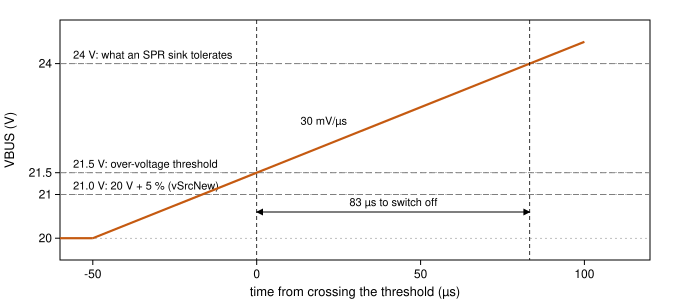

.. _usbpd-monitoring:

Port power monitoring and limits
================================

What evampire must measure and limit on each USB Type-C port and on the
board's power bus, derived from the USB Power Delivery rules. The circuits
that do it are an open choice.

Requirement
-----------

evampire measures the voltage and current of every power port and of the
board's power bus, and enforces current and power limits that software sets
(:ref:`req-power-control`). On a USB Type-C port this means:

* measuring the VBUS voltage and the VBUS current, in both directions;
* comparing them with limits that software writes for the present
  :term:`contract`;
* switching the port off in hardware when a fault is too fast for software,
  such as a short circuit, and then telling the software;
* measuring the bus voltage and current, so that software knows what the
  board itself uses (the :math:`P_\text{board}` of the
  :ref:`power budget <power-budget>`).

:numref:`fig-usbpd-measure-points` shows where each quantity is measured
and how the limits act.

.. graphviz:: measure-points.dot
   :name: fig-usbpd-measure-points
   :caption: The measurements and limits on one USB Type-C port and on the
             board's power bus; bold arrows carry power.
   :alt: Block diagram. Power flows in both directions from the board power
         bus through a VBUS current sense, which measures both directions,
         and the power switch or converter to the USB Type-C connector. A
         VBUS voltage sense at the connector and the current sense feed
         limit comparators whose thresholds software sets; the comparators
         switch the power switch off and send an interrupt and its cause to
         the processor, which writes the limits. The bus voltage and current
         are measured and read by the processor.

The converter pages already sense the same quantities for control and
protection; :ref:`conv-protection` and :ref:`conv-fault-times` cover the
converter side. This page covers what USB Power Delivery adds.

Measurement ranges and steps
----------------------------

The ranges come from the largest voltages and currents a port can see; the
steps from the finest limits it must check (:numref:`tab-usbpd-meas`).

.. list-table:: Ranges and steps from the USB Power Delivery limits
   :name: tab-usbpd-meas
   :header-rows: 1
   :widths: 30 16 54

   * - Quantity
     - Value
     - Limit it comes from
   * - VBUS range, SPR
     - 24 V
     - *vSprMax*, the voltage the specification recommends a sink tolerates (:pd:`Table 4.8`)
   * - VBUS range, EPR
     - 50.9 V
     - 48 V plus its tolerances (:pd:`Table 6.45`)
   * - VBUS window at 5 V
     - ±250 mV
     - *vSrcNew*, ±5 % of the offered voltage (:pd:`Table 4.7`)
   * - VBUS step, PPS
     - 20 mV
     - *vPpsStep*, the PPS voltage step (:pd:`Table 4.7`)
   * - Current range
     - 5 A
     - A 5 A cable (:pd:`Table 6.45`)
   * - Current range, peaks
     - 10 A
     - 200 % of the offer for 1 ms, if offered (:pd:`Table 6.18`)
   * - Current step, PPS
     - 50 mA
     - *iPpsCLStep*, the PPS current-limit step (:pd:`Table 4.7`)
   * - Current accuracy, PPS
     - ±150 mA
     - *iPpsCLNew*, for 1 A to 3 A (:pd:`Table 4.7`)
   * - Sink current in swap standby
     - 2.5 mA
     - *iSnkSwapStdby* (:pd:`Table 4.8`)
   * - Sink current during Hard Reset
     - 1 mA
     - *iSafe0mA* (:pd:`Table 4.8`)

The number of bits follows from range over step, as on the converter
pages (:ref:`conv-fault-times` and the section before it). For example,
24 V in 20 mV steps is 1200 steps, 11 bits; 5 A in 50 mA steps is 100
steps, 7 bits; 5 A in 1 mA steps is 5000 steps, 13 bits. These are
estimates of resolution only; the accuracy needed for the power budget is an
open question.

The two smallest currents in :numref:`tab-usbpd-meas` are limits on the
board's own draw as a sink. They can be met in two ways: by measuring down to
about 1 mA, with a second, low current range or one wide range; or by
switching the sink path fully off, so that only leakage flows, and not
measuring them.

.. _usbpd-limiting:

Hardware limits
---------------

Software sets each limit, and hardware enforces it without waiting for the
processor.

Over-current limit
^^^^^^^^^^^^^^^^^^

A source must have over-current protection, a
:wikipedia:`current limit <Current_limiting>` that switches the port off.
The protection may follow the
contract, but it must not act while the sink draws a current that the
contract allows (:pd:`Section 4.1.5.1`). If the source advertised peak
current, the contract allows overloads of 110 % to 200 % of the offered
current for 1 ms to 10 ms (:pd:`Table 6.18`), and the limit must ride
through them.

A limit circuit has a tolerance, so its setting must sit above the contract
current by at least that tolerance:

.. math::

   I_\text{set} \ge \frac{I_\text{contract}}{1 - \epsilon}

.. list-table::
   :header-rows: 1
   :widths: 22 60 18

   * - Symbol
     - Meaning
     - Unit
   * - :math:`I_\text{set}`
     - Nominal setting of the current limit
     - A
   * - :math:`I_\text{contract}`
     - Largest current the contract allows, including peaks if offered
     - A
   * - :math:`\epsilon`
     - Relative tolerance of the limit, as a fraction below the setting
     - none

For a 3 A contract and a 10 % tolerance,
:math:`I_\text{set} \ge 3\ \text{A} / 0.90 = 3.3\ \text{A}`. For reference,
the TPS65987D offers 20 firmware-selected limit settings from 1.267 A to
6.33 A, each within about ±10 % ([USBPD-TPS65987D]_, Section 6.7). The
limit circuit itself is described on :ref:`usbpd-current-limit` and
:ref:`conv-protection`.

When the contract changes, the order matters. When the current goes down,
the sink must reach the new current before the shortest *tSrcTransition*
(25 ms) ends, and the source lowers its limit only after tSrcTransition
(:pd:`Section 4.5.1.3`). When the current goes up, the sink may draw the new
current as soon as it has the PS_RDY, so the source raises its limit before
it sends PS_RDY. :numref:`fig-usbpd-current-limit` shows both orders.

         The contract is lowered from 3 A to 1.5 A at the first Accept: the
         sink current falls at once, and the limit setting, with a 10 %
         tolerance band, falls from 3.3 A to 1.7 A only after
         tSrcTransition, 25 ms, before PS_RDY. The contract is then raised
         back to 3 A at a second Accept: the limit rises to 3.3 A before
         PS_RDY, and the sink current rises after PS_RDY.

   The source's current-limit setting and the sink current when the
   contract is lowered and raised, with a 10 % limit tolerance; event times
   are examples.

PPS current limit
^^^^^^^^^^^^^^^^^

A source with a :term:`programmable power supply <PPS>` offer has a
current-limit mode. If the sink draws more than the operating current in
its request, the source holds the current at that value, within
*iPpsCLNew* (±150 mA up to 3 A, ±5 % above), and lets the voltage fall. It
must not switch off while in current limit, unless another protection acts
(:pd:`Section 4.1.3.2.2`; :pd:`Table 4.7 <x>`).

The settings run from
*iPpsCLMin* (1 A) to the offer's maximum in 50 mA steps, and a new setting
settles within *tPpsCLProgramSettle* (250 ms). If VBUS falls below
*vPpsShutdown* (85 % to 95 % of the offer's minimum voltage), the source may
send a Hard Reset and must discharge VBUS to vSafe0V. A PPS source's current
limit is therefore a regulation loop, part of the converter control, with a
measurement accurate to ±150 mA. :numref:`fig-usbpd-pps-limit` shows the
resulting VBUS against current.

         for a 5 V to 11 V PPS offer with 9 V and 2 A requested. VBUS stays
         at 9 V up to 2 A. Above that, the current is held within 150 mA
         of 2 A while VBUS falls, down to the vPpsShutdown band at 85 to
         95 % of 5 V, below which the source may send Hard Reset. A dashed
         line at 1 A marks iPpsCLMin, the lowest limit setting; settings
         are in 50 mA steps.

   VBUS against current for a PPS source in current limit, for an example
   request of 9 V and 2 A.

Over-voltage limit
^^^^^^^^^^^^^^^^^^

A sink must have over-voltage protection that does not act on any voltage
the contract allows, *vSrcNew* plus *vSrcValid* (:pd:`Section 4.2.9.3`).
A source's over-voltage protection follows the same rule
(:pd:`Section 4.1.5.2`). The threshold for a fixed offer is therefore:

.. math::

   V_\text{OVP} > 1.05 \times V_\text{offer} + 0.5\ \text{V}

.. list-table::
   :header-rows: 1
   :widths: 22 60 18

   * - Symbol
     - Meaning
     - Unit
   * - :math:`V_\text{OVP}`
     - Over-voltage threshold
     - V
   * - :math:`V_\text{offer}`
     - Voltage of the fixed offer in the contract (:pd:`Table 4.7`)
     - V

The 1.05 is the +5 % of vSrcNew and the 0.5 V is vSrcValid
(:pd:`Table 4.7`). For a 20 V contract the threshold is above
:math:`1.05 \times 20\ \text{V} + 0.5\ \text{V} = 21.5\ \text{V}`, and an SPR
sink, as the specification recommends, tolerates up to 24 V (:pd:`Table 4.8`).

The time the protection has depends on how fast VBUS rises:

.. math::

   t_\text{OVP} \le \frac{V_\text{max} - V_\text{OVP}}{S_\text{VBUS}}

.. list-table::
   :header-rows: 1
   :widths: 22 60 18

   * - Symbol
     - Meaning
     - Unit
   * - :math:`t_\text{OVP}`
     - Time from crossing the threshold to switching the port off
     - s
   * - :math:`V_\text{max}`
     - Highest voltage the board's VBUS circuits tolerate
     - V
   * - :math:`S_\text{VBUS}`
     - Rate of rise of VBUS during the fault
     - V/s

The equation assumes a constant rate of rise and neglects the time the
switch takes to open. For a rise at the largest slew rate allowed in normal
operation, 30 mV/µs (*vSrcSlewPos*, :pd:`Table 4.7`), from 21.5 V to 24 V,
the time available is

.. math::

   t_\text{OVP} \le \frac{2.5\ \text{V}}{30\ \text{mV}/\mu\text{s}}
                = 83\ \mu\text{s}

:numref:`fig-usbpd-ovp-ramp` shows this time budget.

         VBUS rises from 20 V at 30 mV/µs, crosses 21.0 V (20 V plus 5 %),
         then 21.5 V, the lowest the over-voltage threshold may be, at 0 µs,
         and reaches 24 V, what an SPR sink tolerates, 83 µs later.

   The time an over-voltage protection has on a 20 V contract when VBUS
   rises at 30 mV/µs.

A faulty source can make VBUS rise faster, so this is an upper bound.

Fault response
^^^^^^^^^^^^^^

A fault switches the port off in hardware, and the processor then reports
it. :numref:`tab-usbpd-fault-times` lists the events, the response each needs
and where the limit comes from.

.. list-table:: Response needed for each event
   :name: tab-usbpd-fault-times
   :header-rows: 1
   :widths: 28 46 26

   * - Event
     - Response and time
     - Source
   * - Short circuit on VBUS
     - Switch off in hardware before the switch or converter is damaged;
       time as on :ref:`conv-fault-times`
     - Converter limits
   * - Overload above the limit
     - Switch off after riding through any allowed peaks (1 ms to 10 ms)
     - :pd:`Section 4.1.5.1`, :pd:`Table 6.18`
   * - Over-voltage
     - Switch off within :math:`t_\text{OVP}`
     - :pd:`Section 4.2.9.3`
   * - After a shutdown above 5 V
     - VBUS to vSafe5V within 275 ms and to vSafe0V within 650 ms
     - :pd:`Section 4.1.5.1`
   * - Sink standby
     - Own current to 500 mA within 15 ms
     - :pd:`Section 4.2.3`
   * - Swap standby
     - Own current to 2.5 mA within 15 ms
     - :pd:`Section 4.3.2`
   * - Fast role swap signalled
     - Stop sourcing at once; draw at most 500 mA
     - :pd:`Section 10.4`
   * - Board above its power budget
     - Reduce the offers first
     - :ref:`power-sharing`

After the hardware has switched a port off, it records which limit acted and
interrupts the processor. The software then carries out what USB Power
Delivery asks of a source whose protection has acted (:pd:`Section 4.1.5.1`):

#. It attempts to send Hard Reset (see :ref:`usbpd-hard-reset`), and then,
   if a contract was in place, an Alert message reporting the event.
#. It brings VBUS down within the times in
   :numref:`tab-usbpd-fault-times`.
#. It may then resume default 5 V operation and must negotiate again. How
   and when is the source's choice.

If the Hard Reset does not clear the fault, the port goes to ErrorRecovery
(:pd:`Section 7.1.3`; see :ref:`usbpd-error-recovery`).
:numref:`fig-usbpd-fault-flow` shows the whole response.

.. graphviz:: fault-flow.dot
   :name: fig-usbpd-fault-flow
   :caption: The response to a fault on a source port: hardware first, then
             software.
   :alt: Flow chart. A fault, a short, an overload or an over-voltage,
         makes the hardware switch the port off, record the cause and
         interrupt the processor. Software sends Hard Reset, then an Alert
         if a contract was in place. VBUS falls to vSafe5V within 275 ms and
         to vSafe0V within 650 ms, and the port resumes 5 V and negotiates
         again. If the fault is not cleared, the port goes to
         ErrorRecovery.

The Alert message carries one bit for each kind of event (:pd:`Table 6.25`):

* *OCP Event*: a source's output current exceeded its limit;
* *OVP Event*: a sink's input voltage exceeded its limit, which a sink must
  report, or a source's output voltage, which it may report;
* *OTP Event*: a source or sink shut down on over-temperature;
* *Operating Condition Change*: a temperature warning, or a PPS source
  moving between constant-voltage and current-limit operation.

Circuit options
---------------

The needs above can be met in several ways, and the choice is open:

* a comparator per limit, with its threshold from a :term:`DAC`, which
  responds within one comparator delay;
* an :term:`ADC` sampling at a rate set by the fault times, with the limits
  compared in digital logic;
* a combination: comparators for the fast limits, an ADC for monitoring and
  the slow limits.

:numref:`fig-usbpd-limit-options` shows the three options side by side,
with the two ways to sense the current described below.

.. graphviz:: limit-options.dot
   :name: fig-usbpd-limit-options
   :caption: The three ways to build the limits, and the two ways to sense
             the current.
   :alt: Three panels. Comparator per limit: a DAC sets the threshold of a
         comparator, which acts within one comparator delay. ADC and digital
         compare: an ADC sampled at a rate set by the fault times, with the
         limits compared in digital logic. Combination: comparators for the
         fast limits and an ADC for monitoring and the slow limits. Below,
         current sensing by either a series shunt resistor or the drop
         across the power switch.

The current can be sensed with a series resistor, a
:wikipedia:`shunt <Shunt_(electrical)>`, or across the power switch itself. For reference, the TPS65987D senses the forward voltage drop of its
internal switches to latch them off at about 10 A, and disables a path in
hardware when VBUS crosses over- and under-voltage thresholds that firmware
sets ([USBPD-TPS65987D]_, Sections 6.7 and 8.3.3.1). The VBUS
divider and discharge are described on :ref:`usbpd-vbus-sensing`, and the
power path on :ref:`usbpd-power-path`.

Open questions
--------------

* The accuracy the power budget needs from the voltage and current
  measurements, beyond the steps in :numref:`tab-usbpd-meas`.
* Whether the sink-side limits of 2.5 mA and 1 mA are measured, or met by
  switching the sink path off.
* Whether evampire advertises peak current as a source, which sets how long
  the over-current limit must ride through overloads.
* Whether the power limit is compared in hardware from the measured voltage
  and current, or computed by software with a hardware current limit as the
  backstop.
