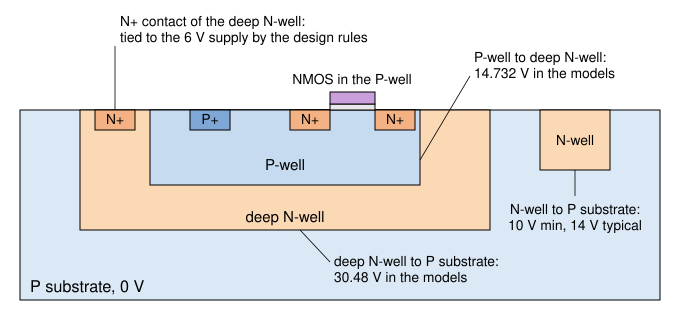
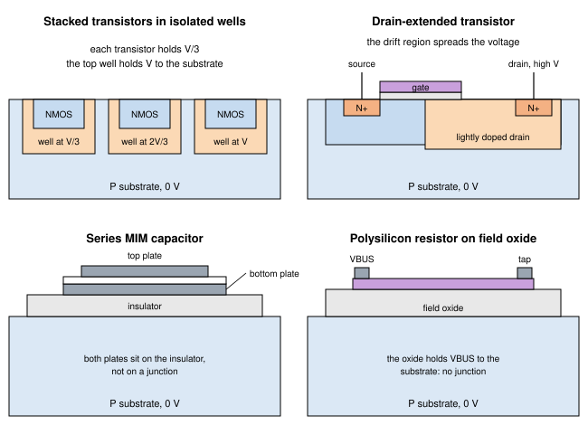

.. _usbpd-process-limits:

gf180mcu voltage limits
=======================

The voltage limits of the :term:`gf180mcu` process that decide which USB
Type-C circuits can be built on evampire, and the on-chip and external option
for each circuit.

The process has three kinds of voltage limit. A rating is the voltage a
standard device is designed to work at continuously. A breakdown is the
voltage at which a junction or an insulator starts to conduct, measured on
test structures. A custom structure, built from the process layers, can work
above the ratings of the standard devices, up to the breakdowns of the layers
it relies on. The converter pages use the same limits for the power
converters (:doc:`../converters/index`).

Standard device ratings
-----------------------

The design manual describes the process as "0.18μm 3.3V/(5V)6V dual-gate
MCU Technology" ([USBPD-GF180-DRM]_, Section 1.0), and its device list adds
10 V :term:`LDMOS` transistors ([USBPD-GF180-DRM]_, Appendix A).
:numref:`tab-usbpd-pdk-ratings` gives the ratings.

.. list-table:: Ratings of the standard devices
   :name: tab-usbpd-pdk-ratings
   :header-rows: 1
   :widths: 34 16 16 34

   * - Device
     - Drain or plate (V)
     - Gate (V)
     - Source
   * - nfet_03v3, pfet_03v3
     - 3.3
     - 3.3
     - [USBPD-GF180-DRM]_, Section 2.7
   * - nfet_05v0, pfet_05v0
     - 5
     - 5
     - [USBPD-GF180-DRM]_, Section 2.7
   * - nfet_06v0, pfet_06v0
     - 6
     - 6
     - [USBPD-GF180-DRM]_, Section 2.7
   * - nfet_06v0_nvt (native)
     - 6
     - 6
     - [USBPD-GF180-ELEC]_, Section 4.0
   * - nfet_10v0_asym, pfet_10v0_asym (LDMOS)
     - 10
     - 6
     - [USBPD-GF180-ELEC]_, Sections 8.1 and 8.2
   * - MIM capacitor, 1.5 fF/µm²
     - 6
     - none
     - [USBPD-GF180-ELEC]_, Section 6.2
   * - MIM capacitor, 1 fF/µm²
     - 20
     - none
     - [USBPD-GF180-ELEC]_, Section 6.2
   * - MIM capacitor, 2 fF/µm²
     - 6
     - none
     - [USBPD-GF180-ELEC]_, Section 6.2

The 5 V devices are the 6 V devices with a marker layer
([USBPD-GF180-DRM]_, Appendix A). A process uses only one of the three
:term:`MIM capacitor` types ([USBPD-GF180-ELEC]_, Section 6.2), and only one
of the 1 kΩ, 2 kΩ and 3 kΩ per square polysilicon resistors
([USBPD-GF180-ELEC]_, Section 6.1C).

Measured breakdown voltages
---------------------------

:numref:`tab-usbpd-pdk-breakdown` gives the documented
:wikipedia:`breakdown voltages <Breakdown_voltage>`. The minimum is the
lowest value the specification allows; a design uses it, not the typical
value. :term:`BVDSS` is the drain-to-source breakdown of a transistor that
is switched off, and :term:`BVCEO` the collector-to-emitter breakdown of a
bipolar transistor with its base open. The
:wikipedia:`gate oxide <Gate_oxide>` is the insulator between a
transistor's gate and its channel. Each minimum breakdown is at or above the
rating of the same device in :numref:`tab-usbpd-pdk-ratings`.

.. list-table:: Documented breakdown limits
   :name: tab-usbpd-pdk-breakdown
   :header-rows: 1
   :widths: 46 14 14 26

   * - Structure
     - Minimum (V)
     - Typical (V)
     - Source
   * - Gate oxide, 3.3 V devices
     - 7
     - 8.8
     - [USBPD-GF180-ELEC]_, Section 5.4
   * - Gate oxide, 6 V devices
     - 12
     - 16
     - [USBPD-GF180-ELEC]_, Section 5.4
   * - N+ to P-well, 6 V NMOS
     - 8.5
     - 11
     - [USBPD-GF180-ELEC]_, Section 5.5
   * - N-well to P substrate
     - 10
     - 14
     - [USBPD-GF180-ELEC]_, Section 5.5
   * - BVDSS, 6 V NMOS
     - 8.5
     - 11
     - [USBPD-GF180-ELEC]_, Section 2.0
   * - BVDSS, native NMOS
     - 8
     - 12
     - [USBPD-GF180-ELEC]_, Section 4.0
   * - BVDSS, LDMOS NMOS
     - 13.2
     - 14.5
     - [USBPD-GF180-ELEC]_, Section 8.1
   * - BVCEO, vertical PNP
     - 10
     - 15
     - [USBPD-GF180-ELEC]_, Section 5.8
   * - MIM dielectric, 1.5 fF/µm²
     - 10
     - 30
     - [USBPD-GF180-ELEC]_, Section 6.2
   * - MIM dielectric, 1 fF/µm²
     - 20
     - 40
     - [USBPD-GF180-ELEC]_, Section 6.2
   * - MIM dielectric, 2 fF/µm²
     - 10
     - 24
     - [USBPD-GF180-ELEC]_, Section 6.2

:term:`Field oxide` is the thick insulator between transistors, on which
polysilicon resistors and metal tracks run (see
:wikipedia:`LOCOS <LOCOS>`). The specification gives no breakdown for it.
It gives the voltage at which a metal 1 track over field oxide turns on a
parasitic transistor between two N+ regions under it: at least 8.5 V,
11 V typical, in the 6 V area ([USBPD-GF180-ELEC]_, Section 2.0). Keep N+
regions of different potential out from under a track or resistor that
carries more than that voltage.

Deep N-well breakdown
---------------------

A :term:`deep N-well` is an N-type layer below a P-well, which isolates the
transistors in that P-well from the P substrate. The process has the layer
and lists transistors, diodes and vertical NPN transistors inside it
([USBPD-GF180-DRM]_, Appendix A). The electrical specification gives no
breakdown for it. The PDK's SPICE diode models give one, in
:numref:`tab-usbpd-model-bv`.

.. list-table:: Junction breakdown in the PDK diode models
   :name: tab-usbpd-model-bv
   :header-rows: 1
   :widths: 40 20 20 20

   * - Junction
     - Model
     - Model (V)
     - Spec typical (V)
   * - N-well to P substrate, 6 V
     - nwp_6p0
     - 14
     - 14
   * - P-well to deep N-well
     - dnwpw
     - 14.732
     - none
   * - Deep N-well to P substrate
     - dnwps
     - 30.48
     - none

The model values come from [USBPD-GF180-MODELS]_ (models nwp_6p0, dnwpw and
dnwps), and the typical value from [USBPD-GF180-ELEC]_, Section 5.5. For the
N-well, the model value equals the documented typical value, not the 10 V
minimum. The 30.48 V of the deep N-well is
therefore a model value near the typical breakdown, not a guaranteed limit.

The design manual also restricts the potential of a deep N-well. Rule DF.15a
connects the N+ contact of a deep N-well in the 6 V area only to the 6 V
supply ([USBPD-GF180-DRM]_, Appendix B, rules not coded in the checks). A
deep N-well held at VBUS potential is outside that rule.
:numref:`fig-usbpd-deep-nwell` shows where each junction of
:numref:`tab-usbpd-model-bv` lies.

         N-well holds a P-well with an NMOS and a P+ contact. The deep
         N-well is contacted through an N+ region, which the design rules
         tie to the 6 V supply. The P-well to deep N-well junction breaks
         down at 14.732 V in the models, and the deep N-well to substrate
         junction at 30.48 V. A separate N-well to the substrate holds
         10 V minimum, 14 V typical.

   A P-well isolated from the substrate by a deep N-well, with the
   breakdown of each junction, schematic and not to scale.

Custom structures
-----------------

Custom structures hold more than the ratings of the standard devices by
working to the documented breakdown limits instead. The requirements allow
custom devices wherever a function needs them (:ref:`req-process`). For the
USB circuits these are:

Stacked transistors in isolated wells
   Each transistor holds a share of the voltage within its own rating. The
   top of the stack sits at the full voltage above the substrate, so the
   isolating junction holds it: 10 V minimum for an N-well, 30.48 V in the
   models for a deep N-well.
Drain-extended transistors
   A longer, lightly doped drain drawn from the existing layers [USBPD-BALLAN]_.
   The PDK's own LDMOS of this kind holds at least 13.2 V. A drain in a deep
   N-well is limited by the deep N-well's own breakdown.
Series capacitors
   For coupling or sensing an AC signal across a high voltage. A 1 fF/µm²
   MIM capacitor holds at least 20 V; its bottom plate sits on the
   insulator above the substrate.
Polysilicon devices on field oxide
   Resistors and diodes in polysilicon have no junction to the substrate,
   so the field oxide holds their voltage to the substrate.
Clamps, crowbars and references
   Built from the documented diodes and bipolar transistors, including a
   :wikipedia:`thyristor <Thyristor>` from the parasitic bipolar
   transistors, and a bandgap reference from the vertical PNP.

:numref:`fig-usbpd-custom-structures` shows the first four.

         Stacked transistors: three NMOS, each in a P-well inside its own
         N-type well, at V/3, 2V/3 and V; each transistor holds V/3 and the
         top well holds V to the substrate. Drain-extended transistor: an
         N+ source in a P-well, a polysilicon gate, and an N+ drain inside
         a lightly doped drift region that spreads the voltage. Series MIM
         capacitor: top and bottom metal plates on the insulator above the
         substrate, with no junction. Polysilicon resistor on field oxide:
         its VBUS end and its tap sit on the oxide, which holds VBUS to the
         substrate.

   Four custom structures for voltages above the standard ratings,
   schematic and not to scale.

:ref:`conv-custom` gives reference examples of stacked and drain-extended
devices in other CMOS processes.

.. _usbpd-placement:

On-chip and external options
----------------------------

:numref:`tab-usbpd-placement` lists each function of
:ref:`usbpd-analogue` and :ref:`usbpd-cc-protection` with the highest
voltage it sees on an :term:`SPR` port, and its options.

.. list-table:: Where each function can be built
   :name: tab-usbpd-placement
   :header-rows: 1
   :widths: 26 14 30 30

   * - Function
     - Up to (V)
     - On chip
     - External
   * - Rp, Rd, comparators, BMC driver, VCONN switch
     - 5.5
     - Standard 5 V and 6 V transistors
     - CC interface, such as the FUSB302B
   * - Dead-battery Rd
     - 2.181
     - Native or 6 V NMOS with a polysilicon resistor
     - Protector with built-in resistors
   * - Voltage reference
     - 3.3
     - Custom bandgap from the vertical PNP
     - Reference IC
   * - CC protection
     - 22.15
     - Custom blocking switch, or a crowbar
     - Protector, such as the TPD8S300A
   * - VBUS sensing
     - 22.15
     - Polysilicon divider on field oxide
     - Top resistor on the board
   * - VBUS discharge
     - 22.15
     - Custom drain-extended or stacked switch
     - Transistor and load on the board
   * - Power-path switches and source converter
     - 22.15
     - Control on chip; switches as custom devices (:ref:`conv-custom`)
     - Transistors, inductor and gate drivers

The highest voltages come from :typec:`Table 4-5` (VCONN),
:typec:`Table 4-37` (the dead-battery Rd at the 3.0 A level) and
:ref:`usbpd-spr` (VBUS with a PPS supply).

On an
:term:`EPR` port, the last four rows rise to
50.9 V (:ref:`usbpd-epr`). That is above the 30.48 V model value of the deep
N-well, so at the model value a single deep N-well does not isolate a node
at the EPR voltage; the measured breakdown decides. The
other on-chip options for those rows on an EPR port are polysilicon devices
on field oxide and a second die. The external options stay as listed.

Open questions
--------------

* The breakdown of the deep N-well to the substrate, which the models give
  as 30.48 V: from the foundry through wafer.space, and from a test
  structure on a wafer.space run.
* Whether a deep N-well may sit above the 6 V supply, against rule DF.15a,
  and at what voltage: a question to wafer.space and the foundry.
* The breakdown of field oxide under polysilicon and metal to the
  substrate, and between neighbouring polysilicon segments: from a test
  structure.
* The isolation of the MIM capacitor's bottom plate from the substrate:
  from the foundry or a test structure.
* Which MIM capacitor type, which high-resistance polysilicon type, and
  whether the LDMOS and deep N-well layers are offered on wafer.space
  runs, which are a :wikipedia:`multi-project wafer service
  <Multi-project_wafer_service>`: a question to wafer.space.
* An ESD structure for a pad that carries VBUS, which conducts only above
  22.15 V or 50.9 V: from a design simulated with the PDK models and a test
  structure.
