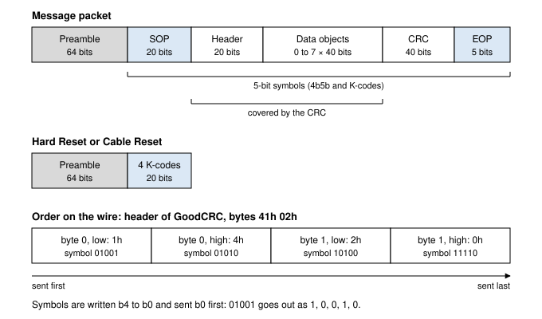

.. _usbpd-packets:

Packet structure
================

How a :term:`USB Power Delivery` message is framed as a packet, coded into
5-bit symbols and checked, and how long a packet takes to send. The
:doc:`electrical signal <cc-signalling>` that carries the bits on the
:term:`CC` wire has its own page.

Packet parts
------------

Every message travels on the CC wire as one packet. :numref:`tab-usbpd-packet`
lists the parts in the order they are sent (:pd:`Section 5.3.1.1`,
:pd:`Figure 5.1`). Each bit of the packet is then sent with
:ref:`biphase mark coding <usbpd-bmc>`.

.. list-table:: Parts of a packet, in the order they are sent
   :name: tab-usbpd-packet
   :header-rows: 1
   :widths: 25 20 55

   * - Part
     - Bits on the wire
     - Content
   * - Preamble
     - 64
     - Alternating ``0`` and ``1``, starting with ``0`` and ending with
       ``1``
   * - :term:`SOP`
     - 20
     - Four special 5-bit symbols (K-codes) that mark the start and say
       who the message is for
   * - Message header
     - 20
     - The 16-bit header, 4b5b coded
   * - Data objects
     - 40 each
     - 0 to 7 data objects of 32 bits, 4b5b coded
   * - CRC
     - 40
     - The 32-bit checksum, 4b5b coded
   * - EOP
     - 5
     - One K-code that marks the end of the packet

The preamble is not 4b5b coded (:pd:`Section 5.3.1.1.1`). It wakes the
receiver, and its last 32 bits set the reference bit rate for the rest of the
packet (:pd:`Section 5.3.4.8`). The number of data objects is a 3-bit field
in the message header (:pd:`Table 6.2`, :pd:`Section 6.2.2`).

A :term:`Hard Reset` or a Cable Reset is shorter: a preamble followed by four
K-codes, with no header, data, CRC or EOP (:pd:`Section 5.3.1.2`,
:pd:`Figure 5.2`).

The header, the data and the CRC are sent least significant byte first, and
the lower 4 bits (nibble) of each byte before the upper nibble
(:pd:`Section 5.3.1.1`, :pd:`Figure 5.1`). This is
:wikipedia:`little-endian <Endianness>` order. :numref:`fig-usbpd-packet`
shows the parts of a packet, a reset, and this order for one header.

         header 20 bits, 0 to 7 data objects of 40 bits, CRC 40 bits and
         EOP 5 bits; a bracket marks everything from SOP to EOP as 5-bit
         symbols, and a second bracket marks the header and data objects as
         covered by the CRC. Hard Reset or Cable Reset: preamble 64 bits and
         four K-codes, 20 bits. Order on the wire for the GoodCRC header
         41h 02h: nibble 1h as symbol 01001, then 4h as 01010, then 2h as
         10100, then 0h as 11110; each symbol is sent bit b0 first.

   The parts of a packet in the order they are sent, the shorter reset
   packet, and the nibble and bit order of one header.

.. _usbpd-4b5b:

4b5b symbols
------------

Everything after the preamble is sent in 5-bit *symbols*, a
:wikipedia:`4B5B` line code (:pd:`Section 5.3.1.1.2`, :pd:`Table 5.2`):

* each 4-bit nibble of data becomes one of 16 symbols
  (:numref:`tab-usbpd-4b5b`);
* six further symbols, the :term:`K-codes <K-code>`, never stand for data. They mark the
  start of a packet, a reset and the end of a packet
  (:numref:`tab-usbpd-kcodes`);
* the other ten 5-bit values are invalid. A receiver that finds one
  discards the packet (:pd:`Section 5.3.2.3`).

A K-code cannot appear in data, so a receiver finds the start and end of a
packet by matching symbols rather than by counting bits. The tables write
each symbol from bit b4 down to bit b0, and bit b0 is sent first
(:pd:`Figure 5.1`; :numref:`fig-usbpd-packet`).

.. list-table:: Data symbols (:pd:`Table 5.2`)
   :name: tab-usbpd-4b5b
   :header-rows: 1
   :widths: 50 50

   * - Nibble (hex)
     - Symbol (b4 to b0)
   * - 0
     - 11110
   * - 1
     - 01001
   * - 2
     - 10100
   * - 3
     - 10101
   * - 4
     - 01010
   * - 5
     - 01011
   * - 6
     - 01110
   * - 7
     - 01111
   * - 8
     - 10010
   * - 9
     - 10011
   * - A
     - 10110
   * - B
     - 10111
   * - C
     - 11010
   * - D
     - 11011
   * - E
     - 11100
   * - F
     - 11101

.. list-table:: K-codes (:pd:`Table 5.2`)
   :name: tab-usbpd-kcodes
   :header-rows: 1
   :widths: 25 30 45

   * - Name
     - Symbol (b4 to b0)
     - Used in
   * - Sync‑1
     - 11000
     - Start of packet
   * - Sync‑2
     - 10001
     - Start of packet
   * - Sync‑3
     - 00110
     - Start of packet
   * - RST‑1
     - 00111
     - Hard Reset and Cable Reset
   * - RST‑2
     - 11001
     - Hard Reset and debug start of packet
   * - EOP
     - 01101
     - End of packet

.. _usbpd-sop:

Start of packet
---------------

The four K-codes after the preamble form an *ordered set*. It says whether
the packet goes to the port at the other end, to a cable plug, or is a reset
(:numref:`tab-usbpd-sop`; :pd:`Section 5.3.1.1.3`,
:pd:`Tables 5.3 <Table 5.3>` and :pd:`5.4 <Table 5.4>`).

.. list-table:: Ordered sets
   :name: tab-usbpd-sop
   :header-rows: 1
   :widths: 28 18 18 18 18

   * - Name
     - 1st
     - 2nd
     - 3rd
     - 4th
   * - SOP
     - Sync‑1
     - Sync‑1
     - Sync‑1
     - Sync‑2
   * - SOP′
     - Sync‑1
     - Sync‑1
     - Sync‑3
     - Sync‑3
   * - SOP″
     - Sync‑1
     - Sync‑3
     - Sync‑1
     - Sync‑3
   * - SOP′_​Debug
     - Sync‑1
     - RST‑2
     - RST‑2
     - Sync‑3
   * - SOP″_​Debug
     - Sync‑1
     - RST‑2
     - Sync‑3
     - Sync‑2
   * - Hard Reset
     - RST‑1
     - RST‑1
     - RST‑1
     - RST‑2
   * - Cable Reset
     - RST‑1
     - Sync‑1
     - RST‑1
     - Sync‑3

Each ordered set addresses a different receiver (:pd:`Section 5.3.1.1.3`,
:pd:`Section 7.1.3`, :pd:`Section 7.1.4`):

SOP
   The port at the other end of the cable.
SOP′ and SOP′_Debug
   A cable plug. Every marked cable has at least one plug that answers
   SOP′.
SOP″ and SOP″_Debug
   The other cable plug, in a cable whose two plugs both communicate.
Hard Reset
   The other port, and the cable plugs, which reset when they see it
   (:pd:`Section 7.1.3.1`).
Cable Reset
   The cable plugs only.

:numref:`fig-usbpd-sop-targets` shows where each receiver sits along the
cable.

.. graphviz:: sop-targets.dot
   :name: fig-usbpd-sop-targets
   :caption: The receivers along a marked cable, with the ordered set that
             addresses each.
   :alt: A chain from the sending port, the VCONN Source, through the near
         cable plug, addressed by SOP′, the cable, and the far cable plug,
         addressed by SOP″, to the far port, addressed by SOP.

:numref:`fig-usbpd-preamble-sop` shows the end of the preamble and the first
Sync-1 symbol on the wire, sent bit b0 first.

.. wavedrom::
   :caption: The last two preamble bits and the first Sync-1 K-code
             (11000), sent bit b0 first as 0 0 0 1 1.
   :name: fig-usbpd-preamble-sop
   :alt: Timing diagram: the last two preamble bits 0 1 followed by the
         Sync-1 bits 0 0 0 1 1 in biphase mark coding.

   {"signal": [
     {"name": "field", "wave": "=...=.........", "data": ["preamble", "Sync-1"]},
     {"name": "data bit", "wave": "=.=.=.=.=.=.=.", "data": ["0", "1", "0", "0", "0", "1", "1"]},
     {"name": "CC", "wave": "1.010.1.0.1010"}
   ],
   "config": {"hscale": 1}}

A receiver must accept an ordered set with all four K-codes correct, and may
accept one with three of the four correct (:pd:`Section 5.3.2.2`,
:pd:`Table 5.5`). A port receives only the ordered sets it has been set up
to receive, and ignores the rest (:pd:`Section 5.3.2`, item 5).

Only the :term:`VCONN` Source talks to the cable plugs with SOP′ and SOP″
packets (:pd:`Section 1.3.7`). How a port uses them to query a marked cable
is on :ref:`usbpd-discover-identity`.

.. _usbpd-crc:

CRC-32
------

The checksum is a 32-bit :wikipedia:`cyclic redundancy check
<Cyclic_redundancy_check>` (CRC) over the header and data objects, not over
the preamble, SOP or EOP (:pd:`Section 5.3.1.1.4`). :numref:`tab-usbpd-crc`
lists its parameters.

.. list-table:: CRC-32 parameters (:pd:`Section 5.3.1.1.4`)
   :name: tab-usbpd-crc
   :header-rows: 1
   :widths: 50 50

   * - Parameter
     - Value
   * - Polynomial
     - 04C1 1DB7h
   * - Initial value
     - FFFF FFFFh
   * - Bit order
     - Byte 0 first, bit 0 first in each byte
   * - Result
     - The remainder, complemented
   * - Residual
     - C704 DD7Bh

A receiver runs the CRC over the received data and checksum together. A
packet that arrived intact leaves the residual C704 DD7Bh. A packet with a
bad CRC is discarded, so it is not acknowledged (:pd:`Section 5.3.2.3`).

The same CRC protects every Ethernet frame as its
:term:`frame check sequence <Frame check sequence>` (:clause:`Clause 3.2.9 <3>`),
and the PD specification states that it is identical to the CRC of USB 3
(:pd:`Section 5.3.1.1.4`). The
:wikipedia:`zlib <Zlib>` library's ``crc32()`` function computes it.
The PD example of a GoodCRC message with the bytes 41h 02h has the checksum
46B5 0D97h (:pd:`Figure 5.1`), the value ``crc32()`` returns for those two
bytes.

The EOP K-code ends the packet. It is not covered by the CRC
(:pd:`Section 5.3.1.1.5`).

.. _usbpd-durations:

Packet durations
----------------

Software and hardware timing budgets depend on how long the line is busy
with each packet. The packet length in bits, from :numref:`tab-usbpd-packet`,
is:

.. math::

   N_\text{bits} &= N_\text{pre} + N_\text{SOP} + N_\text{hdr} \\
                 &\quad + n \times N_\text{obj} + N_\text{CRC}
                        + N_\text{EOP} \\
                 &= 64 + 20 + 20 + n \times 40 + 40 + 5 \\
                 &= 149 + n \times 40

The time to send the packet is:

.. math::

   t_\text{packet} = N_\text{bits} \times T_\text{UI}

.. list-table::
   :header-rows: 1
   :widths: 22 58 20

   * - Symbol
     - Meaning
     - Unit
   * - :math:`N_\text{bits}`
     - Bits in the packet
     - bit
   * - :math:`N_\text{pre}`
     - Preamble, 64
     - bit
   * - :math:`N_\text{SOP}`
     - Ordered set, 4 symbols of 5 bits
     - bit
   * - :math:`N_\text{hdr}`
     - Message header, 4 symbols of 5 bits
     - bit
   * - :math:`n`
     - Number of data objects, 0 to 7
     - none
   * - :math:`N_\text{obj}`
     - One data object, 8 symbols of 5 bits
     - bit
   * - :math:`N_\text{CRC}`
     - CRC, 8 symbols of 5 bits
     - bit
   * - :math:`N_\text{EOP}`
     - End of packet, 1 symbol
     - bit
   * - :math:`t_\text{packet}`
     - Time to send the packet
     - µs
   * - :math:`T_\text{UI}`
     - Unit interval, one bit time (:numref:`tab-usbpd-ui`)
     - µs

The equations count only the packet. The idle time before and after it is
set by the :ref:`transmitter timing <usbpd-transmitter>`.

A GoodCRC message has no data objects, so it has 149 bits, and at the
nominal 300 kbit/s it takes
:math:`149 \times 3.333\ \mu\text{s} = 497\ \mu\text{s}`.
:numref:`tab-usbpd-duration` gives the duration of common messages at the
nominal and the slowest bit rate.

.. list-table:: Packet duration
   :name: tab-usbpd-duration
   :header-rows: 1
   :widths: 40 8 14 19 19

   * - Message
     - :math:`n`
     - Bits
     - 300 kbit/s (µs)
     - 270 kbit/s (µs)
   * - GoodCRC
     - 0
     - 149
     - 497
     - 552
   * - Request
     - 1
     - 189
     - 630
     - 700
   * - Source_​Capabilities
     - 7
     - 429
     - 1430
     - 1589

Accept, PS_RDY and every other message without data objects take as long
as GoodCRC. The Source_Capabilities row is for seven PDOs.

A packet carries at most seven data objects, so no packet lasts longer than
about 1.6 ms, the time of the Source_Capabilities row. Extended messages longer than this are split into chunks of at
most seven data objects each (:pd:`Figure 6.1`). The exception is an
unchunked extended message of up to 260 bytes (MaxExtendedMsgLen,
:pd:`Table 6.74`), which is sent only between two ports that both support it
(:pd:`Section 6.4.2.1.9`).
