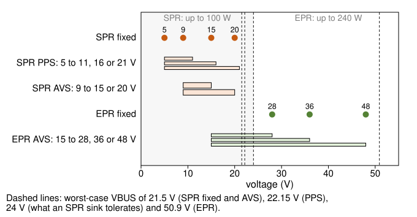

.. _usbpd-power-levels:

Power levels and messages
=========================

:term:`USB Power Delivery` offers a range of voltages and currents, and
messages with a fixed format carry the offers and requests.

Once :term:`VBUS` is at 5 V, the :term:`source` sends a list of what it can
supply and the :term:`sink` asks for one item from the list
(:ref:`usbpd-negotiation`). :numref:`tab-usbpd-ranges` lists the kinds of
supply the list can hold, from the simplest to the most demanding.

.. list-table:: The kinds of supply a source can offer
   :name: tab-usbpd-ranges
   :header-rows: 1
   :widths: 28 24 24 24

   * - Kind
     - Voltage (V)
     - Maximum current (A)
     - Maximum power (W)
   * - SPR fixed
     - 5, 9, 15 or 20
     - 5
     - 100
   * - SPR PPS
     - 5 to 21
     - 5
     - 100
   * - SPR AVS
     - 9 to 20
     - 5
     - 100
   * - EPR fixed
     - 28, 36 or 48
     - 5
     - 240
   * - EPR AVS
     - 15 to 48
     - 5
     - 240

.. list-table:: When each range can be used
   :name: tab-usbpd-range-entry
   :header-rows: 1
   :widths: 25 75

   * - Range
     - Entry condition
   * - SPR
     - A contract. A sink using PPS repeats its request at least every
       10 s.
   * - EPR
     - EPR mode, an EPR cable, and a message at least every 500 ms.

:term:`SPR` is the standard power range and :term:`EPR` the extended power
range. :term:`PPS` is a programmable and :term:`AVS` an adjustable supply. :numref:`tab-usbpd-range-entry`
gives the condition for using each range. Currents above 3 A need a cable
rated for 5 A (:pd:`Section 8.6.1.2.2`), which the source finds out with
:term:`Discover Identity` (:ref:`usbpd-cables`). The rows are explained
below, and :numref:`fig-usbpd-power-levels` draws their voltages.

         fixed: points at 5, 9, 15 and 20 V. SPR PPS: bars from 5 V to
         11, 16 and 21 V. SPR AVS: bars from 9 V to 15 and 20 V. EPR fixed:
         points at 28, 36 and 48 V. EPR AVS: bars from 15 V to 28, 36 and
         48 V. The SPR region, up to 100 W, ends at 24 V; the EPR region
         allows up to 240 W. Dashed lines mark the worst-case VBUS of
         21.5 V, 22.15 V, 24 V and 50.9 V.

   The voltages of each kind of supply, with the worst-case VBUS values
   that circuits on VBUS must withstand.

.. _usbpd-spr:

Fixed supplies
--------------

In the :term:`standard power range <SPR>` (SPR), a fixed supply is one of
5 V, 9 V, 15 V and 20 V, at up to 3 A, or up to 5 A at 20 V, which is 100 W
(:pd:`Table 3.1`). Each offer is a :term:`power data object <PDO>` (PDO)
holding a voltage and a maximum current (:ref:`usbpd-pdo`). Which voltages a
source must offer, and at what current, depends on its power;
:doc:`power-translation` gives these rules (:pd:`Section 3.2.4`).

A fixed supply may differ from its nominal voltage by ± 5 % (*vSrcNew*), and
by another 0.5 V during a voltage change or a load step (*vSrcValid*, both
:pd:`Table 4.7`). The highest voltage VBUS can reach is therefore:

.. math::

   V_\text{max} = V_\text{nom} \times (1 + k_\text{tol}) + \Delta V_\text{valid}

.. list-table::
   :header-rows: 1
   :widths: 20 60 20

   * - Symbol
     - Meaning
     - Unit
   * - :math:`V_\text{max}`
     - Highest voltage VBUS can reach during a contract
     - V
   * - :math:`V_\text{nom}`
     - Highest nominal voltage the contract can use
     - V
   * - :math:`k_\text{tol}`
     - Tolerance of the supply: 0.05 for a fixed supply (*vSrcNew*) and
       for PPS (*vPpsNew*)
     - none
   * - :math:`\Delta V_\text{valid}`
     - Extra range during a transition or load step: 0.5 V for a fixed
       supply (*vSrcValid*), 0.1 V for PPS (*vPpsValid*)
     - V

All four values are in :pd:`Table 4.7`. For a 20 V fixed supply, the SPR
worst case is:

.. math::

   V_\text{max} = 20\ \text{V} \times 1.05 + 0.5\ \text{V} = 21.5\ \text{V}

A PPS supply set to its highest voltage, 21 V, gives
:math:`21\ \text{V} \times 1.05 + 0.1\ \text{V} = 22.15\ \text{V}`. An SPR
AVS supply ends at 20 V and has the same tolerances as a fixed supply
(*vAvsNew*, *vAvsValid*), so it gives 21.5 V.

Every circuit that connects to VBUS, and to the CC pins if they can be
shorted to VBUS (:ref:`usbpd-cc-protection`), must withstand 21.5 V with SPR
fixed supplies, 22.15 V if PPS is used, and 50.9 V in EPR
(:ref:`usbpd-epr`). The
description of the cable's maximum-voltage field quotes 21.55 V for the
fixed-supply sum (:pd:`Table 6.45`); the parameter values in
:pd:`Table 4.7` give 21.5 V.

A sink must tolerate 24 V on VBUS without damage, as the specification
recommends (*vSprMax*, :pd:`Table 4.8`).

Programmable and adjustable supplies
------------------------------------

A :term:`programmable power supply <PPS>` (PPS) is a supply whose voltage
the sink sets in 20 mV steps (*vPpsStep*, :pd:`Table 4.7`) within 5 V to
11 V, 5 V to 16 V or 5 V to 21 V (:pd:`Table 4.2`). The sink also sets a
current limit in 50 mA steps (*iPpsCLStep*, :pd:`Table 4.7`), and the source
holds that current by lowering its voltage (:numref:`fig-usbpd-pps-limit`).
This lets a sink charge a
battery directly. The sink repeats its request at least every *tPPSRequest*,
10 s (:pd:`Section 7.31.16.1`, :pd:`Table 7.10`).

An :term:`adjustable voltage supply <AVS>` (AVS) is set in 100 mV steps
(*vAvsStep*, :pd:`Table 4.7`) and has no current limit. It covers 9 V to
15 V or 9 V to 20 V in SPR (:pd:`Table 4.3`), and 15 V to 28 V, 36 V or
48 V in EPR (:pd:`Table 4.4`). A source that offers PPS must also offer
SPR AVS (:pd:`Section 3.2.5.2`). Both are optional.

.. _usbpd-epr:

Extended power range
--------------------

A source rated above 100 W and up to 240 W can also offer 28 V, 36 V and
48 V at up to 5 A, in the :term:`extended power range <EPR>` (EPR)
(:pd:`Section 3.2.5.3`, :pd:`Table 3.6`). Three conditions apply:

#. The sink asks to enter EPR mode with an EPR_Mode message (Enter), and
   the source answers EPR_Mode (Enter Acknowledged) and, once its checks
   pass, EPR_Mode (Enter Succeeded) (:pd:`Section 6.4.9`,
   :pd:`Section 7.30.1`).
#. The source checks that the cable is rated for EPR, with
   :ref:`Discover Identity <usbpd-discover-identity>`
   (:pd:`Section 8.6.1.2.3`).
#. In EPR mode, the two ends exchange a message at least every
   *tSinkEPRKeepAlive* (250 ms to 500 ms); the sink sends an EPR_KeepAlive
   message when there is no other traffic, and the source answers it with
   EPR_KeepAlive_Ack. A source that sees no message for
   *tSourceEPRKeepAlive* (750 ms to 1000 ms) restarts the port with a
   :ref:`Hard Reset <usbpd-hard-reset>`
   (:pd:`PD Sections 7.31.18.2 and 7.31.18.3 <7.31.18.2>`, :pd:`Table 7.10`).

:numref:`fig-usbpd-epr-entry` shows the entry, and
:numref:`fig-usbpd-epr-keepalive` the keep-alive timing.

.. graphviz:: epr-entry.dot
   :name: fig-usbpd-epr-entry
   :caption: Entering EPR mode; GoodCRC replies are left out, and time runs
             downwards, not to scale.
   :alt: Sequence diagram between a sink, a source and a cable plug. The
         sink sends EPR_Mode (Enter) and the source answers EPR_Mode (Enter
         Acknowledged). The source sends Discover Identity with SOP′ to the
         cable plug, which answers with an ACK carrying a Cable VDO that
         shows the cable is rated for EPR. The source then sends EPR_Mode
         (Enter Succeeded).

.. wavedrom::
   :caption: The EPR keep-alive, ending in a Hard Reset when the messages
            stop, schematic and not to scale; the sink limit is
            tSinkEPRKeepAlive and the source limit tSourceEPRKeepAlive, and
            the break marks a compressed wait.
   :name: fig-usbpd-epr-keepalive
   :alt: Timing diagram. The sink sends EPR_KeepAlive and the source answers
         EPR_KeepAlive_Ack. The sink must send its next message within
         tSinkEPRKeepAlive, 250 to 500 ms. When messages stop, the source
         waits tSourceEPRKeepAlive, 750 to 1000 ms, from the last message,
         and then sends Hard Reset, which returns the port to its defaults.

   {"signal": [
     {"name": "sink", "wave": "=..z...........", "data": ["EPR_KeepAlive"]},
     {"name": "source", "wave": "z..=...z.....=.", "data": ["EPR_KeepAlive_Ack", "Hard Reset"]},
     {"name": "sink limit", "wave": "x..=..x........", "data": ["250–500 ms"]},
     {"name": "source limit", "wave": "x......=..|..x.", "data": ["750–1000 ms"]},
     {"name": "mode", "wave": "=............=.", "data": ["EPR mode", "defaults"]}
   ],
   "config": {"hscale": 1}}

A :ref:`power role swap <usbpd-power-role-swap>` is not allowed in EPR
mode; the port leaves EPR mode first (:pd:`Section 7.10`).

With 48 V, the equation in :ref:`usbpd-spr` gives the EPR worst case:

.. math::

   V_\text{max} = 48\ \text{V} \times 1.05 + 0.5\ \text{V} = 50.9\ \text{V}

Cable electronics powered from VBUS must tolerate this 50.9 V
(:typec:`Section 4.6.2`).

.. _usbpd-messages:

Message header
--------------

Each message starts with a 16-bit header (:numref:`fig-usbpd-header`;
:pd:`Section 6.2.1`, :pd:`Table 6.2`). There are three kinds of message
(:pd:`Section 6.1.1`):

Control messages
   The header alone. GoodCRC, Accept and PS_RDY are control messages.
Data messages
   The header followed by one to seven 32-bit data objects.
   Source_Capabilities and Request are data messages.
Extended messages
   The header, a 16-bit extended header and 1 to 260 bytes of data. They
   are used only by optional features, such as EPR_KeepAlive.

.. wavedrom::
   :caption: The 16-bit message header (:pd:`Table 6.2`), drawn as two rows
             of 8 bits with bit 0 at the right of the lower row.
   :name: fig-usbpd-header
   :alt: Bit-field diagram of the message header: bits 4 to 0 message type,
         bit 5 data role, bits 7 to 6 specification revision, bit 8 power
         role, bits 11 to 9 MessageID, bits 14 to 12 number of data objects,
         bit 15 extended.

   {"reg": [
     {"name": "Message type", "bits": 5, "attr": "00001 = GoodCRC"},
     {"name": "DR", "bits": 1},
     {"name": "Revision", "bits": 2, "attr": "10 = 3.x"},
     {"name": "PR", "bits": 1},
     {"name": "MessageID", "bits": 3},
     {"name": "Data objects", "bits": 3},
     {"name": "Ext", "bits": 1}
   ],
   "config": {"hspace": 380, "bits": 16, "lanes": 2}}

The fields of the header are (:pd:`Table 6.2`):

Message type (bits 4 to 0)
   Which message this is. The same code means different messages for
   control and data messages (:numref:`tab-usbpd-message-types`).
DR (bit 5) and PR (bit 8)
   The sender's :term:`data role` (1 = DFP) and power role (1 = source).
Revision (bits 7 to 6)
   The specification revision. The two ends agree on it from the first
   Source_Capabilities and Request (:pd:`Section 6.1.3.1`).
MessageID (bits 11 to 9)
   A 3-bit counter kept by the sender. A GoodCRC carries the MessageID of
   the message it acknowledges, and a receiver uses it to recognise a
   repeated message (:pd:`Section 6.1.2`).
Data objects (bits 14 to 12)
   The number of 32-bit data objects; zero for a control message.

.. list-table:: Selected message type codes (:pd:`Table 6.4`,
   :pd:`Table 6.5`)
   :name: tab-usbpd-message-types
   :header-rows: 1
   :widths: 50 25 25

   * - Message
     - Kind
     - Code
   * - GoodCRC
     - Control
     - 00001
   * - Accept
     - Control
     - 00011
   * - Reject
     - Control
     - 00100
   * - PS_RDY
     - Control
     - 00110
   * - Get_Source_Cap
     - Control
     - 00111
   * - Get_Sink_Cap
     - Control
     - 01000
   * - DR_Swap
     - Control
     - 01001
   * - PR_Swap
     - Control
     - 01010
   * - VCONN_Swap
     - Control
     - 01011
   * - Wait
     - Control
     - 01100
   * - Soft_Reset
     - Control
     - 01101
   * - Not_Supported
     - Control
     - 10000
   * - FR_Swap
     - Control
     - 10011
   * - Source_Capabilities
     - Data
     - 00001
   * - Request
     - Data
     - 00010
   * - Sink_Capabilities
     - Data
     - 00100
   * - Alert
     - Data
     - 00110
   * - EPR_Request
     - Data
     - 01001
   * - EPR_Mode
     - Data
     - 01010
   * - Source_Info
     - Data
     - 01011
   * - Vendor_Defined
     - Data
     - 01111

Vendor_Defined carries :ref:`Discover Identity <usbpd-discover-identity>`.
How long each message takes on the wire is given in
:ref:`usbpd-durations`.

.. _usbpd-pdo:

Power data objects
------------------

Each PDO is 32 bits long. Source_Capabilities holds one to seven PDOs, with the 5 V fixed supply
first and the other fixed supplies in rising voltage order
(:pd:`Section 6.4.1.1`). :numref:`fig-usbpd-pdo` shows a fixed-supply PDO.

.. wavedrom::
   :caption: The fixed-supply PDO (:pd:`Table 6.8`, :pd:`Table 6.10`), drawn
             as two rows of 16 bits.
   :name: fig-usbpd-pdo
   :alt: Bit-field diagram of the fixed-supply PDO: bits 9 to 0 maximum
         current in 10 mA units, bits 19 to 10 voltage in 50 mV units,
         bits 21 to 20 peak current, bits 29 to 22 flags, bits 31 to 30
         type 00.

   {"reg": [
     {"name": "Max current", "bits": 10},
     {"name": "Voltage", "bits": 10},
     {"name": "Peak", "bits": 2},
     {"name": "Flags", "bits": 8},
     {"name": "00", "bits": 2}
   ],
   "config": {"hspace": 380, "bits": 32, "lanes": 2}}

Bits 31 to 30 are 00 for a fixed supply. Bits 19 to 10 hold the voltage in
50 mV units and bits 9 to 0 the maximum current in 10 mA units
(:pd:`Table 6.10`). In the first PDO, the flags describe the port, for
example *Dual-Role Power* (bit 29), *Unconstrained Power* (bit 27) and
*EPR Capable* (bit 23) (:pd:`Table 6.8`). In a sink's list, bits 24 to 23
give the current it needs after a :term:`fast role swap <FRS>`
(:pd:`Table 6.9`).

For example, an offer of 9 V at 3 A has a voltage field of
:math:`9\ \text{V} / 50\ \text{mV} = 180` and a current field of
:math:`3\ \text{A} / 10\ \text{mA} = 300`, which gives the PDO
``0002 D12Ch``.

.. _usbpd-rdo:

Request data object
-------------------

The sink's Request holds one :term:`request data object <RDO>` (RDO)
(:numref:`fig-usbpd-rdo`; :pd:`Section 6.4.2`).

.. wavedrom::
   :caption: The RDO for a fixed supply (:pd:`Table 6.19`), drawn as two rows
             of 16 bits.
   :name: fig-usbpd-rdo
   :alt: Bit-field diagram of the fixed-supply RDO: bits 9 to 0 maximum
         operating current, bits 19 to 10 operating current, both in 10 mA
         units, bits 21 to 20 reserved, bits 27 to 22 flags, bits 31 to 28
         object position.

   {"reg": [
     {"name": "Max op. current", "bits": 10},
     {"name": "Op. current", "bits": 10},
     {"name": "Resv", "bits": 2},
     {"name": "Flags", "bits": 6},
     {"name": "Position", "bits": 4}
   ],
   "config": {"hspace": 380, "bits": 32, "lanes": 2}}

Bits 31 to 28 select a PDO by its position in the list, starting at 1.
Bits 19 to 10 give the *Operating Current*, the most the sink will draw,
which must not exceed the PDO's maximum current. Bits 9 to 0, the *Maximum
Operating Current*, are no longer used: a sender sets them equal to the
Operating Current, and a receiver ignores them (:pd:`Table 6.19`).

For example, a request for 2 A from the second PDO has position 2 and an
Operating Current field of :math:`2\ \text{A} / 10\ \text{mA} = 200`,
which gives the RDO ``2003 20C8h``.

Open questions
--------------

* Which kinds of supply in :numref:`tab-usbpd-ranges` the board offers and
  accepts. The choices are SPR fixed supplies only; also 5 A, which needs
  :term:`VCONN` and Discover Identity as a source; PPS and AVS; or EPR,
  which puts 48 V on VBUS, and on the CC pins in a fault, and needs keep-alive
  messages.
