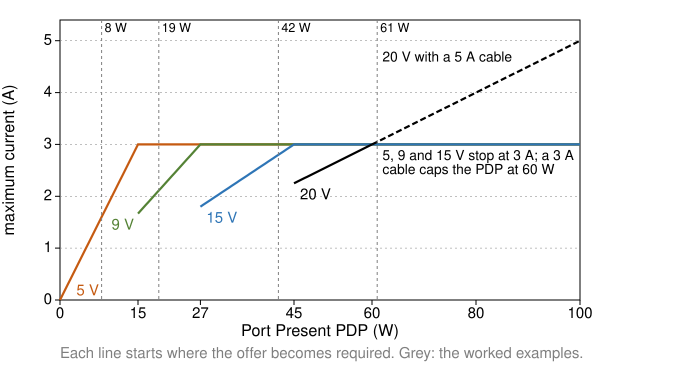
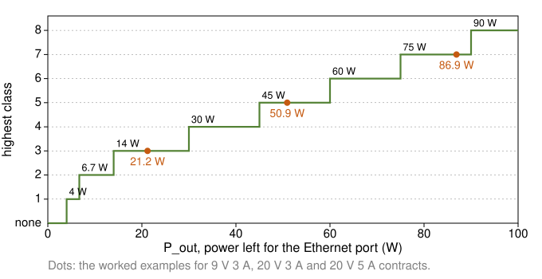

.. _usbpd-power-translation:

USB offers from Power over Ethernet
===================================

How evampire's software turns the power granted by
:term:`Power over Ethernet` into valid :term:`USB Power Delivery` source
offers, and, in the other direction, a USB contract into a Power over
Ethernet :term:`class`.

The :ref:`power translation <power-translation>` section sets out this translation. The
page covers the "Ethernet in, USB out" mode first
(:ref:`power-modes`). :doc:`../poe/index` explains how a class is detected
and granted.

Input power from the class
--------------------------

A :term:`powered device` of a given class may draw up to a fixed average
power at its input (:numref:`tab-usbpd-class-power`). That power,
:math:`P_\text{Class,PD}`, is the input power :math:`P_\text{in}` of the
:ref:`power budget <power-budget>`.

.. list-table:: Maximum average power at the powered device for each class
   (single-signature powered device; :clause:`Table 33-18 <33>`,
   :clause:`Table 145-29 <145>`), and the power after conversion at two
   efficiencies
   :name: tab-usbpd-class-power
   :header-rows: 1
   :widths: 14 18 24 22 22

   * - Class
     - Type
     - :math:`P_\text{Class,PD}` (W)
     - At 81 % (W)
     - At 97 % (W)
   * - 0
     - 1
     - 13.0
     - 10.5
     - 12.6
   * - 1
     - 1 or 3
     - 3.84
     - 3.11
     - 3.72
   * - 2
     - 1 or 3
     - 6.49
     - 5.26
     - 6.30
   * - 3
     - 1 or 3
     - 13.0
     - 10.5
     - 12.6
   * - 4
     - 2 or 3
     - 25.5
     - 20.7
     - 24.7
   * - 5
     - 3
     - 40.0
     - 32.4
     - 38.8
   * - 6
     - 3
     - 51.0
     - 41.3
     - 49.5
   * - 7
     - 4
     - 62.0
     - 50.2
     - 60.1
   * - 8
     - 4
     - 71.3
     - 57.8
     - 69.2

Types 1 and 2 are defined in :clause:`33` and Types 3 and 4 in
:clause:`145` (:clause:`Table 145-19 <145>`,
:clause:`Table 145-26 <145>`). The two
efficiency columns give :math:`P_\text{in} \times \eta` for 81 % and 97 %,
the illustrative range for the Ethernet-to-USB path on the converter pages
(:ref:`conv-efficiency`). A dual-signature powered device has its own
limits for each pair set (:clause:`Table 145-29 <145>`).

The power left for the USB port is (:ref:`power-translation`,
:ref:`usbpd-building-offer`):

.. math::

   P_\text{out} = P_\text{Class,PD} \times \eta - P_\text{board}

.. list-table::
   :header-rows: 1
   :widths: 20 60 20

   * - Symbol
     - Meaning
     - Unit
   * - :math:`P_\text{out}`
     - Power left for the output ports
     - W
   * - :math:`P_\text{Class,PD}`
     - Maximum average power at the powered device for the granted class
     - W
   * - :math:`\eta`
     - Efficiency of the converters from the Ethernet input to the USB port
     - fraction
   * - :math:`P_\text{board}`
     - Power the board itself uses
     - W

The equation neglects USB cable loss and the change of :math:`\eta` with
load, as :ref:`usbpd-building-offer` explains. Both :math:`\eta` and
:math:`P_\text{board}` are parameters here: subtract
:math:`P_\text{board}` from the efficiency columns of
:numref:`tab-usbpd-class-power` to get :math:`P_\text{out}`.

The USB port reports its power as the Port Present PDP, the power it can
supply at present, in 1 W steps rounded down (:pd:`Table 6.29`). The
examples below set the Port Present PDP to :math:`P_\text{out}` rounded
down to 1 W. With two output ports, :math:`P_\text{out}` is shared first
(:ref:`usbpd-sharing`). :numref:`fig-usbpd-budget-chain` shows the steps
from the class to the offers.

.. graphviz:: budget-chain.dot
   :name: fig-usbpd-budget-chain
   :caption: From the granted Power over Ethernet class to the USB source
             offers.
   :alt: Chain of steps. The granted class sets P_Class,PD, which is
         multiplied by the converter efficiency η, 81 to 97 %, and reduced
         by P_board, the board's own use, to give P_out, the power left for
         the output ports. P_out rounded down to 1 W is the Port Present
         PDP, and the power rules turn it into source offers at up to 5, 9,
         15 and 20 V.

.. _usbpd-pd-power-rules:

Power rules
-----------

The USB Power Delivery specification sets which fixed voltages a source
offers, and at what current, from its power
(:pd:`Section 3.2.4`). A port whose power changes in use, as evampire's
does when the Power over Ethernet grant changes, is a
:term:`Managed Capability Port` (:pd:`Section 3.2.3`). Its Port Present PDP
may be below its Port Maximum PDP, the most it will ever provide, and
:pd:`Table 3.2` gives its offers. :numref:`tab-usbpd-pdp-voltages` shows
which voltages are required.

.. list-table:: When a source that is not a wall adapter offers each fixed
   voltage above 5 V (:pd:`Table 3.1`, :pd:`Table 3.2`)
   :name: tab-usbpd-pdp-voltages
   :header-rows: 1
   :widths: 24 38 38

   * - Voltage (V)
     - Required when Port Present PDP is above (W)
     - Allowed only when Port Maximum PDP is above (W)
   * - 9
     - 15
     - 15
   * - 15
     - 27
     - 27
   * - 20
     - 45
     - 45

The 5 V offer is always required. Below its threshold in the middle column,
a voltage is optional, as long as the Port Maximum PDP allows it
(:pd:`Table 3.2`, notes 3, 4 and 6). A wall adapter, which the
specification calls an EPS, must also offer 15 V and 20 V above a Port
Present PDP of 15 W (:pd:`Section 3.2.3.1`, :pd:`Table 3.2`, note 4).

Each fixed offer's maximum current is (:pd:`Section 3.2.4`):

.. math::

   I_\text{max} = \min\left(I_\text{lim},\ \frac{P_\text{PDP}}{V_\text{nom}}\right)

.. list-table::
   :header-rows: 1
   :widths: 20 60 20

   * - Symbol
     - Meaning
     - Unit
   * - :math:`I_\text{max}`
     - Maximum current of the offer
     - A
   * - :math:`I_\text{lim}`
     - 3 A at 5 V, 9 V and 15 V; the cable's rating, 3 A or 5 A, at 20 V
     - A
   * - :math:`P_\text{PDP}`
     - Port Present PDP
     - W
   * - :math:`V_\text{nom}`
     - Nominal voltage of the offer
     - V

:numref:`fig-usbpd-offer-currents` plots the equation for each voltage.

         from 0 to 100 W. The 5 V offer rises from 0 and reaches 3 A at
         15 W. The 9 V offer starts at 15 W and reaches 3 A at 27 W. The
         15 V offer starts at 27 W and reaches 3 A at 45 W. The 20 V offer
         starts at 45 W and reaches 3 A at 60 W, the limit with a 3 A
         cable; with a 5 A cable it rises to 5 A at 100 W. Grey lines mark
         the worked examples at 8, 19, 42 and 61 W.

   The maximum current of each fixed offer against the Port Present PDP,
   from where the offer becomes required.

The current may be rounded up or down to 10 mA (:pd:`Section 3.2.1`,
item 1). The examples round down, so that no offer exceeds the Port
Present PDP. These further rules apply:

* The 5 V offer comes first, and the others follow in rising voltage
  (:pd:`Section 6.4.1.1`).
* No fixed offer may have more power, voltage times current, than a fixed
  offer of higher voltage (:pd:`Section 3.2.1`, item 2).
* In the first Source_Capabilities, the 5 V current is at least the current
  that :term:`Rp` advertises (:pd:`Section 3.2.1`, item 5;
  :ref:`usbpd-switchable-rp`).
* A Port Present PDP above 60 W needs a 5 A cable. With a 3 A cable the
  port limits it to 60 W (:pd:`Section 3.2.3`, item 4; :pd:`Table 3.2`,
  note 2; :ref:`usbpd-discover-identity`).
* A source may offer less than its Port Present PDP. When the sink flags a
  capability mismatch in its Request, the source offers the lesser of its
  Port Present PDP and what the sink needs (:pd:`Section 3.2.3`, item 5).
* PPS and AVS supplies are optional. A source that offers PPS also offers
  SPR AVS (:pd:`Section 3.2.5.2`; :ref:`usbpd-power-levels`).

The specification allows extra fixed voltages of up to 9 V but strongly
discourages them (:pd:`Section 3.2.5.1`).

Worked examples for four classes
--------------------------------

The examples assume, for illustration only, :math:`\eta` = 0.900,
:math:`P_\text{board}` = 3.10 W and a Port Maximum PDP above 45 W.
:numref:`tab-usbpd-translation-examples` gives the Port Present PDP for four
classes, and :numref:`tab-usbpd-offer-examples` the required offers for
each.

.. list-table:: Port Present PDP for four classes, with the assumed values
   :name: tab-usbpd-translation-examples
   :header-rows: 1
   :widths: 16 28 28 28

   * - Class
     - :math:`P_\text{Class,PD}` (W)
     - :math:`P_\text{out}` (W)
     - Port Present PDP (W)
   * - 3
     - 13.0
     - 8.60
     - 8
   * - 4
     - 25.5
     - 19.9
     - 19
   * - 6
     - 51.0
     - 42.8
     - 42
   * - 8
     - 71.3
     - 61.1
     - 61

For class 4, for example:

.. math::

   P_\text{out} = 25.5\ \text{W} \times 0.900 - 3.10\ \text{W} = 19.9\ \text{W}

.. list-table:: Required fixed offers for each Port Present PDP
   :name: tab-usbpd-offer-examples
   :header-rows: 1
   :widths: 24 19 19 19 19

   * - Port Present PDP (W)
     - 5 V (A)
     - 9 V (A)
     - 15 V (A)
     - 20 V (A)
   * - 8
     - 1.60
     - none
     - none
     - none
   * - 19
     - 3.00
     - 2.11
     - none
     - none
   * - 42
     - 3.00
     - 3.00
     - 2.80
     - none
   * - 60, 3 A cable
     - 3.00
     - 3.00
     - 3.00
     - 3.00
   * - 61, 5 A cable
     - 3.00
     - 3.00
     - 3.00
     - 3.05

Each row follows from the rules above:

8 W, class 3
   The 5 V offer is :math:`8\ \text{W} / 5\ \text{V} = 1.60\ \text{A}`, so
   Rp may advertise 1.5 A but not 3.0 A. An optional 9 V offer would be
   0.88 A.
19 W, class 4
   An optional 15 V offer at 1.26 A gives 18.90 W, less than the 18.99 W of
   9 V at 2.11 A, which the rule on higher voltages forbids. A source that
   adds 15 V lowers the 9 V current to 2.10 A.
42 W, class 6
   An optional 20 V offer would be 2.10 A.
61 W, class 8
   Above 60 W the port needs a 5 A cable, found with Discover Identity.
   With a 3 A cable it offers 60 W.

Classes 1 and 2 leave 0.356 W and 2.74 W with these assumptions. Before any
message, a USB Type-C source advertises at least default USB power, which
for a USB 2.0 port is 500 mA at 5 V, 2.5 W (:typec:`Table 4-20`;
:ref:`usbpd-resistor-advertisement`). The first 5 V offer must cover the
advertised current, so a Port Present PDP below 2.5 W cannot follow a default-power advertisement.

When the Power over Ethernet grant changes, for example after a Data Link
Layer reallocation (:clause:`145.5`), the software recomputes the offers
and sends new Source_Capabilities (:ref:`usbpd-building-offer`).

Class from a USB contract
-------------------------

In the "USB in, Ethernet out" mode the translation runs the other way. The
input power is the power of the USB contract, its voltage times its
current. The same equation gives :math:`P_\text{out}`, with :math:`\eta` now
the efficiency of the path from the USB port to the Ethernet port. The
Ethernet port then supplies the highest class whose minimum output power at
the power sourcing equipment, :math:`P_\text{Class}`, does not exceed
:math:`P_\text{out}` (:numref:`tab-usbpd-pse-class-power`).

.. list-table:: Minimum output power of the power sourcing equipment for
   each class (single-signature powered device;
   :clause:`Table 145-11 <145>`)
   :name: tab-usbpd-pse-class-power
   :header-rows: 1
   :widths: 30 70

   * - Class
     - :math:`P_\text{Class}` (W)
   * - 1
     - 4
   * - 2
     - 6.7
   * - 3
     - 14
   * - 4
     - 30
   * - 5
     - 45
   * - 6
     - 60
   * - 7
     - 75
   * - 8
     - 90

With the same assumed :math:`\eta` = 0.900 and :math:`P_\text{board}` =
3.10 W, a 20 V, 3 A contract (60 W) gives:

.. math::

   P_\text{out} = 60\ \text{W} \times 0.900 - 3.10\ \text{W} = 50.9\ \text{W}

The highest class whose :math:`P_\text{Class}` does not exceed 50.9 W is
class 5 (45 W). A 9 V, 3 A contract (27 W) gives 21.2 W and class 3; a 20 V,
5 A contract (100 W) gives 86.9 W and class 7
(:numref:`fig-usbpd-class-steps`).

         from 0 to 100 W, with steps at 4, 6.7, 14, 30, 45, 60, 75 and 90 W.
         Dots mark 21.2 W at class 3, 50.9 W at class 5 and 86.9 W at
         class 7.

   The highest Power over Ethernet class for the power left from a USB
   contract, with the three worked examples.

:doc:`../poe/index` explains how the power sourcing
equipment assigns the class and how it changes the allocation later.

Open questions
--------------

* The Port Maximum PDP that evampire declares on its USB port, which sets
  the voltages it may offer. It depends on the maximum power the board
  supports (:ref:`requirements open questions <requirements-open-questions>`).
* Whether evampire offers PPS and AVS supplies as well as fixed supplies.
* The values of :math:`\eta` and :math:`P_\text{board}`, which depend on
  the converters and on the power evampire and the board need
  (:ref:`requirements open questions <requirements-open-questions>`).
