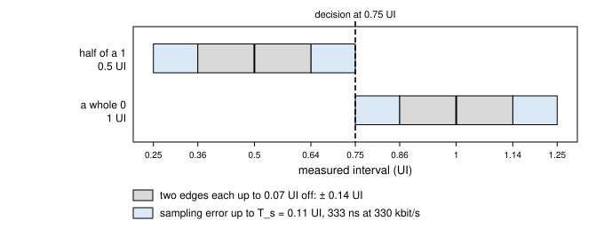
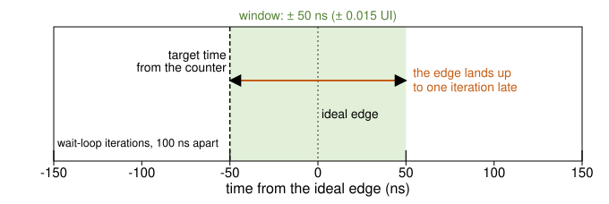
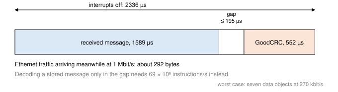

.. _usbpd-software:

Processor requirements
======================

The processor time, sampling rate, edge accuracy and reply deadlines that
sending and receiving :term:`USB Power Delivery` messages in software needs,
and the hardware helper that removes each need.

USB Power Delivery runs mostly in software on the RISC-V processor, with
digital helpers only where software cannot meet the timing
(:ref:`req-power-bridging`). The processor core and its clock are open
(:ref:`req-processor`), so each need is given as a function of its
parameters. A core meets an instruction rate when its clock frequency
divided by its average
:wikipedia:`cycles per instruction <Cycles_per_instruction>` on that code is
at least that rate. The USB serial port uses the same method for USB data
(:doc:`/usb-serial/software-cost`).

The instruction counts are estimates for hand-written
:wikipedia:`assembly <Assembly_language>` in RV32I, the 32-bit base RISC-V
instruction set (:std:`RISC-V ISA <riscv-unpriv>`), to be confirmed by
implementation.

Software-only design
--------------------

The minimum hardware per port is the analogue front end
(:ref:`usbpd-analogue`), connected to plain bits that the processor reads and
writes:

* outputs: Rp level and enable, Rd enable, VCONN enable for each CC pin,
  driver enable, driver data and comparator threshold selection;
* inputs: the :term:`comparator` outputs.

:numref:`fig-usbpd-register-bits` shows these bits between the front end
and the processor.

.. graphviz:: register-bits.dot
   :name: fig-usbpd-register-bits
   :caption: The plain input and output bits of one port in the software-only
             design.
   :alt: Block diagram. Output bits for the Rp level and enable, the Rd
         enable, the VCONN enable for each CC pin, the driver enable and
         data, and the comparator threshold select drive the Rp current
         sources, Rd, the VCONN switches, the BMC driver and the
         comparators. The comparator outputs come back as input bits. The
         processor reads and writes all the bits and does the BMC, 4b5b and
         CRC-32 coding, GoodCRC, timers, state machines and protocol.

Software does the rest: :term:`BMC` encoding and decoding
(:ref:`usbpd-bmc`), :wikipedia:`4B5B` coding, the CRC-32 and the start of
packet (:ref:`usbpd-packets`), the :term:`GoodCRC` reply, retries and all
timers, the attach state machines, and the protocol and policy. The time
limits of this work span five orders of magnitude
(:numref:`tab-usbpd-timescales`).

.. list-table:: The time limits that software has to meet
   :name: tab-usbpd-timescales
   :header-rows: 1
   :widths: 36 30 18 16

   * - Task
     - Spec name
     - Time (µs)
     - PD table
   * - Place a sent edge
     - X1Tx
     - 0.05
     - :pd:`5.6 <Table 5.6>`
   * - Time a received edge
     - X1Rx
     - 0.33
     - :pd:`5.8 <Table 5.8>`
   * - GoodCRC, earliest
     - tInterFrameGap
     - 25
     - :pd:`5.10 <Table 5.10>`
   * - GoodCRC, latest
     - tTransmit
     - 195
     - :pd:`7.10 <Table 7.10>`
   * - Fast role swap signal
     - tFRSwapRx
     - 30 to 50
     - :pd:`10.1 <Table 10.1>`

The first two times are derived from the masks in :ref:`usbpd-receive` and
:ref:`usbpd-transmit`. :ref:`Fast role swap <usbpd-fast-role-swap>` is described with
the role changes. Replies to protocol messages have 15 ms or
more, such as tReceiverResponse (:pd:`Table 7.10`).

.. _usbpd-receive:

Receive timing
--------------

The receiver measures the time between successive edges on the
configuration channel. An interval of about 1 :term:`UI` is a ``0``, and two
intervals of about 0.5 UI are a ``1`` (:ref:`usbpd-bmc`). The decoder
compares each interval with 0.75 UI.

Each received edge may be up to 0.07 UI from its ideal time
(:pd:`Table 5.8`, X1Rx), so an interval may be wrong by twice that. What is
left of the 0.25 UI margin is the largest error the timing may add, and so
the longest sampling period:

.. math::

   T_\text{s,max} = (0.25 - 2 \times x_\text{rx}) \times T_\text{UI,min}

.. list-table::
   :header-rows: 1
   :widths: 22 58 20

   * - Symbol
     - Meaning
     - Unit
   * - :math:`T_\text{s,max}`
     - Longest sampling period, or largest timestamp error
     - s
   * - :math:`x_\text{rx}`
     - Edge displacement a receiver must accept, 0.07 (:pd:`Table 5.8`)
     - UI
   * - :math:`T_\text{UI,min}`
     - Shortest unit interval, 3.03 µs at 330 kbit/s (:pd:`Table 5.9`)
     - s

The relation neglects filter delay and noise. For the values above:

.. math::

   T_\text{s,max} = (0.25 - 2 \times 0.07) \times 3.03\ \mu\text{s}
                  = 333\ \text{ns}

:numref:`fig-usbpd-rx-margin` shows how the edge displacement and the
sampling error together fill the margin on each side of 0.75 UI.

         dashed decision line at 0.75 UI. The half of a 1, nominal 0.5 UI,
         spreads 0.36 to 0.64 UI from edge displacement and 0.25 to 0.75 UI
         with the sampling error added. A whole 0, nominal 1 UI, spreads
         0.86 to 1.14 UI from edge displacement and 0.75 to 1.25 UI with the
         sampling error. The sampling error is up to 0.11 UI, 333 ns at
         330 kbit/s.

   The measured length of a BMC interval: edge displacement of 0.07 UI per
   edge and a sampling error of 0.11 UI just reach the 0.75 UI decision
   point.

A sampled receiver therefore takes at least 3.0 million samples per second.
For reference, the Chromium OS EC firmware times edges with a 2.4 MHz counter,
417 ns per count ([USBPD-CROS-EC]_, ``pd_hw_init_rx()``). That is coarser than
this bound, which assumes both edges of an interval displaced by the full
0.07 UI.

Polling cost
^^^^^^^^^^^^

With only a plain input bit, the processor reads the comparator in a
:wikipedia:`polling <Polling_(computer_science)>` loop, and the time of one
loop iteration is the sampling period. At each change it reads a counter,
classifies the interval and updates the decoder
(:numref:`tab-usbpd-poll-instr`).

.. list-table:: Estimated instructions for receiving in software
   :name: tab-usbpd-poll-instr
   :header-rows: 1
   :widths: 56 22 22

   * - Work
     - Instructions
     - Done once per
   * - Load the input word, compare and branch back
     - 2
     - sample
   * - Read the counter, subtract, compare with 0.75 UI, update state
     - 10
     - edge
   * - Shift the bit into the symbol, count bits
     - 4
     - bit
   * - Look up the 4B5B code, update the CRC-32
     - 16
     - symbol of 5 bits

The instruction rate needed while a message arrives is:

.. math::

   R_\text{poll} = \frac{k_\text{poll}}{T_\text{s}}
     + f_\text{edge} \times N_\text{edge}
     + f_\text{bit} \times N_\text{bit}

.. list-table::
   :header-rows: 1
   :widths: 22 58 20

   * - Symbol
     - Meaning
     - Unit
   * - :math:`R_\text{poll}`
     - Instruction rate needed to receive by polling
     - instructions/s
   * - :math:`k_\text{poll}`
     - Instructions in one poll iteration, 2 (estimate)
     - instructions
   * - :math:`T_\text{s}`
     - Sampling period, at most :math:`T_\text{s,max}`
     - s
   * - :math:`f_\text{edge}`
     - Edge rate, at most twice the bit rate (all ``1`` bits)
     - edges/s
   * - :math:`N_\text{edge}`
     - Instructions per edge, 10 (estimate)
     - instructions
   * - :math:`f_\text{bit}`
     - Bit rate, at most 330 kbit/s (:pd:`Table 5.9`)
     - bit/s
   * - :math:`N_\text{bit}`
     - Instructions per bit, 4 plus 16 per 5-bit symbol, 7.2 (estimate)
     - instructions

The relation counts poll iterations during the edge work too, so it slightly
overestimates. For :math:`T_\text{s}` = 333 ns, :math:`f_\text{bit}` =
330 kbit/s and :math:`f_\text{edge}` = 660 000 edges/s:

.. math::

   R_\text{poll}
     &= \frac{2}{333\ \text{ns}} \\
     &\quad + 660\,000\ \text{s}^{-1} \times 10 \\
     &\quad + 330\,000\ \text{s}^{-1} \times 7.2 \\
     &= 15.0 \times 10^{6}\ \text{instructions/s}

That is 45.4 instructions per bit (estimate). Any pause in the loop adds to
the timing error, so :math:`T_\text{s}` plus the longest pause must stay
below 333 ns. Interrupts stay off from the first edge of a message to the end
of the GoodCRC reply (:ref:`usbpd-goodcrc-deadline`). For reference, PicoRV32
takes 5 clock cycles for a load and 5 for a taken branch
([USBPD-PICORV32]_, "Cycles per Instruction Performance"). Its poll iteration
of 10 cycles takes at most 333 ns with a clock of 30 MHz or more.

Interrupt per edge
^^^^^^^^^^^^^^^^^^

An :wikipedia:`interrupt <Interrupt>` on each comparator edge removes the
polling between edges. Each edge then costs the interrupt entry and exit plus
the edge work:

.. math::

   R_\text{irq} = f_\text{edge} \times (N_\text{irq} + N_\text{edge})
     + f_\text{bit} \times N_\text{bit}

.. list-table::
   :header-rows: 1
   :widths: 22 58 20

   * - Symbol
     - Meaning
     - Unit
   * - :math:`R_\text{irq}`
     - Instruction rate needed to receive with an interrupt per edge
     - instructions/s
   * - :math:`N_\text{irq}`
     - Instructions to enter and leave the interrupt handler, saving and
       restoring registers
     - instructions

For :math:`N_\text{irq}` = 30 (estimate), at the rates above:

.. math::

   R_\text{irq}
     &= 660\,000\ \text{s}^{-1} \times (30 + 10) \\
     &\quad + 330\,000\ \text{s}^{-1} \times 7.2 \\
     &= 28.8 \times 10^{6}\ \text{instructions/s}

That is 87.2 instructions per bit. Interrupts cost less than polling when the
overhead is below the polling cost per edge:

.. math::

   N_\text{irq} &< \frac{k_\text{poll}}{T_\text{s} \times f_\text{edge}} \\
     &= \frac{2}{333\ \text{ns} \times 660\,000\ \text{s}^{-1}} \\
     &= 9.1

On a core where the load and the branch of the poll loop take longer than
the average instruction, both sides are counted in clock cycles instead. For
reference, PicoRV32's 10-cycle poll iteration gives a break-even of 45 cycles
per edge.

The limit is accuracy rather than cost. The handler reads the counter after
the :wikipedia:`interrupt latency <Interrupt_latency>`, so the timestamp is
only as accurate as the variation in that latency. The variation has to stay
below 333 ns, so no other interrupt may run during a message. For reference,
V-USB receives low-speed USB in software with one edge-triggered interrupt
and no timer or input capture unit ([USBSER-VUSB]_, home page).

.. _usbpd-transmit:

Transmit timing
---------------

The transmit mask leaves 0.015 UI between the ideal edge time and the start
of the inner mask (:pd:`Table 5.6`, X1Tx). Read strictly, each edge has to
cross the mid-level within ± 0.015 UI, which is ± 50 ns at the nominal
300 kbit/s. This figure is a target derived from the mask, to be confirmed
by measuring a :ref:`transmitter <usbpd-transmitter>` against it. Computing
each edge time from a counter, rather than counting loop iterations, keeps
the average bit rate within the 0.25 % pBitRate limit (:pd:`Table 5.10`).

Counter wait loop
^^^^^^^^^^^^^^^^^

The processor computes the next edge time, waits in a
:wikipedia:`busy-wait <Busy_waiting>` loop until a counter reaches it, and
writes the output. The edge comes late by up to one loop iteration, so the
iteration must fit in the 100 ns window (:numref:`fig-usbpd-tx-edge`):

         window runs from -50 to 50 ns, plus or minus 0.015 UI. The target
         time from the counter is at -50 ns; wait-loop iterations 100 ns
         apart make the edge land anywhere up to one iteration later, from
         -50 to 50 ns.

   A counter wait loop placing a transmitted edge: aimed at the start of
   the window, it lands up to one iteration late.

The rate the wait loop needs is:

.. math::

   R_\text{wait} = \frac{k_\text{wait}}{2 \times x_\text{tx} \times T_\text{UI}}

.. list-table::
   :header-rows: 1
   :widths: 22 58 20

   * - Symbol
     - Meaning
     - Unit
   * - :math:`R_\text{wait}`
     - Instruction rate the core must run the wait loop at
     - instructions/s
   * - :math:`k_\text{wait}`
     - Instructions in one wait iteration: read counter, compare, branch
     - instructions
   * - :math:`x_\text{tx}`
     - Edge placement target, 0.015 (:pd:`Table 5.6`)
     - UI
   * - :math:`T_\text{UI}`
     - Unit interval of the transmitter, 3.33 µs at 300 kbit/s
     - s

The relation leaves no allowance for other edge errors, such as variation in
the driver's delay. For :math:`k_\text{wait}` = 3 (estimate):

.. math::

   R_\text{wait} &= \frac{3}{2 \times 0.015 \times 3.33\ \mu\text{s}} \\
     &= 30 \times 10^{6}\ \text{instructions/s}

That is 100 instructions per bit at 300 kbit/s. The core is busy and
interrupts are off for the whole message, 1430 µs for the longest one
(:ref:`usbpd-durations`).

Cycle-exact code
^^^^^^^^^^^^^^^^

On an in-order core whose instructions each take a fixed, known number of
clock cycles, straight-line code can place every edge an exact number of
cycles after the previous one. The edge error is then the clock's own
:wikipedia:`jitter <Jitter>`. This is :wikipedia:`bit banging <Bit_banging>`
with counted cycles. It needs:

* a half UI that is a whole number of clock cycles, giving a bit rate within
  270 kbit/s to 330 kbit/s (:pd:`Table 5.9`);
* both paths of every data-dependent branch padded to the same number of
  cycles;
* no :wikipedia:`cache <CPU_cache>` misses, memory wait states or interrupts
  during the message;
* the work of each half UI done within that half UI, about 15.2 instructions
  per bit in total (estimate).

At 300 kbit/s the useful work is :math:`4.6 \times 10^{6}` instructions/s,
but the core is occupied for the whole message. For reference, V-USB sends
and receives low-speed USB, 1.5 Mbit/s, in software on AVR microcontrollers
clocked at 12 MHz to 20 MHz ([USBSER-VUSB]_, home page). That is 8 to
13 clock cycles per bit.

.. _usbpd-goodcrc-deadline:

GoodCRC deadline
----------------

After the last bit of a received message, the receiver starts its GoodCRC
reply no sooner than tInterFrameGap, 25 µs (:pd:`Table 5.10`), and no later
than tTransmit, 195 µs (:pd:`Section 7.31.1`, :pd:`Table 7.10`). The limit is
the same as source and as sink (:ref:`usbpd-goodcrc`).

The work after the message is small if the CRC is updated during reception.
Checking it is then one comparison with the fixed remainder
(:ref:`usbpd-crc`), and the GoodCRC packet for each of the eight MessageID
values can be prepared in advance. That is an estimated 30 instructions, an
average of :math:`30 / 195\ \mu\text{s} = 0.15 \times 10^{6}` instructions/s.
The need is latency rather than rate: the processor must be free to start
the reply within 195 µs.

If hardware stores the edge times of a whole message and software decodes
them only after its end, all the decoding falls inside the deadline:

.. math::

   R_\text{decode} = \frac{n_\text{bits} \times
     (2 \times N_\text{ts} + N_\text{bit})}{t_\text{Transmit}}

.. list-table::
   :header-rows: 1
   :widths: 22 58 20

   * - Symbol
     - Meaning
     - Unit
   * - :math:`R_\text{decode}`
     - Instruction rate needed to decode a stored message in time
     - instructions/s
   * - :math:`n_\text{bits}`
     - Bits in the message, 429 for seven data objects
       (:ref:`usbpd-durations`)
     - bits
   * - :math:`N_\text{ts}`
     - Instructions to read and classify one stored edge time, 12 (estimate)
     - instructions
   * - :math:`t_\text{Transmit}`
     - Latest start of the GoodCRC, 195 µs (:pd:`Table 7.10`)
     - s

The relation assumes two edges per bit, the worst case. For 429 bits:

.. math::

   R_\text{decode}
     &= \frac{429 \times (2 \times 12 + 7.2)}{195\ \mu\text{s}} \\
     &= 69 \times 10^{6}\ \text{instructions/s}

Decoding while the message arrives spreads the same work over the message.
For reference, the Chromium OS EC firmware waits on the
:wikipedia:`direct memory access <Direct_memory_access>` transfer that stores
the edge times, and decodes each interval as soon as it arrives
([USBPD-CROS-EC]_, ``wait_bits()`` and ``pd_dequeue_bits()``).

Processor busy time
^^^^^^^^^^^^^^^^^^^

With polled receive and a bit-banged reply, the processor is busy from the
first edge of a message to the end of its GoodCRC:

.. math::

   t_\text{busy} = t_\text{msg} + t_\text{Transmit} + t_\text{GoodCRC}

.. list-table::
   :header-rows: 1
   :widths: 22 58 20

   * - Symbol
     - Meaning
     - Unit
   * - :math:`t_\text{busy}`
     - Time interrupts are off for one received message
     - s
   * - :math:`t_\text{msg}`
     - Duration of the received message
     - s
   * - :math:`t_\text{GoodCRC}`
     - Duration of the GoodCRC reply
     - s

The worst case is a message of seven data objects at the slowest bit rate,
270 kbit/s: 429 bits take 1589 µs, and the 149-bit GoodCRC takes 552 µs
(:ref:`usbpd-durations`):

.. math::

   t_\text{busy} = 1589\ \mu\text{s} + 195\ \mu\text{s} + 552\ \mu\text{s}
                 = 2336\ \mu\text{s}

:numref:`fig-usbpd-busy-time` shows this busy time.

         1589 µs, a gap of at most 195 µs, and a GoodCRC of 552 µs. About
         292 bytes of Ethernet traffic arrive meanwhile at 1 Mbit/s.
         Decoding a stored message only in the gap would need 69 × 10⁶
         instructions/s instead.

   The time a polling processor is busy with the longest message and its
   reply, at 270 kbit/s.

During that time the processor does not service the Ethernet frame buffers or
the transceiver configuration interface (:ref:`arch-microcontroller`,
:ref:`arch-config-interface`). Forwarding between the Ethernet ports is in
hardware and continues. The processor's network traffic is below 1 Mbit/s
(:ref:`req-processor`), so on average
:math:`1\ \text{Mbit/s} \times 2.336\ \text{ms} = 2336\ \text{bit}`, or
292 bytes, arrive during one busy time. A burst can arrive faster.

A frame that arrives when all receive buffer slots are full is lost.
:wikipedia:`TCP <Transmission_Control_Protocol>` resends lost data.
:wikipedia:`UDP <User_Datagram_Protocol>`,
:wikipedia:`ARP <Address_Resolution_Protocol>` and :term:`LLDP` do not: a
lost ARP request goes unanswered until the asking host tries again, and a
lost LLDP frame is replaced only by the neighbour's next one
(:std:`802.1AB`).

USB data on the USB serial port competes for the same processor time
(:doc:`/usb-serial/software-cost`). In its baseline it also keeps interrupts
off from the start of each packet to the end of the reply. Either protocol
can keep interrupts off for a whole message only if the other has no shorter
deadline.

.. _usbpd-software-two-ports:

Software for two ports
----------------------

With two ports, messages can arrive on both at once, because each port's
partner decides when it transmits. A source sets with its Rp value whether
its sink may start an exchange (:pd:`Section 5.2.2`), but it still has to
answer every message within the deadlines above. Sharing power between the
ports is described in :ref:`usbpd-two-ports`.

A single polling loop can read both comparators in one input word. In
:math:`R_\text{poll}` the poll term stays the same and the edge and bit terms
double, which with the values above gives
:math:`R_\text{poll,2} = 24.0 \times 10^{6}` instructions/s, or 72.6 per bit
(estimate). Here :math:`R_\text{poll,2}` is the polling rate for two ports.

A merged loop can also transmit on one port while it receives on the other.
Each iteration reads the comparators and checks the counter against the next
transmit edge time. The iteration, with the 10 instructions of work for a
received edge, has to fit in the 100 ns transmit window. At 4 instructions
per iteration (estimate), that needs
:math:`(4 + 10) / 100\ \text{ns} = 140 \times 10^{6}` instructions/s.
Spreading the edge work over several iterations lowers this towards
:math:`4 / 100\ \text{ns} = 40 \times 10^{6}` instructions/s.

The third option is to serve one port at a time and let the other port's
partner retry. A sender that receives no GoodCRC within tReceive, 0.9 ms to
1.1 ms, sends the message again, up to nRetryCount = 2 times
(:pd:`Table 7.10`, :pd:`Table 7.12`, :pd:`Section 7.31.1`). Each collision
then costs about 1 ms (:numref:`fig-usbpd-two-port-retry`). Cable plugs do
not retry, so a lost message from a
cable is not sent again (:pd:`Section 7.31.1`).

.. wavedrom::
   :caption: Serving one port at a time: a message on port B that arrives
             while port A is served goes unanswered and is retried,
             schematic and not to scale.
   :name: fig-usbpd-two-port-retry
   :alt: Timing diagram. A message arrives on port A and the processor
         answers it with GoodCRC. A message on port B arrives during port
         A's message and is not answered. After tReceive, 0.9 to 1.1 ms,
         port B's partner sends it again, and the processor answers the
         retry with GoodCRC.

   {"signal": [
     {"name": "port A in", "wave": "z=...z........", "data": ["message"]},
     {"name": "port A out", "wave": "z.....=.z.....", "data": ["GoodCRC"]},
     {"name": "port B in", "wave": "z.=...z...=.z.", "data": ["not answered", "retry"]},
     {"name": "port B timer", "wave": "x.....=...x...", "data": ["tReceive 0.9–1.1 ms"]},
     {"name": "port B out", "wave": "z...........=.", "data": ["GoodCRC"]}
   ],
   "config": {"hscale": 1}}

.. _usbpd-helpers:

Hardware helpers
----------------

The helpers below are generic microcontroller timer and serial features.
None is specific to USB. :numref:`fig-usbpd-helpers` shows where each one
sits between the analogue front end and the processor.

.. graphviz:: helpers.dot
   :name: fig-usbpd-helpers
   :caption: The hardware helpers between the CC front end and the
             processor; the dashed path is a USB-specific helper.
   :alt: Block diagram. The CC comparator's edges go to a capture register
         that copies a free-running counter; the timestamps pass through a
         FIFO of depth D to the RISC-V processor. The processor sends edge
         times to a compare register or FIFO, or a prepared message to a
         shift register clocked at twice the bit rate; either drives the
         BMC driver's data input. A dashed path shows a USB-specific helper
         that decodes BMC, 4b5b and the CRC from the comparator, sends
         GoodCRC to the driver by itself and passes messages to the
         processor.

Input capture
^^^^^^^^^^^^^

:term:`Input capture` copies a free-running counter on each edge of an
input, giving the edge a timestamp in hardware ([USBPD-ATMEGA328P]_,
section 15.6; [USBPD-MSP430]_, section 12.2.4). The accuracy is one counter
period, whatever the processor is doing. With the timestamps in a
:term:`FIFO`, software reads them later, at
:math:`f_\text{edge} \times N_\text{ts} + f_\text{bit} \times N_\text{bit}
= 10.3 \times 10^{6}` instructions/s, or 31.2 per bit (estimate).
Interrupts can stay on as long as the FIFO does not overflow:

.. math::

   t_\text{lat,max} = D \times \frac{T_\text{UI,min}}{2}

.. list-table::
   :header-rows: 1
   :widths: 22 58 20

   * - Symbol
     - Meaning
     - Unit
   * - :math:`t_\text{lat,max}`
     - Longest time software may leave the FIFO unread
     - s
   * - :math:`D`
     - FIFO depth
     - entries

The relation takes the shortest interval between edges, half of the
shortest UI. For :math:`D` = 16:

.. math::

   t_\text{lat,max} = 16 \times 1.515\ \mu\text{s} = 24.2\ \mu\text{s}

Depths of 8 and 32 give 12.1 µs and 48.5 µs. A direct memory access channel
can move the timestamps to memory instead, which removes the depth limit.
For reference, the Chromium OS EC firmware for STM32 microcontrollers uses
timer input capture with direct memory access for receive
([USBPD-CROS-EC]_, ``pd_hw_init_rx()`` and ``pd_rx_start()``).

Output compare
^^^^^^^^^^^^^^

:term:`Output compare` changes an output when a counter reaches the value
in a compare register ([USBPD-ATMEGA328P]_, section 15.7; [USBPD-MSP430]_,
section 12.2.4). Each edge lands on a counter period, whatever the processor
is doing. Software loads the next edge time within half a UI, 1.67 µs at
300 kbit/s, or several ahead with a FIFO of compare values. At an estimated
6 instructions per edge plus the bit work, that is 19.2 instructions per bit,
or :math:`5.8 \times 10^{6}` instructions/s.

Shift register
^^^^^^^^^^^^^^

A :wikipedia:`shift register <Shift_register>` clocked at twice the bit rate
sends one BMC half bit per clock from memory. Software encodes the whole
message beforehand, about 3100 instructions for 429 bits at 7.2 per bit
(estimate). The edges are then as accurate as the shift clock. For
reference, the Chromium OS EC firmware transmits from a
:wikipedia:`serial peripheral interface <Serial_Peripheral_Interface>`
unit fed by direct memory access and clocked by a timer output at twice the
bit rate ([USBPD-CROS-EC]_, ``pd_hw_init()``, ``pd_write_sym()`` and
``pd_start_tx()``).

CRC-32 and protocol
^^^^^^^^^^^^^^^^^^^

The CRC-32 is updated one 4-bit nibble at a time from a 16-entry
:wikipedia:`table <Lookup_table>` of 64 bytes, which the 16 instructions per
symbol above include. The carry-less multiply instructions of the RISC-V Zbc
extension (:std:`RISC-V ISA <riscv-unpriv>`, see
:wikipedia:`carry-less product <Carry-less_product>`) are an option for it.

USB-specific helpers go further. For reference, the onsemi FUSB302B decodes
BMC and 4B5B, checks the CRC, holds messages in a FIFO, and sends the GoodCRC
reply by itself ([USBPD-FUSB302B]_, figure 12 and "PD Automatic Receive
GoodCRC"); the dashed path of :numref:`fig-usbpd-helpers` is such a
helper. An automatic GoodCRC removes the 195 µs deadline from software.

Method comparison
^^^^^^^^^^^^^^^^^

:numref:`tab-usbpd-methods` gives each method's cost with the estimates
above: instructions per bit and per second, the time other interrupts are
masked for one message, and what sets the timing error of an edge. Receive
rows are at 330 kbit/s and transmit rows at 300 kbit/s.

.. list-table:: Instructions each receive and transmit method needs
   (estimates)
   :name: tab-usbpd-methods
   :header-rows: 1
   :widths: 28 16 16 18 22

   * - Method
     - Per bit
     - 10\ :sup:`6` per s
     - Masked (µs)
     - Timing error
   * - Receive, polling
     - 45.4
     - 15.0
     - 2336
     - Poll period
   * - Receive, interrupt per edge
     - 87.2
     - 28.8
     - 2336
     - Latency
   * - Receive, input capture
     - 31.2
     - 10.3
     - none
     - Counter
   * - Two ports, polling
     - 72.6
     - 24.0
     - 2336
     - Poll period
   * - Two ports, merged loop
     - 424
     - 140
     - 2336
     - Loop time
   * - Transmit, counter wait loop
     - 100
     - 30
     - 1430
     - Loop time
   * - Transmit, cycle-exact code
     - 15.2
     - 4.6
     - 1430
     - Clock jitter
   * - Transmit, output compare
     - 19.2
     - 5.8
     - none
     - Counter
   * - Transmit, shift register
     - 7.2
     - 2.2
     - none
     - Shift clock

For polling and wait loops, the rate is what the core must reach while the
loop runs, and the core does nothing else then. The interrupt per edge row
keeps only the edge interrupt on, and uses an overhead of 30 instructions.

Helper for each need
^^^^^^^^^^^^^^^^^^^^

Each need is met in software when the core reaches the rate or latency
given here, and calls for a helper when it does not:

Receive timing
   Software polling, if a poll iteration takes at most 333 ns less any pause
   and the core can keep interrupts off for 2.3 ms per message. Otherwise
   input capture, with a FIFO depth set by the interrupt latency.
Transmit timing
   Cycle-exact code on a core with fixed instruction timing, or a wait loop
   whose iteration takes at most 100 ns. Otherwise output compare, or a
   shift register.
GoodCRC deadline
   Software, if the processor can always start the reply within 195 µs of
   the message's end. Otherwise an automatic GoodCRC.
Two ports
   A merged loop, if the core reaches its rate. Otherwise one input capture
   and one output compare per port, or retries.

Open questions
--------------

* Which helpers to build: input capture, output compare, a shift register,
  direct memory access or an automatic GoodCRC, per port. This follows from
  the processor core and its clock (:ref:`req-processor`).
* The edge-placement target of ± 50 ns, to be confirmed by measuring a
  :ref:`transmitter <usbpd-transmitter>` against the mask.
* The instruction counts and the interrupt overhead, by writing the receive,
  transmit and reply code and running it on the chosen core or a model of
  it.
* Whether two ports are served at once, or one at a time with retries.
* How processor time is shared between USB Power Delivery, USB data and
  Ethernet frames, and how many receive buffer slots the Ethernet side
  needs.
