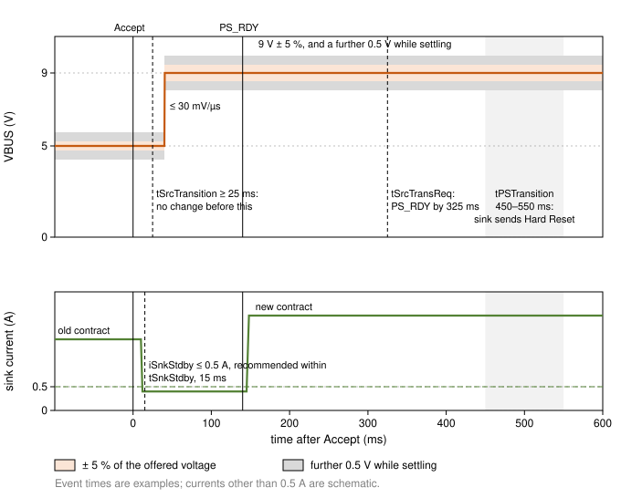
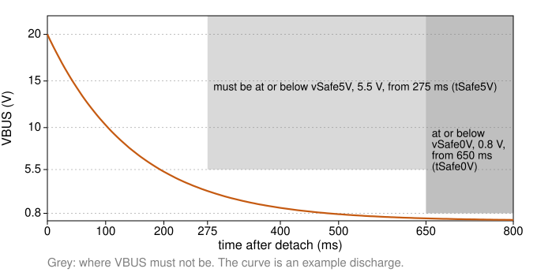

.. _usbpd-source-sink:

Source and sink duties
======================

The steps a :term:`source` and a :term:`sink` each follow to set up and keep
a power :term:`contract`, and how evampire's software builds its offer from
the :ref:`power budget <power-budget>`.

The message exchange itself, and its time limits, are on
:doc:`negotiation`.

Source side
-----------

.. _usbpd-switchable-rp:

Collision avoidance with Rp
^^^^^^^^^^^^^^^^^^^^^^^^^^^

A source presents a pull-up, :term:`Rp`, on the :term:`CC` wire. Its value
has two meanings (:ref:`usbpd-resistor-advertisement`):

Before a contract
   Rp states the current the sink may draw at 5 V: default USB power,
   1.5 A or 3.0 A. The source must supply that current, and its first
   Source_Capabilities must offer at least that much at 5 V
   (:typec:`Section 4.5.2.2.9.1`; :pd:`Section 3.2.1`, item 5).
During a contract
   Rp no longer sets a current. It controls which end may start a message
   exchange. The 3.0 A value, *SinkTxOK*, lets the sink start one. The 1.5 A
   value, *SinkTxNG*, reserves the line for the source
   (:pd:`Section 5.2.2`, :pd:`Table 5.1`; :pd:`Section 7.2`).

After changing Rp from SinkTxOK to SinkTxNG, the source waits *tSinkTx*
(16 ms to 20 ms) before it starts an exchange, so that a message the sink
has already started can finish (:pd:`Section 7.31.13.1`,
:pd:`Table 7.10`). A source therefore switches Rp during normal operation,
and its Rp circuit must provide the 1.5 A and 3.0 A levels whatever power
it offers. :numref:`fig-usbpd-sinktx` shows the order.

.. wavedrom::
   :caption: A source reserving the line by changing Rp from SinkTxOK to
             SinkTxNG, schematic and not to scale.
   :name: fig-usbpd-sinktx
   :alt: Timing diagram. The source's Rp changes from SinkTxOK, the 3.0 A
         value with the CC wire idle at about 1.7 V, to SinkTxNG, the 1.5 A
         value with the CC wire idle at about 0.9 V. A message the sink had
         already started is allowed to finish. The source waits tSinkTx,
         16 to 20 ms, from the change before it starts its own exchange.

   {"signal": [
     {"name": "source Rp", "wave": "=.....=...............",
      "data": ["SinkTxOK, about 1.7 V", "SinkTxNG, about 0.9 V"]},
     {"name": "sink message", "wave": "z.=......z............",
      "data": ["already started: finishes"]},
     {"name": "source timer", "wave": "x.....=.......x.......",
      "data": ["tSinkTx 16–20 ms"]},
     {"name": "source message", "wave": "z.............=....z..",
      "data": ["source's exchange"]}
   ],
   "config": {"hscale": 1}}

Rp can be a resistor to a supply or a
:wikipedia:`current source <Current_source>`: 80 µA, 180 µA or 330 µA from
any supply between 1.7 V and 5.5 V (:typec:`Table 4-27`). A current source
suits a chip. The three currents come from one reference through switched
:wikipedia:`current mirrors <Current_mirror>`, and the supply can be any
the chip has in that range. The resistor options need a 5 V or 3.3 V supply
and, for the 1.5 A and 3.0 A levels, resistors within ± 5 %
(:typec:`Table 4-27`). The circuit is on :ref:`usbpd-rp-sources`.

.. _usbpd-source-sequence:

Source sequence
^^^^^^^^^^^^^^^

After attach (the Attached.SRC state, :ref:`usbpd-attach-sequence`), the
source:

#. turns :term:`VBUS` on to *vSafe5V*, 4.75 V to 5.5 V (:pd:`Table 4.9`),
   within *tVBUSON*, 275 ms (:typec:`Table 4-32`), and supplies
   :term:`VCONN` if the cable needs it (:ref:`usbpd-vconn`);
#. starts no message until VBUS has reached vSafe5V
   (:typec:`Section 4.5.2.2.9.1`);
#. checks the cable with :term:`Discover Identity` if it will offer more
   than 3 A or EPR voltages (:ref:`usbpd-discover-identity`);
#. sends Source_Capabilities, and repeats it until it is acknowledged
   (:pd:`Section 7.31.3`);
#. checks the Request and answers Accept, Reject or Wait
   (:pd:`Section 7.9.2`);
#. after Accept, waits, changes VBUS and sends PS_RDY
   (:pd:`Section 4.5.1.1`).

The time limit on each step is in :numref:`tab-usbpd-timing-contract`
(:ref:`usbpd-timing`). The source checks that the Request names an offered
PDO and asks for no more than its maximum current; otherwise it answers
Reject (:pd:`Section 7.9.2`). It answers Wait only when a contract already
exists and it can meet the request later (:pd:`Section 7.9.2.2`).

The new voltage must be within ± 5 % of the offered value, plus 0.5 V while
it settles (*vSrcNew*, *vSrcValid*, :pd:`Table 4.7`). It must change at no
more than 30 mV/µs (*vSrcSlewPos*, *vSrcSlewNeg*, :pd:`Table 4.7`). This
:wikipedia:`slew rate <Slew_rate>` limit keeps the current that charges the
sink's input capacitors within a 3 A connector rating, for up to 100 µF of
sink capacitance (:pd:`Table 4.7`). :numref:`fig-usbpd-vbus-transition`
shows these limits on a change from 5 V to 9 V, with the sink's side
from :ref:`usbpd-sink-sequence`; the order of messages is in
:numref:`fig-usbpd-negotiation`.

         VBUS stays at 5 V inside its 5 % band until at least 25 ms after
         Accept (tSrcTransition), then rises to 9 V at no more than
         30 mV/µs and stays inside 9 V plus or minus 5 %, with a further
         0.5 V while settling. PS_RDY comes at an example time of 140 ms,
         before the 325 ms limit tSrcTransReq. A shaded region from 450 to
         550 ms marks tPSTransition, after which the sink sends Hard Reset.
         Bottom: the sink current falls from the old contract to at most
         0.5 A, iSnkStdby, within the recommended 15 ms, stays there until
         PS_RDY, then rises to the new contract.

   VBUS and the sink current when the contract changes from 5 V to 9 V;
   event times are examples within the limits.

The source needs at least 10 µF of output capacitance, or 120 µF when the
port is powered from a supply shared with other ports (*cSrcBulk*,
*cSrcBulkShared*, :pd:`Table 4.7`). A dual-role port that is not supplying
VBUS may present at most 10 µF on VBUS (:typec:`Table 4-2`). Any larger
capacitance therefore sits behind the source switch
(:ref:`usbpd-power-path`).

.. _usbpd-building-offer:

Offer from the power budget
^^^^^^^^^^^^^^^^^^^^^^^^^^^

The software on the processor decides what to offer from the
:ref:`power budget <power-budget>`. The power it offers on one USB port
cannot exceed the power left for all output ports
(:ref:`power-translation`):

.. math::

   P_\text{offer} \le P_\text{out}

   P_\text{out} = P_\text{in} \times \eta - P_\text{board}

.. list-table::
   :header-rows: 1
   :widths: 20 60 20

   * - Symbol
     - Meaning
     - Unit
   * - :math:`P_\text{offer}`
     - Power offered on this USB port, the Port Present PDP
     - W
   * - :math:`P_\text{out}`
     - Power left for all output ports
     - W
   * - :math:`P_\text{in}`
     - Power granted on the input port, for example the Power over
       Ethernet class power
     - W
   * - :math:`\eta`
     - Efficiency of the converters from the input to the USB port
     - fraction
   * - :math:`P_\text{board}`
     - Power the board itself uses
     - W

*Port Present PDP* is the specification's name for the power a source can
supply at present, in 1 W steps (:pd:`Table 6.29`). With one output port,
:math:`P_\text{offer} = P_\text{out}`; with more, the software shares
:math:`P_\text{out}` between them (:ref:`power-sharing`,
:ref:`usbpd-sharing`).

The equation neglects the loss in the USB cable, because the offered
voltage is measured at the source's connector (*vSrcNew*,
:pd:`Table 4.7`). It treats :math:`\eta` as a constant, although a
converter's efficiency changes with its load; the converter pages give the
ranges (:ref:`conv-efficiency`).

For example, a class 4 Power over Ethernet grant of 25.5 W, with
:math:`\eta` = 0.900 and :math:`P_\text{board}` = 3.10 W, both assumed for
illustration, gives:

.. math::

   P_\text{out} = 25.5\ \text{W} \times 0.900 - 3.10\ \text{W} = 19.9\ \text{W}

The source reports this as 19 W, rounded down to 1 W (:pd:`Table 6.29`).
Which voltages and currents a source of a given Port Present PDP must offer
is set by the specification's power rules; :doc:`power-translation` gives
the rules and worked examples for each Power over Ethernet class.

Offer reduction
^^^^^^^^^^^^^^^

When the input power changes, the source sends new Source_Capabilities, and
the sink must request again. Before lowering its offer, the specification
recommends that the source sends an Alert, a data message that warns the
sink of an event. It sends it up to *tReducePowerAlert*, 2.0 s to 2.4 s,
before the reduced capabilities (:pd:`Section 6.4.5.5`, :pd:`Table 4.7`).
:numref:`fig-usbpd-lower-offer` shows the sequence.

The input can fall faster than that, for example when the Power over
Ethernet input is removed. The source then relies on its over-current
protection (:ref:`usbpd-current-limit`) or a :term:`Hard Reset`
(:ref:`usbpd-hard-reset`). Keep a margin in the
:ref:`power budget <power-budget>` for this case.

.. _usbpd-current-limit:

Over-current protection
^^^^^^^^^^^^^^^^^^^^^^^

A source must have over-current protection that does not trip while the
sink draws a current that the contract allows (:pd:`Section 4.1.5.1`). The
specification recommends that a source whose protection trips sends Hard
Reset, followed by an Alert. A port that shuts down from above 5 V must
bring VBUS down to vSafe5V within *tSafe5V*, 275 ms, and to vSafe0V within
*tSafe0V*, 650 ms (:pd:`Section 4.1.5.1`, :pd:`Table 4.9`).

On evampire the software sets the current limit of each port and the
hardware enforces it (:ref:`req-power-control`, :ref:`usbpd-limiting`). The
limit sits in the source power path (:ref:`usbpd-power-path`).

.. _usbpd-discharge:

VBUS discharge
^^^^^^^^^^^^^^

After detach, a source must bring VBUS below vSafe5V (maximum) within
tSafe5V, 275 ms, and to vSafe0V, at most 0.8 V, within tSafe0V, 650 ms
(:pd:`Section 4.1.5.5`, :pd:`Table 4.9`; :numref:`fig-usbpd-vbus-discharge`).
It also discharges VBUS before
attaching (the AttachWait.SRC state, :typec:`Section 4.5.2.2.8.1`) and
during a power role swap. A switched load from VBUS to ground, controlled by
the processor, does this (:ref:`usbpd-vbus-sensing`).

         800 ms. Grey regions mark where VBUS must not be: above 5.5 V
         (vSafe5V) from 275 ms, and above 0.8 V (vSafe0V) from 650 ms. An
         example discharge falls from 20 V and stays below both.

   An example discharge of VBUS from 20 V after detach, with the two
   limits.

.. _usbpd-sink-sequence:

Sink side
---------

A sink:

#. presents :term:`Rd` and waits for VBUS (:ref:`usbpd-attach-sequence`);
#. if it uses the 1.5 A or 3.0 A Rp level before a contract, follows every
   change of Rp within *tSinkAdj*, 60 ms (:typec:`Section 4.6.2.1`,
   :typec:`Table 4-32`);
#. waits for Source_Capabilities and chooses one PDO;
#. sends Request within *tReceiverResponse*, 15 ms (:pd:`Section 7.31.2`);
#. after Accept for a higher voltage, cuts its current to *iSnkStdby*,
   500 mA, before the source may start the change 25 ms later, and keeps it
   there until PS_RDY arrives; the specification recommends doing so within
   *tSnkStdby*, 15 ms (:pd:`Section 4.5.1.1`, :pd:`Table 4.8`);
#. during the contract, checks that Rp is at SinkTxOK before it starts a
   message exchange of its own (:pd:`Section 7.2`).

A slow sink does not miss the negotiation. The source repeats
Source_Capabilities up to 50 times, then less often
(:pd:`Section 7.32.4`). A sink that sees no Source_Capabilities within
*tTypeCSinkWaitCap* may send Hard Reset to restart the source
(:pd:`Section 7.32.4`). Do not send this Hard Reset from a board powered
only from VBUS: the source answers a Hard Reset by switching VBUS off
(:ref:`usbpd-hard-reset`).

Open questions
--------------

* How fast the board must react when the Power over Ethernet input is
  reduced or lost, and so how large a margin the power budget keeps for a
  USB source that cannot lower its offer in time.
