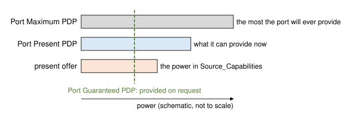

.. _usbpd-two-ports:

Two ports and budget sharing
============================

How a board with two USB Type-C ports uses them together, and how the
software moves power between them while devices stay connected. The number
of USB Type-C ports in each configuration is given in
:ref:`board configurations <tab-power-board-configs>`.

Port role combinations
----------------------

Each USB Type-C port is a :term:`dual-role port`, so with two ports the
board can work in more ways than with one:

* one port as :term:`sink` and the other as :term:`source`, which makes the
  board a USB-to-USB power bridge as well as a USB-to-Ethernet one;
* both ports as sources, sharing the power from
  :term:`Power over Ethernet` or from the other input;
* both ports as sinks, for example two chargers feeding one Ethernet output.

:numref:`fig-usbpd-two-port-roles` shows the three combinations.

.. graphviz:: two-port-roles.dot
   :name: fig-usbpd-two-port-roles
   :caption: The three ways a board can use two dual-role USB Type-C ports;
             bold arrows show the direction of power.
   :alt: Three panels, each with USB port 1 and USB port 2 above the board
         power bus and an Ethernet port below it. Sink and source: power
         flows from USB port 1 into the bus and out of USB port 2, with an
         optional Ethernet output. Both sources: power flows from the Power
         over Ethernet input into the bus and out of both USB ports. Both
         sinks: power flows from both USB ports into the bus and out of the
         Ethernet output.

Whenever two or more ports supply power at once, their offers together must
stay within the :ref:`power budget <power-budget>`. The rule and how the
software applies it on every kind of port are on
:ref:`sharing the budget <power-sharing>`. This page covers what USB Power
Delivery allows when the software changes a USB port's share.

.. _usbpd-sharing:

Moving power between ports
--------------------------

A source can change what it offers while a device is attached, by sending a
new Source_Capabilities message. The sink must then answer with a new
Request, because a Request always refers to the most recent offer
(:pd:`Section 7.9.2`). The new contract is set up with the same exchange as
the first one (see :ref:`usbpd-negotiation`).

Managed Capability Port
^^^^^^^^^^^^^^^^^^^^^^^

USB Power Delivery describes every source port by three powers
(:pd:`Section 3.2`; :pd:`Table 6.29 <x>`):

* the *Port Maximum PDP*, the most it will ever provide;
* the *Port Present PDP*, what it can provide at present;
* the power in its present Source_Capabilities, which may be less again.

A *Guaranteed Capability Port* always has Port Present PDP equal to Port
Maximum PDP, apart from faults and cable limits. A
:term:`Managed Capability Port` may set Port Present PDP lower, and may
change it during operation (:pd:`PD Sections 3.2.2 <x>` and :pd:`3.2.3 <x>`).
The port says which kind it is in the Port Type bit of its Source_Info
message (:pd:`Table 6.29`).

Ports that share one supply are Managed Capability Ports by definition
(:typec:`Section 4.8.6`). An evampire source port is one in every board
configuration, because its power depends on the input port and, on a
two-port board, on the other USB port.

A Managed Capability Port may offer less than its Port Present PDP. If the
sink sets the *Capability Mismatch* bit in its Request, asking for more,
the port must then offer the smaller of its Port Present PDP and what the
sink can take (:pd:`Section 3.2.3`, item 5). It must also provide at least
its *Port Guaranteed PDP* when a sink asks for it this way, and while a
contract for the Port Guaranteed PDP is in place it must not reduce its
offer (:pd:`Section 7.26.2.3`). :numref:`fig-usbpd-pdp-nesting` shows how
the powers relate.

         most the port will ever provide, is the longest; Port Present PDP,
         what it can provide now, is shorter; the present offer, the power
         in Source_Capabilities, is shorter again. A dashed line marks the
         Port Guaranteed PDP, which the port provides on request.

   The powers that describe a Managed Capability Port, schematic and not to
   scale.

Lowering an offer
^^^^^^^^^^^^^^^^^

When the software must take power from a port to give it to the other, the
steps on the port that gives it up are:

#. Send an Alert message whose extended event says that the source is about
   to reduce its capabilities, *tReducePowerAlert* (2.0 s to 2.4 s) before
   the new Source_Capabilities. The specification recommends this, so that
   the sink can prepare; if the time is not available, the Alert goes as
   early as possible (:pd:`Section 6.4.5.5`; :pd:`Tables 4.7 <x>` and
   :pd:`6.25 <x>`).
#. Send the reduced Source_Capabilities. The sink requests one of the new
   offers.
#. Accept the Request. If the new current is lower, the sink must reach it
   before the shortest *tSrcTransition* (25 ms) ends, and the source waits
   tSrcTransition before it lowers its current limit
   (:pd:`Section 4.5.1.3`; see :ref:`usbpd-limiting`).
#. Send PS_RDY. From here the port's share is the new, lower offer.

:numref:`fig-usbpd-lower-offer` shows these steps in time, with the
moment the freed power can go to the other port.

.. wavedrom::
   :caption: Lowering the offer on port A to free power for port B,
             schematic and not to scale; the break marks the 2.0 s to 2.4 s
             wait after the Alert.
   :name: fig-usbpd-lower-offer
   :alt: Timing diagram. Port A sends Alert, then after tReducePowerAlert,
         2.0 to 2.4 s, sends Source_Capabilities. The sink answers Request
         within 15 ms and the source answers Accept within 15 ms. The sink
         lowers its current at once; the source lowers its current limit
         only after tSrcTransition, 25 ms after Accept, and sends PS_RDY
         within tSrcTransReq, 325 ms. From the end of tSrcTransition, the
         power budget of port B can be raised.

   {"signal": [
     {"name": "port A messages", "wave": "=..z.|.=....=..=..z...=..z..",
      "data": ["Alert", "Source_Capabilities", "Request", "Accept",
               "PS_RDY"]},
     {"name": "wait", "wave": "=......x....................",
      "data": ["tReducePowerAlert 2.0–2.4 s"]},
     {"name": "timers", "wave": "x...........=..=..=..x......",
      "data": ["≤ 15 ms", "≤ 15 ms", "≥ 25 ms"]},
     {"name": "PS_RDY limit", "wave": "x.................=...x.....",
      "data": ["≤ 325 ms"]},
     {"name": "port A sink current", "wave": "=.................=.........",
      "data": ["old current", "new, lower current"]},
     {"name": "port A source limit", "wave": "=....................=......",
      "data": ["old limit", "new limit"]},
     {"name": "port B budget", "wave": "=....................=......",
      "data": ["old share", "can be raised"]}
   ],
   "config": {"hscale": 1.1}}

Without the Alert, the exchange takes at most about 355 ms: up to 15 ms each
for the Request and the Accept (*tReceiverResponse*), then up to
*tSrcTransReq* (325 ms) to the PS_RDY (:pd:`PD Tables 7.10 <x>` and
:pd:`4.7 <x>`; see :ref:`usbpd-timing`). With the Alert, about 2 s more. The
power freed on this port can go to the other port once the sink has lowered
its current, tSrcTransition after the Accept.

The GotoMin message, which told a sink to drop to a minimum current at
once, is deprecated in PD R3.3: a port that receives one answers
Not_Supported (:pd:`Section 6.3.2`). The
multi-port charger section of the USB Type-C specification still lists
GotoMin as a way to reclaim power (:typec:`Section 4.8.6.2`), but a source
cannot rely on a sink that follows R3.3 acting on it.

Raising an offer or unplugging
^^^^^^^^^^^^^^^^^^^^^^^^^^^^^^

Raising an offer needs no Alert: the source sends the larger
Source_Capabilities and the sink requests again. A sink that wants more
than it was offered sets Capability Mismatch, and the source then offers up
to its Port Present PDP. In a group of shared ports, every port must reach
its maximum or the sink's need within 3 s of such a request
(:typec:`Section 4.8.6.2`).

When a device is unplugged, the source sees the detach on CC and removes
VBUS, reaching vSafe0V within *tSafe0V* (650 ms) (:pd:`Section 4.1.5.5`).
Its share is free once VBUS is off. The software can then raise the offer
on the other port as above. :numref:`fig-usbpd-raise-offer` shows both
cases.

.. wavedrom::
   :caption: Raising an offer after a Capability Mismatch, and freeing a
             port's share when its device is unplugged, schematic and not to
             scale; the break marks a wait.
   :name: fig-usbpd-raise-offer
   :alt: Timing diagram in two parts. Raising: the sink sends a Request with
         Capability Mismatch set; the source sends a larger
         Source_Capabilities, and Request, Accept and PS_RDY follow, within
         3 s in a group of shared ports. Unplugging: port B's CC goes open
         when its device is unplugged; port B's VBUS falls to vSafe0V within
         tSafe0V, 650 ms; port A's offer can then be raised.

   {"signal": [
     ["raise",
      {"name": "messages", "wave": "=.....z|.=.....=..=..=..z...",
       "data": ["Request, Capability Mismatch", "Source_Capabilities",
                "Request", "Accept", "PS_RDY"]},
      {"name": "limit", "wave": "x.....=................x....",
       "data": ["within 3 s in a group of shared ports"]}
     ],
     {},
     ["unplug",
      {"name": "port B CC", "wave": "=..=........................",
       "data": ["Rd", "open: device unplugged"]},
      {"name": "port B VBUS", "wave": "1..=......0.................",
       "data": ["falling"]},
      {"name": "port B timer", "wave": "x..=......x.................",
       "data": ["tSafe0V ≤ 650 ms"]},
      {"name": "port A share", "wave": "=..........=................",
       "data": ["old share", "can be raised"]}
     ]
   ],
   "config": {"hscale": 1}}

The USB Type-C specification gives two example sharing policies for groups
of shared ports: *highest-to-lowest*, which serves the first-connected port
first, and *balanced*, which splits the power equally between connected
ports (:typec:`Table 4-23`). It also requires that a shared port reclaiming
power for a newly attached device uses offers and renegotiation, not a Hard
Reset, ErrorRecovery or the Disabled state (:typec:`Section 4.8.6.1`).

Per-port circuits and shared software
-------------------------------------

Each port needs its own CC circuits, because both ports must present their
terminations and detect attach at the same time, and messages on the two
ports arrive independently (see :ref:`usbpd-analogue`). Slow measurements,
such as attach levels and the VBUS voltage, can share one converter through a
multiplexer. Each port also needs its own power path and its own current
limit (see :ref:`usbpd-monitoring`). :numref:`fig-usbpd-two-port-blocks`
shows which circuits are per port and which are shared.

.. graphviz:: two-port-blocks.dot
   :name: fig-usbpd-two-port-blocks
   :caption: The circuits of a two-port board: per-port power paths and CC
             circuits, a shared ADC and one processor; bold arrows carry
             power.
   :alt: Block diagram. The board power bus connects in both directions to
         a power path and current limit for port A and another for port B,
         each joined to its port connector. Each connector has its own CC
         circuits, linked to the processor. Both connectors also feed slow
         levels to a shared ADC through a multiplexer, which reports to the
         processor, which runs both negotiations.

The processor runs the negotiations on both ports, which can overlap. The
cost of that is worked out in :ref:`usbpd-software-two-ports`.

Open questions
--------------

* Whether a two-port board counts as a USB Type-C multi-port charger. Such a
  charger must offer at least 5 V at 1.5 A on every port, whatever the other
  ports draw (:typec:`Section 4.8.6.1`). Two such ports need 15 W of output
  between them.
* Which sharing policy the software uses between the two USB ports, and
  between a USB port and an Ethernet output.
* Whether the board sends the Alert before reducing an offer, which delays
  the move of power by about 2 s.
