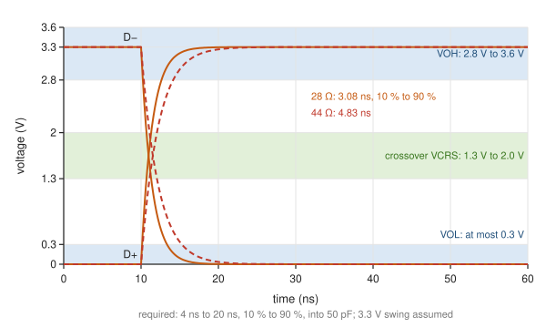
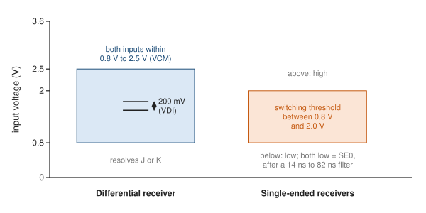

Analogue front end
==================

This page lists the electrical requirements of a full-speed device's D+ and
D− connection from the :std:`USB 2.0 specification <usb2>` [USBSER-USB2]_, and compares
them with the standard I/O cells of the gf180mcu process. Where no standard
cell meets a requirement, it describes the custom options.

:numref:`fig-usbser-frontend` shows the blocks of the front end for one
port.

.. _fig-usbser-frontend:

.. graphviz:: analogue/frontend.dot
   :caption: The analogue front end of one USB port, between the digital
             logic and the D+, D− and VBUS pins.
   :alt: Block diagram: the digital logic drives a pull-up switch and a
         full-speed driver, which connect to the D+ and D− pins; the pins
         feed a differential receiver and single-ended receivers with an
         SE0 filter, which report to the digital logic; a VBUS comparator
         reports whether VBUS is present.
   :align: center

Full-speed driver
-----------------

:numref:`tab-usbser-driver` lists the driver requirements.

.. list-table:: Full-speed driver requirements ([USBSER-USB2]_ section
   7.1.1, section 7.1.2.1, Table 7‑7, Table 7‑9)
   :name: tab-usbser-driver
   :header-rows: 1
   :widths: 55 15 15 15

   * - Parameter
     - Minimum
     - Maximum
     - Unit
   * - Output low voltage, VOL, 1.5 kΩ load to 3.6 V
     - 0.0
     - 0.3
     - V
   * - Output high voltage, VOH, 15 kΩ load to ground
     - 2.8
     - 3.6
     - V
   * - Crossover voltage of D+ and D−, VCRS
     - 1.3
     - 2.0
     - V
   * - Rise and fall time, TFR and TFF, 10 % to 90 %, 50 pF load
     - 4
     - 20
     - ns
   * - Rise time divided by fall time, TFRFM
     - 90
     - 111.11
     - %
   * - Output impedance of each driver, ZDRV, series resistor included
     - 28
     - 44
     - Ω

The driver also has to:

* switch off both outputs (tri-state) between packets, because the same two
  wires carry both directions ([USBSER-USB2]_ section 7.1.1);
* never drive both lines high at once (SE1);
* change monotonically, with its edge rate controlled to limit radio
  emissions ([USBSER-USB2]_ section 7.1.1, section 7.1.2.1);
* survive the stresses described in
  :ref:`Short-circuit and electrostatic discharge protection <usbser-protection>`.

The specification makes the impedance from a CMOS output stage with a
lower impedance plus an external series resistor *RS*
([USBSER-USB2]_ section 7.1.1.1), as in :numref:`fig-usbser-driver`.

.. graphviz:: analogue/driver.dot
   :name: fig-usbser-driver
   :caption: The full-speed driver of one line, with its series resistor
             and the 50 pF test load.
   :alt: Block diagram: inside evampire, the data and output enable drive
         a pre-driver with edge-rate control, which drives an output stage
         with a PMOS to 3.3 V and an NMOS to ground that turns both off for
         tri-state. The output passes a series resistor RS, on chip or on
         the board, to the D+ pin, which is loaded by a 50 pF test load to
         ground. A bracket marks ZDRV, 28 Ω to 44 Ω, as the output stage
         and RS together. D− has the same driver with opposite data.
   :align: center

A driver that is only a resistance charging the 50 pF test load gives an
edge of:

.. math::

   t_{10\text{–}90} = \ln 9 \cdot Z_\text{DRV} \cdot C_\text{L}

.. list-table::
   :header-rows: 1
   :widths: 20 60 20

   * - Symbol
     - Meaning
     - Unit
   * - :math:`t_{10\text{–}90}`
     - Time to move from 10 % to 90 % of the swing
     - ns
   * - :math:`Z_\text{DRV}`
     - Driver output impedance, 28 Ω to 44 Ω
     - Ω
   * - :math:`C_\text{L}`
     - Test load, 50 pF ([USBSER-USB2]_ Figure 7‑9)
     - pF

At 28 Ω, :math:`t_{10\text{–}90} = 2.197 \times 28\ \Omega \times
50\ \text{pF} = 3.08\ \text{ns}`, below the 4 ns minimum; at 44 Ω it is
4.83 ns (:numref:`fig-usbser-driver-waveform`). A driver at the low end of
the impedance range therefore needs its own slew-rate control, which the
specification requires in any case.

         60 ns. D+ rises and D− falls as RC edges into 50 pF, for a 28 Ω
         driver, 3.08 ns from 10 % to 90 %, and a 44 Ω driver, 4.83 ns.
         They cross in the shaded crossover band of 1.3 V to 2.0 V. Shaded
         bands mark VOH of 2.8 V to 3.6 V and VOL of at most 0.3 V. A note
         gives the required 4 ns to 20 ns edge and the assumed 3.3 V swing.
   :align: center

   Edges of a purely resistive driver into the 50 pF test load, against
   the driver's voltage limits.

Receivers
---------

A full-speed device has three receivers ([USBSER-USB2]_ section 7.1.4.1),
shown in :numref:`fig-usbser-frontend`; :numref:`fig-usbser-receiver-levels`
shows their input ranges:

* A *differential receiver*, which decides J or K. It must resolve a
  difference of 200 mV (*VDI*) with both inputs anywhere from 0.8 V to
  2.5 V (*VCM*).
* Two *single-ended receivers*, one per line, with a switching threshold
  between 0.8 V and 2.0 V, recommended with
  :wikipedia:`hysteresis <Schmitt_trigger>`. Together they detect SE0.
* The SE0 decision needs a filter: both lines can be low together for up to
  14 ns during a normal transition (:doc:`timing`).

         box from 0.8 V to 2.5 V marks the common-mode range VCM, within
         which a 200 mV difference, VDI, must be resolved as J or K. For the
         single-ended receivers, a box from 0.8 V to 2.0 V marks where the
         switching threshold lies; above it is high, below it low, and both
         lines low after a 14 ns to 82 ns filter is SE0.
   :align: center

   Input voltage ranges of the differential and single-ended receivers.

Each line, without its pull-up or pull-down, must present more than
300 kΩ (*ZINP*). An upstream port with a detachable cable may have at most
100 pF on D+ or D−, of which up to 75 pF at the transceiver and connector,
and D+ and D− must match within 10 % ([USBSER-USB2]_ section 7.1.6.1,
Table 7‑7).

Pull-up resistor
----------------

The device announces itself (:numref:`fig-usbser-connect`) with
1.5 kΩ ± 5 % from D+ to a supply of
3.0 V to 3.6 V (*RPU*, *VTERM*). It must be able to pull D+ from 0 V to
2.0 V within 2.5 µs, and it must not supply current when VBUS is absent
([USBSER-USB2]_ section 7.1.5.1, Table 7‑7). With the host's 15 kΩ ± 5 %
pull-down, the idle voltage on D+ is:

.. math::

   V_\text{D+} = V_\text{TERM} \cdot \frac{R_\text{PD}}{R_\text{PU} + R_\text{PD}}

.. list-table::
   :header-rows: 1
   :widths: 20 60 20

   * - Symbol
     - Meaning
     - Unit
   * - :math:`V_\text{D+}`
     - Voltage on D+ when nobody drives
     - V
   * - :math:`V_\text{TERM}`
     - Pull-up supply, 3.0 V to 3.6 V
     - V
   * - :math:`R_\text{PU}`
     - Device pull-up, 1.425 kΩ to 1.575 kΩ
     - kΩ
   * - :math:`R_\text{PD}`
     - Host pull-down, 14.25 kΩ to 15.75 kΩ
     - kΩ

In the worst case, 3.0 V, 1.575 kΩ and 14.25 kΩ, this gives
:math:`3.0\ \text{V} \times 14.25 / 15.825 = 2.70\ \text{V}`, equal to the
2.7 V minimum idle level *VIHZ* ([USBSER-USB2]_ Table 7‑7). Any switch in
series with the resistor counts as part of *RPU*, so its resistance comes
out of the ± 5 % tolerance.

VBUS sensing
------------

Because the pull-up must be off when VBUS is absent, the device needs to
know whether VBUS is present. The specification gives 4.01 V as the level
at which VBUS is valid for the attach timing
([USBSER-USB2]_ section 7.1.7.3). On a USB Type-C port VBUS can be far
higher after a USB Power Delivery agreement, and the sensing input has to
withstand the highest VBUS the board allows.

evampire already measures the voltage of every power port
(:ref:`requirements`), and the same measurement can supply the "VBUS
present" decision. :doc:`usb-pd-roles` describes what
happens when VBUS changes or when evampire itself supplies VBUS.

.. _usbser-protection:

Short-circuit and electrostatic discharge protection
----------------------------------------------------

USB 2.0 asks a transceiver to withstand ([USBSER-USB2]_ section 7.1.1):

* a continuous short of D+ or D− to VBUS, ground, the other data line or the
  cable shield, for at least 24 hours, while transmitting half the time, at
  VBUS up to 5.25 V;
* a continuous waveform between 4.6 V and −1.0 V at 6 MHz with 4 ns to
  20 ns edges, from a 39 Ω source.

In the USB Type-C receptacle, Dp1 and Dn1 sit next to CC1 and SBU1, and Dp2
and Dn2 next to CC2 and SBU2 (:typec:`Table 3-4`). A short between
neighbouring contacts can therefore also bring the CC voltage, up to 5.5 V
when it carries VCONN, onto a data line. A short from VBUS above 5.25 V,
which USB Power Delivery allows, goes beyond the USB 2.0 requirement; the
analysis of such shorts for the CC pins in
:ref:`CC pin protection <usbpd-cc-protection>` applies to the data pins in
the same way.

If the pad's output stage is supplied from 3.3 V, a short to 5.25 V
forward-biases the diode from the pad to its supply
(:numref:`fig-usbser-short`). The current is then
limited only by the series resistance:

.. math::

   I_\text{short} = \frac{V_\text{BUS} - V_\text{DD} - V_\text{D}}{R_\text{S}}

.. list-table::
   :header-rows: 1
   :widths: 20 60 20

   * - Symbol
     - Meaning
     - Unit
   * - :math:`I_\text{short}`
     - Current through the pad diode into the 3.3 V supply
     - mA
   * - :math:`V_\text{BUS}`
     - Short-circuit voltage, 5.25 V ([USBSER-USB2]_ section 7.1.1)
     - V
   * - :math:`V_\text{DD}`
     - Pad supply, 3.3 V (assumption)
     - V
   * - :math:`V_\text{D}`
     - Diode forward voltage, 0.6 V (assumption)
     - V
   * - :math:`R_\text{S}`
     - Total series resistance, 28 Ω to 44 Ω (*ZDRV*)
     - Ω

This gives :math:`(5.25 - 3.3 - 0.6)\ \text{V} / 44\ \Omega = 31\ \text{mA}`
to :math:`1.35\ \text{V} / 28\ \Omega = 48\ \text{mA}`, continuously for
24 hours.

.. graphviz:: analogue/short.dot
   :name: fig-usbser-short
   :caption: Current path of a short from VBUS to D+ into a pad supplied
             from 3.3 V.
   :alt: Diagram: VBUS at 5.25 V, shorted to D+, drives current through a
         series resistance of 28 Ω to 44 Ω to the pad on evampire, then
         through the forward-biased pad diode into the 3.3 V pad supply.
         The output stage and receivers also connect to the pad. The
         current is (5.25 − 3.3 − 0.6) V divided by 28 Ω to 44 Ω, 31 mA to
         48 mA, continuously for 24 hours.
   :align: center

The pad, its diode and the 3.3 V supply all have to accept this
current, or the pad has to block it, for example with an output stage whose
wells follow the higher of the pad and supply voltages.

Electrostatic discharge reaches the connector pins from people and cables.
The gf180mcu I/O library targets 2000 V human body model, 200 V machine
model and 500 V charged device model ([USBSER-GF180-IO]_, ESD protection
page). These are ratings for handling a chip; a connector pin of a finished
product also faces the stronger system-level discharge test, which
:ref:`the CC pin protection page <usbpd-esd>` compares for the CC pins.

gf180mcu standard I/O cells
---------------------------

The ``gf180mcu_fd_io`` library has a bidirectional pad ``bi_t`` with 4, 8,
12 or 16 mA drive and fast or slow slew, and a 24 mA version ``bi_24t``. It
also has CMOS and Schmitt input pads ``in_c`` and ``in_s``, and an analogue
pad ``asig_5p0`` with two protection diodes rated for 10 mA DC
([USBSER-GF180-IO]_, cell list). :numref:`tab-usbser-gf180-io` compares them with the requirements.

.. list-table:: gf180mcu_fd_io cells against the full-speed requirements
   :name: tab-usbser-gf180-io
   :header-rows: 1
   :widths: 26 37 37

   * - Requirement
     - Standard cell
     - Notes
   * - Output high 2.8 V to 3.6 V
     - ``bi_t`` outputs swing to its I/O supply DVDD; the datasheet tables
       are for DVDD 4.5 V to 5.5 V
     - Needs the USB pads on a 3.3 V DVDD; liberty timing exists at 3.3 V
       ([USBSER-GF180-IO-LIB]_)
   * - Rise and fall 4 ns to 20 ns, matched within 90 % to 111 %
     - Slow slew at 12 mA or 16 mA comes closest
       (:numref:`tab-usbser-gf180-edges`)
     - Measured at 33 pF, not the 50 pF test load
   * - Impedance 28 Ω to 44 Ω
     - Not tabulated
     - Set by simulation, with an external series resistor
   * - Differential receiver, 200 mV over 0.8 V to 2.5 V
     - No differential input in the library
     - Custom comparator behind ``asig_5p0`` pads, or single-ended inputs
       only
   * - Single-ended threshold 0.8 V to 2.0 V
     - ``in_c``, ``in_s``: VIL 0.8 V, VIH 2.0 V, hysteresis 0.4 V to 0.6 V
       at DVDD 4.5 V to 5.5 V
     - Thresholds at 3.3 V DVDD set by simulation
   * - Switchable 1.5 kΩ pull-up
     - Pad pull-ups are 80 kΩ to 210 kΩ
     - External resistor switched from a pad, or a custom poly resistor and
       switch
   * - Short to 5.25 V for 24 hours
     - ``asig_5p0`` diodes: 10 mA DC
     - 31 mA to 48 mA at 3.3 V DVDD (see above)

The library's control pins forbid enabling input and output together on
``bi_t`` ([USBSER-GF180-IO]_, control pins page), which suits USB, where a
device only receives while it is not transmitting.

:numref:`tab-usbser-gf180-edges` gives the output transition times of
``bi_t`` from its typical-corner liberty file at 3.3 V and 25 °C, at the
largest load in the table, 30 pF plus the pad's own 2.98 pF.

.. list-table:: Output transitions of gf180mcu_fd_io__bi_t, typical corner,
   3.3 V, 33 pF ([USBSER-GF180-IO-LIB]_)
   :name: tab-usbser-gf180-edges
   :header-rows: 1
   :widths: 20 16 20 20 24

   * - Drive (mA)
     - Slew
     - Rise (ns)
     - Fall (ns)
     - Rise / fall (%)
   * - 4
     - Fast
     - 12.94
     - 8.74
     - 148
   * - 4
     - Slow
     - 13.07
     - 10.25
     - 127
   * - 8
     - Fast
     - 6.49
     - 4.43
     - 146
   * - 8
     - Slow
     - 6.84
     - 6.12
     - 112
   * - 12
     - Fast
     - 4.35
     - 3.03
     - 144
   * - 12
     - Slow
     - 4.87
     - 4.60
     - 106
   * - 16
     - Fast
     - 3.28
     - 2.33
     - 141
   * - 16
     - Slow
     - 3.93
     - 3.71
     - 106

The 12 mA slow-slew setting falls inside the 4 ns to 20 ns window and the
± 10 % matching at this load. The 50 pF test load, the cable and the
host's 150 pF of input capacitance ([USBSER-USB2]_ section 7.1.6.1) are
outside the table, so the edges at the real load, and the output impedance,
come from simulating the pad with the PDK models.

For reference, the USB serial port of Tiny Tapeout GF 0.2, project 130,
was made in gf180mcu with standard digital I/O and enumerated on a computer
([USBSER-TTGF130]_). An earlier version of the design, on Tiny Tapeout 04,
recommends 68 Ω
series resistors and an external 1.5 kΩ pull-up driven from a chip output
([USBSER-TT04-USBCDC]_).

Custom circuits
---------------

Where the standard cells fall short, the process allows custom circuits:

* *A custom full-speed I/O cell.* An output stage of 6 V devices, sized for
  the 28 Ω to 44 Ω range with an on-chip polysilicon resistor or an
  external series resistor. A pre-driver shapes matched rise and fall
  edges, and the wells are arranged to block a 5.25 V short.
* *A custom differential receiver* on analogue pads, with single-ended
  comparators and the SE0 filter beside it.
* *Custom transistors* drawn from the existing layers, as on
  :doc:`/power/usb-pd/on-chip-or-external`, where the voltages call for them.
* *Parasitic bipolar transistors.* The process has a documented vertical PNP
  transistor ([USBSER-GF180-ELEC]_); bipolar devices can serve as ESD
  clamps or as the input pair of a fast comparator.
* *External parts* for the series resistors, the pull-up and the protection,
  in any combination with the on-chip blocks.

Open questions
--------------

* Standard ``bi_t`` pads on a 3.3 V I/O supply, or a custom I/O cell, for
  the driver.
* The driver's output impedance and edges at the 50 pF test load, by
  simulation with the PDK models.
* The receiver: a custom differential receiver, or single-ended inputs only,
  and the thresholds of ``in_c`` and ``in_s`` at 3.3 V.
* The pull-up: external resistor driven from a pad, or on chip, and how its
  ± 5 % tolerance is met.
* The protection: how the pad survives a 24-hour short to 5.25 V, whether to
  protect against higher VBUS shorts, and how system-level ESD is handled at
  the connector.
* How the pad ring is divided to give the USB pads their own supply.
