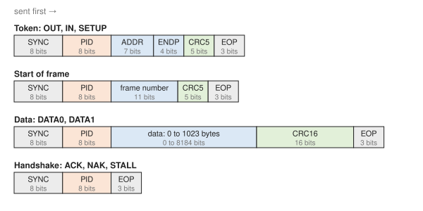

Full-speed signalling and packets
=================================

A USB 2.0 full-speed connection carries its packets as line states on two
wires, D+ and D−. Software or small hardware blocks can receive and send
them, from the wire levels up to the checksum. Section and table numbers
are those of the :std:`USB 2.0 specification <usb2>` [USBSER-USB2]_.

Host and device
---------------

USB connects one *host*, normally a computer, to one or more *devices*. The
host starts every exchange: a device only sends when the host has asked it
to in the packet before ([USBSER-USB2]_ section 8.4.1), as in the
transactions of :numref:`fig-usbser-transactions`. A device never talks to
another device.

The end of a cable at the host is the *downstream facing port* (DFP) and the
end at the device is the *upstream facing port* (UFP). On a USB Type-C port
these two *data roles* are separate from the power roles, source and sink,
described in :ref:`power-roles`. :doc:`usb-pd-roles` explains how they
combine. evampire acts only as a device, so its port must be in the UFP
data role for the serial port to work.

D+ and D− on the USB Type-C connector
-------------------------------------

USB 2.0 data travels on one pair of wires, D+ and D−. They are driven with
opposite levels most of the time, so the information is in the difference
between them (:wikipedia:`differential signalling <Differential_signalling>`).
The pair is twisted in the cable and has a differential
:wikipedia:`characteristic impedance <Characteristic_impedance>` of
90 Ω ± 15 % ([USBSER-USB2]_ section 7.1.1.1).

A USB Type-C receptacle has two D+ contacts and two D− contacts: Dp1 and Dn1
on A6 and A7, and Dp2 and Dn2 on B6 and B7 (:typec:`Table 3-4`). The plug
has only the A6 and A7 contacts, and the cable carries a single D+/D− pair
(:typec:`Section 3.2.3`; :typec:`Table 3-4`, note 1). Because the plug can be
inserted either way up, it meets A6 and A7 in one orientation and B6 and B7
in the other.

A host or device joins the two D+ contacts together and the two D− contacts
together in its receptacle, so the pair works in either orientation without
a switch (:typec:`Section 4.5.1.1`). The joining trace should be no longer
than 3.5 mm, to keep the unused branch, the *stub*, short
(:typec:`Table 3-4`, note 1). :numref:`fig-usbser-dpdn` shows the
connection to evampire, with the series resistors and the pull-up resistor
described in :doc:`analogue`.

.. graphviz:: signalling/dpdn.dot
   :name: fig-usbser-dpdn
   :caption: The two D+ contacts and the two D− contacts of the receptacle
             joined near the connector and taken to evampire.
   :alt: Diagram: receptacle contacts A6 and B6 join into one D+ line and
         A7 and B7 into one D− line; each line passes a series resistor to
         an evampire pin, and a 1.5 kΩ pull-up resistor with a switch
         connects the D+ pin to 3.3 V.
   :align: center

USB speeds
----------

USB 2.0 has three speeds (:numref:`tab-usbser-speeds`).

.. list-table:: USB 2.0 speeds ([USBSER-USB2]_ section 7.1.11)
   :name: tab-usbser-speeds
   :header-rows: 1
   :widths: 25 25 25 25

   * - Speed
     - Bit rate (Mbit/s)
     - Bit time (ns)
     - Device transmit tolerance (%)
   * - Low speed
     - 1.5
     - 666.7
     - ± 1.5
   * - Full speed
     - 12
     - 83.33
     - ± 0.25
   * - High speed
     - 480
     - 2.083
     - ± 0.05

Full speed is the speed that fits the requirement:

* Low speed allows only control and interrupt transfers; a low-speed device
  must not have the bulk endpoints that a serial port uses
  ([USBSER-USB2]_ section 5.8.3). :doc:`alternatives` discusses the
  low-speed option and what other projects do with it.
* High speed uses a different signalling scheme with current-mode drivers,
  a 45 Ω termination and a 400 mV swing ([USBSER-USB2]_ section 7.1.1.3,
  Table 7‑7, Table 7‑8), at a bit time of 2.083 ns, far beyond processor software.
  Every high-speed device starts as a full-speed device and changes speed
  only after a handshake during reset ([USBSER-USB2]_ section 7.1.7.5), so
  a full-speed device works on every USB 2.0 host.

Connect detection
-----------------

The host pulls each of D+ and D− to ground through 15 kΩ
([USBSER-USB2]_ section 7.1.5.1). With nothing attached both wires sit
near 0 V. A full-speed device connects a 1.5 kΩ resistor from D+ to a
3.0 V to 3.6 V supply; a low-speed device puts the same resistor on D−
instead ([USBSER-USB2]_ section 7.1.5.1). The host sees D+
rise, and knows that a full-speed device is attached
(:numref:`fig-usbser-connect`).

.. graphviz:: signalling/connect.dot
   :name: fig-usbser-connect
   :caption: Connect detection: the host's pull-down resistors and the
             device's switched pull-up on D+.
   :alt: Schematic: in the host, D+ and D− each connect to ground through
         15 kΩ. The cable carries D+ and D− to the device, evampire, where
         they reach the driver and receivers. In the device a 1.5 kΩ ± 5 %
         resistor and a switch connect D+ to a 3.0 V to 3.6 V supply; the
         switch closes when VBUS is present. D+ sits near 0 V with no
         device and at least 2.7 V, idle J, once the pull-up is on. A
         low-speed device puts the pull-up on D− instead.
   :align: center

The pull-up must be switchable: the device must not drive current into D+
when VBUS, the cable's power wire, is absent ([USBSER-USB2]_ section
7.1.5.1). Switching the resistor off and on also lets software disconnect
and reconnect the device without unplugging it. :doc:`analogue` gives the
resistor and supply limits.

Line states
-----------

The receiver classifies the two wires into a few *line states*
(:numref:`tab-usbser-states`, :numref:`fig-usbser-states`).

.. list-table:: Full-speed line states ([USBSER-USB2]_ section 7.1.7.1,
   Table 7‑2)
   :name: tab-usbser-states
   :header-rows: 1
   :widths: 22 20 20 38

   * - State
     - D+
     - D−
     - Meaning
   * - J
     - High
     - Low
     - One of the two data levels. Also the idle level, held by the
       pull-up when nobody drives.
   * - K
     - Low
     - High
     - The other data level.
   * - SE0 (single-ended zero)
     - Low
     - Low
     - Both low. Marks the end of a packet, or a reset when it lasts
       10 ms or more.
   * - SE1 (single-ended one)
     - High
     - High
     - Never sent on purpose ([USBSER-USB2]_ section 7.1.1).

On a low-speed connection J and K are swapped; :numref:`tab-usbser-states`
gives the full-speed states.

.. wavedrom::
   :caption: The D+ and D− levels of the idle, J, K and SE0 line states on a
             full-speed connection.
   :name: fig-usbser-states
   :alt: Timing diagram: idle with D+ high and D− low, then K with D+ low
         and D− high, then J, then SE0 with both low, then idle again.

   {"signal": [
     {"name": "line state", "wave": "=.=.=.=.=.",
      "data": ["Idle (J)", "K", "J", "SE0", "Idle (J)"]},
     {"name": "D+", "wave": "1.0.1.0.1."},
     {"name": "D−", "wave": "0.1.0.0.0."}
   ],
   "config": {"hscale": 1.5}}

A device also recognises some states by how long they last
([USBSER-USB2]_ Table 7‑2, section 7.1.7.5, section 7.1.7.6;
:numref:`fig-usbser-long-states`):

* *Reset:* SE0 for more than 2.5 µs. The device then returns to its
  default state with address 0.
* *Suspend:* idle for more than 3 ms. The device must then reduce its
  current from VBUS. The host normally prevents this by sending a packet
  every millisecond (see :doc:`transactions`).

.. wavedrom::
   :caption: Line states recognised by their length: reset and suspend,
             and the start-of-frame packets that keep a device out of
             suspend (not to scale).
   :name: fig-usbser-long-states
   :alt: Timing diagram with three rows. Reset: after idle, SE0 for more
         than 2.5 µs, then idle. Suspend: after a packet, idle for more than
         3 ms, after which the device is suspended. Normal operation: a
         start-of-frame packet every 1 ms, with idle between, so the idle
         time never reaches 3 ms.

   {"signal": [
     {"name": "reset", "wave": "2.3.....2.",
      "data": ["idle", "SE0 longer than 2.5 µs", "idle"]},
     {"name": "suspend", "wave": "5.2.....4.",
      "data": ["packet", "idle longer than 3 ms", "suspended"]},
     {"name": "normal", "wave": "5.2..5.2..",
      "data": ["SOF", "idle, under 1 ms", "SOF", "idle"]}
   ],
   "config": {"hscale": 1.4}}

NRZI coding and bit stuffing
----------------------------

USB sends bits with
:wikipedia:`NRZI coding <Non-return-to-zero>` (non-return-to-zero,
inverted): a ``0`` is sent as a change of line state, between J and K, and
a ``1`` as no change ([USBSER-USB2]_ section 7.1.8).

A long run of ``1`` bits would therefore give the receiver no edges from
which to recover the sender's clock. To prevent this, the sender inserts a
``0`` after every six ``1`` bits in a row, before NRZI coding, and the
receiver removes it (:wikipedia:`bit stuffing <Bit_stuffing>`,
[USBSER-USB2]_ section 7.1.9). This guarantees an edge at least every
seven bit times. A receiver that sees seven ``1`` bits in a row has found an
error and ignores the packet ([USBSER-USB2]_ section 7.1.9.1).
:numref:`fig-usbser-nrzi` shows both steps.

.. wavedrom::
   :caption: Bit stuffing inserts a 0 after six 1 bits, and NRZI coding
             turns each 0 into a change between J and K.
   :name: fig-usbser-nrzi
   :alt: Timing diagram: the data bits 0 1 1 1 1 1 1 1 0 become 0 1 1 1 1 1
         1 then an inserted 0 then 1 0; the line changes state at each 0
         and stays the same at each 1.

   {"signal": [
     {"name": "data bits", "wave": "x=======x==",
      "data": ["0", "1", "1", "1", "1", "1", "1", "1", "0"]},
     {"name": "sent bits", "wave": "x==========",
      "data": ["0", "1", "1", "1", "1", "1", "1", "0", "1", "0"]},
     {"name": "stuffing", "wave": "x.......=x.",
      "data": ["inserted"]},
     {"name": "line (J high)", "wave": "10......1.0"}
   ],
   "config": {"hscale": 2}}

Packet start, identifier and end
--------------------------------

Every packet has the same frame (:numref:`fig-usbser-packet`):

1. *SYNC*, 8 bits: ``00000001`` before coding, which is ``KJKJKJKK`` on the
   line. The first K marks the start of the packet and the edges let the
   receiver lock its sampling to the sender ([USBSER-USB2]_ section 7.1.10,
   section 8.2).
2. *PID* (packet identifier), 8 bits: a 4-bit packet type followed by the
   same 4 bits inverted, so a receiver can check it
   ([USBSER-USB2]_ section 8.3.1).
3. The packet's own fields, which depend on its type.
4. *EOP* (end of packet): SE0 for two bit times, then J for one bit time,
   after which the sender stops driving and the pull-up holds the line at J
   ([USBSER-USB2]_ section 7.1.7.4.1).

Bits are sent least significant bit first ([USBSER-USB2]_ section 8.1).

.. wavedrom::
   :caption: An ACK handshake packet on the wire: SYNC, the packet
             identifier and the end of packet.
   :name: fig-usbser-packet
   :alt: Timing diagram of D+ and D− for an ACK packet: two idle bit times,
         the SYNC pattern K J K J K J K K, the PID bits 0 1 0 0 1 0 1 1 as
         J J K J J K K K, two bit times of SE0, one J, then idle.

   {"signal": [
     {"name": "field", "wave": "2.3.......4.......5..2",
      "data": ["idle", "SYNC", "PID = ACK", "EOP", "idle"]},
     {"name": "bit", "wave": "x.================x...",
      "data": ["0","0","0","0","0","0","0","1",
               "0","1","0","0","1","0","1","1"]},
     {"name": "D+", "wave": "1.0101010.1.01.0....1."},
     {"name": "D−", "wave": "0.1010101.0.10.1..0..."}
   ],
   "config": {"hscale": 1.4}}

Packet types
------------

The PID gives the packet type (:numref:`tab-usbser-pid`). There are three
kinds:

* *Token* packets, sent only by the host, say what the next packet is for:
  a 7-bit device address and a 4-bit endpoint number (an *endpoint* is one
  numbered data channel inside the device), with a 5-bit checksum
  ([USBSER-USB2]_ section 8.4.1).
* *Data* packets carry 0 to 1023 bytes and a 16-bit checksum
  ([USBSER-USB2]_ section 8.4.4).
* *Handshake* packets are only a PID. They report whether data was accepted
  ([USBSER-USB2]_ section 8.4.5).

:numref:`fig-usbser-packets` shows the fields of each kind, with the
start-of-frame token, in the order they are sent.

         SETUP): SYNC 8 bits, PID 8 bits, ADDR 7 bits, ENDP 4 bits, CRC5 5
         bits, EOP. Start of frame: SYNC, PID, an 11-bit frame number,
         CRC5, EOP. Data (DATA0, DATA1): SYNC, PID, 0 to 1023 bytes of data,
         CRC16 16 bits, EOP. Handshake (ACK, NAK, STALL): SYNC, PID, EOP.
   :align: center

   Fields of the full-speed packet kinds, in the order sent; widths are
   proportional to the bits except for the data field.

.. list-table:: Packet identifiers used by a full-speed device
   ([USBSER-USB2]_ section 8.3.1, Table 8‑1)
   :name: tab-usbser-pid
   :header-rows: 1
   :widths: 14 14 18 54

   * - Kind
     - Name
     - Type bits PID<3:0>
     - Meaning
   * - Token
     - OUT
     - 0001
     - Host will send data to the endpoint.
   * - Token
     - IN
     - 1001
     - Host asks the endpoint for data.
   * - Token
     - SOF
     - 0101
     - Start of frame, with an 11-bit frame number; sent every 1 ms.
   * - Token
     - SETUP
     - 1101
     - Host will send a control request to the endpoint.
   * - Data
     - DATA0
     - 0011
     - Data packet with sequence bit 0.
   * - Data
     - DATA1
     - 1011
     - Data packet with sequence bit 1.
   * - Handshake
     - ACK
     - 0010
     - Data received without error and accepted.
   * - Handshake
     - NAK
     - 1010
     - Device cannot accept data, or has none to send, at the moment.
   * - Handshake
     - STALL
     - 1110
     - Endpoint halted, or request not supported.

The type bits are shown most significant bit first, as in the
specification; on the wire bit 0 goes first. The other identifiers in the
specification (DATA2, MDATA, NYET, PRE, ERR, SPLIT, PING) are used only at
high speed or between hubs, and a full-speed device ignores them.

CRC5 and CRC16 checksums
------------------------

Token and data packets end with a
:wikipedia:`cyclic redundancy check <Cyclic_redundancy_check>` (CRC), a
checksum computed with a shift register and exclusive-or gates
([USBSER-USB2]_ section 8.3.5):

* tokens: a 5-bit CRC over the 11 bits of address and endpoint (or frame
  number), with generator polynomial :math:`x^5 + x^2 + 1`;
* data packets: a 16-bit CRC over the data bytes, with generator polynomial
  :math:`x^{16} + x^{15} + x^2 + 1`.

Both start from all ones, are computed before bit stuffing, and are sent
inverted, most significant bit first. A receiver that runs the same register
over the whole packet, CRC included, ends with a fixed value when there is
no error: ``01100`` for CRC5 and ``1000000000001101`` for CRC16
([USBSER-USB2]_ section 8.3.5.1, section 8.3.5.2). The PID has its own check
and is not covered. :numref:`fig-usbser-crc5` shows the CRC5 register.

.. graphviz:: signalling/crc5.dot
   :name: fig-usbser-crc5
   :caption: The CRC5 shift register for the generator polynomial
             x⁵ + x² + 1.
   :alt: Shift register of five stages, c0 to c4. Each data bit is XORed
         with c4; the result, the feedback, enters c0 and is also XORed into
         the input of c2, between c1 and c2. The register starts at 11111;
         over a good token, CRC included, it ends at 01100.
   :align: center

A packet with a wrong PID check, CRC, bit stuffing or length is ignored and
gets no reply ([USBSER-USB2]_ section 8.3.1, section 8.4.1). The sender
learns of the error from the missing reply (see :doc:`timing`).

Open questions
--------------

* Where the series resistors of :numref:`fig-usbser-dpdn` sit, on the board
  or on the chip, depends on the driver design (see :doc:`analogue`).
