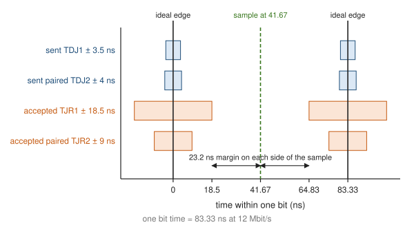
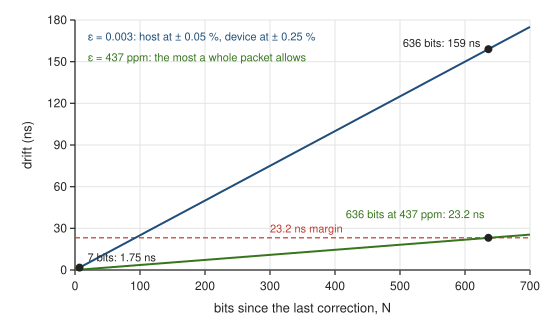
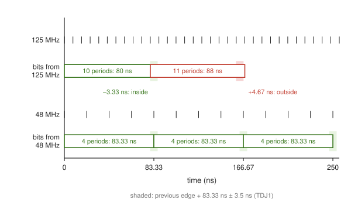
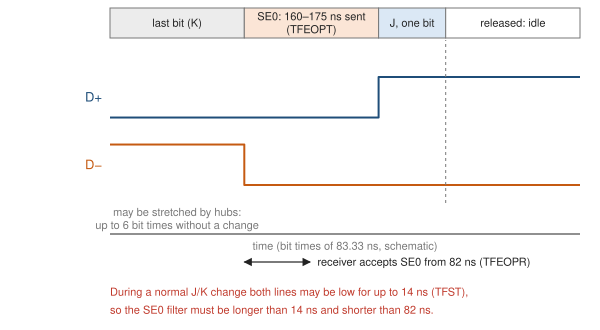

Timing requirements
===================

This page collects the time limits of a full-speed device, from the USB 2.0
specification [USBSER-USB2]_, and works out what each one requires of the
circuit or the software that meets it. :doc:`software-cost` uses these
figures.

Bit time and tolerance
----------------------

The bit time is the reciprocal of the bit rate:

.. math::

   T_\text{bit} = \frac{1}{f_\text{bit}}
                = \frac{1}{12 \times 10^{6}\ \text{s}^{-1}}
                = 83.33\ \text{ns}

.. list-table::
   :header-rows: 1
   :widths: 20 60 20

   * - Symbol
     - Meaning
     - Unit
   * - :math:`T_\text{bit}`
     - Duration of one bit on the wire
     - ns
   * - :math:`f_\text{bit}`
     - Full-speed bit rate, 12 Mbit/s ([USBSER-USB2]_ section 7.1.11)
     - bit/s

A device that is not high-speed capable must send at 12 Mbit/s ± 0.25 %,
which is 11.97 Mbit/s to 12.03 Mbit/s, or a bit time of 83.13 ns to
83.54 ns (*TFDRATE*, [USBSER-USB2]_ Table 7‑9). Hosts and hubs are held to
± 0.05 % ([USBSER-USB2]_ section 7.1.11). The tolerance covers every source
of error: initial accuracy, supply, temperature and ageing.

Transmit and receive edge timing
--------------------------------

The sender's edges may deviate from their ideal positions by small amounts,
and the receiver must cope with much larger deviations, because the signal
may pass through up to five hubs ([USBSER-USB2]_ section 7.1.15.1,
Table 7‑4). :numref:`tab-usbser-jitter` gives the limits.

.. list-table:: Full-speed edge timing limits ([USBSER-USB2]_ Table 7‑9)
   :name: tab-usbser-jitter
   :header-rows: 1
   :widths: 40 15 15 30

   * - Limit
     - Symbol
     - Value (ns)
     - Applies to
   * - Source jitter, to the next transition
     - TDJ1
     - ± 3.5
     - Edges evampire sends
   * - Source jitter, paired transitions
     - TDJ2
     - ± 4
     - Edges evampire sends
   * - Receiver jitter, to the next transition
     - TJR1
     - ± 18.5
     - Edges evampire must accept
   * - Receiver jitter, paired transitions
     - TJR2
     - ± 9
     - Edges evampire must accept

:numref:`fig-usbser-bit-cell` draws these windows around the edges of one
bit. The source jitter includes the effect of the sender's frequency
error. The
receiver must decode edges anywhere within a quarter of a bit time either
side of the ideal position, and the specification notes that a receiver
sampling four times per bit, with a simple digital phase-locked loop, can
meet this ([USBSER-USB2]_ section 7.1.15.1).

Receiver sampling margin
------------------------

A receiver that takes one sample per bit, placed in the middle of the bit,
has this margin against the receive jitter:

.. math::

   t_\text{margin} &= \frac{T_\text{bit}}{2} - T_\text{JR1} \\
                   &= 41.67\ \text{ns} - 18.5\ \text{ns} \\
                   &= 23.2\ \text{ns}

.. list-table::
   :header-rows: 1
   :widths: 20 60 20

   * - Symbol
     - Meaning
     - Unit
   * - :math:`t_\text{margin}`
     - Time left for drift and sampling error before a sample falls in the
       wrong bit
     - ns
   * - :math:`T_\text{JR1}`
     - Receiver jitter to the next transition, 18.5 ns
       ([USBSER-USB2]_ Table 7‑9)
     - ns

:numref:`fig-usbser-bit-cell` shows the sample in the middle of the bit and
the margin on each side.

         edge, windows show the sent limits TDJ1 ± 3.5 ns and TDJ2 ± 4 ns
         for paired transitions, and the accepted limits TJR1 ± 18.5 ns and
         TJR2 ± 9 ns for paired transitions. A dashed line marks the sample
         at 41.67 ns, with a margin of 23.2 ns to the edge of each TJR1
         window, at 18.5 ns and 64.83 ns.
   :align: center

   Edge windows of one full-speed bit and the margin of a sample taken in
   its middle.

If the sampling instants are set once, at the SYNC pattern, and then run
freely, they drift against the sender's bits by:

.. math::

   \Delta t = N \cdot T_\text{bit} \cdot \varepsilon

.. list-table::
   :header-rows: 1
   :widths: 20 60 20

   * - Symbol
     - Meaning
     - Unit
   * - :math:`\Delta t`
     - Drift of the sampling instant after :math:`N` bits
     - ns
   * - :math:`N`
     - Number of bits since the sampling instant was last corrected
     - bits
   * - :math:`\varepsilon`
     - Relative frequency difference between sender and receiver
     - (fraction)

Two cases show what this means (:numref:`fig-usbser-drift`):

* *Correcting at every edge.* Bit stuffing guarantees an edge at least every
  7 bit times ([USBSER-USB2]_ section 7.1.9). With a host at the limit of
  ± 0.05 % and a device at ± 0.25 %, :math:`\varepsilon = 0.003`, and
  :math:`\Delta t = 7 \times 83.33\ \text{ns} \times 0.003 = 1.75\ \text{ns}`.
  This is small against the 23.2 ns margin.
* *Never correcting.* The longest packet a serial port receives is a 64-byte
  data packet: 544 bits plus up to 89 stuffed bits plus the end of packet,
  636 bit times. At :math:`\varepsilon = 0.003` the drift is
  :math:`636 \times 83.33\ \text{ns} \times 0.003 = 159\ \text{ns}`, far
  beyond the margin. Running freely across a whole packet requires
  :math:`\varepsilon \le 23.2\ \text{ns} / (636 \times 83.33\ \text{ns})
  = 437 \times 10^{-6}` (437 ppm), and any error in placing the first
  sample reduces this further.

         correction, 0 to 700. A line for ε = 0.003 reaches 1.75 ns at 7
         bits and 159 ns at 636 bits. A line for ε = 437 ppm reaches the
         dashed 23.2 ns margin at 636 bits.
   :align: center

   Drift of a free-running sampling instant for the two cases above.

A receiver therefore either corrects its sampling instant at each edge, or
holds its clock within a few hundred parts per million of the host's (see
`Clock accuracy and frame tracking`_).

.. _usbser-placing-edges:

Transmit edge placement
-----------------------

A transmitter that changes its output only on the edges of a clock of
frequency :math:`f_\text{tx}` can place each edge exactly when
:math:`f_\text{tx}` is a whole multiple of 12 MHz. Otherwise each bit lasts
a whole number of clock periods, either one more or one fewer than the
ideal, and the error of an interval reaches up to one clock period. Meeting
*TDJ1* then needs:

.. math::

   \frac{1}{f_\text{tx}} \le T_\text{DJ1}
   \quad\Rightarrow\quad
   f_\text{tx} \ge \frac{1}{3.5\ \text{ns}} = 286\ \text{MHz}

.. list-table::
   :header-rows: 1
   :widths: 20 60 20

   * - Symbol
     - Meaning
     - Unit
   * - :math:`f_\text{tx}`
     - Clock that times the transmitted edges
     - MHz
   * - :math:`T_\text{DJ1}`
     - Source jitter to the next transition, 3.5 ns
       ([USBSER-USB2]_ Table 7‑9)
     - ns

As an example, evampire's existing 125 MHz reference (see
:ref:`arch-clock`) gives 10.42 clock periods per bit. Bits of 10 or 11
periods last 80 ns or 88 ns, errors of −3.33 ns and +4.67 ns. The second
is outside ± 3.5 ns, so edges timed from 125 MHz directly do not meet
*TDJ1*. A clock that is a multiple of 12 MHz, such as 48 MHz, has no such
error (:numref:`fig-usbser-edge-placement`).

         8 ns. Bits timed from it last 10 periods, 80 ns, ending 3.33 ns
         early, inside the ± 3.5 ns window after the previous edge; or 11
         periods, 88 ns, ending 4.67 ns late, outside the window. A 48 MHz
         clock gives bits of exactly 4 periods, 83.33 ns, each ending in the
         middle of its window.
   :align: center

   Transmitted bits timed from a 125 MHz clock and from a 48 MHz clock,
   against the TDJ1 window.

Inter-packet delay and reply deadline
-------------------------------------

The time between packets runs from the end of one packet to the start of
the next ([USBSER-USB2]_ section 7.1.18.1). The end is the change from SE0
to J in the end of packet, and the start is the change from J to K at the
beginning of SYNC.
:numref:`fig-usbser-turnaround` shows the case that matters most, a device
answering the host.

.. wavedrom::
   :caption: The device must start its reply between 2 and 6.5 bit times
             after the end of the host's packet.
   :name: fig-usbser-turnaround
   :alt: Timing diagram: the host sends a data packet ending with an end of
         packet; after a gap of 2 to 6.5 bit times the device starts its
         ACK handshake.

   {"signal": [
     {"name": "host", "wave": "3...5.x.....",
      "data": ["DATA packet", "EOP"]},
     {"name": "gap", "wave": "x.....4...x.",
      "data": ["2 to 6.5 bit times"]},
     {"name": "device", "wave": "x.........3.",
      "data": ["ACK"]}
   ],
   "config": {"hscale": 2.5}}

The limits are ([USBSER-USB2]_ section 7.1.18.1, section 7.1.19.1,
Table 7‑14):

* A device leaves at least 2 bit times, 166.7 ns, before it replies. This
  gives the sender time to finish its J and release the line.
* A device with a detachable cable, which includes any device with a USB
  Type-C receptacle, starts its reply no more than 6.5 bit times, 541.7 ns,
  after the end of the host's packet, measured at the receptacle
  (*TRSPIPD1*).
* The host waits at least 16 bit times and gives up before 18 bit times,
  1.333 µs to 1.5 µs. A reply after that is lost and the transaction counts
  as an error.

The reply deadline in the device is:

.. math::

   t_\text{reply} &= 6.5 \cdot T_\text{bit} - t_\text{rx} - t_\text{tx} \\
                  &= 541.7\ \text{ns} - t_\text{rx} - t_\text{tx}

.. list-table::
   :header-rows: 1
   :widths: 20 60 20

   * - Symbol
     - Meaning
     - Unit
   * - :math:`t_\text{reply}`
     - Time left to decide the reply and start sending it
     - ns
   * - :math:`t_\text{rx}`
     - Delay from the end of packet at the receptacle to the moment the
       receiver reports it (input stage, filtering, synchronisation)
     - ns
   * - :math:`t_\text{tx}`
     - Delay from the decision to the first K at the receptacle (output
       stage and driver)
     - ns

Within :math:`t_\text{reply}` the device must, for an OUT or SETUP data
packet, finish checking the CRC16, and for an IN token, check the address,
endpoint and CRC5 and find out whether data is ready. :doc:`software-cost`
works out what this takes. The deadline applies to every token addressed to
the device, including the IN tokens the host sends repeatedly when the
device has nothing to send.

End of packet
-------------

The end of packet has several rules that a receiver and a transmitter must
follow (:numref:`fig-usbser-eop`) ([USBSER-USB2]_ section 7.1.7.4.1, section 7.1.13.2.1, section 7.1.4.1,
section 7.1.9.1, Table 7‑9):

* A transmitter sends SE0 for 160 ns to 175 ns (*TFEOPT*, 1.92 to 2.10 bit
  times), then J for one bit time, then releases the line.
* A receiver must accept an SE0 as short as 82 ns (*TFEOPR*, 0.98 bit
  times).
* During a normal change between J and K, both lines may be low together
  for up to 14 ns (*TFST*). The receiver must not take this for an SE0, so
  an SE0 detector needs a filter longer than 14 ns and shorter than 82 ns.
* The last bit before the end of packet can be stretched by hubs. A receiver
  must accept up to six bit times without a transition before the end of
  packet, without reporting a stuffing error.

         low and D− high. Both then go low for the SE0, sent for 160 ns to
         175 ns (TFEOPT); D+ then goes high for one bit of J, after which
         the transmitter releases the line and it stays at idle. An arrow
         shows that the receiver accepts an SE0 from 82 ns (TFEOPR). A note
         says that during a normal J/K change both lines may be low for up
         to 14 ns (TFST), so the SE0 filter must be longer than 14 ns and
         shorter than 82 ns, and that hubs may stretch the last bit to six
         bit times.
   :align: center

   End of packet on D+ and D−, with the transmitter and receiver timing
   rules (schematic).

Clock accuracy and frame tracking
---------------------------------

The device's bit clock has to be within ± 0.25 % of 12 MHz to transmit, and
its receiver needs either edge correction or a closer match
(`Receiver sampling margin`_). Three sources can provide it:

* *A crystal-derived clock.* evampire already has a 125 MHz reference for
  Ethernet (:ref:`arch-clock`), and gigabit Ethernet requires that
  reference to be within 100 ppm (:clause:`40`). A clock derived from it
  with a phase-locked loop at a multiple of 12 MHz is within 100 ppm.
* *A local oscillator trimmed against the host.* The start-of-frame tokens
  arrive every 1.000 ms ± 500 ns, that is ± 500 ppm
  ([USBSER-USB2]_ section 7.1.12, Table 7‑9). A device can count its own
  clock cycles between them and adjust its oscillator.
* *A dedicated crystal* for USB, at the cost of a board part.

Counting a clock of frequency :math:`f` over one frame gives a resolution
of:

.. math::

   r = \frac{1}{f \cdot T_\text{frame}}

.. list-table::
   :header-rows: 1
   :widths: 20 60 20

   * - Symbol
     - Meaning
     - Unit
   * - :math:`r`
     - Smallest frequency error one frame measurement can see
     - (fraction)
   * - :math:`f`
     - Frequency of the clock being counted
     - Hz
   * - :math:`T_\text{frame}`
     - Frame interval, 1 ms ([USBSER-USB2]_ section 7.1.12)
     - s

For a 48 MHz clock, :math:`r = 1 / (48 \times 10^{6} \times 10^{-3}) =
1/48\,000`, or 20.8 ppm; averaging several frames improves it. The host's
own frame interval is accurate to ± 500 ppm, well inside the ± 0.25 %
needed for transmitting, and successive frames differ by less than 42 ns
(*TRFI*, [USBSER-USB2]_ Table 7‑9).

For reference, the rv003usb low-speed device trims the internal oscillator
of its CH32V003 microcontroller against the 1 ms low-speed keep-alive
signals in this way ([USBSER-RV003USB]_, ``README.md`` and
``rv003usb.S``).

Open questions
--------------

* The clock that times the USB receiver and transmitter: a phase-locked loop
  from the 125 MHz reference at a multiple of 12 MHz, a local oscillator
  trimmed from the start-of-frame tokens, or a dedicated crystal.
* The values of :math:`t_\text{rx}` and :math:`t_\text{tx}`, which depend on
  the receiver and driver designs of :doc:`analogue`.
