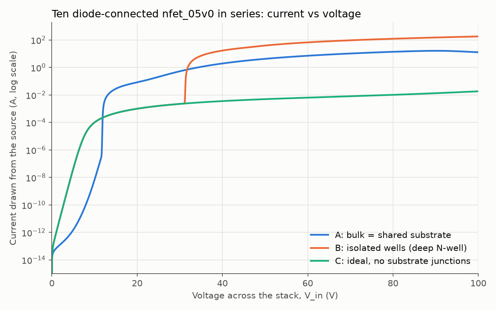
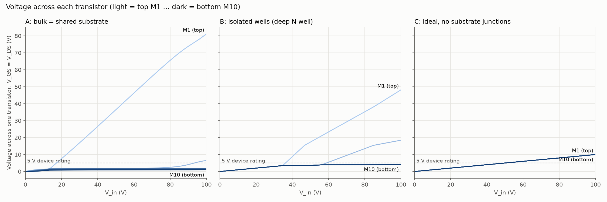
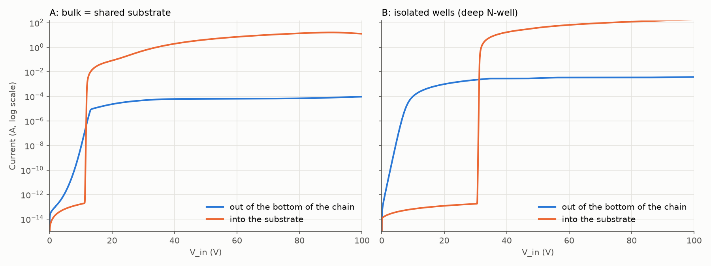

# Ten 5 V transistors in series as diodes, swept to 100 V

A small gf180mcu experiment. Ten `nfet_05v0` (5 V NMOS) transistors are each
wired as a diode (gate tied to drain) and stacked in series. A DC source is
swept from 0 V to 100 V across the whole stack.

```
 V_in ──┬── M1 ── n1 ── M2 ── n2 ── … ── n9 ── M10 ──┬── 0 V
        │  (each Mk: gate = drain, W = 10 µm, L = 0.6 µm)
```

## How to run

```
uv run sim/diode_stack/run.py
```

This needs Docker and the `hpretl/iic-osic-tools` image, which holds
ngspice-47 and the open gf180mcuD PDK. `run.py` writes one netlist per variant
(`results/*.cir`), runs ngspice, and writes `results/summary.md` plus three
plots.

## The three variants

What happens depends almost entirely on **where each transistor's body
(bulk) is connected**. So the stack is simulated three ways:

| Variant | Body of each NMOS | Buildable in gf180mcu? |
|---|---|---|
| **A** | the shared P-substrate, at 0 V | Yes: this is the default NMOS |
| **B** | its own source, in an isolated P-well inside its own deep N-well; the deep N-well is tied to that transistor's drain | Yes, with the deep N-well layer |
| **C** | its own source, with no junction to the substrate at all | **No.** It is the "textbook" answer, for comparison |

For A and B, the junctions to the substrate use the PDK's own diode models:

* `diode_nd2ps_06v0`: N+ diffusion to P-substrate. The model sets `bv = 11` V.
* `diode_pw2dw`: P-well to deep N-well. `bv = 14.7` V.
* `diode_dw2ps`: deep N-well to P-substrate. `bv = 30.5` V.

These have to be added by hand. The `nfet_05v0` transistor model contains
`bvs = 11`, but its drain junction does **not** break down in ngspice: it
passes only 2 nA at 40 V. The PDK diode of the same area passes 0.73 mA at
12 V. `junction_check.cir` reproduces this.

## Results







Selected points (full table in `results/summary.md`):

| V_in | A: current | A: worst device | B: current | B: worst device | C: current | C: worst device |
|---:|---:|---:|---:|---:|---:|---:|
| 5 V   | 1.5 pA  | 0.9 V  | 41 nA   | 0.5 V  | 41 nA   | 0.5 V |
| 10 V  | 6.6 nA  | 1.3 V  | 101 µA  | 1.0 V  | 101 µA  | 1.0 V |
| 12 V  | 730 µA  | 1.5 V  | 231 µA  | 1.2 V  | 231 µA  | 1.2 V |
| 20 V  | 84 mA   | 7.6 V  | 1.0 mA  | 2.0 V  | 1.0 mA  | 2.0 V |
| 30 V  | 0.53 A  | 17 V   | 2.3 mA  | 3.0 V  | 2.3 mA  | 3.0 V |
| 40 V  | 2.0 A   | 27 V   | 17 A    | 8.8 V  | 3.6 mA  | 4.0 V |
| 50 V  | 4.3 A   | 36 V   | 39 A    | 17 V   | 5.0 mA  | 5.0 V |
| 100 V | 12.8 A  | 81 V   | 181 A   | 48 V   | 18.5 mA | 10 V  |

"Worst device" is the largest voltage across any one transistor. For a
diode-connected transistor this is both V_GS and V_DS, so it is also the
voltage across its gate oxide.

### What happens

**C, the ideal stack.** The ten transistors share the voltage equally, each
taking V_in / 10. The stack starts to conduct around 7–8 V, which is ten
thresholds of about 0.7–0.8 V each. Above 50 V every transistor is past its
5 V rating, and at 100 V each one has 10 V across it. So **even the ideal
stack cannot stand off 100 V with 5 V transistors.** It would need at least
20 of them.

**A, the default layout.** Every N+ diffusion forms a junction with the one
shared substrate. At about 11.5 V, the top transistor's drain junction to the
substrate breaks down. From then on, nearly all the current goes **straight
into the substrate** (microamps along the chain, amps into the substrate).
The stack stops sharing voltage. Breakdown pins node n1 at about 12–13 V
(19 V at 100 V), and the nine lower transistors share only that. The top
transistor M1 takes the rest (81 V at 100 V). The
transistors themselves do almost nothing above about 12 V.

**B, isolated wells.** This behaves like C until about 31 V. There, the deep
N-well of the top transistor, which is tied to V_in, breaks down to the
substrate (`bv = 30.5` V). Above that, the source drives amps straight into
the substrate. The next deep N-well down then clamps n1 at about 31 V, so M1
takes the excess. **Wells only raise the limit from about 11.5 V to about
31 V.** In this process nothing can sit more than about 30 V above the
substrate.

### What the simulation cannot tell you

* **Gate-oxide breakdown is not modelled.** The PDK models have no oxide
  failure, so the simulation happily reports 81 V across a gate oxide rated
  for 5 V operation. A real device would be destroyed long before that.
* **The source has no current limit.** The amps shown above 12 V (A) and
  31 V (B) come from junctions in breakdown driven by an ideal voltage source.
  A real chip would melt its metal or junctions. The point that matters is
  *where* the current starts, not how big it gets.
* **Impact ionisation.** With the substrate diodes left out, variant A
  instead shows amps of substrate current from the model's impact-ionisation
  term (`alpha1 = 19`, `beta0 = 36.6`) at V_DS of 20–45 V. That is far outside
  the range the model was fitted for, so those numbers mean nothing.
* **Assumed geometry.** Diffusion length is 0.18 µm (the xschem symbol
  default). In B, each transistor has a 20 × 20 µm deep N-well holding a
  16 × 16 µm P-well. These sizes change leakage and the current after
  breakdown, but not the breakdown voltages.
* Typical corner, 27 °C, DC sweep in 0.05 V steps.
